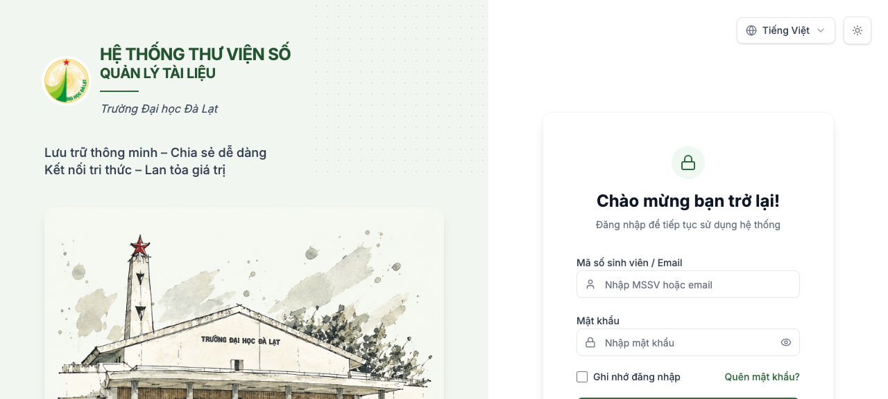
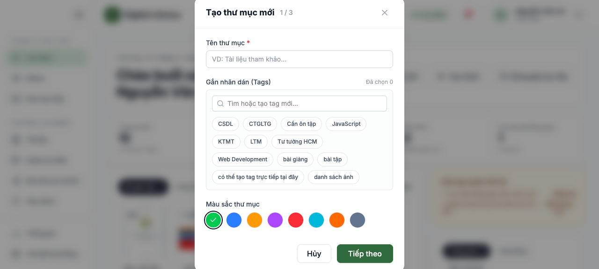
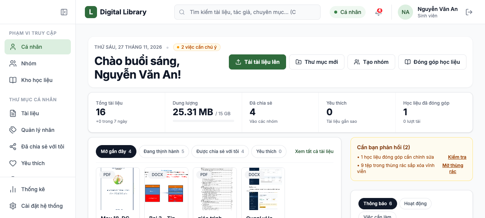
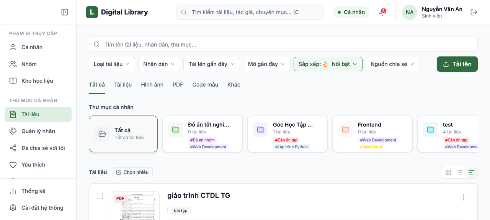
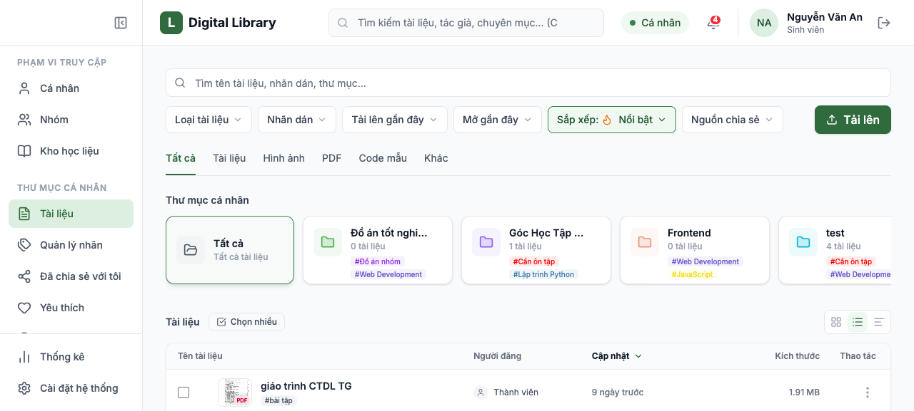
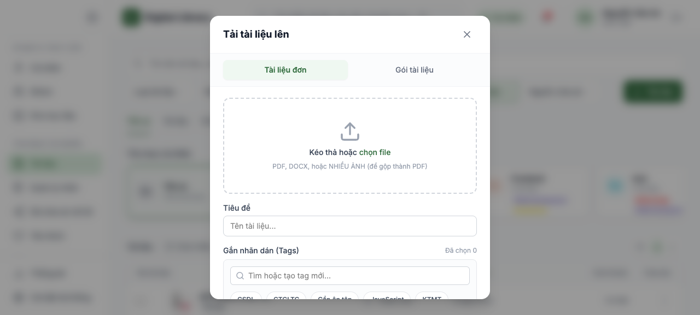
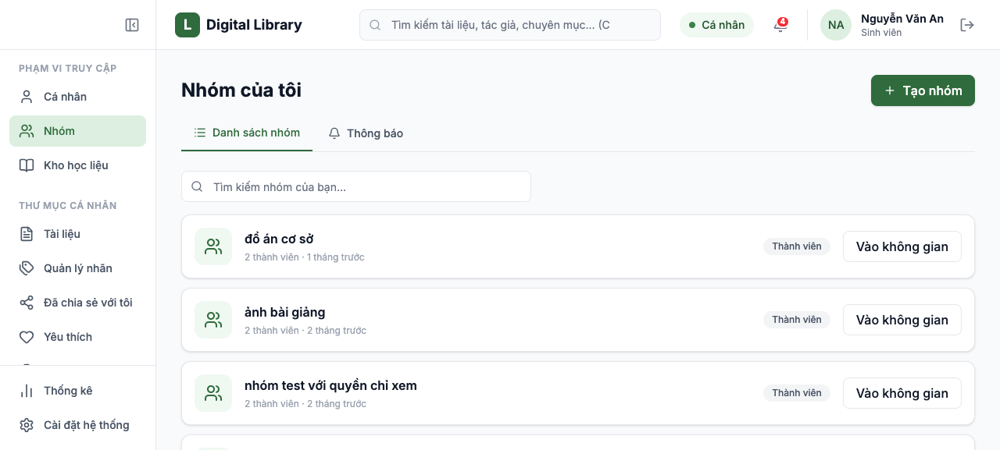
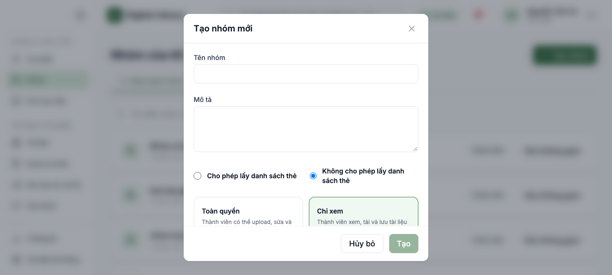
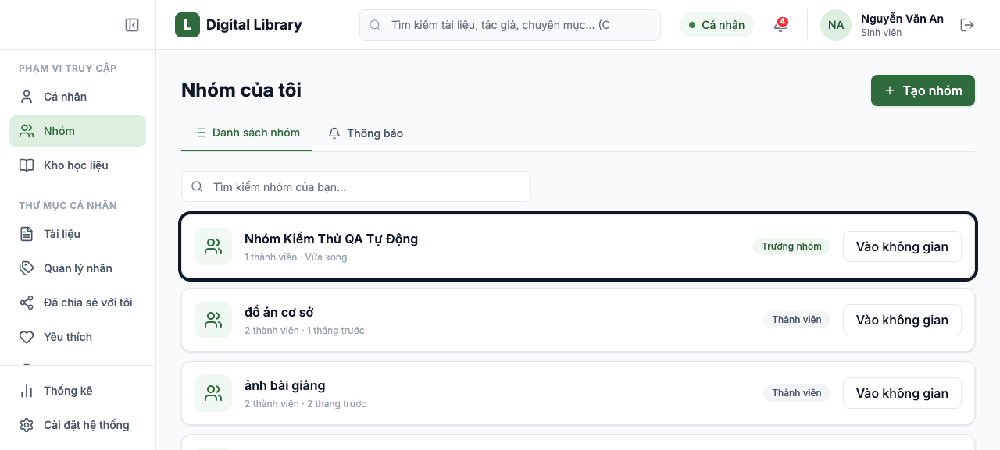
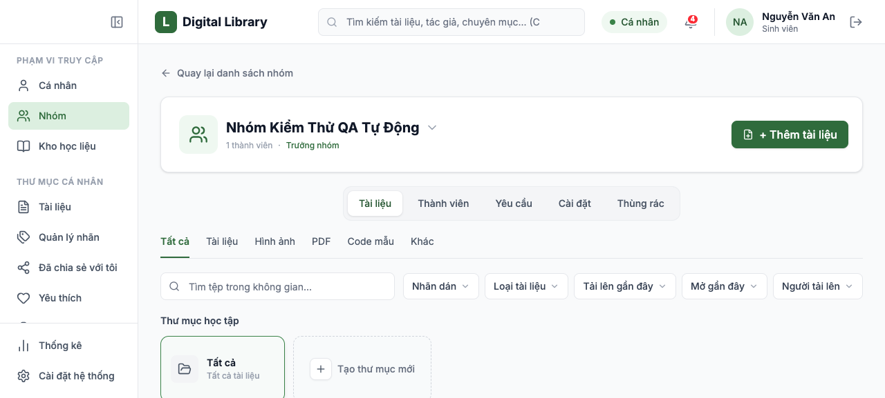

# Foundation Project

### Nền tảng quản lý, lưu trữ và chia sẻ học liệu số dành cho môi trường giáo dục đại học

**Foundation Project** hướng đến việc tập trung hóa học liệu, hỗ trợ quản lý tài liệu cá nhân, cộng tác theo nhóm và xây dựng thư viện số dùng chung có quy trình thẩm định.

---

## Giới thiệu

Trong môi trường đại học, tài liệu học tập thường được chia sẻ phân tán qua các nhóm trò chuyện, dịch vụ lưu trữ đám mây cá nhân hoặc thiết bị lưu trữ rời. Cách thức này khiến học liệu khó được kế thừa qua các học kỳ, phát sinh nhiều bản sao trùng lặp và thiếu một quy trình thống nhất để kiểm soát chất lượng, nguồn gốc cũng như quyền chia sẻ tài liệu.

**Foundation Project** được xây dựng nhằm giải quyết những vấn đề đó thông qua một nền tảng quản lý học liệu tập trung. Hệ thống cung cấp các không gian lưu trữ theo mục đích sử dụng, hỗ trợ tìm kiếm toàn văn, xem trước tài liệu trực tiếp và quy trình nộp duyệt trước khi tài liệu được công khai trong thư viện cộng đồng.

## Mục tiêu dự án

- **Tập trung hóa học liệu:** cung cấp một nơi thống nhất để lưu trữ, quản lý, tra cứu và chia sẻ tài liệu học tập.
- **Tổ chức lưu trữ theo nhu cầu:** phân tách rõ không gian cá nhân, không gian cộng tác nhóm và thư viện dùng chung.
- **Hạn chế dữ liệu trùng lặp:** sử dụng SHA-256 để nhận diện nội dung tệp và tránh lưu nhiều bản nhị phân giống nhau.
- **Tăng khả năng tra cứu:** hỗ trợ tìm kiếm toàn văn, bao gồm từ khóa tiếng Việt có dấu và không dấu, cùng các tiêu chí lọc liên quan.
- **Kiểm soát chất lượng học liệu:** áp dụng quy trình nộp, thẩm định và xuất bản tài liệu lên thư viện cộng đồng.
- **Ưu tiên triển khai cục bộ:** hướng đến khả năng cài đặt và vận hành trên máy cá nhân hoặc máy chủ nội bộ, không phụ thuộc vào dịch vụ lưu trữ đám mây thương mại.

## Các không gian lưu trữ chính

Hệ thống hiện được tổ chức thành **3 kho lưu trữ cốt lõi**:

| Kho lưu trữ | Mục đích | Một số chức năng tiêu biểu |
|---|---|---|
| **Kho cá nhân** (*Personal Repository*) | Không gian riêng tư để mỗi người dùng quản lý tài liệu học tập, nghiên cứu và ghi chú. | Tải lên tài liệu, quản lý thư mục và thẻ, yêu thích, danh sách đọc, ghi chú, thùng rác và khôi phục tài liệu. |
| **Kho nhóm** (*Workspace Repository*) | Không gian cộng tác dành cho nhóm học tập, nghiên cứu hoặc thực hiện đề tài. | Tạo workspace, mời thành viên, quản lý tài liệu và thẻ nhóm, phân quyền Owner/Admin/Member. |
| **Kho học liệu số** (*Community Library*) | Thư viện dùng chung của cơ sở đào tạo, tổ chức học liệu theo Khoa/Viện và Môn học. | Nộp tài liệu, thẩm định và xuất bản, tạo bộ học liệu, đánh giá tài liệu và ghi nhận lượt tải. |

> **Lưu ý về phạm vi:** Foundation Project sử dụng mô hình 3 kho nêu trên. Lớp học và Khoa/Viện là dữ liệu định danh hoặc dữ liệu phân loại, không phải các kho lưu trữ độc lập.

## Vai trò người dùng

Hệ thống quy định ba nhóm vai trò chính:

- **Sinh viên (Student):** quản lý kho cá nhân, tạo hoặc tham gia kho nhóm, tra cứu và tải học liệu cộng đồng, gửi tài liệu đóng góp lên thư viện số.
- **Giảng viên (Teacher):** sử dụng kho cá nhân và kho nhóm; thẩm định, duyệt tài liệu thuộc Khoa/Bộ môn phụ trách; tạo các bộ học liệu chuyên đề.
- **Quản trị viên (Admin):** quản trị người dùng và danh mục Khoa/Môn học, kiểm duyệt học liệu và quản lý các cấu hình, nhật ký hệ thống.

## Điểm nhấn kỹ thuật

- **Backend bất đồng bộ:** Python FastAPI, SQLAlchemy 2.0 AsyncSession và `asyncpg`.
- **Cơ sở dữ liệu:** PostgreSQL, sử dụng các ràng buộc và chỉ mục phù hợp với mô hình dữ liệu.
- **Tìm kiếm toàn văn:** PostgreSQL Full-Text Search (`tsvector`) kết hợp chỉ mục GIN.
- **Khử trùng lặp tệp:** SHA-256 checksum để nhận diện các tệp có nội dung giống nhau và hỗ trợ lưu trữ đơn bản.
- **Triển khai cục bộ:** định hướng Local Deployment / Offline-First, phù hợp cho việc cài đặt và trình diễn trong môi trường nội bộ.

## Giao diện ứng dụng

Các hình ảnh dưới đây minh họa những màn hình chính trong luồng sử dụng ứng dụng. Ảnh được bố trí theo từng hàng, tối đa ba ảnh mỗi hàng. Khung hiển thị sử dụng chế độ crop để tạo bố cục đồng nhất; tệp ảnh gốc không bị thay đổi.

<!-- Các ảnh được tham chiếu theo đường dẫn tương đối từ thư mục gốc repository. -->

<table>
  <tr>
    <td width="33%">
01 · Đăng nhập
</td>
    <td width="33%">
02 · Dashboard cá nhân
</td>
    <td width="33%">
03 · Tạo thư mục
</td>
  </tr>
  <tr>
    <td width="33%">
04 · Tạo thư mục thành công
</td>
    <td width="33%">
05 · Tài liệu dạng lưới
</td>
    <td width="33%">
06 · Tài liệu dạng danh sách
</td>
  </tr>
  <tr>
    <td width="33%">
07 · Tải tài liệu lên
</td>
    <td width="33%">
08 · Danh sách nhóm
</td>
    <td width="33%">
09 · Tạo nhóm
</td>
  </tr>
  <tr>
    <td width="33%">
10 · Nhóm đã tạo
</td>
    <td width="33%">
11 · Không gian nhóm
</td>
    <td width="33%"></td>
  </tr>
</table>

## Video minh họa luồng hoạt động

Video dưới đây mô tả luồng thao tác tổng quan của ứng dụng:

<video controls width="100%">
  <source src="docs/99-luu-tru/minh-hoa-luong-hoat-dong.mp4" type="video/mp4">
  Trình duyệt không hỗ trợ phát video. Bạn có thể <a href="docs/99-luu-tru/minh-hoa-luong-hoat-dong.mp4">mở video tại đây</a>.
</video>

Nếu trình xem README trên GitHub không phát video trực tiếp, hãy mở tệp [minh-hoa-luong-hoat-dong.mp4](docs/99-luu-tru/minh-hoa-luong-hoat-dong.mp4).

## Tài liệu dự án

Các tài liệu mô tả chi tiết được lưu trong thư mục `docs/`:

- [Bối cảnh và mục tiêu dự án](docs/boi-canh-va-muc-tieu.md)
- [Phạm vi sản phẩm và mô hình 3 kho lưu trữ](docs/pham-vi-san-pham.md)
- [Từ điển thuật ngữ kỹ thuật](docs/thuat-ngu.md)

## Tiêu chí nghiệm thu định hướng

| Tiêu chí | Mục tiêu |
|---|---|
| Toàn vẹn dữ liệu | Tệp tải lên và tải xuống giữ nguyên SHA-256 checksum. |
| Tiết kiệm dung lượng | Nhiều lần tải lên cùng một nội dung không làm phát sinh nhiều bản lưu vật lý. |
| Hiệu năng tìm kiếm | Hướng đến thời gian phản hồi truy vấn Full-Text Search dưới 100 ms trong môi trường local. |
| Khả năng vận hành độc lập | Có thể khởi chạy và trình diễn các chức năng khi không có kết nối Internet, theo cấu hình triển khai. |

---

**Foundation Project**  
*Nền tảng quản lý và chia sẻ tri thức học thuật.*

## bạn hãy truy cập hệ thống tại đây (lưu í không hoạt động khi tôi đóng server)

[thư viện số - quản lí tài liệu](https://macbook-pro-2.taile4a1e8.ts.net/library "https://macbook-pro-2.taile4a1e8.ts.net/library")