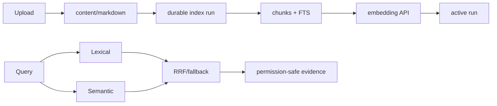

# Kiến trúc AI/vector và RAG cơ bản

Worker dùng transaction, `SKIP LOCKED`, retry/backoff và publish một active run. Search lexical/semantic/hybrid trả provenance; Q&A/summary/tag/related chỉ dùng visible chunks; stats dùng activity aggregates. Lỗi collect/provider/vector/migration được ghi stage và xử lý retry/failed, không log body/key. Citation stale trả 404.
