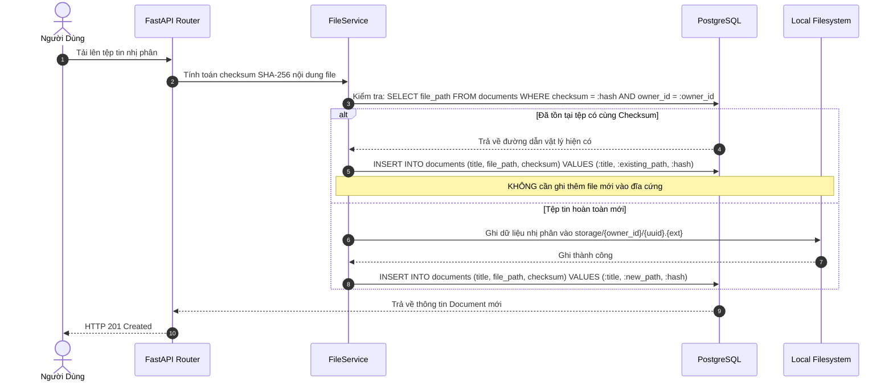

# 📦 KIẾN TRÚC HỆ THỐNG LƯU TRỮ TẬP TIN CỤC BỘ (LOCAL STORAGE)

Tài liệu này giải thích chi tiết cấu trúc lưu trữ nhị phân, thuật toán khử trùng lặp (Deduplication) và lý do lựa chọn mô hình lưu trữ cục bộ phục vụ bảo vệ đồ án.

---

## 1. Cấu Trúc Lưu Trữ Trên Hệ Thống Tập Tin (Filesystem)

Khi hệ thống vận hành ở chế độ Cục bộ (`STORAGE_BACKEND=local`), toàn bộ tệp tin nhị phân được lưu trữ trực tiếp trên đĩa cứng máy chủ dưới cấu trúc phân cấp an toàn:

```
backend/storage/
├── {owner_id_1}/
│   ├── {uuid_1}.pdf            # Tệp tài liệu gốc
│   ├── {uuid_1}_thumb.jpg      # Ảnh thu nhỏ / bìa trích xuất tự động
│   └── {uuid_2}.docx
├── {owner_id_2}/
│   └── {uuid_3}.pptx
└── public/
    └── default_avatar.png
```

### Nguyên tắc bảo mật đường dẫn:
1. **Cô lập theo người sở hữu (`owner_id`)**: Tệp tin của từng người dùng được phân vào các thư mục con riêng biệt, ngăn chặn việc quét tự do toàn bộ cây thư mục.
2. **Định danh ngẫu nhiên bằng UUIDv4**: Tên tệp vật lý được đổi thành chuỗi UUID ngẫu nhiên kết hợp với phần mở rộng gốc. Tên tệp hiển thị ban đầu của người dùng được lưu trữ an toàn trong trường `documents.title` của CSDL.
3. **Phòng chống Path Traversal**: Ứng dụng sử dụng lớp `Path` của Python để chuẩn hóa đường dẫn, tuyệt đối ngăn chặn việc truy xuất vượt cấp ra khỏi thư mục `backend/storage/` (như `../../etc/passwd`).

---

## 2. Giải Thuật Khử Trùng Lặp Tệp Tin (SHA-256 Deduplication)

### 2.1. Bản Chất Bài Toán
Nếu nhiều người dùng cùng tải lên cùng một cuốn giáo trình PDF nặng 50MB, việc lưu nhiều bản sao vật lý sẽ gây lãng phí nghiêm trọng dung lượng đĩa cứng.

### 2.2. Quy Trình Khử Trùng Lặp
Hệ thống sử dụng kỹ thuật **Lưu Trữ Đơn Bản (Single Instance Storage)** dựa trên mã băm mã hóa **SHA-256**:



---

## 3. Đánh Giá Khoa Học Phục Vụ Hội Đồng: Local Storage vs Cloud Object Storage

| Tiêu chí kỹ thuật | Hệ Thống Lưu Trữ Cục Bộ (Đồ án áp dụng) | Lưu Trữ Đám Mây (S3 / Cloudflare R2) |
| :--- | :--- | :--- |
| **Độ trễ truy xuất (Latency)** | **< 5ms**: Đọc trực tiếp từ ổ cứng SSD NVMe của máy cục bộ. | **50ms - 200ms**: Phụ thuộc vào tốc độ đường truyền Internet và độ trễ CDN. |
| **Tính độc lập & Sẵn sàng** | **100% Offline**: Chạy demo mượt mà kể cả khi phòng chấm thi mất mạng Internet. | Phụ thuộc hoàn toàn vào kết nối mạng; nguy cơ gặp lỗi DNS/timeout trong buổi chấm thi. |
| **Chi phí vận hành** | **0 VNĐ**: Tận dụng hoàn toàn tài nguyên phần cứng sẵn có của trường/máy trạm. | Phát sinh chi phí duy trì hàng tháng theo dung lượng lưu trữ và số lượng request. |
| **Đánh đổi & Giới hạn** | Bị giới hạn bởi dung lượng ổ cứng của máy chủ đơn lẻ; cần thiết lập cơ chế sao lưu (Backup) thủ công. | Khả năng mở rộng dung lượng vô hạn (Petabytes), độ bền dữ liệu 99.999999999% (11 số 9). |
