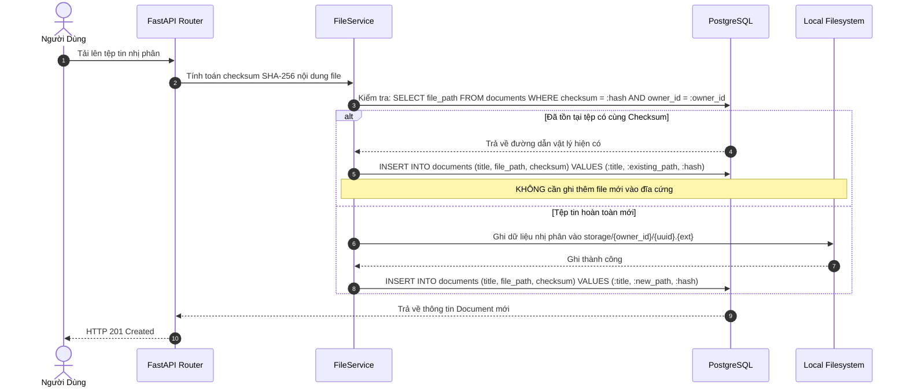

# 📦 KIẾN TRÚC LƯU TRỮ VÀ XỬ LÝ TÀI LIỆU

Tài liệu này mô tả luồng upload, lưu trữ, khử trùng lặp, xử lý nội dung, tìm kiếm và vòng đời xóa tài liệu theo source hiện tại.

---

## 1. Lưu trữ tệp

Khi chạy với `STORAGE_BACKEND=local`, tệp gốc được lưu dưới dạng:

```
backend/storage/
├── {owner_id_1}/
│   ├── {uuid_1}.pdf            # Tệp tài liệu gốc
│   ├── {uuid_1}_thumb.jpg      # Ảnh thu nhỏ / bìa trích xuất tự động
│   └── {uuid_2}.docx
├── {owner_id_2}/
│   └── {uuid_3}.pptx
└── public/
    └── default_avatar.png
```

Tên vật lý dùng UUID ngẫu nhiên; tên hiển thị được lưu trong `documents.title`. `documents.file_path` lưu đường dẫn dùng để truy xuất tệp. Hệ thống cũng hỗ trợ lưu trên Cloudflare R2; khi đó `file_path` là key hoặc URL tương ứng.

Các artifact được sinh trong quá trình xử lý gồm `thumbnail_path`, `markdown_path` và `content`.

---

## 2. Luồng upload và khử trùng lặp

API đọc tệp để tính mã SHA-256. Tên trường thực tế là `documents.checksum`.

Quy trình thực tế:

1. Với tài liệu cá nhân, kiểm tra checksum theo `owner_id` và `workspace_id IS NULL`; với tài liệu nhóm, kiểm tra theo `workspace_id`.
2. Nếu đã có bản ghi đang hoạt động, trả `409` với mã `DUPLICATE`.
3. Nếu có bản ghi cùng checksum trong thùng rác, trả `409` với mã `IN_TRASH`.
4. Nếu chưa có bản ghi trong kho hiện tại, tìm bản ghi cùng checksum trên toàn bảng để tái sử dụng `file_path`.
5. Nếu không tìm thấy, ghi tệp mới vào Storage rồi tạo bản ghi.

Khi tái sử dụng, bản ghi mới có thể dùng lại cả thumbnail, Markdown và content của bản ghi đã có.



---

### 2.1. Xử lý nền sau upload

Pipeline chạy bằng FastAPI `BackgroundTasks`, không phải worker queue riêng. API commit bản ghi và trả response trước khi OCR, thumbnail hoặc Markdown hoàn tất. Tác vụ nền đọc tệp, trích xuất text, tạo thumbnail, sinh Markdown và cập nhật DB.

Source chưa có khóa giao dịch hoặc unique constraint bảo vệ rõ ràng khỏi hai upload đồng thời cùng checksum. Đây là rủi ro race condition cần theo dõi.

### 2.2. Phân loại và trích xuất

PDF dùng `pdfplumber`, nếu không có text layer thì OCR; DOCX dùng `python-docx`; PPTX dùng `python-pptx`; hình ảnh dùng OCR; text/mã nguồn đọc trực tiếp. Khi sinh Markdown, code dùng Pygments để đoán ngôn ngữ và các loại khác dùng Anydoc.

## 3. Thumbnail và Markdown

- PDF được render **trang đầu tiên** thành thumbnail.
- Hình ảnh được resize thành thumbnail.
- DOCX/PPTX không được render thumbnail trực tiếp bởi `create_thumbnail`; frontend dùng icon mặc định nếu không có thumbnail.
- Nếu Markdown có ảnh đầu tiên phù hợp và tài liệu chưa có thumbnail, ảnh đó có thể được dùng làm thumbnail.

## 4. Tìm kiếm PostgreSQL

Trigger DB cập nhật `documents.search_vector` khi `title` hoặc `content` thay đổi. Trigger hiện tại tạo `tsvector` từ `title` (trọng số A) và `content` (trọng số B), với chỉ mục GIN.

Truy vấn tìm kiếm dùng `websearch_to_tsquery`, bổ sung `LIKE` trên `title` và `description`, đồng thời luôn lọc `is_deleted = false` và giới hạn theo kho người dùng có quyền truy cập. `description` hiện chưa nằm trong biểu thức trigger tạo `search_vector`.

## 5. Xóa mềm, khôi phục và xóa vĩnh viễn

Xóa mềm cập nhật `is_deleted = true` và `deleted_at`. Với bundle, các tài liệu con cũng được đánh dấu. File gốc, thumbnail và Markdown được giữ lại. Vì các truy vấn đều lọc `is_deleted = false`, tài liệu xóa mềm bị ẩn khỏi danh sách và FTS.

Khôi phục đặt `is_deleted = false` và `deleted_at = NULL`.

Xóa vĩnh viễn thủ công và tác vụ APScheduler `cleanup_deleted_documents` cùng dùng `remove_file_if_unreferenced`. Helper đếm các bản ghi còn tham chiếu tới đường dẫn qua `file_path`, `thumbnail_path` hoặc `markdown_path`; chỉ khi không còn bản ghi nào tham chiếu thì mới xóa tệp vật lý.

Thứ tự hiện tại là xóa Storage trước, sau đó xóa bản ghi DB và commit. Nếu commit thất bại, có thể còn bản ghi trỏ tới tệp đã bị xóa; source chưa có cơ chế bù trừ cho trường hợp này.

## 6. Vector hóa, hỏi đáp và tóm tắt

Vector hóa, embedding, hỏi đáp RAG và tóm tắt theo tài liệu AI-Vector **chưa triển khai trong source hiện tại**. Tài liệu AI-Vector chỉ là định hướng cho kế hoạch sau, không phải pipeline đang chạy.

## 7. Nội dung đã triển khai nhưng cần bổ sung docs

Phân loại tệp, OCR, Pygments, Anydoc và luồng gộp nhiều ảnh thành PDF đã được triển khai nhưng trước đây chưa mô tả đầy đủ trong tài liệu kiến trúc. Cần bổ sung chi tiết gộp ảnh vào tài liệu upload/bundle khi hoàn thiện đặc tả.

## 8. Điểm cần theo dõi

- Bổ sung cơ chế chống race condition nếu cần bảo đảm tuyệt đối theo checksum.
- Xem xét thứ tự xóa Storage và DB để tránh bản ghi mồ côi khi commit thất bại.
- Nếu muốn `description` nằm trong `search_vector`, cần cập nhật trigger và migration.

<!-- Phần so sánh Local Storage và Cloud Object Storage được giữ ở dưới để tham khảo. -->

## 9. Local Storage và Cloud Object Storage

| Tiêu chí kỹ thuật | Hệ Thống Lưu Trữ Cục Bộ (Đồ án áp dụng) | Lưu Trữ Đám Mây (S3 / Cloudflare R2) |
| :--- | :--- | :--- |
| **Độ trễ truy xuất (Latency)** | **< 5ms**: Đọc trực tiếp từ ổ cứng SSD NVMe của máy cục bộ. | **50ms - 200ms**: Phụ thuộc vào tốc độ đường truyền Internet và độ trễ CDN. |
| **Tính độc lập & Sẵn sàng** | **100% Offline**: Chạy demo mượt mà kể cả khi phòng chấm thi mất mạng Internet. | Phụ thuộc hoàn toàn vào kết nối mạng; nguy cơ gặp lỗi DNS/timeout trong buổi chấm thi. |
| **Chi phí vận hành** | **0 VNĐ**: Tận dụng hoàn toàn tài nguyên phần cứng sẵn có của trường/máy trạm. | Phát sinh chi phí duy trì hàng tháng theo dung lượng lưu trữ và số lượng request. |
| **Đánh đổi & Giới hạn** | Bị giới hạn bởi dung lượng ổ cứng của máy chủ đơn lẻ; cần thiết lập cơ chế sao lưu (Backup) thủ công. | Khả năng mở rộng dung lượng vô hạn (Petabytes), độ bền dữ liệu 99.999999999% (11 số 9). |
