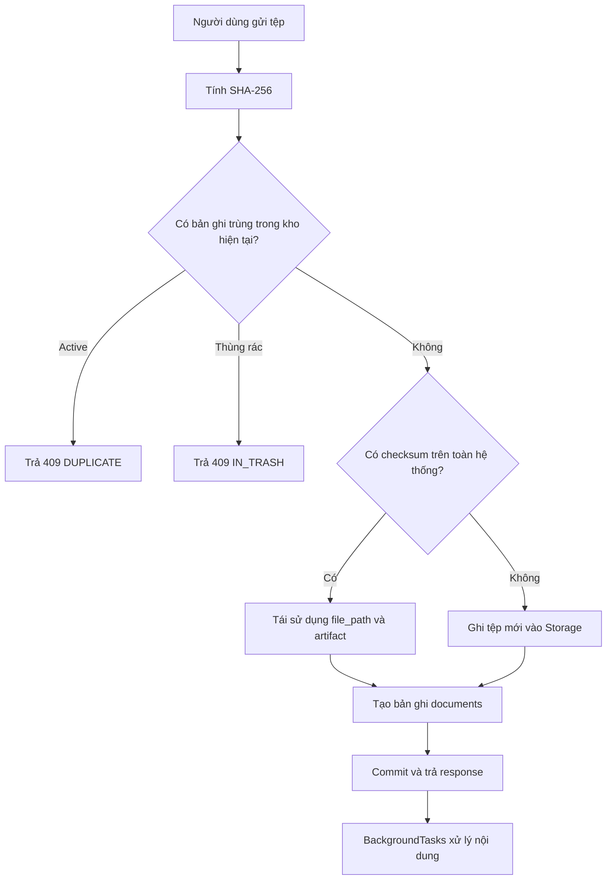
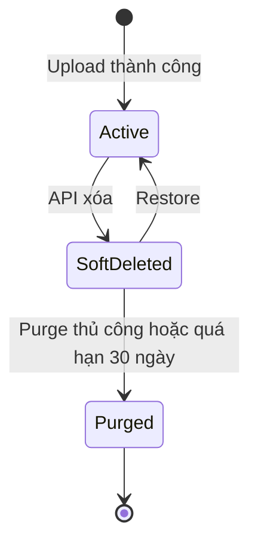

# 🔄 ĐẶC TẢ QUY TRÌNH HOẠT ĐỘNG HỆ THỐNG THƯ VIỆN SỐ

Tài liệu này là đặc tả tổng hợp về cách hệ thống tiếp nhận, lưu trữ, xử lý, tìm kiếm và xóa tài liệu. Nội dung phản ánh source hiện tại; các chức năng chưa triển khai được đánh dấu rõ.

## 1. Phạm vi và mục tiêu

Hệ thống quản lý tài liệu số trong kho cá nhân và workspace nhóm. Các chức năng chính gồm upload, khử trùng lặp, trích xuất nội dung, xem trước, tìm kiếm toàn văn và quản lý thùng rác.

Vector hóa, hỏi đáp tài liệu và tóm tắt bằng AI hiện chưa triển khai; chỉ có tài liệu định hướng riêng cho giai đoạn sau.

## 2. Mô hình dữ liệu và Storage

Mỗi tài liệu có một bản ghi trong bảng `documents`. Các trường quan trọng:

| Trường | Vai trò |
|---|---|
| `owner_id` | Người sở hữu bản ghi |
| `workspace_id` | Workspace nhóm; `NULL` đối với kho cá nhân |
| `file_path` | Đường dẫn hoặc key của tệp gốc |
| `thumbnail_path` | Đường dẫn thumbnail nếu có |
| `markdown_path` | Đường dẫn Markdown nếu có |
| `checksum` | Mã SHA-256 của nội dung tệp |
| `content` | Văn bản được trích xuất |
| `search_vector` | `tsvector` phục vụ FTS |
| `is_deleted`, `deleted_at` | Trạng thái xóa mềm |

Ở local Storage, tệp có dạng `storage/{owner_id}/{uuid}.{extension}`. Tên UUID là tên vật lý; tên hiển thị nằm ở `documents.title`. Hệ thống cũng có nhánh lưu trên Cloudflare R2.

## 3. Quy trình upload

### 3.1. Kiểm tra deduplication

Checksum được kiểm tra trong phạm vi kho hiện tại:

- Kho cá nhân: `owner_id` hiện tại và `workspace_id IS NULL`.
- Workspace nhóm: `workspace_id` hiện tại.

Nếu tài liệu trùng đang hoạt động, API trả lỗi `409` với mã `DUPLICATE`. Nếu bản trùng đang ở thùng rác, API trả lỗi `409` với mã `IN_TRASH`.

Sau khi không tìm thấy bản trùng trong kho hiện tại, service tìm checksum trên toàn bảng `documents` để dùng lại `file_path`. Vì vậy, bản ghi mới có thể tham chiếu đến tệp vật lý đã được tạo bởi owner hoặc workspace khác.

Hiện source chưa có cơ chế khóa hoặc ràng buộc duy nhất đủ rõ để bảo vệ hai upload đồng thời cùng checksum khỏi race condition.

### 3.2. Xử lý sau khi tạo bản ghi

API commit bản ghi và trả response trước khi hoàn thành trích xuất. Pipeline xử lý được đăng bằng FastAPI `BackgroundTasks`, không dùng worker queue riêng cho upload.

## 4. Phân loại và tiền xử lý tài liệu

Pipeline hiện có các nhánh:

- **PDF:** `pdfplumber` đọc text layer; nếu không có text thì chuyển sang OCR.
- **DOCX:** đọc đoạn văn bằng `python-docx`.
- **PPTX:** đọc text trong slide bằng `python-pptx`.
- **Hình ảnh:** OCR ảnh.
- **Text và mã nguồn:** đọc trực tiếp bằng encoding UTF-8.

Khi sinh Markdown, code/mã nguồn được bọc trong code block và Pygments được dùng để đoán ngôn ngữ; các loại tài liệu khác được chuyển đổi bằng Anydoc.

Luồng xử lý nhiều ảnh thành một PDF là chức năng đã triển khai nhưng cần được đặc tả chi tiết hơn trong tài liệu upload/bundle.

## 5. Xử lý nền sau upload

Hàm `_process_document_background` thực hiện:

1. Đọc tệp từ local Storage hoặc tải tạm từ R2.
2. Trích xuất text và cập nhật `documents.content`.
3. Tạo thumbnail.
4. Sinh Markdown.
5. Lưu các đường dẫn artifact và commit DB.

Nếu bản ghi đã có đầy đủ `content`, thumbnail và Markdown do tái sử dụng CAS, tác vụ có thể bỏ qua xử lý nặng.

## 6. Thumbnail và Markdown

- PDF lấy **trang đầu tiên** để tạo thumbnail.
- Hình ảnh được resize thành thumbnail.
- DOCX/PPTX không được render thumbnail trực tiếp bởi backend; giao diện dùng icon mặc định nếu không có thumbnail.
- Nếu Markdown có ảnh đầu tiên phù hợp và tài liệu chưa có thumbnail, ảnh đó có thể được dùng làm thumbnail.
- Markdown lưu ở `storage/markdowns/{document_id}.md` hoặc key tương ứng trên R2.

## 7. Tìm kiếm PostgreSQL

Trigger DB cập nhật `search_vector` khi `title` hoặc `content` thay đổi. Biểu thức hiện tại gồm:

- `title` với trọng số `A`.
- `content` với trọng số `B`.

`search_vector` có GIN index. Truy vấn tìm kiếm dùng `websearch_to_tsquery`, đồng thời dùng `LIKE` trên `title` và `description`. Tài liệu có `is_deleted = true` luôn bị loại khỏi danh sách và FTS.

`description` hiện được tìm bằng nhánh `LIKE`, chưa nằm trong biểu thức trigger tạo `search_vector`.

## 8. Vòng đời tài liệu

### 8.1. Xóa mềm

API xóa cập nhật `is_deleted = true` và `deleted_at`. Với bundle, các tài liệu con cũng được đánh dấu. Không xóa file gốc, thumbnail hoặc Markdown. Do các truy vấn đều lọc `is_deleted = false`, tài liệu bị ẩn hoàn toàn khỏi danh sách hoạt động và FTS.

### 8.2. Khôi phục

API restore đặt `is_deleted = false` và `deleted_at = NULL`. Bản ghi được phép xuất hiện lại nếu các artifact cần thiết vẫn còn.

### 8.3. Xóa vĩnh viễn và reference counting

Purge thủ công trong `routers/trash.py` và purge tự động trong APScheduler cùng dùng `remove_file_if_unreferenced`.

Helper kiểm tra các tham chiếu qua cả `file_path`, `thumbnail_path` và `markdown_path`. Tệp vật lý chỉ bị xóa khi không còn bất kỳ bản ghi `documents` nào tham chiếu đến đường dẫn đó. Sau bước kiểm tra Storage, bản ghi DB mới bị xóa.

Source hiện xóa Storage trước rồi mới commit DB. Nếu commit thất bại, có nguy cơ bản ghi còn tồn tại nhưng tệp vật lý đã bị xóa; chưa có cơ chế bù trừ hoàn chỉnh cho trường hợp này.

## 9. Vector hóa, hỏi đáp và tóm tắt

Các chức năng sau **chưa triển khai**:

- Chia nội dung thành chunk để embedding.
- Lưu vector vào bảng vector.
- Hỏi đáp RAG.
- Tóm tắt và lưu kết quả AI.

Tài liệu `docs/99-luu-tru/ke-hoach/AI-Vector/ke-hoach-trien-khai-AI.md` chỉ là định hướng kiến trúc cho giai đoạn sau, không phải mô tả pipeline đang vận hành.

## 10. Các điểm cần bổ sung hoặc cải thiện

- Bổ sung khóa/ràng buộc chống race condition cho deduplication.
- Thiết kế thứ tự hoặc cơ chế bù trừ giữa xóa Storage và commit DB.
- Cập nhật trigger nếu muốn đưa `description` vào `search_vector`.
- Viết đặc tả riêng cho luồng gộp nhiều ảnh thành PDF.
