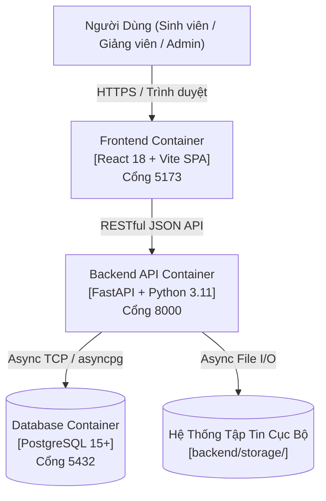

# 📐 KIẾN TRÚC TỔNG THỂ & MÔ HÌNH C4

## 1. Mô Hình Kiến Trúc Phân Tầng (Layered Architecture)

Hệ thống được thiết kế theo mô hình kiến trúc phân tầng kinh điển kết hợp với cơ chế phân tách hoàn toàn giữa Tầng Trình Diễn (Presentation) và Tầng Xử Lý Nghiệp Vụ (Application/Business):

```
+--------------------------------------------------------------------------------------------------+
|                                    CÁC TẦNG KIẾN TRÚC HỆ THỐNG                                    |
|                                                                                                  |
| 1. PRESENTATION LAYER (Client - Single Page Application)                                         |
|    - React 18, Vite, Tailwind CSS, Lucide Icons, Axios Client                                   |
|    - Điều hướng Router, Quản lý State, Caching LocalStorage                                     |
|                                                                                                  |
|              ▲                                                    │                              |
|   JSON / RESTful API                                   HTTP 200/400/500                          |
|              │                                                    ▼                              |
|                                                                                                  |
| 2. API ROUTING & VALIDATION LAYER (FastAPI)                                                      |
|    - Router endpoints (`/auth`, `/documents`, `/workspaces`, `/library`, `/dashboard`)           |
|    - Dependency Injection: `Depends(get_db)`, `Depends(get_current_user)`                         |
|    - Kiểm thực dữ liệu vào/ra bằng Pydantic V2 Schemas                                           |
|                                                                                                  |
| 3. BUSINESS SERVICE LAYER                                                                        |
|    - DocumentService (Upload, SHA-256 Deduplication, Soft Delete, Purge)                         |
|    - WorkspaceService (Member roles, Invitation, Dissolution lifecycle)                          |
|    - LibraryService (Submission review, Rating aggregation, Bundles)                             |
|    - ActivityService (Action logging, Download counter, Trending score)                          |
|                                                                                                  |
| 4. DATA PERSISTENCE & STORAGE LAYER                                                              |
|    - SQLAlchemy 2.0 ORM (AsyncSession, Declarative Base, Relationships)                         |
|    - PostgreSQL 15+ Server (26 Tables, GIN Index FTS, Partial Unique Indexes)                    |
|    - Local Filesystem Storage (`backend/storage/{owner_id}/{uuid}.{ext}`)                        |
+--------------------------------------------------------------------------------------------------+
```

---

## 2. Mô Hình C4 — Mức Container (C4 Container Diagram)



---

## 3. Phân Tích Đánh Đổi: Monolith Tách Rời SPA vs Microservices (Defense Rationale)

Khi bảo vệ đồ án trước Hội đồng khoa học, một câu hỏi quan trọng là: **Tại sao lựa chọn kiến trúc Monolith (với SPA tách rời) thay vì Microservices?**

Dưới đây là cơ sở khoa học và đánh giá so sánh khách quan:

| Tiêu chí so sánh | Kiến trúc Đồ án Lựa chọn (Monolith API + Decoupled SPA) | Kiến trúc Vi dịch vụ (Microservices Architecture) |
| :--- | :--- | :--- |
| **Độ phức tạp triển khai** | **Thấp**: Chỉ cần khởi động 1 tiến trình Backend, 1 tiến trình Frontend và 1 DB PostgreSQL. Dễ dàng chạy trơn tru trên mọi máy laptop chấm thi. | **Rất cao**: Đòi hỏi thiết lập API Gateway, Service Discovery (Consul/Eureka), Message Broker (Kafka/RabbitMQ), cấu hình nhiều container Docker đồng thời. |
| **Tính toàn vẹn giao dịch (ACID)** | **Tuyệt đối**: Tận dụng cơ chế giao dịch ACID của PostgreSQL trong cùng một phiên `AsyncSession` (ví dụ: tạo bản ghi tài liệu, cập nhật bảng thống kê và ghi log hoạt động trong 1 transaction an toàn). | **Phức tạp**: Đòi hỏi áp dụng mẫu thiết kế Saga Pattern, 2-Phase Commit hoặc Eventual Consistency; dễ phát sinh lỗi bất đồng bộ dữ liệu khi một dịch vụ gặp sự cố. |
| **Độ trễ liên dịch vụ (Latency)** | **Bằng 0**: Lời gọi giữa Router và Service là lời gọi hàm trực tiếp trong bộ nhớ (In-memory function call). | **Cao**: Mỗi tác vụ liên dịch vụ đều tốn thời gian tuần tự hóa JSON và trễ mạng qua giao thức HTTP/gRPC. |
| **Nhu cầu nghiệp vụ thực tế** | **Phù hợp hoàn hảo**: Phục vụ nội bộ trường đại học với quy mô vài nghìn người dùng, không cần thiết phải đánh đổi lấy sự phức tạp không đáng có của Microservices. | Thừa thãi so với quy mô đồ án cơ sở, làm tăng nguy cơ lỗi hệ thống trong buổi bảo vệ. |
