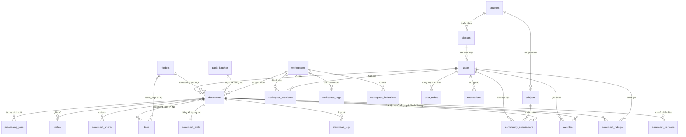

# 📊 SƠ ĐỒ THỰC THỂ QUAN HỆ (ERD)

Hệ thống cơ sở dữ liệu **Foundation Project** bao gồm **26 bảng dữ liệu nghiệp vụ**, được tổ chức thành 5 miền chức năng mạch lạc:

1. **Miền Người dùng & Định danh**: `users`, `faculties`, `classes`
2. **Miền Quản lý Tài liệu & Lưu trữ**: `documents`, `document_versions`, `trash_batches`, `tags`, `document_tags`, `folders`, `folder_tags`
3. **Miền Không gian làm việc nhóm (Workspace)**: `workspaces`, `workspace_members`, `workspace_invitations`, `workspace_tags`
4. **Miền Thư viện Học liệu Cộng đồng**: `community_submissions`, `subjects`, `document_ratings`, `download_logs`, `document_stats`
5. **Miền Tương tác, Tiện ích & Xử lý nền**: `document_shares`, `favorites`, `notes`, `user_todos`, `notifications`, `processing_jobs`

---

## Sơ Đồ Mermaid ERD Toàn Diện

---

## Phân Tích Các Mối Quan Hệ Trọng Yếu

1. **Quan hệ Tự Tham Chiếu Nhân Bản Tài Liệu (`documents.source_document_id`)**:  
   Bảng `documents` có khóa ngoại `source_document_id` tự trỏ về chính `documents.id`. Khi một tài liệu được sao chép (Fork) từ Thư viện số về Kho cá nhân hoặc Kho nhóm, bản sao sẽ trỏ về bản gốc nhằm theo dõi cây phả hệ tài liệu mà không phải nhân đôi tệp vật lý.
2. **Quan hệ Nhiều - Nhiều (N-N) Qua Bảng Trung Gian**:
   - `document_tags(document_id, tag_id)`: Gắn nhiều thẻ cá nhân cho một tài liệu.
   - `folder_tags(folder_id, tag_id)`: Gắn nhãn cho thư mục.
3. **Quan hệ Không Gian Làm Việc (`workspaces` - `workspace_members`)**:
   - Khóa chính kết hợp `(workspace_id, user_id)` trong `workspace_members` ngăn chặn việc một người dùng bị thêm trùng lặp vào cùng một nhóm.
