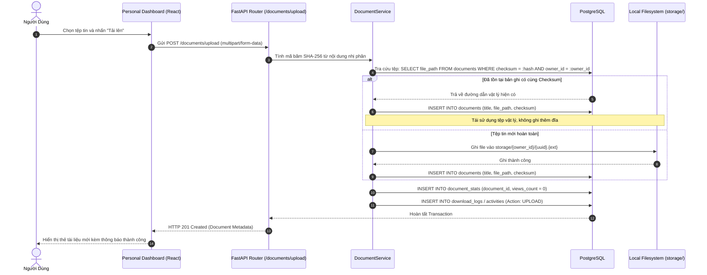

# 📁 PHÂN HỆ 01: KHO CÁ NHÂN & QUẢN LÝ TÀI LIỆU (PERSONAL REPOSITORY)

## 1. Mục Đích & Bối Cảnh Nghiệp Vụ
Kho cá nhân là không gian lưu trữ tài liệu riêng tư của từng giảng viên và sinh viên, giúp họ quản lý học liệu cá nhân, ghi chú, tổ chức danh mục môn học mà không bị lộ dữ liệu ra bên ngoài.

---

## 2. Luồng Nghiệp Vụ Tải Lên & Khử Trùng Lặp (Upload & Deduplication Workflow)

---

## 3. Quy Tắc Nghiệp Vụ & Ràng Buộc (Business Rules)
1. **Cô lập dữ liệu riêng tư**: Mọi tài liệu cá nhân bắt buộc có `workspace_id IS NULL`. Người dùng chỉ có quyền truy xuất tài liệu có `owner_id == current_user.id`.
2. **Hạn ngạch dung lượng (Storage Quota)**: Tổng dung lượng tệp tin của người dùng được kiểm tra trước khi ghi; mặc định hạn ngạch là 15GB.
3. **Quy trình Thùng rác hai cấp (Trash Lifecycle)**:
   - *Xóa mềm (Soft Delete)*: Cập nhật `is_deleted = true` và `deleted_at = now()`. Tài liệu biến mất khỏi danh sách chính nhưng vẫn còn trong CSDL và đĩa cứng.
   - *Khôi phục (Restore)*: Đưa `is_deleted = false`.
   - *Xóa vĩnh viễn (Purge)*: Chỉ người sở hữu mới được xóa hoàn toàn bản ghi khỏi bảng `documents`. Nếu không còn bản ghi nào khác trỏ tới cùng `file_path`, tệp vật lý trên đĩa cứng mới bị gỡ bỏ (`os.remove`).

---

## 4. Mô Hình Dữ Liệu Liên Quan
- `documents`: Lưu trữ thông tin tài liệu (`title`, `file_path`, `checksum`, `file_size`, `mime_type`, `is_deleted`).
- `tags` & `document_tags`: Bảng liên kết N-N quản lý thẻ nhãn cá nhân.
- `folders`: Phân cấp thư mục cá nhân.
- `favorites`: Danh sách tài liệu yêu thích của người dùng.
- `user_todos`: Danh sách việc cần làm cá nhân trên Dashboard.

---

## 5. Tương Tác API & Giao Diện Người Dùng
- `GET /documents`: Lấy danh sách tài liệu cá nhân (hỗ trợ phân trang, lọc theo tag, thư mục).
- `POST /documents/upload`: Tải lên tài liệu mới.
- `DELETE /documents/{id}`: Xóa mềm đưa vào thùng rác.
- `POST /documents/{id}/restore`: Phục hồi từ thùng rác.
- `DELETE /documents/{id}/purge`: Xóa vĩnh viễn.
- **Giao diện**: Trang `PersonalDashboard.tsx` tích hợp 3 chế độ xem (Grid/List/Detail), thanh thống kê dung lượng và danh sách đọc gần đây.

---

## 6. Giới Hạn Kỹ Thuật & Đánh Đổi
- Quá trình tính băm SHA-256 thực thi trực tiếp trên luồng I/O của máy chủ Backend; với các tệp tin cực lớn (>500MB), có thể làm tăng thời gian chờ của request.
