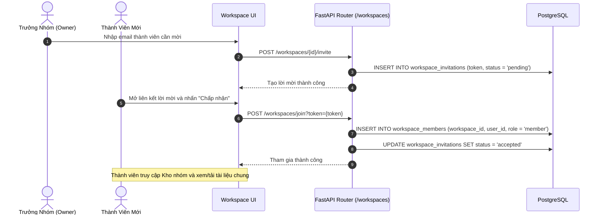

# 👥 PHÂN HỆ 02: KHO NHÓM & KHÔNG GIAN LÀM VIỆC (WORKSPACES)

## 1. Mục Đích & Bối Cảnh Nghiệp Vụ
Kho nhóm phục vụ nhu cầu làm việc cộng tác giữa các sinh viên cùng làm bài tập lớn, nghiên cứu khoa học hoặc nhóm bộ môn của giảng viên. Phân hệ cung cấp môi trường khép kín có phân quyền vai trò nội bộ và quy trình giải thể nhóm an toàn.

---

## 2. Luồng Nghiệp Vụ Tham Gia & Cộng Tác Nhóm

---

## 3. Quy Tắc Nghiệp Vụ & Phân Quyền (Business Rules)
1. **Phân cấp vai trò trong nhóm (Workspace Roles)**:
   - `owner`: Người tạo nhóm, có toàn quyền cấu hình, đổi tên, xóa nhóm, kích hoạt quy trình giải thể.
   - `admin`: Có quyền mời thành viên mới, xóa thành viên thường, quản lý thẻ nhóm (`workspace_tags`).
   - `member`: Có quyền xem, tải về và tải lên tài liệu vào kho nhóm.
2. **Quy trình giải thể không gian an toàn (Graceful Dissolution)**:
   - Trưởng nhóm kích hoạt giải thể qua `POST /workspaces/{id}/dissolve`.
   - Hệ thống cập nhật `is_dissolving = true` và hẹn giờ giải thể `dissolve_at = now() + 7 days`.
   - Trong thời gian 7 ngày đệm, nhóm chuyển sang chế độ chỉ đọc (Read-only); các thành viên nhận thông báo và có quyền sao chép (Fork) tài liệu về Kho cá nhân.
   - Sau thời hạn trên, nhóm chính thức bị xóa hoàn toàn.

---

## 4. Mô Hình Dữ Liệu Liên Quan
- `workspaces`: Định danh nhóm, tên, mô tả, trạng thái giải thể (`is_dissolving`, `dissolve_at`).
- `workspace_members`: Bảng nối thành viên với khóa chính kép `(workspace_id, user_id)` và cột `role`.
- `workspace_tags`: Thẻ nhãn dành riêng cho tài liệu của nhóm.
- `workspace_invitations`: Quản lý lời mời tham gia qua mã token có thời hạn.

---

## 5. Tương Tác API & Giao Diện Người Dùng
- `GET /workspaces`: Lấy danh sách các nhóm người dùng đang tham gia.
- `POST /workspaces`: Tạo nhóm làm việc mới.
- `GET /workspaces/{id}/documents`: Lấy danh sách tài liệu của nhóm.
- `POST /workspaces/{id}/members`: Thêm thành viên vào nhóm.
- `DELETE /workspaces/{id}/members/{user_id}`: Xóa thành viên khỏi nhóm.
- `POST /workspaces/{id}/dissolve`: Kích hoạt quy trình giải thể.

---

## 6. Giới Hạn Kỹ Thuật
- Việc kiểm tra hết hạn giải thể hiện tại được thực thi khi có request truy cập vào nhóm (Lazy evaluation), chưa có tiến trình CronJob nền độc lập quét định kỳ.
