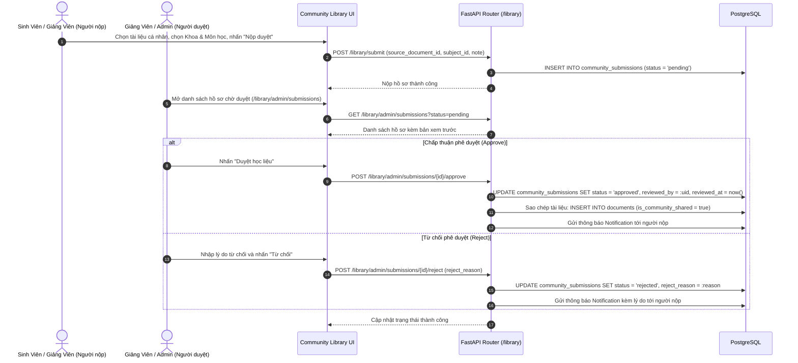

# 🏛️ PHÂN HỆ 03: KHO HỌC LIỆU SỐ & QUY TRÌNH DUYỆT TÀI LIỆU (COMMUNITY LIBRARY)

## 1. Mục Đích & Bối Cảnh Nghiệp Vụ
Kho học liệu số là thư viện công khai chính thức của trường đại học, lưu trữ các giáo trình, slide bài giảng, đề thi và tài liệu tham khảo chính quy. Để đảm bảo chất lượng học thuật và bản quyền, tài liệu nộp lên bắt buộc phải trải qua quy trình thẩm định trước khi công khai.

---

## 2. Luồng Nghiệp Vụ Nộp & Phê Duyệt Học Liệu (Submission & Review Workflow)

---

## 3. Quy Tắc Nghiệp Vụ & Ràng Buộc (Business Rules)
1. **Trạng thái vòng đời hồ sơ (Submission Statuses)**:
   - `pending`: Hồ sơ vừa nộp, đang chờ phân công hoặc chờ duyệt; chỉ người nộp và người duyệt mới có thể xem.
   - `approved`: Đã được duyệt thành công; hệ thống tự động xuất bản tài liệu vào Kho học liệu số của Môn học tương ứng.
   - `rejected`: Bị từ chối xuất bản; bắt buộc người duyệt phải nhập `reject_reason`.
2. **Quy định Đánh giá sao (Rating Rules)**:
   - Chỉ người dùng đã đăng nhập và không phải là tác giả của tài liệu mới được đánh giá sao (từ 1 đến 5 sao).
   - Mỗi người dùng chỉ được gửi 1 đánh giá cho mỗi tài liệu (`UNIQUE(user_id, document_id)`); có thể cập nhật lại điểm đánh giá.
   - Điểm trung bình đánh giá được tự động tổng hợp vào bảng `document_stats.average_rating`.
3. **Trọn bộ học liệu (Document Bundles)**: Giảng viên có thể gom nhiều tài liệu thuộc cùng một học phần thành 1 bộ học liệu (Bundle) để sinh viên dễ dàng tải về hoặc học tập có hệ thống.

---

## 4. Mô Hình Dữ Liệu Liên Quan
- `community_submissions`: Quản lý hồ sơ nộp duyệt (`source_document_id`, `published_document_id`, `subject_id`, `status`, `reject_reason`).
- `faculties` & `subjects`: Cây phân loại danh mục học thuật (Khoa/Viện -> Môn học).
- `document_ratings`: Bảng lưu điểm đánh giá sao và nhận xét của người dùng.
- `download_logs`: Ghi nhận lịch sử tải tệp (phục vụ bộ đếm tải và thống kê).

---

## 5. Tương Tác API & Giao Diện Người Dùng
- `GET /library/faculties`: Lấy danh sách Khoa và số lượng môn học/học liệu.
- `GET /library/subjects/{id}/documents`: Lấy danh sách tài liệu công khai của môn học.
- `POST /library/submit`: Gửi tài liệu vào hàng đợi phê duyệt.
- `POST /library/admin/submissions/{id}/approve`: Phê duyệt xuất bản.
- `POST /library/admin/submissions/{id}/reject`: Từ chối hồ sơ.
- `POST /library/documents/{id}/rate`: Đánh giá sao tài liệu.

---

## 6. Giới Hạn Kỹ Thuật
- Việc đếm số lượng tài liệu theo Khoa và Môn học được tính toán động (Dynamic aggregation), có thể gây chậm truy vấn nếu tập dữ liệu vượt quá hàng trăm nghìn bản ghi.
