# 🔍 PHÂN HỆ 04: TÌM KIẾM TOÀN VĂN & TRA CỨU (FULL-TEXT SEARCH)

## 1. Mục Đích & Bối Cảnh Nghiệp Vụ
Giúp giảng viên và sinh viên tra cứu nhanh chóng các học liệu cần thiết trong hàng nghìn tài liệu của trường dựa trên từ khóa tìm kiếm theo tiêu đề, nội dung tệp tin kết hợp với các bộ lọc đa chiều (Khoa, Môn học, định dạng tệp, năm học).

---

## 2. Luồng Xử Lý Tìm Kiếm (Search Pipeline)

```mermaid
graph LR
    Input["Người Dùng Nhập Từ Khóa<br/>'giao trinh co so du lieu'"] --> Debounce["Frontend Debounce<br/>(300ms)"]
    Debounce --> API["FastAPI /search Endpoint"]
    API --> Parse["Xử Lý Chuỗi Truy Vấn<br/>Chuyển sang plainto_tsquery('simple', :q)"]
    Parse --> Engine["PostgreSQL Query Engine<br/>documents.search_vector @@ tsquery"]
    Engine --> GIN["GIN Index Scan<br/>(ix_documents_search_vector)"]
    GIN --> Rank["Hàm Xếp Hạng<br/>ts_rank(search_vector, tsquery) DESC"]
    Rank --> Filter["Áp Dụng Bộ Lọc<br/>WHERE is_deleted = false AND faculty_id = ..."]
    Filter --> Result["Trả Về Kết Quả Kèm Phân Trang<br/>(Pagination JSON)"]
```

---

## 3. Quy Tắc Nghiệp Vụ & Thuật Toán Xếp Hạng (Business Rules)
1. **Xử lý tiếng Việt không dấu**: Từ khóa người dùng nhập vào (có dấu hoặc không dấu) được đối khớp linh hoạt nhờ cấu hình phân tích `'simple'` đã loại bỏ các dấu thanh tiếng Việt.
2. **Trọng số xếp hạng kết quả**:
   - Khớp từ khóa trong **Tiêu đề (`title`)**: Nhận trọng số hạng `A` (Hệ số tương đương 1.0).
   - Khớp từ khóa trong **Nội dung (`content`)**: Nhận trọng số hạng `B` (Hệ số tương đương 0.4).
   - Điểm số xếp hạng tính theo hàm `ts_rank` đảm bảo tài liệu có từ khóa ở tiêu đề luôn được ưu tiên hiển thị lên đầu.
3. **Phân trang an toàn**: Mọi truy vấn bắt buộc giới hạn `limit` (tối đa 50 tài liệu mỗi trang) và `offset` để tránh tình trạng tràn bộ nhớ (Out of Memory).

---

## 4. Mô Hình Dữ Liệu & Chỉ Mục
- Cột `documents.search_vector`: Kiểu dữ liệu `tsvector` được tự động cập nhật bởi Trigger `trg_documents_search_vector`.
- Chỉ mục GIN `ix_documents_search_vector`: Đảm bảo tốc độ tra cứu đạt độ trễ < 50ms.

---

## 5. Tương Tác API & Giao Diện Người Dùng
- `GET /documents/search`: Endpoint tìm kiếm toàn văn.
  - **Tham số**: `q` (từ khóa), `faculty_id`, `subject_id`, `mime_type`, `page`, `page_size`, `sort_by` (`relevance`, `newest`, `rating`, `downloads`).
- **Giao diện**: Trang tìm kiếm `SearchPage.tsx` có thanh tìm kiếm thông minh, thanh trượt lọc định dạng (PDF, DOCX, PPTX), danh sách tags gợi ý và bảng kết quả hiển thị đoạn trích khớp từ khóa.

---

## 6. Giới Hạn Kỹ Thuật
- Bộ tìm kiếm chưa hỗ trợ từ điển đồng nghĩa (Synonyms) tiếng Việt chuyên ngành (ví dụ: tìm "CSDL" chưa tự động gợi ý "Cơ sở dữ liệu").
