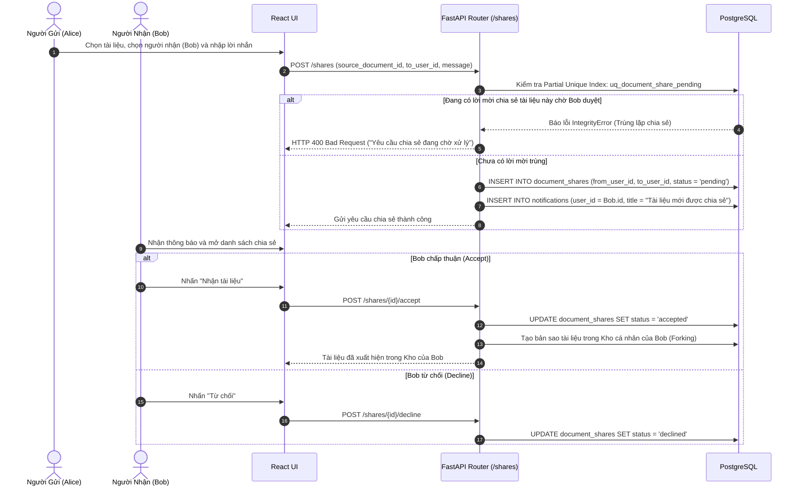

# 🔗 PHÂN HỆ 06: CHIA SẺ & LIÊN KẾT TÀI LIỆU (DOCUMENT SHARING & FORKING)

## 1. Mục Đích & Bối Cảnh Nghiệp Vụ
Cho phép sinh viên và giảng viên chia sẻ học liệu với các cá nhân khác trong trường hoặc tạo liên kết chia sẻ tạm thời, đồng thời hỗ trợ cơ chế sao chép (Forking) tài liệu về kho riêng.

---

## 2. Luồng Nghiệp Vụ Chia Sẻ Trực Tiếp Giữa Hai Người Dùng

---

## 3. Quy Tắc Nghiệp Vụ & Kiểm Soát Trùng Lặp (Business Rules)
1. **Chống trùng lặp chia sẻ bằng Partial Unique Index**:  
   Chỉ mục `uq_document_share_pending` trên PostgreSQL ngăn chặn tuyệt đối tình huống một người bấm gửi nhiều lần lời mời chia sẻ cùng 1 tài liệu cho 1 người khi trạng thái đang là `pending`.
2. **Cơ chế Forking / Cloning an toàn**:  
   Khi tài liệu được nhận hoặc sao chép về kho cá nhân:
   - Bản ghi mới kế thừa `file_path`, `checksum`, `file_size` của bản gốc.
   - Trường `source_document_id` trỏ về bản gốc.
   - Thao tác diễn ra tức thì, không làm tăng dung lượng ổ cứng máy chủ.
3. **Thời hạn liên kết chia sẻ công khai**: Có thể thiết lập thời điểm hết hạn `expires_at`. Sau mốc này, liên kết tự động vô hiệu hóa.

---

## 4. Mô Hình Dữ Liệu Liên Quan
- `document_shares`: Lưu trữ quan hệ chia sẻ (`from_user_id`, `to_user_id`, `source_document_id`, `status`, `expires_at`, `responded_at`).
- `notifications`: Lưu trữ thông báo gửi tới người nhận.

---

## 5. Tương Tác API & Giao Diện Người Dùng
- `POST /shares`: Tạo yêu cầu chia sẻ mới.
- `GET /shares/incoming`: Xem danh sách tài liệu người khác chia sẻ cho mình.
- `GET /shares/outgoing`: Xem danh sách tài liệu mình đã chia sẻ.
- `POST /shares/{id}/accept`: Chấp thuận nhận tài liệu.
- `POST /shares/{id}/decline`: Từ chối nhận tài liệu.

---

## 6. Giới Hạn Kỹ Thuật
- Chưa hỗ trợ cơ chế đồng bộ tự động 2 chiều (Bi-directional sync): Nếu tác giả tài liệu gốc chỉnh sửa nội dung, bản sao đã Fork của người nhận không tự động cập nhật theo mà vẫn giữ nguyên trạng thái tại thời điểm Fork.
