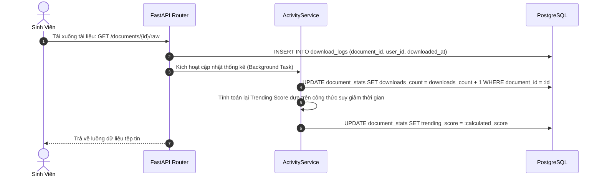

# 📊 PHÂN HỆ 07: NHẬT KÝ HOẠT ĐỘNG & THỐNG KÊ (ACTIVITY & TRENDING)

## 1. Mục Đích & Bối Cảnh Nghiệp Vụ
Phân hệ cung cấp khả năng giám sát nhật ký tương tác của người dùng (Audit Trail) phục vụ công tác quản trị và bảo mật, đồng thời tính toán điểm số xu hướng (Trending Score) để đề xuất các tài liệu học tập nổi bật nhất cho sinh viên trên trang chủ.

---

## 2. Luồng Ghi Nhận Hoạt Động & Tính Điểm Xu Hướng

---

## 3. Quy Tắc Nghiệp Vụ & Thuật Toán Tính Điểm Xu Hướng (Business Rules)

### 3.1. Các Hành Động Được Ghi Nhật Ký (`ActivityAction`)
Hệ thống chuẩn hóa các hành vi tương tác trong enum `ActivityAction`:
- `UPLOAD`: Tải lên tài liệu mới.
- `DOWNLOAD`: Tải tệp tin về máy.
- `VIEW`: Xem trước nội dung tài liệu.
- `SHARE`: Chia sẻ tài liệu cho người khác.
- `DELETE`: Xóa tài liệu vào thùng rác.
- `RESTORE`: Khôi phục tài liệu.

### 3.2. Thuật Toán Tính Điểm Xu Hướng (Trending Score Algorithm)
Điểm xu hướng không chỉ dựa vào tổng số lượt xem hay tải mà có tính đến **hệ số suy giảm theo thời gian (Time Decay Factor)**, nhằm ưu tiên các tài liệu đang được quan tâm nhiều trong tuần hoặc tháng gần nhất:

$$
	ext{Trending Score} = rac{W_v \cdot V + W_d \cdot D + W_r \cdot R}{(T + 2)^G}
$$

Trong đó:
- $V$: Số lượt xem gần đây (`views_count`).
- $D$: Số lượt tải gần đây (`downloads_count`).
- $R$: Điểm đánh giá trung bình (`average_rating`).
- $W_v, W_d, W_r$: Trọng số tương ứng ($W_d > W_v$ vì hành vi tải về thể hiện sự quan tâm sâu sắc hơn xem lướt).
- $T$: Khoảng thời gian từ thời điểm tải lên đến hiện tại (tính bằng ngày).
- $G$: Hệ số suy giảm trọng lực ($G = 1.5$).

---

## 4. Mô Hình Dữ Liệu Liên Quan
- `download_logs`: Lưu từng lượt tải cụ thể (`document_id`, `user_id`, `downloaded_at`).
- `document_stats`: Bảng tổng hợp chỉ số tương tác (`views_count`, `downloads_count`, `average_rating`, `trending_score`, `updated_at`).

---

## 5. Tương Tác API & Giao Diện Người Dùng
- `GET /dashboard/stats`: Lấy thống kê tổng quan (Tổng số tài liệu, dung lượng đã dùng, phân bổ loại tệp).
- `GET /dashboard/activities`: Lấy dòng nhật ký hoạt động gần đây của người dùng.
- `GET /library/trending`: Lấy danh sách tài liệu có điểm xu hướng cao nhất để hiển thị tại banner trang chủ.

---

## 6. Giới Hạn Kỹ Thuật
- Điểm xu hướng hiện tại được cập nhật tức thì (On-the-fly) khi có sự kiện tải xuống hoặc xem tài liệu; với khối lượng truy cập đồng thời lớn, nên chuyển tác vụ tính toán này thành một CronJob chạy định kỳ hàng giờ.
