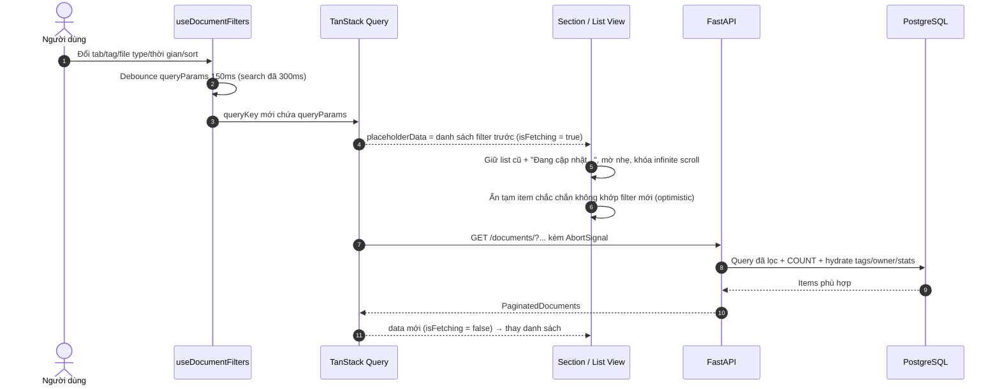

# ⚡ TỐI ƯU LỌC TÀI LIỆU & TRẠNG THÁI LOADING

## 1. Mục Đích & Bối Cảnh Nghiệp Vụ

Khi người dùng đổi bộ lọc trong **Kho cá nhân**, **Kho nhóm** hoặc **Kho học liệu theo môn**, danh sách tài liệu chuyển sang trạng thái loading trắng trong vài giây.

Nguyên nhân không nằm ở tốc độ lọc của trình duyệt mà ở chuỗi sau:

1. Filter được gom vào `queryParams` → nằm trong `queryKey` của `useInfiniteQuery` / `useQuery`.
2. `queryKey` mới chưa có cache → TanStack Query chuyển `isLoading = true`, `data = undefined`.
3. Component thay **toàn bộ** danh sách bằng skeleton (`GroupDocumentsSection`, `PersonalDocumentsSection`, `LibrarySubject`).
4. API lọc chạy các subquery (`folder_id` qua `FolderTag`, `q` theo tên nhãn/con của bundle, `accessed_within` qua `download_logs`, `COUNT(*)` ở trang 1) nên thời gian chờ càng kéo dài cảm giác "trắng".

Mục tiêu: **đổi filter không làm trống khung danh sách**, vẫn giữ kết quả đúng từ server và giảm số request thừa.

---

## 2. Luồng Nghiệp Vụ (Workflow)

Request cũ bị hủy qua `AbortSignal` nếu người dùng đổi filter liên tiếp.

---

## 3. Quy Tắc Nghiệp Vụ & Ràng Buộc

1. **Giữ dữ liệu cũ khi đổi filter**: `placeholderData: (prev) => prev` áp dụng cho 3 query: nhóm, cá nhân, kho môn học. Khi có dữ liệu placeholder, `isLoading` không bật → không render skeleton.
2. **Skeleton chỉ khi chưa có gì để hiển thị**: điều kiện render là `isLoading && items.length === 0` (kể cả trong `DocumentListView` / `DocumentDetailView`).
3. **Server là nguồn sự thật**: component vẫn gọi API cho mọi filter. FE chỉ ẩn tạm để phản hồi tức thì; khi response về, danh sách server thay thế.
4. **Lọc optimistic chỉ dùng filter an toàn** (`src/utils/matchesLoadedFilters.ts`):
   - `category`, `file_type`, `uploaded_within`, `tag_id` (bỏ qua item bundle vì bundle có thể khớp qua con).
   - Không lọc FE: `q` (tìm cả tên tag/con bundle), `folder_id` (lọc qua `FolderTag`), `accessed_within` (log theo user), `sort=trending/views` (cần `DocumentStats`).
5. **Khóa infinite scroll lúc đang lọc lại**: `hasNextPage = !isFetching && hasNextPage` để tránh nạp trang của filter cũ.
6. **Giảm spam request**: debounce 150ms cho toàn bộ `queryParams`; ô tìm kiếm giữ debounce 300ms riêng (tổng ~450ms). `staleTime` là 30s ở cả 3 luồng.
7. **Hủy request cũ**: `queryFn` nhận `signal` từ TanStack Query, truyền xuống axios trong `groupService.getDocuments` và `documentService.getAll`.

---

## 4. Mô Hình Dữ Liệu & Chỉ Mục

Không đổi schema nghiệp vụ. Chỉ bổ sung một chỉ mục phục vụ bộ lọc **"Mở gần đây"** (`accessed_within`):

- Migration: `alembic/versions/6a8f0b1c2d3e_add_download_logs_access_filter_index.py` (revises `c3d4e5f6a7b8`, head đã commit tại thời điểm tạo).
- Index: `ix_download_logs_user_action_created_document` trên `download_logs (user_id, action, created_at, document_id)`.
- Truy vấn được tối ưu: `user_id = :me AND action IN ('viewed','view') AND created_at >= :start` → lấy `document_id`.

Các index cũ `(user_id, created_at)`, `(action, created_at)`, `(document_id, created_at)` vẫn giữ nguyên; index mới bao phủ đủ điều kiện lọc.

---

## 5. Tương Tác API & Giao Diện

### Endpoint (không đổi signature)

| Method | Path | Filter chính |
| :--- | :--- | :--- |
| `GET` | `/groups/{group_id}/documents/` | `q`, `tag_id`, `category`, `file_type`, `uploaded_within`, `accessed_within`, `sort`, `page`, `page_size` |
| `GET` | `/documents/` | Tương tự ở phạm vi cá nhân |
| `GET` | `/library/subjects/{id}/documents/` | `page`, `sort`, `doc_type`, `academic_year` |

### File triển khai

| Việc | File |
| :--- | :--- |
| Giữ data cũ, gửi `signal`, staleTime | `useGroupDocuments.ts`, `usePersonalDocuments.ts`, `LibrarySubject.tsx` |
| Debounce toàn bộ filter | `hooks/useDocumentFilters.ts` |
| Lọc optimistic dùng chung | `utils/matchesLoadedFilters.ts` |
| Truyền `signal` xuống axios | `services/groupService.ts`, `services/documentService.ts` |
| Bỏ nhánh skeleton, thêm indicator, khóa sentinel | `GroupDocumentsSection.tsx`, `PersonalDocumentsSection.tsx`, `DocumentListView.tsx`, `DocumentDetailView.tsx`, `GroupSpace.tsx`, `DocumentsTab.tsx` |
| Index DB | `alembic/versions/6a8f0b1c2d3e_add_download_logs_access_filter_index.py` |

UI: dòng **"Đang cập nhật..."** với spinner nhỏ cạnh ViewToggle; danh sách cũ mờ đi (`opacity-60 pointer-events-none`) thay vì biến mất.

---

## 6. Giới Hạn Kỹ Thuật & Đánh Đổi

- FE chỉ có 20 tài liệu/trang đầu. Lọc optimistic trên tập này **có thể thiếu kết quả ở trang sau**; vì vậy API vẫn luôn được gọi và là nguồn quyết định cuối cùng.
- Với bundle/tag hoặc `q`, item hợp lệ có thể bị ẩn thoáng qua trước khi response server về — đánh đổi để đổi filter có phản hồi ngay.
- `uploaded_within` dùng mốc UTC ở cả FE lẫn BE; chỉ khác biệt ở ranh giới ngày nếu người dùng ở múi giờ không phải UTC.
- Debounce 150ms làm đổi dropdown chậm hơn đúng 150ms so với trước; đổi lại giảm đáng kể request khi bấm liên tiếp.
- Index mới chỉ có tác dụng sau khi chạy `alembic upgrade head`.
- Đã kiểm tra: `npm run build`, `npm run lint`, self-check 11 assertion của hàm lọc, `alembic heads` (một head). **Chưa** thử nghiệm trên browser với API thật hay đo benchmark sau khi apply index.

### Hướng nâng cấp

- Thêm cột `last_accessed_at` trên `documents` để thay subquery `download_logs` (repo đã có `backend/tests/benchmark_accessed_within.py` để so sánh).
- Cache kết quả theo `filterKey` và preload các filter kề nhau để bật lại filter cũ dùng cache ngay.
