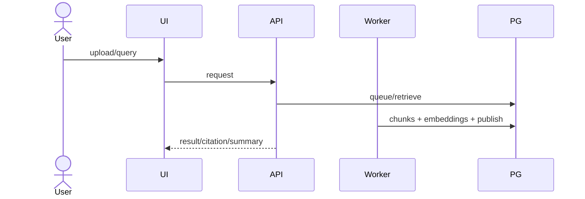

# Tra cứu, hỗ trợ AI và gợi ý nội dung

## 1. Mục đích & bối cảnh

Sáu chức năng phục vụ sinh viên/giảng viên: hybrid search, Q&A citation, summary, tag suggestions, related và interest stats.

## 2. Luồng nghiệp vụ

## 3. Quy tắc

Index lifecycle là pending/retry/ready/empty/failed/obsolete; retry reset attempts. Summary hiển thị cùng mô tả gốc trong khu vực Mô tả, không persist overwrite `documents.description`. Tag phải confirm-before-write; related permission-safe; stats nhận 7 hoặc 30 ngày.

## 4. Dữ liệu

Run/chunk/vector theo [ERD AI/vector](../99-luu-tru/ke-hoach/AI-Vector/ke-hoach-AI-chi-tiet.md); FTS dùng tsvector/GIN/unaccent.

## 5. API & UI

Search badges dựa trên `match.methods` (`lexical_title`, `lexical_content`, `semantic`); Q&A `/questions`; summary/tag/related dưới `/documents/{id}`; stats `/stats/me`.

## 6. Giới hạn

Provider/DB thật và benchmark deferred; OCR chuyên biệt Phase 7; advanced QA/generative Phase 8.
