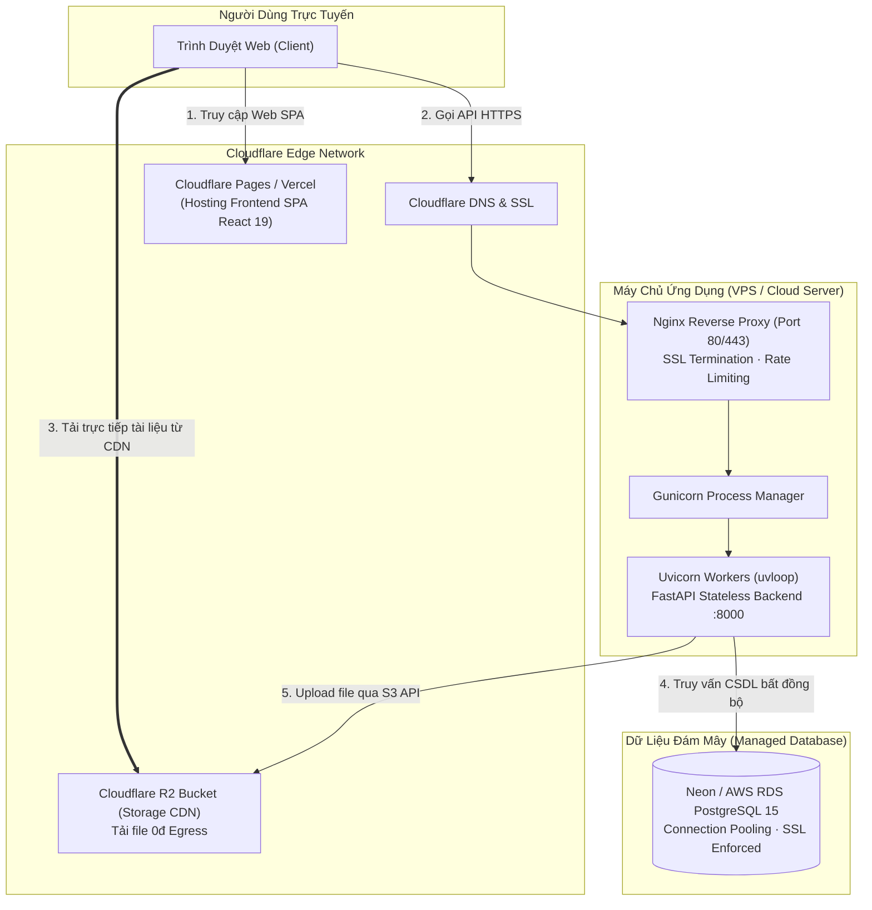

> [!WARNING] TÀI LIỆU LƯU TRỮ LỊCH SỬ
> Tài liệu này mô tả hạ tầng thử nghiệm điện toán đám mây trước đây (Cloudflare R2, Neon Database, Vercel).
> **Không phản ánh hiện trạng vận hành chính thức của hệ thống.** Hiện trạng đồ án hoạt động 100% trên môi trường Cục bộ (Localhost).
> Vui lòng tham khảo: [Hướng dẫn Localhost](../../02-huong-dan-local/README.md) và [Kiến trúc lưu trữ](../../03-kien-truc/he-thong-luu-tru-tap-tin.md).

---


# 🚀 Hướng Dẫn Triển Khai Thực Tế (Production Deployment Guide)

Tài liệu này cung cấp quy trình từng bước đã được kiểm chứng để triển khai toàn bộ hệ thống **Digital Library** lên môi trường Production (hoặc Staging), bao gồm FastAPI Backend, React Frontend SPA, Cơ sở dữ liệu PostgreSQL Serverless, Lưu trữ đám mây Cloudflare R2 và Website tài liệu GitHub Pages.

---

## 🗺️ Kiến Trúc Hạ Tầng Triển Khai Thực Tế



---

## 1. Triển Khai Cơ Sở Dữ Liệu PostgreSQL Đám Mây (Neon / RDS)

1. **Khởi tạo Database:** Tạo cơ sở dữ liệu PostgreSQL (phiên bản 15+) trên dịch vụ quản lý như **Neon Tech** hoặc **AWS RDS**.
2. **Kích hoạt phần mở rộng bắt buộc:**
   ```sql
   CREATE EXTENSION IF NOT EXISTS pg_trgm;
   CREATE EXTENSION IF NOT EXISTS unaccent;
   ```
3. **Thực thi bản di chuyển lược đồ (Alembic Migrations):**
   Từ máy tính quản trị viên hoặc trong bước build container:
   ```bash
   export DATABASE_URL="postgresql+asyncpg://<USER>:<PASS>@<HOST>/<DB>?sslmode=require"
   alembic upgrade head
   python backend/apply_fts.py
   ```

---

## 2. Cấu Hình Hạ Tầng Lưu Trữ Cloudflare R2

1. **Tạo Bucket:** Đăng nhập Cloudflare Dashboard $\rightarrow$ **R2** $\rightarrow$ **Create Bucket** đặt tên `elibrary-bucket`.
2. **Cấu hình Public Access:** Bật tính năng **Public URL** (hoặc gán Custom Domain) để Client có thể tải tệp trực tiếp.
3. **Thiết lập CORS Policy:** Cho phép tên miền Frontend gửi yêu cầu tải dữ liệu nhị phân:
   ```json
   [
     {
       "AllowedOrigins": ["https://your-domain.edu.vn", "https://*.pages.dev"],
       "AllowedMethods": ["GET", "HEAD"],
       "AllowedHeaders": ["*"],
       "MaxAgeSeconds": 86400
     }
   ]
   ```
4. **Tạo R2 API Tokens:** Tạo cặp khóa `R2_ACCESS_KEY_ID` và `R2_SECRET_ACCESS_KEY` với quyền *Object Read & Write*.

---

## 3. Triển Khai Máy Chủ Backend FastAPI (Docker / Systemd)

### Cách 1: Triển khai bằng Docker Compose (Khuyến nghị)
Tạo file `docker-compose.prod.yml`:
```yaml
version: '3.8'

services:
  backend:
    build:
      context: .
      dockerfile: backend/Dockerfile
    restart: always
    environment:
      - DATABASE_URL=${DATABASE_URL}
      - SECRET_KEY=${SECRET_KEY}
      - STORAGE_BACKEND=r2
      - MINIO_ENDPOINT=${MINIO_ENDPOINT}
      - MINIO_ACCESS_KEY=${MINIO_ACCESS_KEY}
      - MINIO_SECRET_KEY=${MINIO_SECRET_KEY}
      - MINIO_PUBLIC_URL=${MINIO_PUBLIC_URL}
      - BUCKET_NAME=elibrary-bucket
    ports:
      - "8000:8000"
    command: >
      gunicorn backend.app.main:app 
      -w 4 
      -k uvicorn.workers.UvicornWorker 
      --bind 0.0.0.0:8000 
      --access-logfile -
```

### Cách 2: Triển khai trực tiếp qua Systemd Service (Linux Server)
Tạo file `/etc/systemd/system/elibrary-backend.service`:
```ini
[Unit]
Description=Digital Library FastAPI Backend
After=network.target

[Service]
User=www-data
Group=www-data
WorkingDirectory=/var/www/Foundation-Project
EnvironmentFile=/var/www/Foundation-Project/.env
ExecStart=/var/www/Foundation-Project/.venv/bin/gunicorn backend.app.main:app -w 4 -k uvicorn.workers.UvicornWorker --bind 127.0.0.1:8000

[Install]
WantedBy=multi-user.target
```
Kích hoạt dịch vụ:
```bash
sudo systemctl daemon-reload
sudo systemctl enable elibrary-backend
sudo systemctl start elibrary-backend
```

---

## 4. Triển Khai Frontend Client (React 19 Vite SPA)

### Bước 1: Biên dịch mã nguồn Frontend
```bash
cd frontend/digital-library
# Cấu hình URL Backend chính thức
export VITE_API_URL="https://api.your-domain.edu.vn"
npm run build
```
*Kết quả xuất bản nằm trong thư mục `frontend/digital-library/dist/`.*

### Bước 2: Cấu hình Nginx Reverse Proxy & Phục Vụ Tệp Tĩnh
Tạo file `/etc/nginx/sites-available/elibrary.conf`:
```nginx
server {
    listen 80;
    server_name your-domain.edu.vn;
    return 301 https://$host$request_uri;
}

server {
    listen 443 ssl http2;
    server_name your-domain.edu.vn;

    ssl_certificate /etc/letsencrypt/live/your-domain.edu.vn/fullchain.pem;
    ssl_certificate_key /etc/letsencrypt/live/your-domain.edu.vn/privkey.pem;

    # Phục vụ Frontend React SPA
    root /var/www/Foundation-Project/frontend/digital-library/dist;
    index index.html;

    location / {
        try_files $uri $uri/ /index.html;
    }

    # Chuyển tiếp yêu cầu API sang Backend FastAPI
    location /api/ {
        rewrite ^/api/(.*) /$1 break;
        proxy_pass http://127.0.0.1:8000;
        proxy_set_header Host $host;
        proxy_set_header X-Real-IP $remote_addr;
        proxy_set_header X-Forwarded-For $proxy_add_x_forwarded_for;
        proxy_set_header X-Forwarded-Proto $scheme;
    }
}
```

---

## 5. Triển Khai Website Tài Liệu Docusaurus Lên GitHub Pages

Quy trình xuất bản website tài liệu được tự động hóa hoàn toàn bằng **GitHub Actions**:
1. Workflow [.github/workflows/deploy-docs.yml](../../../.github/workflows/deploy-docs.yml) tự động kích hoạt khi có commit đẩy vào nhánh `main`.
2. Pipeline thực thi:
   ```bash
   cd docs-site
   npm ci
   npm run build
   ```
3. Action `peaceiris/actions-gh-pages@v4` tự động đẩy thư mục build lên nhánh `gh-pages`.
4. Trang web tài liệu được cập nhật tức thì tại:  
   👉 **`https://Nguyen06-CSE.github.io/Foundation-Project/`**
