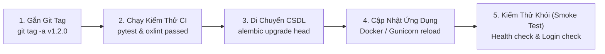
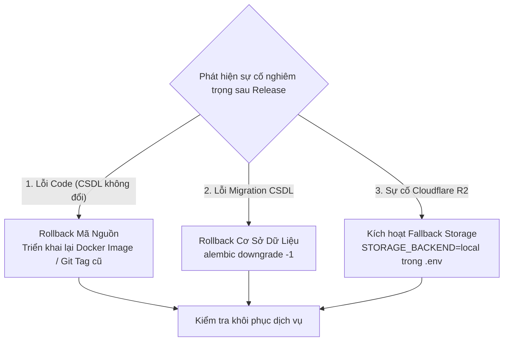

> [!WARNING] TÀI LIỆU LƯU TRỮ LỊCH SỬ
> Tài liệu này mô tả hạ tầng thử nghiệm điện toán đám mây trước đây (Cloudflare R2, Neon Database, Vercel).
> **Không phản ánh hiện trạng vận hành chính thức của hệ thống.** Hiện trạng đồ án hoạt động 100% trên môi trường Cục bộ (Localhost).
> Vui lòng tham khảo: [Hướng dẫn Localhost](../../02-huong-dan-local/README.md) và [Kiến trúc lưu trữ](../../03-kien-truc/he-thong-luu-tru-tap-tin.md).

---


# 🔄 Quy Trình Phát Hành & Khôi Phục Sự Cố (Release & Rollback)

Tài liệu này xác định quy trình chuẩn hóa để phát hành phiên bản mới (**Release Protocol**), kiểm soát di chuyển lược đồ dữ liệu, và kế hoạch khôi phục khẩn cấp (**Rollback & Disaster Recovery**) khi xảy ra sự cố nghiêm trọng trên môi trường Production của **Digital Library Platform**.

---

## 1. Quy Trình Phát Hành Phiên Bản Mới (Standard Release Protocol)

Hệ thống áp dụng chuẩn phiên bản **Semantic Versioning (SemVer 2.0.0)** với định dạng `vMAJOR.MINOR.PATCH`:



### Các Bước Triển Khai Phát Hành:
1. **Đóng gói phiên bản & Gắn nhãn Git Tag:**
   ```bash
   git checkout main
   git pull origin main
   git tag -a v1.2.0 -m "Release v1.2.0: System Enhancements & Bulk Actions"
   git push origin v1.2.0
   ```
2. **Kiểm tra tự động trước khi triển khai (Pre-flight Checks):**
   * Toàn bộ 100% kịch bản kiểm thử trong `backend/tests/` phải Passed.
   * Linter `oxlint` và biên dịch TypeScript không phát hiện bất kỳ lỗi nào.
3. **Thực thi Migration CSDL:**
   ```bash
   alembic upgrade head
   python backend/apply_fts.py
   ```
4. **Cập nhật ứng dụng (Zero-Downtime Reload):**
   Khởi động lại các worker Uvicorn thông qua tín hiệu `HUP` của Gunicorn:
   ```bash
   sudo systemctl reload elibrary-backend
   ```
5. **Kiểm thử khói sau triển khai (Post-deployment Smoke Testing):**
   * Kiểm tra endpoint sức khỏe: `curl -I https://api.your-domain.edu.vn/health` (phải trả về `200 OK`).
   * Đăng nhập thử bằng tài khoản kiểm thử và thực hiện upload 1 tài liệu mẫu.

---

## 2. Kế Hoạch Khôi Phục Khẩn Cấp (Emergency Rollback Protocol)

Khi phát hiện sự cố nghiêm trọng ảnh hưởng đến người dùng (lỗi 500 hàng loạt, mất dữ liệu, hoặc nghẽn mạng), đội ngũ kỹ thuật kích hoạt quy trình Rollback tương ứng với từng tình huống:



### Tình huống 1: Lỗi mã nguồn nhưng cấu trúc CSDL không thay đổi
* **Hành động:** Rollback ngay lập tức về Git tag ổn định liền trước:
  ```bash
  git checkout v1.1.0
  sudo systemctl restart elibrary-backend
  ```

### Tình huống 2: Bản migration CSDL bị lỗi hoặc gây xung đột dữ liệu
* **Hành động:** Hạ cấp lược đồ CSDL về phiên bản trước bằng Alembic:
  ```bash
  # Hạ cấp 1 revision liền trước
  alembic downgrade -1
  
  # Hoặc hạ cấp về một revision cụ thể
  alembic downgrade <target_revision_id>
  ```

### Tình huống 3: Sự cố mạng hoặc lỗi kết nối Cloudflare R2
* **Hành động:** Kích hoạt cơ chế Fallback sang lưu trữ cục bộ:
  1. Mở file `.env` trên máy chủ và đổi `STORAGE_BACKEND=local`.
  2. Khởi động lại backend: `sudo systemctl restart elibrary-backend`.
  3. Hệ thống sẽ tự động chuyển hướng ghi/đọc tệp vào thư mục `backend/storage/`, duy trì hoạt động cho người dùng trong lúc chờ Cloudflare khắc phục sự cố.

---

## 3. Kế Hoạch Sao Lưu & Phục Hồi Thảm Họa (Backup & Disaster Recovery)

| Tài nguyên | Tần suất sao lưu | Phương thức sao lưu | Thời gian phục hồi mục tiêu (RTO / RPO) |
|---|:---:|---|:---:|
| **Cơ Sở Dữ Liệu PostgreSQL** | Hàng ngày (01:00 AM) | Automated Snapshots (Neon) + Bản xuất file `pg_dump` nén | RPO < 24 giờ / RTO < 15 phút |
| **Tệp Tin Vật Lý (Cloudflare R2)** | Tự động | Bật tính năng **Object Versioning** trên R2 Bucket | RPO = 0 / RTO tức thì |
| **Mã Nguồn & Tài Liệu** | Từng commit | GitHub Repository (Full Git History) | RPO = 0 / RTO tức thì |
