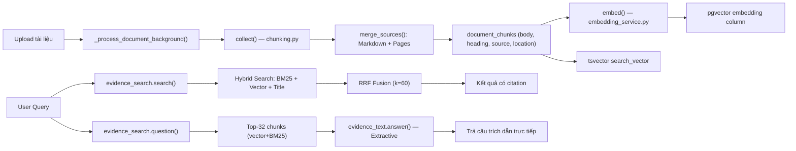
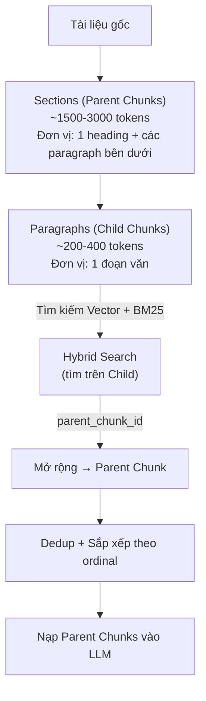
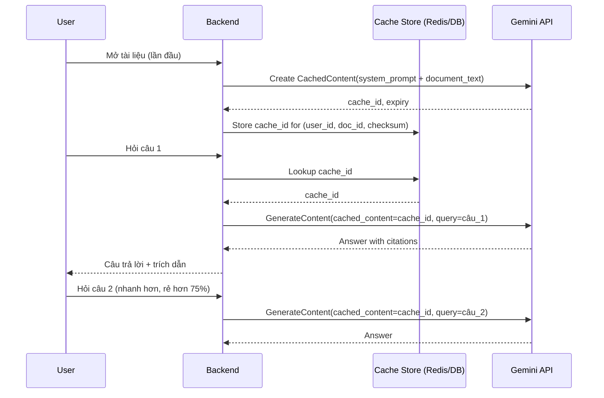

# Đánh giá tính khả thi & Kế hoạch triển khai Kiến trúc Hybrid RAG + Long-Context

## Mục tiêu

Đánh giá khả năng áp dụng kiến trúc lai **RAG truyền thống + Long-Context Grounding** (4 cơ chế: Dynamic Context Routing, Parent-Child Chunking, Context Grounding & Citation, Prefix Caching) vào hệ thống thư viện số Foundation-Project, dựa trên hiện trạng code và hạ tầng thực tế.

---

## 1. Hiện trạng hệ thống RAG hiện tại

### 1.1. Những gì đã có (đang hoạt động)



| Thành phần | Trạng thái | File chính |
|:---|:---|:---|
| **Chunking** | ✅ Paragraph-level (~1600 chars max), merge từ Markdown + Pages + Content | [chunking.py](file:///Users/caotiendattx/Developer/Do_An_Co_So/Foundation-Project/backend/app/services/chunking.py) |
| **Embedding** | ✅ OpenAI-compatible API, configurable model/dimensions | [embedding_service.py](file:///Users/caotiendattx/Developer/Do_An_Co_So/Foundation-Project/backend/app/services/embedding_service.py) |
| **Hybrid Search** | ✅ Vector (cosine) + BM25 (tsvector) + Title FTS, RRF fusion | [evidence_search.py](file:///Users/caotiendattx/Developer/Do_An_Co_So/Foundation-Project/backend/app/services/evidence_search.py) |
| **Q&A** | ⚠️ Extractive only (regex/keyword matching), không dùng LLM | [evidence_text.py](file:///Users/caotiendattx/Developer/Do_An_Co_So/Foundation-Project/backend/app/services/evidence_text.py) |
| **Tóm tắt** | ⚠️ Extractive (chọn câu đại diện bằng TF-IDF), không dùng LLM | [evidence_text.py](file:///Users/caotiendattx/Developer/Do_An_Co_So/Foundation-Project/backend/app/services/evidence_text.py) |
| **Citation** | ✅ Chunk-level, có heading/source/location/url | [evidence_search.py](file:///Users/caotiendattx/Developer/Do_An_Co_So/Foundation-Project/backend/app/services/evidence_search.py) |
| **Index pipeline** | ✅ Background worker, retry, batch embedding, trigger auto-queue | [index_worker.py](file:///Users/caotiendattx/Developer/Do_An_Co_So/Foundation-Project/backend/app/services/index_worker.py) |
| **DB Schema** | ✅ `document_index_runs` + `document_chunks` (pgvector) | [migration](file:///Users/caotiendattx/Developer/Do_An_Co_So/Foundation-Project/alembic/versions/ea41b38547bc_document_index.py) |

### 1.2. Điểm yếu chính (tại sao hiệu quả chưa cao)

| Vấn đề | Nguyên nhân gốc | Mức ảnh hưởng |
|:---|:---|:---|
| **Q&A chỉ trích xuất câu nguyên văn** | `answer()` trong `evidence_text.py` chỉ dùng regex keyword matching, overlap score ≥ 0.55. Không có LLM tổng hợp. | 🔴 Nghiêm trọng — Không thể trả lời câu hỏi tổng hợp, so sánh, suy luận |
| **Tóm tắt rời rạc** | `summarize()` chọn câu đại diện bằng TF-IDF, không có LLM viết lại | 🟠 Cao — Tóm tắt thiếu mạch lạc, không tự nhiên |
| **Chunk quá nhỏ, không có Parent** | Paragraph-level (~250-1600 chars), không có parent chunk bao quanh | 🟠 Cao — LLM mất ngữ cảnh xung quanh đoạn được trích |
| **Không có intent routing** | Mọi query đều đi qua cùng pipeline hybrid search → extractive answer | 🟡 Trung bình — Lãng phí tài nguyên hoặc thiếu ngữ cảnh tùy loại query |
| **Không dùng LLM** | Chưa có integration nào với Gemini/OpenAI/local LLM cho generation | 🔴 Nghiêm trọng — Giới hạn toàn bộ khả năng AI |

---

## 2. Đánh giá từng cơ chế Hybrid

### 2.1. Cơ chế 1: Dynamic Context Routing

> **Verdict: ✅ KHẢ THI & CÓ GIÁ TRỊ CAO**

**Phân tích cho Foundation-Project:**

Hệ thống quản lý giáo trình/sách/ghi chú có đặc thù:
- Tài liệu đơn lẻ: 5-100 trang (10k-200k tokens) → **phổ biến nằm trong vùng Gemini 1M context**
- Kho toàn bộ: hàng trăm tài liệu → **quá lớn cho long-context**

| Kịch bản trong hệ thống | Routing đề xuất | Lý do |
|:---|:---|:---|
| Hỏi đáp **trên 1 tài liệu** dưới 200k tokens | **Long-Context** (nạp toàn bộ Markdown/Content) | Giáo trình thường 50-150 trang, nằm trong context window Gemini Flash |
| Hỏi đáp **trên 1 tài liệu** trên 200k tokens | **Hybrid RAG** (parent-child retrieval) | Sách dày cần lọc trước |
| Tìm kiếm **xuyên kho** (search toàn bộ thư viện) | **Hybrid RAG** (giữ nguyên pipeline hiện tại) | Không thể nạp cả kho vào context |
| Tóm tắt **1 tài liệu** | **Long-Context** (nạp toàn bộ + Gemini) | Cần đọc hết mới tóm tắt tốt |
| So sánh **nhiều tài liệu** | **Map-Reduce** trên từng doc rồi tổng hợp | Quá lớn cho 1 context window |

**Triển khai cụ thể:**

```python
# Pseudo-code cho Context Router
async def route_query(db, uid, doc_id, query):
    doc_info = await get_doc_info(db, uid, doc_id)
    intent = classify_intent(query)  # local/global/summary
    total_tokens = estimate_tokens(doc_info)
    
    if total_tokens < 150_000:  # ~100 trang
        # Long-Context path: nạp toàn bộ + Gemini
        return await long_context_qa(doc_info, query)
    else:
        # Hybrid RAG path: retrieve → rerank → LLM
        return await hybrid_rag_qa(db, uid, doc_id, query)
```

---

### 2.2. Cơ chế 2: Parent-Child Chunking

> **Verdict: ✅ KHẢ THI & NÊN TRIỂN KHAI**

**Hiện trạng:**
- Chunk hiện tại: paragraph-level, ~250-1600 chars
- Mỗi chunk có `heading`, `source`, `location` (page/slide number) nhưng **không có parent chunk**
- Schema `document_chunks` đã có `run_id`, `ordinal`, `body`, `heading`

**Đề xuất thay đổi:**



**Thay đổi DB cần thiết:**

```sql
-- Thêm cột vào document_chunks
ALTER TABLE document_chunks ADD COLUMN chunk_type text NOT NULL DEFAULT 'child';
-- 'parent' hoặc 'child'
ALTER TABLE document_chunks ADD COLUMN parent_chunk_id bigint 
    REFERENCES document_chunks(id) ON DELETE CASCADE;

-- Index để lookup nhanh
CREATE INDEX ix_chunk_parent ON document_chunks(parent_chunk_id) 
    WHERE parent_chunk_id IS NOT NULL;
```

**Thay đổi chunking logic:**
- **Phase Index**: Tạo parent chunks theo heading/section → tạo child chunks (paragraph) bên trong mỗi parent → embedding chỉ trên child chunks
- **Phase Retrieval**: Tìm top-K child → truy ngược parent → dedup → sắp xếp theo ordinal → nạp vào LLM

> [!IMPORTANT]
> Thay đổi này tương thích ngược: child chunks vẫn có `body`, `search_vector`, `embedding` như hiện tại. Parent chunks chỉ thêm 1 bản ghi lớn hơn với `chunk_type='parent'` và không cần embedding.

---

### 2.3. Cơ chế 3: Context Grounding & Citation Attribution

> **Verdict: ✅ KHẢ THI với Gemini API (Partial — không cần fine-tune model)**

**Phân tích:**

Cơ chế NotebookLM dùng 3 tầng grounding:
1. **Span-level Tagging** → ✅ Có thể triển khai qua prompt engineering
2. **Attention Grounding** → ⚠️ Cần fine-tuned model (không thực tế cho dự án này)  
3. **Post-hoc Attribution** → ✅ Có thể triển khai bằng string matching + verification

**Đề xuất triển khai thực tế:**

```python
# 1. Span-level Tagging khi nạp context
def build_grounded_prompt(parent_chunks, question):
    context = ""
    for i, chunk in enumerate(parent_chunks):
        context += f"\n<source id=\"{chunk['chunk_id']}\" "
        context += f"doc=\"{chunk['document_id']}\" "
        if chunk['location'].get('page'):
            context += f"page=\"{chunk['location']['page']}\" "
        context += f"heading=\"{chunk['heading']}\">\n"
        context += chunk['text']
        context += f"\n</source>\n"
    
    return f"""Bạn là trợ lý học tập chuyên trả lời dựa trên tài liệu được cung cấp.

QUY TẮC BẮT BUỘC:
1. CHỈ trả lời dựa trên nội dung trong các thẻ <source>.
2. Mỗi luận điểm PHẢI kèm [SRC_<id>] ở cuối câu.
3. Nếu không tìm thấy thông tin, trả lời: "Không tìm thấy thông tin trong tài liệu."
4. Trả lời bằng tiếng Việt tự nhiên, dễ hiểu.

TÀI LIỆU:
{context}

CÂU HỎI: {question}"""

# 2. Post-hoc verification
def verify_citation(answer_text, cited_chunk_text):
    """Kiểm tra xem câu trả lời có thực sự được hỗ trợ bởi chunk không."""
    # Fuzzy string matching hoặc semantic similarity
    overlap = compute_token_overlap(answer_text, cited_chunk_text)
    return overlap > 0.3  # threshold
```

> [!NOTE]
> Với Gemini API, chỉ cần **prompt engineering tốt** là đủ đạt 80-90% chất lượng grounding mà không cần fine-tune. Gemini 2.0 Flash đã có built-in grounding capabilities khi dùng với `google.genai` SDK.

---

### 2.4. Cơ chế 4: Prefix Caching (KV-Cache Reuse)

> **Verdict: ✅ KHẢ THI — Gemini API hỗ trợ native Context Caching**

**Phân tích:**

| Yếu tố | Chi tiết |
|:---|:---|
| **Gemini Context Caching** | Gemini API hỗ trợ `cachedContent` — lưu prefix prompt và trả về `cache_id` dùng lại cho nhiều query |
| **Chi phí** | Cached input tokens rẻ hơn 75% so với non-cached |
| **TTL** | Mặc định 1 giờ, có thể extend |
| **Minimum size** | 32,768 tokens (phù hợp với giáo trình) |

**Flow triển khai:**



**Thay đổi cần thiết:**
- Thêm bảng `document_context_cache` lưu `(document_id, checksum, cache_id, expires_at)`
- Endpoint mới hoặc sửa `POST /documents/{id}/questions` để kiểm tra cache trước

---

## 3. Ma trận đánh giá: Hiệu quả theo loại input

> [!IMPORTANT]
> Bảng dưới so sánh hiện trạng (Extractive RAG) với kiến trúc Hybrid đề xuất cho **từng kịch bản sử dụng thực tế** của hệ thống thư viện số.

| Kịch bản sử dụng | Hiện tại (Extractive) | Hybrid đề xuất | Cải thiện | Đáng triển khai? |
|:---|:---|:---|:---|:---|
| **Hỏi fact cụ thể trong 1 tài liệu** ("Điều 5 quy định gì?") | ⭐⭐⭐ Tìm đúng chunk, trả nguyên văn | ⭐⭐⭐⭐⭐ LLM tổng hợp + trích dẫn chính xác | +2★ | ✅ Có |
| **Hỏi tổng hợp 1 tài liệu** ("So sánh 3 phương pháp trong chương 4") | ⭐ Thất bại — extractive không tổng hợp được | ⭐⭐⭐⭐⭐ Long-context nạp cả doc + LLM suy luận | +4★ | ✅ Rất cần |
| **Tóm tắt 1 tài liệu** | ⭐⭐ Chọn câu đại diện, rời rạc | ⭐⭐⭐⭐⭐ LLM đọc toàn văn, viết tóm tắt mạch lạc | +3★ | ✅ Rất cần |
| **Tìm kiếm xuyên kho** ("tài liệu nào nói về TCP/IP") | ⭐⭐⭐⭐ Hybrid search RRF đã tốt | ⭐⭐⭐⭐ Giữ nguyên, có thể thêm reranker | +0★ | ⬜ Giữ nguyên |
| **Hỏi đáp xuyên nhiều tài liệu** ("So sánh OOP trong C++ và Java") | ⭐ Không hỗ trợ | ⭐⭐⭐⭐ Map-Reduce trên từng doc | +3★ | ✅ Có |
| **Gợi ý tài liệu liên quan** | ⭐⭐⭐ BM25 heading match | ⭐⭐⭐⭐ Semantic similarity + reranking | +1★ | 🟡 Nice-to-have |
| **Gợi ý tag** | ⭐⭐⭐ Heading-based, heuristic | ⭐⭐⭐⭐ LLM-assisted tag extraction | +1★ | 🟡 Nice-to-have |

---

## 4. Đánh giá ROI: Có đáng triển khai không?

### 4.1. Chi phí

| Hạng mục | Ước tính |
|:---|:---|
| **Gemini API** (Flash 2.0) | Input: \$0.075/1M tokens (cached: \$0.01875/1M). Giáo trình 100 trang ≈ 50k tokens ≈ \$0.004/câu hỏi |
| **Thời gian dev** | ~3-4 tuần cho 1 developer (đã có nền tảng) |
| **Schema migration** | 1 migration thêm `chunk_type`, `parent_chunk_id`, bảng `document_context_cache` |
| **Re-index** | Worker hiện tại chạy lại, thêm 30-50% thời gian index do parent chunks |
| **Infra mới** | Redis (optional cho cache_id) hoặc dùng PostgreSQL |

### 4.2. Lợi ích

| Lợi ích | Mô tả |
|:---|:---|
| **Q&A chất lượng cao** | Từ "trả câu nguyên văn" → "trả lời tổng hợp có trích dẫn" — đây là cải thiện lớn nhất |
| **Tóm tắt mạch lạc** | Từ "ghép câu rời rạc" → "đoạn văn tự nhiên" |
| **Trải nghiệm NotebookLM-like** | Phiên hỏi đáp liên tục trên 1 tài liệu với latency thấp nhờ caching |
| **Phân biệt sản phẩm** | Hệ thống thư viện số có AI Q&A thực sự — không chỉ search |

### 4.3. Verdict

> [!TIP]
> **Rất đáng triển khai**, đặc biệt trong bối cảnh:
> 1. Hệ thống đã có nền tảng RAG (chunking, embedding, hybrid search, citation) rất vững
> 2. Chi phí Gemini Flash cực thấp cho use case này (giáo trình ≤ 100 trang)
> 3. 80% cải thiện đến từ việc **thêm LLM generation** — điều hệ thống hiện tại hoàn toàn thiếu
> 4. Parent-child chunking chỉ là extension nhẹ trên schema hiện có

---

## 5. Kế hoạch triển khai đề xuất

### Phase 1: LLM Integration + Grounded Q&A (Tuần 1-2)

> Mục tiêu: Thay thế `evidence_text.answer()` bằng LLM-powered answer có grounding

#### [NEW] `backend/app/services/llm_service.py`
Service wrapper cho Gemini API:
```python
"""Gemini LLM service with grounding and context caching."""
import google.generativeai as genai
from app.core.config import settings

class LLMService:
    def __init__(self):
        genai.configure(api_key=settings.GEMINI_API_KEY)
        self.model = genai.GenerativeModel(settings.GEMINI_MODEL or "gemini-2.0-flash")
    
    async def grounded_qa(self, context_chunks, question):
        prompt = build_grounded_prompt(context_chunks, question)
        response = await self.model.generate_content_async(prompt)
        return parse_cited_response(response.text, context_chunks)
    
    async def summarize(self, full_text, doc_title):
        prompt = build_summary_prompt(full_text, doc_title)
        response = await self.model.generate_content_async(prompt)
        return parse_summary_response(response.text)
```

#### [MODIFY] `backend/app/core/config.py`
```diff
 class Settings(BaseSettings):
     ...
+    GEMINI_API_KEY: str = ""
+    GEMINI_MODEL: str = "gemini-2.0-flash"
+    LLM_ENABLED: bool = False  # Feature flag
+    CONTEXT_CACHE_TTL: int = 3600  # seconds
```

#### [MODIFY] `backend/app/services/evidence_search.py`
```diff
 async def question(db, uid, doc_id, query):
     ...
     evidence = [cite(row) for row in result.mappings()]
-    return answer(query, evidence)
+    if settings.LLM_ENABLED:
+        from app.services.llm_service import LLMService
+        llm = LLMService()
+        return await llm.grounded_qa(evidence, query)
+    return answer(query, evidence)  # fallback extractive
```

#### [MODIFY] `backend/app/services/evidence_search.py` — summary
```diff
 async def summary(db, uid, doc_id):
     ...
-    items = summarize(evidence)
+    if settings.LLM_ENABLED:
+        full_text = "\n\n".join(c["text"] for c in evidence)
+        from app.services.llm_service import LLMService
+        llm = LLMService()
+        return await llm.summarize(full_text, info.get("title", ""))
+    items = summarize(evidence)  # fallback extractive
```

---

### Phase 2: Parent-Child Chunking (Tuần 2-3)

> Mục tiêu: Cải thiện chất lượng context nạp cho LLM

#### [NEW] Migration: `add_parent_child_chunking.py`
```python
def upgrade():
    op.execute("ALTER TABLE document_chunks ADD COLUMN chunk_type text NOT NULL DEFAULT 'child'")
    op.execute("ALTER TABLE document_chunks ADD COLUMN parent_chunk_id bigint REFERENCES document_chunks(id) ON DELETE CASCADE")
    op.execute("CREATE INDEX ix_chunk_parent ON document_chunks(parent_chunk_id) WHERE parent_chunk_id IS NOT NULL")
    op.execute("CREATE INDEX ix_chunk_type ON document_chunks(run_id, chunk_type)")
```

#### [MODIFY] `backend/app/services/chunking.py`
Thêm logic tạo parent chunks:
- Gom paragraphs dưới cùng heading thành 1 parent chunk (~1500-3000 tokens)
- Mỗi child chunk lưu `parent_chunk_id` trỏ về parent
- Parent chunks không cần embedding (tiết kiệm API cost)

#### [MODIFY] `backend/app/services/evidence_search.py`
Thay đổi retrieval flow:
1. Tìm top-30 child chunks (giữ nguyên hybrid search)
2. Truy ngược `parent_chunk_id` → lấy parent chunks
3. Dedup parents, sắp xếp theo `ordinal`
4. Nạp parent chunks vào LLM thay vì child chunks

---

### Phase 3: Dynamic Context Routing (Tuần 3)

> Mục tiêu: Tự động chọn chiến lược tối ưu cho mỗi query

#### [NEW] `backend/app/services/context_router.py`
```python
async def route(db, uid, doc_id, query):
    doc = await get_doc_with_stats(db, uid, doc_id)
    total_tokens = estimate_tokens(doc)
    
    if total_tokens < 150_000:
        # Dưới 100 trang: nạp toàn bộ + context caching
        return Strategy.LONG_CONTEXT
    else:
        # Trên 100 trang: hybrid RAG + parent-child
        return Strategy.HYBRID_RAG
```

#### [MODIFY] `backend/app/services/evidence_search.py`
Tích hợp router vào endpoint `question()` và `summary()`.

---

### Phase 4: Context Caching (Tuần 4)

> Mục tiêu: Giảm latency và cost cho phiên hỏi đáp liên tục

#### [NEW] Migration: `add_context_cache_table.py`
```sql
CREATE TABLE document_context_cache (
    id bigserial PRIMARY KEY,
    document_id integer NOT NULL REFERENCES documents ON DELETE CASCADE,
    checksum text NOT NULL,
    cache_id text NOT NULL,
    expires_at timestamptz NOT NULL,
    created_at timestamptz NOT NULL DEFAULT now(),
    UNIQUE(document_id, checksum)
);
```

#### [NEW/MODIFY] `backend/app/services/llm_service.py`
Thêm logic tạo và tái sử dụng Gemini Context Cache.

---

## 6. Verification Plan

### Automated Tests

```bash
# Phase 1: LLM integration
PYTHONPATH=backend .venv/bin/python -m pytest backend/tests/test_document_insights.py -q

# Phase 2: Chunking
PYTHONPATH=backend .venv/bin/python -m pytest backend/tests/test_document_indexing.py -q

# Phase 3-4: Integration
PYTHONPATH=backend .venv/bin/python -m pytest backend/tests/ -k "question or summary or insight" -q
```

### Manual Verification

1. Upload 1 giáo trình PDF (~50 trang) → chờ index hoàn tất
2. Test Q&A: hỏi câu hỏi fact → kiểm tra có citation chính xác
3. Test Q&A tổng hợp: "So sánh các phương pháp trong chương 3" → kiểm tra LLM tổng hợp
4. Test Tóm tắt: kiểm tra văn phong mạch lạc, có trích dẫn
5. Test Cache: hỏi 2 câu liên tiếp → câu 2 phải nhanh hơn rõ rệt
6. Test Fallback: tắt `LLM_ENABLED` → kiểm tra extractive vẫn hoạt động

### Benchmark so sánh

| Metric | Hiện tại (Extractive) | Mục tiêu (Hybrid) |
|:---|:---|:---|
| Hit@5 (search) | 0.896 | ≥ 0.90 (giữ hoặc cải thiện) |
| Answer quality (manual 1-5) | ~2/5 (nguyên văn) | ≥ 4/5 (tổng hợp + citation) |
| Summary coherence (manual 1-5) | ~2/5 (rời rạc) | ≥ 4/5 (mạch lạc) |
| Latency Q&A (p50) | ~2ms (extractive) | ≤ 3s (LLM generation) |
| Hallucination rate | 0% (extractive) | ≤ 5% (grounding enforcement) |

---

## User Review Required

> [!WARNING]
> ### Quyết định về chi phí API
> Phase 1 yêu cầu **Gemini API key** (hoặc API LLM tương đương). Gemini Flash 2.0 có free tier 15 RPM, paid tier rất rẻ (~\$0.004/câu hỏi cho giáo trình 100 trang). Bạn muốn:
> - Dùng **Gemini API** (khuyến nghị — dễ nhất, rẻ nhất, có context caching)?
> - Dùng **local LLM** (Qwen 2.5 / Llama qua llama.cpp / vLLM)?
> - Hay **hỗ trợ cả hai** (Gemini làm mặc định, local LLM làm fallback)?

> [!IMPORTANT]
> ### Feature Flag
> Toàn bộ tính năng mới sẽ nằm sau `LLM_ENABLED=true` trong `.env`. Khi tắt, hệ thống hoạt động y như hiện tại (extractive). Điều này đảm bảo **không phá vỡ** bất kỳ tính năng nào đang chạy.

## Open Questions

1. **Giới hạn chi phí**: Có muốn đặt rate limit cho số lần gọi LLM/user/ngày không?
2. **Phạm vi Phase 1**: Bạn muốn triển khai Phase 1 (LLM Integration) trước rồi đánh giá, hay muốn xem xét thêm trước khi code?
3. **Frontend UI**: Hiện tại frontend đã có UI cho Q&A và Summary chưa, hay cần thiết kế mới?
