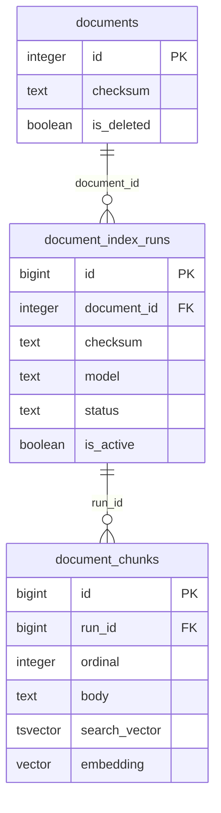

# AI/vector — ERD và hợp đồng kỹ thuật

## Phạm vi

Sáu chức năng nghiệm thu: tìm kiếm kết hợp; Q&A trích dẫn; tóm tắt; gợi ý tag; tài liệu liên quan; thống kê chủ đề quan tâm. Lập chỉ mục/chunk/embedding/keyword là nền tảng kỹ thuật cho các chức năng này; preview là consumer/hồi quy, không phải chức năng thứ bảy. Text generation không nằm trong embedding provider.

## ERD



## Data dictionary (migration `ea41b38547bc`)

| Bảng.cột | Type / null / default | Ý nghĩa và vòng đời |
|---|---|---|
| runs.id | bigserial PK | ID run, tạo tự động |
| runs.document_id | integer NOT NULL FK documents ON DELETE CASCADE | tài liệu nguồn |
| runs.checksum | text NOT NULL | checksum snapshot; phải khớp documents để publish |
| runs.model | text NOT NULL DEFAULT '' | model key provider; rỗng nếu chỉ lexical |
| runs.processor | integer NOT NULL DEFAULT 1 | phiên processor |
| runs.status | text NOT NULL DEFAULT pending | queue/publish lifecycle |
| runs.is_active | boolean NOT NULL DEFAULT false | run đang phục vụ retrieval |
| runs.attempts | integer NOT NULL DEFAULT 0 | số lần worker lỗi; reset khi publish/retry thủ công |
| runs.next_attempt | timestamptz NOT NULL DEFAULT now() | earliest claim time |
| runs.last_error | text nullable | chỉ tên lỗi kỹ thuật, không body |
| runs.coverage | jsonb NOT NULL DEFAULT '{}' | số trang/đơn vị đã đọc và state |
| runs.summary | jsonb nullable | cache summary/citations metadata |
| chunks.id | bigserial PK | ID chunk |
| chunks.run_id | bigint NOT NULL FK runs ON DELETE CASCADE | run sở hữu chunk |
| chunks.ordinal | integer NOT NULL | thứ tự ổn định trong run |
| chunks.body | text NOT NULL | evidence text; không log |
| chunks.heading | text NOT NULL | heading nguồn |
| chunks.source | text NOT NULL | nguồn `markdown`, `page`, `slide` hoặc `content` |
| chunks.location | jsonb NOT NULL | vị trí trang/section |
| chunks.search_vector | tsvector NOT NULL | FTS simple/unaccent |

Migration `f2c3d4e5a6b7` thêm `chunks.embedding vector` nullable và bật extension `vector`; dimension được validate ở application/provider, không khai báo cứng trong DB. Migration `b7c8d9e0f1a2` bật `unaccent` và trigger search vector trên documents (không phải `ea41`).

## Constraint, trigger, state

Partial unique indexes: tối đa một `is_active=true`/document và một queued `status IN ('pending','retry')`/document; lookup queue `(next_attempt,id)`; GIN FTS; unique `(run_id,ordinal)`. Trigger `queue_document_index` tạo run khi document insert/update nội dung, obsolete run cũ khi checksum/content thay đổi; bundle không queue. FK cascade đi từ document → run → chunks.

```text
pending -> retry (collect/provider lỗi, attempts < INDEX_MAX_RETRIES)
retry -> retry (backoff)
pending/retry -> ready (chunk tồn tại, publish)
pending/retry -> empty (không có chunk)
pending/retry -> failed (đạt giới hạn)
active ready -> obsolete (run mới publish hoặc document đổi checksum)
failed --manual retry--> pending (attempts=0, next_attempt=now, last_error=NULL)
```

Publish transaction deactivates prior active run then activates candidate only when checksum still matches. Model change queues a new run; re-index is required after model/dimension change.

Coverage describes read units from collector; `location` identifies page/section and citation URLs use chunk ID. Retrieval first checks permission in `_VISIBLE`; inaccessible/revoked documents never reach chunks, citation, summary or related. Hybrid combines lexical title/content/chunk FTS and semantic vector candidates; evidence search uses rank fusion (RRF-style score) and reports provenance methods.

## Endpoint contract

| Endpoint | Contract |
|---|---|
| `GET /search/full` | `q`, `page`, `page_size`, `mode=keyword|hybrid`, repeatable `match_fields=title|content|semantic`; returns items/total/fallback/unavailable fields and `match.methods` |
| `GET /documents/{id}/index-status` | status + coverage |
| `POST /documents/{id}/index-retry` | only owner or group write/full; failed → pending/reset; other status idempotent |
| `GET /documents/{id}/chunks/{chunk}` | cited chunk only if visible/active |
| `POST /documents/{id}/questions` | answer/insufficient/not_ready with citations |
| `GET /documents/{id}/summary` | summary items/text and coverage state |
| `GET /documents/{id}/tag-suggestions` | suggestions derived from evidence |
| `GET /documents/{id}/related` | related documents with access filtering |
| `GET /stats/me?days=7|30` | user activity stats; invalid days 422 |

## Giới hạn / ngoài phạm vi

Embedding provider availability, real DB benchmark and production account matrix remain Phase 6A deferred. Phase 7/8 features, text-generation provider selection, automatic model migration and broad data cleanup are ngoài phạm vi.
