# Bản Đồ Lược Đồ Cơ Sở Dữ Liệu (AI-Readable) — Foundation Project

> **Mục đích:** mô tả toàn bộ cơ sở dữ liệu PostgreSQL của backend bằng lời, theo cách một AI/LLM có thể đọc và suy luận trực tiếp khi viết query, sửa model hoặc debug.
>
> **Nguồn đối chiếu (theo thứ tự ưu tiên):**
> 1. `backend/app/models/*.py` — nguồn chuẩn bậc nhất (cột, kiểu, FK, quan hệ).
> 2. `alembic/versions/*.py` — lịch sử DDL, index, trigger.
> 3. `backend/db/sync_*.py`, `backend/app/main.py` — các thay đổi schema chạy bổ sung lúc khởi động.
> 4. `backend/app/routers/*.py`, `backend/app/services/*.py` — ngữ nghĩa nghiệp vụ thực tế của từng bảng/cột.
>
> **Thời điểm đọc code:** commit `8d5ec848` (2026-11-20).
> **Số bảng:** 26 bảng dữ liệu (chưa tính `alembic_version`).
> **CSDL:** PostgreSQL 15+, truy cập qua SQLAlchemy 2.0 async (`AsyncSession`), migration bằng Alembic.

---

## 0. Quy Ước Chung (đọc trước khi query)

1. **Khóa chính:** mọi bảng nghiệp vụ dùng `id INTEGER` tự tăng, trừ các bảng nối/composite PK:
   - `document_tags(document_id, tag_id)`
   - `folder_tags(folder_id, tag_id)`
   - `favorites(user_id, document_id)`
   - `workspace_members(workspace_id, user_id)`
   - `document_stats(document_id)`
2. **Timestamps:** `created_at TIMESTAMPTZ NOT NULL DEFAULT now()` đến từ `TimestampMixin`.
   Chỉ một số bảng có `updated_at`: `workspaces`, `document_ratings`, `document_stats`, và `user_todos` (chỉ tồn tại ở tầng DB, ORM không map).
   **`documents` KHÔNG có `updated_at` trong ORM** (xem mục 8 — cột legacy).
3. **Xóa mềm:** `documents.is_deleted`, `workspaces.is_deleted`. Hầu hết query nghiệp vụ phải thêm `is_deleted = false`.
4. **File vật lý không nằm trong DB.** DB chỉ lưu `file_path`, `thumbnail_path`, `markdown_path` (local path hoặc R2 key). Nhiều bản ghi `documents` có thể trỏ tới **cùng một file vật lý** (single-instance storage theo `checksum`).
5. **`ON DELETE`:** chỉ ghi nhận hành vi khi model/migration khai báo rõ. Nếu không ghi, FK mặc định là `NO ACTION/RESTRICT` ở DB.
6. **JSONB:** `documents.metadata` (ORM attr `metadata_`) và `download_logs.extra_data`. Cấu trúc key xem mục 6.7.
7. **Không có CHECK constraint cho hầu hết cột trạng thái** (role, status, permission…). Giá trị hợp lệ được kiểm soát ở tầng ứng dụng — xem mục 6.
8. **Bảng dẫn xuất:** `document_stats` là bảng tổng hợp 1:1, có thể **chưa tồn tại row** cho một document (luôn `LEFT JOIN`).

---

## 1. Mô Hình Tư Duy: Ba Không Gian Tài Liệu

Bảng trung tâm là `documents`. Cùng một bảng phục vụ 3 không gian, phân biệt bằng bộ cột:

| Không gian | Điều kiện nhận diện | Ý nghĩa |
| :--- | :--- | :--- |
| **Cá nhân (Personal)** | `owner_id = :user_id AND workspace_id IS NULL AND is_public = false` | Tài liệu riêng của người dùng. |
| **Nhóm (Group)** | `workspace_id IS NOT NULL AND is_public = false` | Tài liệu trong không gian nhóm; `owner_id` là người upload/chia sẻ vào nhóm. |
| **Cộng đồng (Community/Library)** | `is_public = true AND workspace_id IS NULL` | Bản public được tạo khi admin duyệt một `community_submission`; `subject_id` bắt buộc trên thực tế; `source_document_id` trỏ về tài liệu nguồn. |
| **Bản sao được chia sẻ** | `source_document_id IS NOT NULL` (và không phải public) | Bản copy trong kho cá nhân người nhận, metadata có `shared_by`. |
| **Bundle** | `is_bundle = true`, `file_path = '__bundle__'` | "Gói" tài liệu; các file con là `documents` có `bundle_parent_id` trỏ về bundle. |

**Hệ quả quan trọng:**
- `workspace_id IS NULL` **không đủ** để kết luận là tài liệu cá nhân — phải thêm `is_public = false`.
- Tài liệu community dùng chung `file_path` với tài liệu nguồn (không copy file).
- Bản sao chia sẻ / lưu về cá nhân cũng dùng chung `file_path` với bản gốc.
- Vì vậy **không được xóa file vật lý chỉ dựa trên một row**; phải kiểm tra `remove_file_if_unreferenced`.

---

## 2. Sơ Đồ Quan Hệ Tổng Thể (Mermaid ERD)

```mermaid
erDiagram
    faculties ||--o{ classes : "1-n"
    faculties ||--o{ subjects : "1-n"
    faculties ||--o{ users : "faculty_id"
    faculties ||--o{ workspaces : "ref_faculty_id"

    classes ||--o{ users : "class_id"
    classes ||--o{ workspaces : "ref_class_id"

    users ||--o{ documents : "owner_id"
    users ||--o{ folders : "owner_id"
    users ||--o{ categories : "owner_id"
    users ||--o{ tags : "owner_id"
    users ||--o{ notes : "user_id"
    users ||--o{ favorites : "user_id"
    users ||--o{ download_logs : "user_id"
    users ||--o{ document_versions : "uploaded_by"
    users ||--o{ document_ratings : "user_id"
    users ||--o{ community_submissions : "submitter_id / reviewed_by"
    users ||--o{ notifications : "user_id"
    users ||--o{ user_todos : "user_id"
    users ||--o{ workspaces : "owner_id"
    users ||--o{ workspace_members : "user_id"
    users ||--o{ workspace_invitations : "invited_user_id / invited_by"
    users ||--o{ workspace_tags : "owner_user_id"
    users ||--o{ trash_batches : "deleted_by"
    users ||--o{ document_shares : "from_user_id / to_user_id"

    workspaces ||--o{ workspace_members : "1-n"
    workspaces ||--o{ workspace_invitations : "1-n"
    workspaces ||--o{ workspace_tags : "1-n"
    workspaces ||--o{ folders : "1-n"
    workspaces ||--o{ documents : "1-n"
    workspaces ||--o{ trash_batches : "1-n"
    workspaces ||--o{ document_shares : "source_workspace_id"
    workspaces ||--o{ download_logs : "workspace_id"
    workspaces ||--o{ notifications : "workspace_id"
    workspaces ||--o{ user_todos : "workspace_id"

    categories ||--o{ categories : "parent_id"
    categories ||--o{ documents : "category_id"

    tags ||--o{ tags : "parent_id"
    tags ||--o{ document_tags : "1-n"
    tags ||--o{ folder_tags : "1-n"
    tags ||--o{ workspace_tags : "1-n"

    folders ||--o{ folder_tags : "1-n"

    documents ||--o{ document_tags : "1-n"
    documents ||--o{ document_versions : "1-n"
    documents ||--o{ notes : "1-n"
    documents ||--o{ favorites : "1-n"
    documents ||--o{ download_logs : "1-n"
    documents ||--o{ document_ratings : "1-n"
    documents ||--o{ community_submissions : "source_document_id"
    documents ||--o{ community_submissions : "published_document_id"
    documents ||--o{ document_shares : "source_document_id"
    documents ||--o{ document_shares : "document_id (bản copy)"
    documents ||--o{ processing_jobs : "1-n"
    documents ||--o{ notifications : "document_id"
    documents ||--o{ user_todos : "document_id"
    documents ||--o| document_stats : "0..1 document_id"
    documents ||--o{ documents : "source_document_id (fork/copy)"
    documents ||--o{ documents : "bundle_parent_id"
    documents ||--o{ trash_batches : "trash_batch_id"

    subjects ||--o{ documents : "subject_id"
    subjects ||--o{ community_submissions : "subject_id"
```



---

## 3. Từ Điển Bảng (Table-by-Table)

### 3.1. Cụm Học Thuật

#### `faculties` — Khoa/Viện
- **Vai trò:** danh mục khoa. Gốc của cây học thuật và là phạm vi phân quyền `faculty_admin`.
- **PK:** `id`.
- **Cột:**
  - `code VARCHAR(10) NOT NULL UNIQUE`
  - `name VARCHAR(150) NOT NULL`
  - `created_at TIMESTAMPTZ NOT NULL DEFAULT now()`
- **Quan hệ:** 1-n `classes`, `subjects`, `users`, `workspaces` (`ref_faculty_id`).
- **Ghi chú:** `code` là unique toàn cục. Không có `updated_at`.

#### `classes` — Lớp sinh hoạt
- **Vai trò:** lớp hành chính của sinh viên; cũng có thể gắn vào workspace (`ref_class_id`).
- **PK:** `id`.
- **Cột:**
  - `faculty_id INTEGER NOT NULL` → `faculties.id`
  - `code VARCHAR(20) NOT NULL UNIQUE`
  - `name VARCHAR(150) NOT NULL`
  - `created_at TIMESTAMPTZ NOT NULL DEFAULT now()`
- **Quan hệ:** n-1 `faculties`; 1-n `users`; 1-n `workspaces`.

#### `subjects` — Môn học
- **Vai trò:** môn học thuộc khoa; là trục phân loại chính của **kho cộng đồng** (`documents.subject_id`).
- **PK:** `id`.
- **Cột:**
  - `faculty_id INTEGER NOT NULL` → `faculties.id` **ON DELETE CASCADE**
  - `code VARCHAR(20) NOT NULL`
  - `name VARCHAR(255) NOT NULL`
  - `description TEXT NULL`
  - `created_at TIMESTAMPTZ NOT NULL DEFAULT now()`
- **Quan hệ:** n-1 `faculties`; 1-n `documents`; 1-n `community_submissions`.
- **Ghi chú:** **không có unique `(faculty_id, code)`** ở DB; trùng mã môn chỉ được chặn (nếu có) ở tầng ứng dụng.
- **Nguồn tạo bảng:** `Base.metadata.create_all` (không có migration Alembic riêng).

---

### 3.2. Cụm Người Dùng & Phân Quyền

#### `users` — Tài khoản
- **Vai trò:** người dùng hệ thống; vai trò quyết định quyền toàn cục và quyền theo khoa.
- **PK:** `id`.
- **Cột:**
  - `username VARCHAR(150) NOT NULL UNIQUE` (index unique `ix_users_username`)
  - `email VARCHAR(255) NOT NULL UNIQUE` (index unique `ix_users_email`)
  - `password_hash VARCHAR(255) NOT NULL` — bcrypt; **không bao giờ serialize ra API**.
  - `full_name VARCHAR(150) NULL`
  - `role VARCHAR(20) NOT NULL DEFAULT 'student'`
  - `student_code VARCHAR(20) NULL UNIQUE`
  - `class_id INTEGER NULL` → `classes.id`
  - `faculty_id INTEGER NULL` → `faculties.id`
  - `created_at TIMESTAMPTZ NOT NULL DEFAULT now()`
- **Quan hệ:** n-1 `classes`, `faculties`; 1-n `documents`, `folders`, `categories`, `tags`, `notes`, `favorites`, `download_logs`, `document_versions`, `document_ratings`, `community_submissions`, `notifications`, `user_todos`, `owned_workspaces`, `workspace_memberships`, `received_invitations`, `sent_invitations`, `workspace_tags_created`, `deleted_trash_batches`; 2 vai trò trong `document_shares`.
- **Giá trị `role`:** xem mục 6.1. Legacy `sysadmin`/`schooladmin` được chuẩn hóa trong code, nhưng DB có thể còn dữ liệu cũ.
- **Ghi chú:** không có `avatar_url` (tài liệu cũ đề cập là sai).

---

### 3.3. Cụm Không Gian Nhóm (Workspace)

#### `workspaces` — Nhóm làm việc
- **Vai trò:** không gian cộng tác. Trong code hiện tại, nhóm dùng `type = 'group'`; cột `type` vẫn cho phép giá trị khác qua endpoint generic.
- **PK:** `id`.
- **Cột:**
  - `type VARCHAR(20) NOT NULL DEFAULT 'group'`
  - `name VARCHAR(150) NOT NULL`
  - `description TEXT NULL`
  - `owner_id INTEGER NOT NULL` → `users.id` **ON DELETE RESTRICT**
  - `ref_class_id INTEGER NULL` → `classes.id`
  - `ref_faculty_id INTEGER NULL` → `faculties.id`
  - `default_member_permission VARCHAR(10) NOT NULL DEFAULT 'view'`
  - `is_deleted BOOLEAN NOT NULL DEFAULT false`
  - `deleted_at TIMESTAMPTZ NULL`
  - `is_dissolving BOOLEAN NOT NULL DEFAULT false`
  - `dissolve_at TIMESTAMPTZ NULL`
  - `created_at TIMESTAMPTZ NOT NULL DEFAULT now()`
  - `updated_at TIMESTAMPTZ NULL DEFAULT now()` (có `onupdate=now()`)
- **Quan hệ:** 1-n `workspace_members`, `workspace_invitations`, `workspace_tags`, `folders`, `documents`, `trash_batches`, `tags` (`tags.workspace_id`), `document_shares` (`source_workspace_id`), `download_logs`, `notifications`, `user_todos`.
- **Vòng đời giải tán:** `is_dissolving = true` + `dissolve_at`; scheduler `execute_group_dissolution()` chạy khi tới hạn, chuyển tài liệu nhóm:
  - Nếu có bản copy cá nhân của thành viên → đưa bản copy vào thùng rác cá nhân với `trash_source = 'group_dissolved'`, `trash_group_name = <tên nhóm>`.
  - Nếu không → đánh dấu `is_orphaned = true`, `orphaned_at = now()`, chuyển file vào `storage/orphaned/`.
  - Sau đó `workspace.is_deleted = true`, xóa member + invitation.
- **Xóa mềm:** `is_deleted` + `deleted_at`.

#### `workspace_members` — Thành viên nhóm
- **PK tổ hợp:** `(workspace_id, user_id)`.
- **Cột:**
  - `workspace_id INTEGER` → `workspaces.id` **ON DELETE CASCADE**
  - `user_id INTEGER` → `users.id` **ON DELETE CASCADE**
  - `permission_level VARCHAR(10) NOT NULL DEFAULT 'view'`
  - `joined_at TIMESTAMPTZ NOT NULL DEFAULT now()`
- **Index:** `ix_workspace_members_user_id(user_id)`.
- **Giá trị quyền:** `view` | `full`. Dữ liệu cũ có thể có `admin` (router `workspaces.py` tạo owner với `'admin'`).
- **Ghi chú:** migration đã **drop cột `id`**; PK là composite. `owner_id` của workspace cũng được thêm làm member `full`.

#### `workspace_invitations` — Lời mời vào nhóm
- **PK:** `id`.
- **Cột:**
  - `workspace_id INTEGER NOT NULL` → `workspaces.id` **ON DELETE CASCADE**
  - `invited_user_id INTEGER NOT NULL` → `users.id` **ON DELETE CASCADE**
  - `invited_by INTEGER NOT NULL` → `users.id` **ON DELETE CASCADE**
  - `status VARCHAR(20) NOT NULL DEFAULT 'pending'`
  - `message VARCHAR(500) NULL`
  - `created_at TIMESTAMPTZ NOT NULL DEFAULT now()`
  - `responded_at TIMESTAMPTZ NULL`
- **Index:** `ix_workspace_invitations_invited_user(invited_user_id, status)`.
- **Trạng thái:** `pending` → `accepted` | `rejected`.
- **Ghi chú:** bảng tham chiếu SQL cũ có thêm `updated_at`; ORM không map.

#### `workspace_tags` — Bảng tham chiếu tag trong nhóm
- **Vai trò:** map một `Tag` (thường là tag cá nhân được import) vào một workspace, đảm bảo mỗi tag chỉ xuất hiện một lần trong mỗi nhóm.
- **PK:** `id`.
- **Cột:**
  - `workspace_id INTEGER NOT NULL` → `workspaces.id` **ON DELETE CASCADE**
  - `tag_id INTEGER NOT NULL` → `tags.id` **ON DELETE CASCADE**
  - `owner_user_id INTEGER NOT NULL` → `users.id` **ON DELETE CASCADE** (người import/tạo)
  - `created_at TIMESTAMPTZ NOT NULL DEFAULT now()`
- **Ràng buộc:** `UNIQUE(workspace_id, tag_id)` tên `uq_workspace_tag`; index riêng trên `workspace_id`, `tag_id`, `owner_user_id`.
- **Ghi chú quan trọng:** tồn tại **hai cơ chế tag nhóm**:
  1. `workspace_tags` — bảng map (import tag cá nhân, hoặc tạo tag mới với `tags.owner_id = NULL`).
  2. `tags.workspace_id` — tag được tạo trực tiếp trong nhóm bởi router `groups.py` (owner_id = người tạo).
  Khi query tag của nhóm, cần xác định code đang dùng cơ chế nào; không giả định chỉ một nguồn.

---

### 3.4. Bảng Trung Tâm: `documents`

#### `documents` — Tài liệu
- **Vai trò:** lưu metadata của mọi tài liệu (cá nhân, nhóm, cộng đồng, bundle, bản sao chia sẻ). File nhị phân nằm ngoài DB.
- **PK:** `id`.
- **Cột (theo ORM):**

| Cột | Kiểu | Null | Ghi chú |
| :--- | :--- | :--- | :--- |
| `id` | INTEGER | NO | PK |
| `owner_id` | INTEGER | NO | FK → `users.id`. Với tài liệu nhóm: người upload/share vào nhóm. Với community: người đóng góp. |
| `workspace_id` | INTEGER | YES | FK → `workspaces.id`. NULL = cá nhân/community. |
| `category_id` | INTEGER | YES | FK → `categories.id` (phân loại cũ, vẫn được ghi khi upload). |
| `source_document_id` | INTEGER | YES | FK → `documents.id`. Trỏ về bản gốc khi đây là bản sao (share, save-to-personal, community publish). |
| `subject_id` | INTEGER | YES | FK → `subjects.id`. Bắt buộc trên thực tế với tài liệu community. |
| `is_public` | BOOLEAN | NO | DEFAULT false. `true` = tài liệu kho cộng đồng. |
| `title` | VARCHAR(255) | NO | |
| `description` | TEXT | YES | |
| `file_path` | VARCHAR(1024) | NO | Local path hoặc R2 key. Bundle dùng sentinel `__bundle__`. |
| `thumbnail_path` | TEXT | YES | Ảnh bìa. |
| `markdown_path` | VARCHAR(1024) | YES | File markdown sinh ra từ tài liệu. |
| `file_type` | VARCHAR(255) | YES | MIME type; bundle = `application/bundle`. |
| `file_size` | BIGINT | YES | Bytes; bundle = 0. |
| `checksum` | VARCHAR(255) | NO | SHA-256 hex (64 ký tự) của nội dung file; bundle = `"bundle"`. Dùng để dedup + single-instance storage. |
| `content` | TEXT | YES | Text trích xuất/OCR; là nguồn cho FTS và snippet tìm kiếm. |
| `metadata` | JSONB | YES | ORM attr `metadata_`. Cấu trúc xem mục 6.7. |
| `search_vector` | TSVECTOR | YES | Duy trì bởi trigger; GIN index. Không ghi trực tiếp từ app. |
| `is_important` | BOOLEAN | YES | DEFAULT false. |
| `is_deleted` | BOOLEAN | YES | DEFAULT false. Xóa mềm (thùng rác). |
| `deleted_at` | TIMESTAMP (no tz) | YES | Thời điểm vào thùng rác. |
| `is_orphaned` | BOOLEAN | NO | DEFAULT false. Tài liệu mồ côi sau khi nhóm giải tán. |
| `orphaned_at` | TIMESTAMPTZ | YES | |
| `trash_source` | VARCHAR(30) | YES | Nguồn vào thùng rác; giá trị code dùng: `group_dissolved`. |
| `trash_group_name` | VARCHAR(150) | YES | Snapshot tên nhóm khi nhóm giải tán. |
| `trash_batch_id` | INTEGER | YES | FK → `trash_batches.id`. |
| `is_bundle` | BOOLEAN | NO | DEFAULT false. |
| `bundle_parent_id` | INTEGER | YES | FK → `documents.id` **ON DELETE CASCADE**; có index. |
| `created_at` | TIMESTAMPTZ | NO | DEFAULT now(). |

- **Index:**
  - `ix_documents_checksum(checksum)`
  - `ix_documents_search_vector` GIN trên `search_vector`
  - index trên `bundle_parent_id`
  - partial index `ix_documents_source_owner(source_document_id, owner_id) WHERE is_deleted = false AND source_document_id IS NOT NULL` (migration `c3d4e5f6a7b8`).
- **Quan hệ ORM:** `owner`, `workspace`, `category`, `subject`; self-reference `source_document` ↔ `derived_documents`; self-reference `bundle_parent` ↔ `bundle_children` (cascade all, delete-orphan); `tags` (n-n qua `document_tags`); `versions`, `notes`, `trash_batch`, `ratings` (cascade), `activity_logs` (cascade), `stats` (1:1).
- **Quy tắc dedup khi upload** (`document_service.create_document_from_upload`):
  - Phạm vi kiểm tra trùng: **cùng workspace** nếu upload vào nhóm; **cùng owner + `workspace_id IS NULL`** nếu upload cá nhân.
  - Kiểm tra cả bản ghi **đang active** và **đang trong thùng rác**; trùng active → lỗi `DUPLICATE`; trùng trong trash → lỗi `IN_TRASH`.
  - Nếu checksum đã tồn tại ở bất kỳ đâu trên hệ thống → **tái sử dụng `file_path`/`thumbnail_path`/`markdown_path`/`content`**, không ghi file mới.
- **Xóa cứng (purge):** nếu là bundle, xóa children trước; sau đó gọi `remove_file_if_unreferenced` cho file/thumbnail/markdown trước khi xóa row.
- **Lưu ý:** `documents.updated_at` tồn tại trong DB thực tế (được dùng bởi raw SQL trong `search_service.search_documents`) nhưng **không có trong ORM model**. Đừng dùng `Document.updated_at` trong ORM; nếu cần hãy dùng raw SQL hoặc bổ sung cột vào model.

#### `document_tags` — Nối document ↔ tag
- **PK tổ hợp:** `(document_id, tag_id)`.
- **FK:** `document_id` → `documents.id` **CASCADE**; `tag_id` → `tags.id` **CASCADE**.
- **Vai trò:** gắn tag cho tài liệu; cũng là cơ chế suy ra "tài liệu thuộc folder" (xem `folders`).

#### `document_versions` — Lịch sử phiên bản
- **PK:** `id`.
- **Cột:**
  - `document_id INTEGER NOT NULL` → `documents.id`
  - `version_no INTEGER NOT NULL`
  - `file_path VARCHAR(1024) NOT NULL`
  - `checksum VARCHAR(64) NULL`
  - `uploaded_by INTEGER NULL` → `users.id`
  - `note VARCHAR(255) NULL`
  - `created_at TIMESTAMPTZ NOT NULL DEFAULT now()`
- **Ràng buộc:** không có unique `(document_id, version_no)`; helper `add_document_version` tự tính `max(version_no)+1`.
- **Trạng thái sử dụng:** bảng có tồn tại và có API đọc (`GET /document-versions/{document_id}`), nhưng **chưa có API ghi version mới** trong code hiện tại (helper chưa được gọi). Chủ yếu là dữ liệu seed/legacy.

#### `folders` — Thư mục (tag-based)
- **Vai trò:** thư mục hiển thị trong UI. **Không có `folder_id` trên `documents`.**
- **PK:** `id`.
- **Cột:**
  - `owner_id INTEGER NOT NULL` → `users.id`
  - `workspace_id INTEGER NULL` → `workspaces.id` **ON DELETE CASCADE**
  - `name VARCHAR(128) NOT NULL`
  - `color VARCHAR(7) NULL`
  - `created_at TIMESTAMPTZ NOT NULL DEFAULT now()`
- **Index:** `ix_folders_workspace_id(workspace_id)`.
- **Quan hệ:** n-n với `tags` qua `folder_tags`; 1-n `folder_tags`.
- **Quy tắc nghiệp vụ quan trọng:** "tài liệu nằm trong folder" được suy ra bằng **giao của tag**:
  ```sql
  SELECT DISTINCT dt.document_id
  FROM document_tags dt
  JOIN folder_tags ft ON ft.tag_id = dt.tag_id
  WHERE ft.folder_id = :folder_id;
  ```
  Folder rỗng tag ⇒ không chứa tài liệu nào.
- **Ghi chú:** không có `parent_id` (folder phẳng). Tài liệu tham chiếu SQL cũ có `updated_at`; ORM không map.

#### `folder_tags` — Nối folder ↔ tag
- **PK tổ hợp:** `(folder_id, tag_id)`.
- **FK:** `folder_id` → `folders.id` **CASCADE**; `tag_id` → `tags.id` **CASCADE**.

---

### 3.5. Cụm Phân Loại: Category & Tag

#### `categories` — Danh mục (legacy)
- **Vai trò:** phân loại cây (có `parent_id`), gắn trực tiếp lên `documents.category_id`. Vẫn được ghi khi upload nhưng không phải cơ chế thư mục chính (thư mục dùng tag).
- **PK:** `id`.
- **Cột:**
  - `owner_id INTEGER NULL` → `users.id`
  - `name VARCHAR(128) NOT NULL`
  - `parent_id INTEGER NULL` → `categories.id`
  - `created_at TIMESTAMPTZ NOT NULL DEFAULT now()`
- **Quan hệ:** self-reference parent/sub_categories; 1-n `documents`.

#### `tags` — Nhãn
- **Vai trò:** nhãn dùng cho tài liệu và folder; có thể là tag cá nhân, tag nhóm (qua `workspace_id`), hoặc tag workspace-owned (`owner_id = NULL`, qua `workspace_tags`).
- **PK:** `id`.
- **Cột:**
  - `owner_id INTEGER NULL` → `users.id`
  - `name VARCHAR(128) NOT NULL`
  - `color VARCHAR(7) NULL`
  - `parent_id INTEGER NULL` → `tags.id` (self-reference)
  - `workspace_id INTEGER NULL` → `workspaces.id`
- **Ràng buộc:** **không có unique index**. Tính duy nhất được kiểm tra ở ứng dụng (case-insensitive theo `owner_id`/`workspace_id`).
- **Quan hệ:** 1-n `document_tags`, `folder_tags`, `workspace_tags`; n-n `documents` (qua `document_tags`), `folders` (qua `folder_tags`).
- **Ghi chú:** `tags` **không có `created_at`/`is_deleted`**. Có đoạn code (`workspace_tag_service`) lọc `Tag.is_deleted` — đây là lỗi/dead code, không có cột tương ứng.

---

### 3.6. Cụm Chia Sẻ, Cộng Đồng & Tương Tác

#### `document_shares` — Chia sẻ tài liệu giữa người dùng
- **Vai trò:** yêu cầu/chấp nhận chia sẻ tài liệu cá nhân (hoặc từ nhóm) cho người dùng khác. Khi được chấp nhận/auto-accept, hệ thống tạo **bản copy** trong kho cá nhân người nhận.
- **PK:** `id`.
- **Cột:**
  - `source_document_id INTEGER NULL` → `documents.id` **ON DELETE SET NULL** — tài liệu gốc.
  - `document_id INTEGER NULL` → `documents.id` **ON DELETE SET NULL** — bản copy đã giao cho người nhận; **NULL khi còn pending**.
  - `from_user_id INTEGER NOT NULL` → `users.id`
  - `to_user_id INTEGER NOT NULL` → `users.id`
  - `source_workspace_id INTEGER NULL` → `workspaces.id` **ON DELETE CASCADE** — nếu chia sẻ từ nhóm.
  - `share_type VARCHAR(20) NOT NULL DEFAULT 'direct'` — `direct` | `bulk`.
  - `status VARCHAR(20) NOT NULL DEFAULT 'pending'` — xem mục 6.4.
  - `message VARCHAR(500) NULL`
  - `expires_at TIMESTAMPTZ NULL` — thường `now + 30 ngày`.
  - `responded_at TIMESTAMPTZ NULL`
  - `created_at TIMESTAMPTZ NOT NULL DEFAULT now()`
- **Index:**
  - `ix_document_shares_to_user_status(to_user_id, status)`
  - `ix_document_shares_from_user_status(from_user_id, status)`
  - **partial unique** `uq_document_share_pending(from_user_id, to_user_id, source_document_id) WHERE status = 'pending' AND source_document_id IS NOT NULL`
- **Quy tắc auto-accept:** nếu `role_rank(sender) > role_rank(recipient)` → tạo bản copy ngay, status `auto_accepted`, `document_id` được set. Ngược lại → `pending`, `document_id = NULL`.
- **Hết hạn:** khi list pending/sent, nếu `expires_at < now` và status `pending` → cập nhật thành `expired` (lazy expiration, không có job riêng).
- **Withdraw:** người gửi có thể chuyển `pending` → `withdrawn`.

#### `community_submissions` — Yêu cầu đóng góp kho cộng đồng
- **Vai trò:** quy trình duyệt tài liệu cá nhân thành tài liệu public.
- **PK:** `id`.
- **Cột:**
  - `source_document_id INTEGER NOT NULL` → `documents.id` **ON DELETE CASCADE** — tài liệu nguồn (thường là tài liệu cá nhân của submitter).
  - `published_document_id INTEGER NULL` → `documents.id` **ON DELETE SET NULL** — tài liệu public được tạo sau khi duyệt.
  - `submitter_id INTEGER NOT NULL` → `users.id` **ON DELETE CASCADE**
  - `subject_id INTEGER NOT NULL` → `subjects.id` **ON DELETE CASCADE**
  - `academic_year VARCHAR(50) NULL`
  - `doc_type VARCHAR(50) NULL`
  - `note TEXT NULL`
  - `status VARCHAR(20) NOT NULL DEFAULT 'pending'` — `pending` | `approved` | `rejected`.
  - `reviewed_by INTEGER NULL` → `users.id` **ON DELETE SET NULL**
  - `reviewed_at TIMESTAMPTZ NULL`
  - `reject_reason TEXT NULL`
  - `created_at TIMESTAMPTZ NOT NULL DEFAULT now()`
- **Quy tắc:** một tài liệu nguồn chỉ được có **một submission `pending`** tại một thời điểm (kiểm tra ở ứng dụng).
- **Khi duyệt:** tạo `Document` mới với `is_public = true`, `workspace_id = NULL`, `subject_id = submission.subject_id`, `source_document_id = source_doc.id`, **dùng chung `file_path`/`checksum`/`content`**; copy tags; set `submission.status = 'approved'`, `published_document_id = new_doc.id`, `reviewed_by`, `reviewed_at`.
- **Nguồn tạo bảng:** `Base.metadata.create_all` (không có migration Alembic riêng).

#### `document_ratings` — Đánh giá tài liệu công khai
- **PK:** `id`.
- **Cột:**
  - `document_id INTEGER NOT NULL` → `documents.id` **ON DELETE CASCADE**
  - `user_id INTEGER NOT NULL` → `users.id` **ON DELETE CASCADE**
  - `stars INTEGER NOT NULL` — CHECK `stars >= 1 AND stars <= 5`
  - `comment TEXT NULL`
  - `created_at TIMESTAMPTZ NOT NULL DEFAULT now()`
  - `updated_at TIMESTAMPTZ NULL` (onupdate now())
- **Ràng buộc:** `UNIQUE(document_id, user_id)` tên `uq_document_ratings_document_user` — mỗi user chỉ có 1 đánh giá/tài liệu; API dùng upsert (tạo hoặc cập nhật).
- **Phạm vi:** chỉ áp dụng cho `documents.is_public = true` và chưa xóa.
- **Nguồn tạo bảng:** `Base.metadata.create_all` (không có migration Alembic riêng).

#### `favorites` — Yêu thích
- **PK tổ hợp:** `(user_id, document_id)`.
- **Cột:** `user_id` → `users.id`; `document_id` → `documents.id`; `created_at TIMESTAMPTZ NOT NULL DEFAULT now()`.
- **Ghi chú:** không khai báo `ON DELETE`; dọn dẹp phụ thuộc ứng dụng.

---

### 3.7. Cụm Vòng Đời & Thùng Rác

#### `trash_batches` — Lô xóa
- **Vai trò:** nhóm các tài liệu bị xóa cùng lúc (đặc biệt ở nhóm) để restore/purge theo lô.
- **PK:** `id`.
- **Cột:**
  - `workspace_id INTEGER NULL` → `workspaces.id` **ON DELETE SET NULL**
  - `name VARCHAR(255) NOT NULL`
  - `deleted_by INTEGER NOT NULL` → `users.id` **ON DELETE RESTRICT**
  - `deleted_at TIMESTAMPTZ NOT NULL DEFAULT now()`
  - `purge_at TIMESTAMPTZ NOT NULL` — thời điểm được phép xóa vĩnh viễn.
- **Quan hệ:** 1-n `documents` (`documents.trash_batch_id`).
- **Chính sách:** `TRASH_RETENTION_DAYS = 30`, `EXPIRING_TRASH_DAYS = 3` (cảnh báo UI). Scheduler `cleanup_deleted_documents()` xóa cứng các document có `is_deleted = true AND deleted_at < now - 30 ngày`.

---

### 3.8. Cụm Hoạt Động & Thống Kê

#### `download_logs` — Nhật ký hoạt động
- **Vai trò:** log mọi tương tác tài liệu (view/download/save/share/…); nguồn để tính thống kê và trending.
- **PK:** `id`.
- **Cột:**
  - `document_id INTEGER NOT NULL` → `documents.id`
  - `user_id INTEGER NOT NULL` → `users.id`
  - `action VARCHAR(30) NOT NULL` — xem catalog 6.6.
  - `workspace_context VARCHAR(20) NOT NULL DEFAULT 'personal'` — `personal` | `group` | `library`.
  - `workspace_id INTEGER NULL` → `workspaces.id` **ON DELETE SET NULL**
  - `extra_data JSONB NOT NULL DEFAULT '{}'` — ví dụ `{source_document_id, to_user_id, from_user_id, copy_document_id, recipients_count}`.
  - `created_at TIMESTAMPTZ NOT NULL DEFAULT now()`
- **Index:**
  - `ix_download_logs_document_id_created_at(document_id, created_at DESC)`
  - `ix_download_logs_user_id_created_at(user_id, created_at DESC)`
  - `ix_download_logs_action_created_at(action, created_at DESC)`
- **Dedup:** action `DOCUMENT_VIEWED` được dedup 30 phút theo `(document_id, user_id, action)`; các action khác không dedup (caller truyền window = 0).
- **Ghi chú:** log được ghi bất đồng bộ qua `BackgroundTasks`/service với session riêng; lỗi log không làm hỏng request chính.

#### `document_stats` — Thống kê tổng hợp 1:1
- **Vai trò:** bảng dẫn xuất để sort/filter nhanh, tránh aggregate trên `download_logs`.
- **PK/FK:** `document_id INTEGER PRIMARY KEY` → `documents.id` **ON DELETE CASCADE**.
- **Cột:**
  - `view_count INTEGER NOT NULL DEFAULT 0`
  - `download_count INTEGER NOT NULL DEFAULT 0`
  - `save_count INTEGER NOT NULL DEFAULT 0`
  - `share_count INTEGER NOT NULL DEFAULT 0`
  - `unique_viewers INTEGER NOT NULL DEFAULT 0` — số user distinct có action `DOCUMENT_VIEWED`.
  - `trending_score FLOAT NOT NULL DEFAULT 0.0`
  - `last_activity_at TIMESTAMPTZ NULL`
  - `updated_at TIMESTAMPTZ NOT NULL DEFAULT now()` (onupdate now())
- **Không có `created_at`** (không dùng TimestampMixin).
- **Cập nhật:**
  - Near real-time: mỗi lần `log_activity` tăng count tương ứng và bump `trending_score` (view +1, download +3, save +5, share/contribute +2).
  - Hàng giờ: job `refresh_document_stats()` tính lại cho các document có activity trong 48h:
    ```
    weighted = views*1 + downloads*2 + saves*3 + shares*2
    recency  = 1.5 nếu last_activity < 24h, ngược lại 1.0
    score    = (weighted / ((age_hours + 2) ** 1.5)) * recency
    ```
    với `age_hours` tính từ `documents.created_at`.
- **Luôn LEFT JOIN** vì document mới có thể chưa có row.

---

### 3.9. Cụm Tiện Ích Người Dùng

#### `notes` — Ghi chú cá nhân trên tài liệu
- **PK:** `id`.
- **Cột:** `document_id INTEGER NOT NULL` → `documents.id`; `user_id INTEGER NOT NULL` → `users.id`; `note TEXT NOT NULL`; `created_at TIMESTAMPTZ NOT NULL DEFAULT now()`.
- **Ghi chú:** không có `updated_at`; API sửa note cập nhật nội dung nhưng DB không lưu thời điểm sửa.

#### `notifications` — Thông báo
- **PK:** `id`.
- **Cột:**
  - `user_id INTEGER NOT NULL` → `users.id` (người nhận)
  - `type VARCHAR(50) NOT NULL`
  - `workspace_id INTEGER NULL` → `workspaces.id`
  - `document_id INTEGER NULL` → `documents.id`
  - `message VARCHAR(255) NOT NULL`
  - `link VARCHAR(255) NULL` — deep link frontend (ví dụ `/library/admin/submissions?status=pending&highlight_submission=12`).
  - `is_read BOOLEAN NULL DEFAULT false`
  - `created_at TIMESTAMPTZ NOT NULL DEFAULT now()`
- **Index:** không có index riêng ngoài PK; API lọc theo `user_id` + `is_read`.
- **Ghi chú:** migration `a1b2c3d4e5f6` mở rộng `type` lên `VARCHAR(50)` và thêm `link`.

#### `user_todos` — Việc cần làm
- **PK:** `id`.
- **Cột:**
  - `user_id INTEGER NOT NULL` → `users.id` **ON DELETE CASCADE**
  - `title VARCHAR(255) NOT NULL`
  - `note TEXT NULL`
  - `task_type VARCHAR(30) NOT NULL DEFAULT 'custom'`
  - `document_id INTEGER NULL` → `documents.id` **ON DELETE SET NULL**
  - `workspace_id INTEGER NULL` → `workspaces.id` **ON DELETE SET NULL**
  - `start_at TIMESTAMPTZ NULL`
  - `due_at TIMESTAMPTZ NULL`
  - `priority VARCHAR(10) NOT NULL DEFAULT 'normal'`
  - `remind_before_minutes INTEGER NULL DEFAULT 30`
  - `reminded_at TIMESTAMPTZ NULL`
  - `completed_at TIMESTAMPTZ NULL`
  - `created_at TIMESTAMPTZ NOT NULL DEFAULT now()`
  - `updated_at TIMESTAMPTZ NOT NULL DEFAULT now()` — **chỉ có ở DB**, ORM không map.
- **Index:** `ix_user_todos_user_id(user_id)`.
- **Ghi chú:** `is_completed` trong API/frontend là **giá trị dẫn xuất** từ `completed_at IS NOT NULL`, không phải cột DB.
- **Nhắc việc:** scheduler `remind_due_todos()` tạo notification `todo_due` và set `reminded_at`.

#### `processing_jobs` — Job xử lý tài liệu (chưa dùng)
- **PK:** `id`.
- **Cột:** `document_id INTEGER NOT NULL` → `documents.id`; `job_type VARCHAR(50) NOT NULL`; `status VARCHAR(20) NULL DEFAULT 'pending'`; `result JSONB NULL`; `finished_at TIMESTAMP NULL`; `created_at TIMESTAMPTZ NOT NULL DEFAULT now()`.
- **Trạng thái sử dụng:** bảng có trong schema và seed, nhưng **không có code ứng dụng ghi/đọc** trong backend hiện tại. Xử lý OCR/thumbnail/markdown hiện chạy qua `BackgroundTasks`, không qua bảng này.

---

## 4. Ma Trận Khóa Ngoại (FK Matrix)

| Bảng con | Cột | Bảng cha | Cột cha | ON DELETE |
| :--- | :--- | :--- | :--- | :--- |
| `classes` | `faculty_id` | `faculties` | `id` | — |
| `subjects` | `faculty_id` | `faculties` | `id` | CASCADE |
| `users` | `class_id` | `classes` | `id` | — |
| `users` | `faculty_id` | `faculties` | `id` | — |
| `categories` | `owner_id` | `users` | `id` | — |
| `categories` | `parent_id` | `categories` | `id` | — |
| `tags` | `owner_id` | `users` | `id` | — |
| `tags` | `parent_id` | `tags` | `id` | — |
| `tags` | `workspace_id` | `workspaces` | `id` | — |
| `workspaces` | `owner_id` | `users` | `id` | RESTRICT |
| `workspaces` | `ref_class_id` | `classes` | `id` | — |
| `workspaces` | `ref_faculty_id` | `faculties` | `id` | — |
| `workspace_members` | `workspace_id` | `workspaces` | `id` | CASCADE |
| `workspace_members` | `user_id` | `users` | `id` | CASCADE |
| `workspace_invitations` | `workspace_id` | `workspaces` | `id` | CASCADE |
| `workspace_invitations` | `invited_user_id` | `users` | `id` | CASCADE |
| `workspace_invitations` | `invited_by` | `users` | `id` | CASCADE |
| `workspace_tags` | `workspace_id` | `workspaces` | `id` | CASCADE |
| `workspace_tags` | `tag_id` | `tags` | `id` | CASCADE |
| `workspace_tags` | `owner_user_id` | `users` | `id` | CASCADE |
| `documents` | `owner_id` | `users` | `id` | — |
| `documents` | `workspace_id` | `workspaces` | `id` | — |
| `documents` | `category_id` | `categories` | `id` | — |
| `documents` | `subject_id` | `subjects` | `id` | — |
| `documents` | `source_document_id` | `documents` | `id` | — |
| `documents` | `bundle_parent_id` | `documents` | `id` | CASCADE |
| `documents` | `trash_batch_id` | `trash_batches` | `id` | — |
| `document_tags` | `document_id` | `documents` | `id` | CASCADE |
| `document_tags` | `tag_id` | `tags` | `id` | CASCADE |
| `document_versions` | `document_id` | `documents` | `id` | — |
| `document_versions` | `uploaded_by` | `users` | `id` | — |
| `folders` | `owner_id` | `users` | `id` | — |
| `folders` | `workspace_id` | `workspaces` | `id` | CASCADE |
| `folder_tags` | `folder_id` | `folders` | `id` | CASCADE |
| `folder_tags` | `tag_id` | `tags` | `id` | CASCADE |
| `notes` | `document_id` | `documents` | `id` | — |
| `notes` | `user_id` | `users` | `id` | — |
| `trash_batches` | `workspace_id` | `workspaces` | `id` | SET NULL |
| `trash_batches` | `deleted_by` | `users` | `id` | RESTRICT |
| `document_shares` | `source_document_id` | `documents` | `id` | SET NULL |
| `document_shares` | `document_id` | `documents` | `id` | SET NULL |
| `document_shares` | `from_user_id` | `users` | `id` | — |
| `document_shares` | `to_user_id` | `users` | `id` | — |
| `document_shares` | `source_workspace_id` | `workspaces` | `id` | CASCADE |
| `community_submissions` | `source_document_id` | `documents` | `id` | CASCADE |
| `community_submissions` | `published_document_id` | `documents` | `id` | SET NULL |
| `community_submissions` | `submitter_id` | `users` | `id` | CASCADE |
| `community_submissions` | `subject_id` | `subjects` | `id` | CASCADE |
| `community_submissions` | `reviewed_by` | `users` | `id` | SET NULL |
| `document_ratings` | `document_id` | `documents` | `id` | CASCADE |
| `document_ratings` | `user_id` | `users` | `id` | CASCADE |
| `document_stats` | `document_id` | `documents` | `id` | CASCADE |
| `download_logs` | `document_id` | `documents` | `id` | — |
| `download_logs` | `user_id` | `users` | `id` | — |
| `download_logs` | `workspace_id` | `workspaces` | `id` | SET NULL |
| `favorites` | `user_id` | `users` | `id` | — |
| `favorites` | `document_id` | `documents` | `id` | — |
| `notifications` | `user_id` | `users` | `id` | — |
| `notifications` | `workspace_id` | `workspaces` | `id` | — |
| `notifications` | `document_id` | `documents` | `id` | — |
| `user_todos` | `user_id` | `users` | `id` | CASCADE |
| `user_todos` | `document_id` | `documents` | `id` | SET NULL |
| `user_todos` | `workspace_id` | `workspaces` | `id` | SET NULL |
| `processing_jobs` | `document_id` | `documents` | `id` | — |

---

## 5. Catalog Index & Ràng Buộc

| Bảng | Index / Constraint | Cột | Ghi chú |
| :--- | :--- | :--- | :--- |
| `users` | UNIQUE `ix_users_username` | `username` | |
| `users` | UNIQUE `ix_users_email` | `email` | |
| `users` | UNIQUE | `student_code` | |
| `faculties` | UNIQUE | `code` | |
| `classes` | UNIQUE | `code` | |
| `workspaces` | — | — | Không có index ngoài PK. |
| `workspace_members` | PK composite | `(workspace_id, user_id)` | `id` đã bị drop. |
| `workspace_members` | `ix_workspace_members_user_id` | `user_id` | |
| `workspace_invitations` | `ix_workspace_invitations_invited_user` | `(invited_user_id, status)` | |
| `workspace_tags` | UNIQUE `uq_workspace_tag` | `(workspace_id, tag_id)` | |
| `workspace_tags` | `ix_workspace_id`, `ix_tag_id`, `ix_owner_user_id` | | |
| `documents` | `ix_documents_checksum` | `checksum` | |
| `documents` | `ix_documents_search_vector` GIN | `search_vector` | |
| `documents` | index `bundle_parent_id` | | |
| `documents` | partial `ix_documents_source_owner` | `(source_document_id, owner_id)` | `WHERE is_deleted = false AND source_document_id IS NOT NULL` |
| `document_tags` | PK composite | `(document_id, tag_id)` | |
| `folder_tags` | PK composite | `(folder_id, tag_id)` | |
| `folders` | `ix_folders_workspace_id` | `workspace_id` | |
| `document_shares` | `ix_document_shares_to_user_status` | `(to_user_id, status)` | |
| `document_shares` | `ix_document_shares_from_user_status` | `(from_user_id, status)` | |
| `document_shares` | partial UNIQUE `uq_document_share_pending` | `(from_user_id, to_user_id, source_document_id)` | `WHERE status = 'pending' AND source_document_id IS NOT NULL` |
| `document_ratings` | UNIQUE `uq_document_ratings_document_user` | `(document_id, user_id)` | |
| `document_ratings` | CHECK `check_document_ratings_stars_range` | `stars BETWEEN 1 AND 5` | |
| `favorites` | PK composite | `(user_id, document_id)` | |
| `download_logs` | `ix_download_logs_document_id_created_at` | `(document_id, created_at DESC)` | |
| `download_logs` | `ix_download_logs_user_id_created_at` | `(user_id, created_at DESC)` | |
| `download_logs` | `ix_download_logs_action_created_at` | `(action, created_at DESC)` | |
| `document_stats` | PK | `document_id` | |
| `user_todos` | `ix_user_todos_user_id` | `user_id` | |

**FTS trigger:**
- Function `update_document_search_vector()` (PL/pgSQL):
  ```
  NEW.search_vector :=
    setweight(to_tsvector('simple', coalesce(NEW.title, '')), 'A') ||
    setweight(to_tsvector('simple', coalesce(NEW.content, '')), 'B');
  ```
- Trigger `trg_documents_search_vector` chạy `BEFORE INSERT OR UPDATE OF title, content`.
- Query dùng `websearch_to_tsquery('simple', :q)` và `ts_rank`; tìm kiếm nhanh còn dùng `unaccent(lower(...)) LIKE ...` (cần extension `unaccent`).

---

## 6. Catalog Giá Trị (Enum-Like, Không Có CHECK Ở DB)

### 6.1. `users.role`
- `student` (mặc định)
- `teacher`
- `faculty_admin`
- `school_admin`
- `system_admin`
- Legacy: `sysadmin` → chuẩn hóa thành `system_admin`; `schooladmin` → `school_admin`.

Thứ hạng (`role_rank`): student 1, teacher 2, faculty_admin 3, school_admin 4, system_admin 4.
Auto-accept share khi `rank(sender) > rank(recipient)`.

### 6.2. `workspaces`
- `type`: code hiện tại tạo `'group'`; endpoint generic có thể nhận giá trị khác.
- `default_member_permission` / `workspace_members.permission_level`: `view` | `full` (legacy: `admin`).
- `is_deleted`, `is_dissolving`: boolean.

### 6.3. `workspace_invitations.status`
`pending` | `accepted` | `rejected`.

### 6.4. `document_shares.status`
`pending` | `accepted` | `rejected` | `auto_accepted` | `expired` | `withdrawn`.
`share_type`: `direct` | `bulk`.

### 6.5. `community_submissions.status`
`pending` | `approved` | `rejected`.

### 6.6. `download_logs.action` (ActivityAction)
13 mã chuẩn:
1. `DOCUMENT_UPLOADED`
2. `DOCUMENT_VIEWED`
3. `DOCUMENT_DOWNLOADED`
4. `DOCUMENT_SAVED`
5. `DOCUMENT_SHARED`
6. `DOCUMENT_RECEIVED`
7. `DOCUMENT_CONTRIBUTED`
8. `DOCUMENT_RENAMED`
9. `DOCUMENT_DELETED`
10. `DOCUMENT_RESTORED`
11. `TAG_ADDED`
12. `TAG_REMOVED`
13. `BUNDLE_CREATED`

> Lưu ý: code thống kê còn chấp nhận giá trị legacy `"view"` / `"download"`; dữ liệu cũ có thể chứa chúng.

`workspace_context`: `personal` | `group` | `library`.

### 6.7. `documents.metadata` (JSONB) — các key được code sử dụng
| Key | Kiểu | Ý nghĩa |
| :--- | :--- | :--- |
| `doc_type` | string | Loại tài liệu cộng đồng (VD: bài giảng, đề thi…). Được filter trong library. |
| `academic_year` | string | Năm học của tài liệu cộng đồng. |
| `is_shared` | boolean | Đánh dấu **tài liệu gốc** đã từng được chia sẻ. |
| `last_shared_at` | ISO datetime | Lần chia sẻ gần nhất trên bản gốc. |
| `shared_by` | object | `{id, username, full_name, role}` của người chia sẻ — có trên **bản copy của người nhận**. |
| `shared_at` | ISO datetime | Thời điểm nhận chia sẻ. |
| `share_message` | string | Lời nhắn kèm chia sẻ. |

### 6.8. `user_todos`
- `task_type`: `read_document` | `upload_to_group` | `view_group_document` | `custom`.
- `priority`: `low` | `normal` | `high`.
- `is_completed` (API only) = `completed_at IS NOT NULL`.

### 6.9. `notifications.type` (các giá trị đang được code tạo)
- `group_invitation`
- `group_invitation_accepted`
- `group_dissolving`
- `document_shared`
- `document_share_request`
- `share_accepted`
- `community_submission_received`
- `community_submission_approved`
- `community_submission_rejected`
- `todo_due`
- (một số giá trị generic khác như `group`, `workspace`, `personal_folder`, `group_folder`)

### 6.10. `documents.trash_source`
- `group_dissolved` — bản copy cá nhân bị đẩy vào thùng rác khi nhóm giải tán.
- Có thể NULL với tài liệu tự xóa.

---

## 7. Quy Tắc Nghiệp Vụ Ảnh Hưởng Trực Tiếp Tới Dữ Liệu

### 7.1. Upload & Dedup (Single-Instance Storage)
1. Tính `checksum = SHA-256(file_bytes).hexdigest()`.
2. Tìm bản ghi trùng trong phạm vi:
   - Nhóm: `workspace_id = :ws`.
   - Cá nhân: `owner_id = :uid AND workspace_id IS NULL`.
   - Kiểm tra cả `is_deleted = false` và `is_deleted = true`.
3. Nếu trùng active → trả `409 DUPLICATE` kèm `document_id`.
4. Nếu trùng trong trash → trả `409 IN_TRASH` kèm `document_id`, `title`.
5. Nếu checksum đã tồn tại ở bất kỳ document nào → tái sử dụng `file_path`/`thumbnail_path`/`markdown_path`/`content`, không ghi file mới.
6. Ngược lại → lưu file mới, tạo `documents` row.

### 7.2. Fork / Chia sẻ / Lưu về cá nhân
- Tất cả đều tạo **row mới** trong `documents` với `source_document_id` trỏ về bản gốc, **dùng chung file vật lý**.
- Chia sẻ user→user: `document_shares.source_document_id` = gốc; `document_shares.document_id` = bản copy (chỉ có sau accept/auto-accept).
- Chia sẻ personal→group (`group_service.share_document_to_group`): tạo row mới với `workspace_id = group`, `owner_id = sharer`, `source_document_id = gốc`.
- Lưu group→personal (`group_service.save_to_personal`): tạo row mới `workspace_id = NULL`, `owner_id = user`, `source_document_id = bản nhóm`; copy tag (tạo tag cá nhân nếu chưa có).
- Đánh dấu bản gốc: `metadata.is_shared = true`, `metadata.last_shared_at`.
- Bản copy của người nhận: `metadata.shared_by`, `metadata.shared_at`, `metadata.share_message`.

### 7.3. Bundle (Gói tài liệu)
- Bundle cha: `is_bundle = true`, `file_path = '__bundle__'`, `file_type = 'application/bundle'`, `file_size = 0`, `checksum = 'bundle'`.
- File con: `bundle_parent_id = bundle.id`, `is_bundle = false`, có file vật lý riêng.
- Query danh sách phải loại con: `bundle_parent_id IS NULL` (trừ khi intentionally mở bundle).
- Xóa bundle: xóa children trước, sau đó xóa cha; file vật lý chỉ xóa nếu không còn row nào khác tham chiếu.

### 7.4. Thùng rác & Purge
- Xóa mềm: `is_deleted = true`, `deleted_at = now()`, có thể gán `trash_batch_id`.
- Khôi phục: `is_deleted = false`, `deleted_at = NULL`.
- Purge thủ công: chỉ chủ sở hữu (và admin với tài liệu public).
- Purge tự động: scheduler mỗi ngày, `deleted_at < now() - 30 ngày`.
- Tài liệu public trong kho cộng đồng: chỉ admin/system_admin được xóa vĩnh viễn.

### 7.5. Tài Liệu Mồ Côi (Orphaned)
- Xảy ra khi nhóm giải tán và tài liệu không có bản copy cá nhân nào.
- `is_orphaned = true`, `orphaned_at = now()`, file chuyển vào `storage/orphaned/<workspace_id>/`.
- Scheduler `cleanup_orphaned_documents()` xóa cứng sau **10 ngày**.

### 7.6. Giải Tán Nhóm
- Đánh dấu `workspaces.is_dissolving = true`, `dissolve_at`.
- Khi tới hạn: xử lý tài liệu như 7.5, xóa member/invitation, `workspaces.is_deleted = true`.

### 7.7. Đóng Góp Cộng Đồng
- Chỉ người có `documents.owner_id = current_user.id` được tạo submission. Code hiện **không chặn** tài liệu nhóm nếu user là owner của row đó.
- Một tài liệu chỉ có 1 submission `pending`.
- Duyệt → tạo document public mới (dùng chung file), copy tag, set `published_document_id`.
- Từ chối → `status = 'rejected'`, `reject_reason`, `reviewed_by`, `reviewed_at`.
- Thông báo cho `faculty_admin` cùng khoa + `system_admin`/`school_admin`.

### 7.8. FTS & Tìm Kiếm
- `search_vector` chỉ cập nhật khi `title` hoặc `content` thay đổi (trigger).
- Cấu hình `'simple'` (không stemming tiếng Việt) + `unaccent` cho fallback LIKE.
- Phạm vi tìm kiếm: tài liệu cá nhân của user HOẶC tài liệu trong các workspace mà user là owner/member (workspace chưa xóa).

---

## 8. Bẫy & Điểm Lệch Cần Biết Khi Query/Sửa Code

1. **`workspace_id IS NULL` chưa đủ là "cá nhân".**
   Phải thêm `is_public = false`. Tài liệu community cũng có `workspace_id = NULL`.

2. **`documents` không có `folder_id`.**
   Quan hệ folder ↔ document đi qua tag: `folder_tags` ∩ `document_tags`.

3. **`documents.updated_at` là cột legacy.**
   Có trong DB thực tế (raw SQL `search_service.search_documents` dùng để `ORDER BY updated_at`), nhưng **không có trong ORM model**. Không dùng `Document.updated_at`; nếu cần, dùng raw SQL hoặc bổ sung vào model.

4. **`folders.updated_at`, `workspace_invitations.updated_at`, `workspace_members.id`** có trong file SQL tham chiếu cũ nhưng không còn trong ORM/migration. `workspace_members` hiện dùng composite PK, không có `id`.

5. **`user_todos.updated_at` có ở DB nhưng ORM không map.** ORM chỉ có `created_at`; cột `updated_at` do DB default.

6. **`document_shares` có 2 FK tới `documents`:**
   - `source_document_id` = bản gốc.
   - `document_id` = bản copy đã giao cho người nhận (NULL khi pending).
   Đừng nhầm `document_id` là tài liệu gốc.

7. **`document_tags` / `folder_tags` / `favorites` / `workspace_members` không có cột `id`.** Query phải dùng composite key.

8. **`tags` không có unique constraint và không có `is_deleted`.**
   Đừng viết `WHERE is_deleted = false` cho `tags`; đừng giả định DB chặn trùng tên.

9. **Hai cơ chế tag nhóm:** `tags.workspace_id` và `workspace_tags`. Khi đếm/tag filter cho nhóm, xác định rõ đang dùng cơ chế nào.

10. **`processing_jobs` gần như chưa dùng.** Không có code ghi/đọc; đừng thiết kế query phụ thuộc vào nó.

11. **`document_versions` chỉ có API đọc.** Helper ghi version chưa được gọi; dữ liệu chủ yếu từ seed.

12. **`document_stats` có thể không tồn tại.** Luôn `LEFT JOIN document_stats` và `COALESCE`.

13. **Xóa file vật lý:** nhiều row có thể cùng `file_path`. Luôn dùng `remove_file_if_unreferenced(db, path, exclude_doc_ids=...)`.

14. **`documents.checksum` kiểu `VARCHAR(255)` trong ORM**, dù giá trị thực tế là SHA-256 64 ký tự. Đừng giả định độ dài 64 ở DB.

15. **Không có CHECK constraint cho `role`, `status`, `permission_level`, `action`.** Dữ liệu legacy có thể chứa giá trị ngoài catalog.

16. **`document_ratings`, `community_submissions`, `subjects` được tạo bởi `Base.metadata.create_all`**, không có migration Alembic riêng. Khi dựng DB mới chỉ chạy `alembic upgrade head` có thể thiếu các bảng này — cần chạy thêm sync script/seed hoặc `create_all`.

17. **`unaccent` extension** là dependency của tìm kiếm nhanh; DB mới cần `CREATE EXTENSION IF NOT EXISTS unaccent`.

18. **`search_vector` không được ghi từ app.** Trigger sẽ ghi đè khi insert/update `title`/`content`; đừng set thủ công.

---

## 9. Mẫu Query Thường Dùng

### 9.1. Tài liệu cá nhân đang hoạt động (không phải bundle con)
```sql
SELECT d.*
FROM documents d
WHERE d.owner_id = :user_id
  AND d.workspace_id IS NULL
  AND d.is_public = false
  AND d.is_deleted = false
  AND d.bundle_parent_id IS NULL
ORDER BY d.created_at DESC;
```

### 9.2. Tài liệu trong một nhóm
```sql
SELECT d.*
FROM documents d
WHERE d.workspace_id = :workspace_id
  AND d.is_deleted = false
  AND d.bundle_parent_id IS NULL
ORDER BY d.created_at DESC;
```

### 9.3. Tài liệu cộng đồng kèm môn/khoa + rating
```sql
SELECT d.id, d.title, d.subject_id, s.name AS subject_name,
       f.id AS faculty_id, f.name AS faculty_name,
       COALESCE(r.avg_rating, 0) AS avg_rating,
       COALESCE(r.rating_count, 0) AS rating_count
FROM documents d
JOIN subjects s ON s.id = d.subject_id
JOIN faculties f ON f.id = s.faculty_id
LEFT JOIN (
    SELECT document_id, AVG(stars) AS avg_rating, COUNT(*) AS rating_count
    FROM document_ratings
    GROUP BY document_id
) r ON r.document_id = d.id
WHERE d.is_public = true
  AND d.is_deleted = false
  AND (:faculty_id IS NULL OR s.faculty_id = :faculty_id)
  AND (:subject_id IS NULL OR d.subject_id = :subject_id)
ORDER BY d.created_at DESC;
```

### 9.4. Phạm vi tìm kiếm được phép của một user
```sql
SELECT d.*
FROM documents d
WHERE d.is_deleted = false
  AND d.search_vector @@ websearch_to_tsquery('simple', :q)
  AND (
        (d.workspace_id IS NULL AND d.owner_id = :user_id)
     OR (d.workspace_id IN (
            SELECT w.id
            FROM workspaces w
            LEFT JOIN workspace_members wm ON wm.workspace_id = w.id
            WHERE (w.owner_id = :user_id OR wm.user_id = :user_id)
              AND w.is_deleted = false
        ))
  )
ORDER BY ts_rank(d.search_vector, websearch_to_tsquery('simple', :q)) DESC;
```

### 9.5. Tài liệu trong folder (tag-based)
```sql
SELECT DISTINCT d.*
FROM documents d
JOIN document_tags dt ON dt.document_id = d.id
JOIN folder_tags ft ON ft.tag_id = dt.tag_id
WHERE ft.folder_id = :folder_id
  AND d.is_deleted = false
  AND d.bundle_parent_id IS NULL;
```

### 9.6. Lời mời chia sẻ đang chờ của tôi
```sql
SELECT ds.*, u.username AS from_username, d.title AS source_title
FROM document_shares ds
JOIN users u ON u.id = ds.from_user_id
LEFT JOIN documents d ON d.id = ds.source_document_id
WHERE ds.to_user_id = :user_id
  AND ds.status = 'pending'
  AND (ds.expires_at IS NULL OR ds.expires_at > now())
ORDER BY ds.created_at DESC;
```

### 9.7. Thùng rác cá nhân + thời hạn purge
```sql
SELECT d.*, (d.deleted_at + INTERVAL '30 days') AS purge_at
FROM documents d
WHERE d.owner_id = :user_id
  AND d.workspace_id IS NULL
  AND d.is_deleted = true
ORDER BY d.deleted_at DESC;
```

### 9.8. Thống kê + trending
```sql
SELECT d.id, d.title,
       COALESCE(st.view_count, 0) AS views,
       COALESCE(st.download_count, 0) AS downloads,
       COALESCE(st.save_count, 0) AS saves,
       COALESCE(st.share_count, 0) AS shares,
       COALESCE(st.trending_score, 0) AS trending_score
FROM documents d
LEFT JOIN document_stats st ON st.document_id = d.id
WHERE d.is_public = true
  AND d.is_deleted = false
ORDER BY COALESCE(st.trending_score, 0) DESC, d.created_at DESC;
```

### 9.9. Tài liệu mồ côi quá hạn dọn dẹp
```sql
SELECT *
FROM documents
WHERE is_orphaned = true
  AND orphaned_at < now() - INTERVAL '10 days';
```

### 9.10. Tài liệu trong thùng rác quá hạn purge
```sql
SELECT *
FROM documents
WHERE is_deleted = true
  AND deleted_at < now() - INTERVAL '30 days';
```

---

## 10. Tóm Tắt Một Dòng Cho Từng Bảng

| Bảng | Một dòng tóm tắt |
| :--- | :--- |
| `faculties` | Danh mục khoa; gốc phân quyền học thuật. |
| `classes` | Lớp sinh hoạt thuộc khoa. |
| `subjects` | Môn học thuộc khoa; trục phân loại kho cộng đồng. |
| `users` | Tài khoản, vai trò, khoa/lớp. |
| `workspaces` | Nhóm làm việc; có vòng đời giải tán. |
| `workspace_members` | Thành viên nhóm + mức quyền view/full. |
| `workspace_invitations` | Lời mời tham gia nhóm. |
| `workspace_tags` | Map tag vào nhóm (unique theo cặp). |
| `documents` | Trung tâm: metadata tài liệu cá nhân/nhóm/cộng đồng/bundle/bản sao. |
| `document_tags` | Nối tài liệu ↔ tag. |
| `document_versions` | Lịch sử phiên bản file (chủ yếu đọc/seed). |
| `folders` | Thư mục tag-based, không có folder_id trên document. |
| `folder_tags` | Nối thư mục ↔ tag. |
| `categories` | Cây danh mục legacy gắn trực tiếp document. |
| `tags` | Nhãn cá nhân/nhóm; không unique ở DB. |
| `document_shares` | Chia sẻ user→user; lưu cả bản gốc và bản copy. |
| `community_submissions` | Quy trình duyệt đóng góp lên kho cộng đồng. |
| `document_ratings` | Đánh giá 1–5 sao, unique theo user/tài liệu. |
| `favorites` | Yêu thích (composite PK). |
| `trash_batches` | Lô xóa, thời hạn purge 30 ngày. |
| `download_logs` | Log hoạt động 13 loại action. |
| `document_stats` | Thống kê 1:1 + trending score. |
| `notes` | Ghi chú cá nhân trên tài liệu. |
| `notifications` | Thông báo + deep link. |
| `user_todos` | Việc cần làm, nhắc hạn. |
| `processing_jobs` | Job xử lý nền (chưa sử dụng). |

---

## 11. Checklist Cho AI Trước Khi Viết Query

1. Xác định **không gian**: personal / group / community → áp đúng bộ điều kiện (`owner_id`, `workspace_id`, `is_public`).
2. Luôn thêm `is_deleted = false` cho `documents`/`workspaces` nếu không chủ đích xem thùng rác.
3. Loại bundle con nếu muốn danh sách phẳng: `bundle_parent_id IS NULL`.
4. Dùng `LEFT JOIN document_stats` + `COALESCE`.
5. Phân quyền nhóm: kiểm tra `workspaces.owner_id` **hoặc** `workspace_members.user_id`; loại `workspaces.is_deleted`.
6. Với `document_shares`, phân biệt `source_document_id` và `document_id`.
7. Với folder, join qua `folder_tags` + `document_tags`, không tìm `documents.folder_id`.
8. Với tag nhóm, xác định `tags.workspace_id` hay `workspace_tags`.
9. Không xóa file vật lý dựa trên một row; dùng `remove_file_if_unreferenced`.
10. Không dựa vào `processing_jobs`/`document_versions` cho luồng hiện tại.
