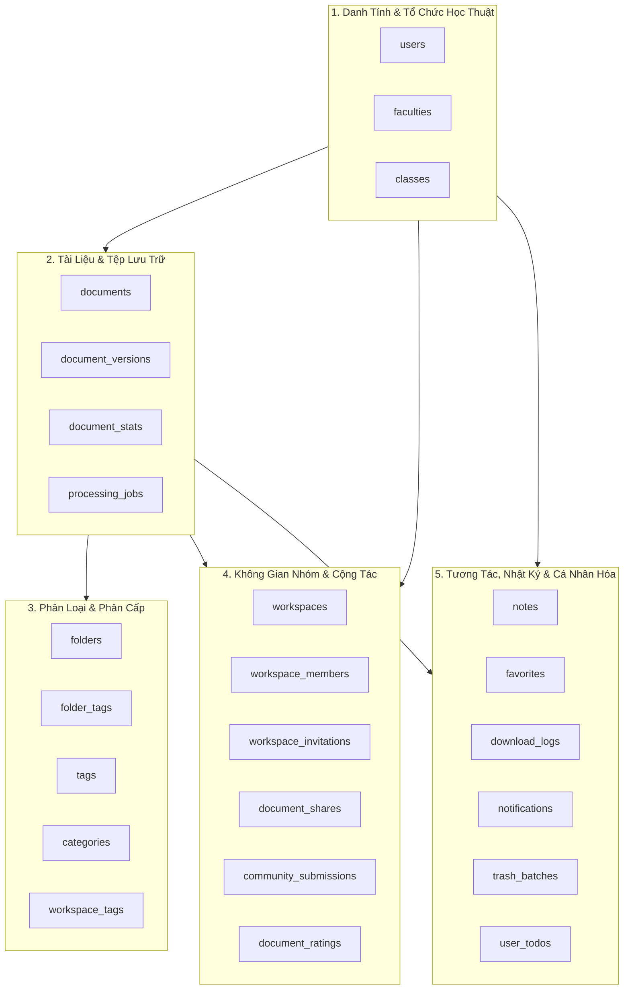

# Tổng Quan Hệ Quản Trị Cơ Sở Dữ Liệu (Database Overview)

Tài liệu này trình bày chi tiết về kiến trúc lưu trữ dữ liệu quan hệ, cách thức tổ chức các cụm bảng logic, cơ chế kết nối bất đồng bộ và các mẫu thiết kế dữ liệu đặc thù được áp dụng trong **Foundation Project**.

---

## 1. Công Nghệ & Hạ Tầng Kết Nối

- **Hệ quản trị CSDL**: PostgreSQL 15+ (Hỗ trợ cấu trúc dữ liệu JSONB, Full-Text Search kiểu `tsvector`, và các kiểu mở rộng nâng cao).
- **Driver kết nối**: `asyncpg` — driver bất đồng bộ hiệu năng cao cho Python.
- **ORM Framework**: SQLAlchemy 2.0 triển khai theo phong cách Declarative 2.0 hiện đại kết hợp với `ext.asyncio`.
- **Cấu hình Connection Pool**:
  - `pool_size=10`: Duy trì sẵn 10 kết nối thường trực.
  - `max_overflow=20`: Cho phép mở rộng thêm tối đa 20 kết nối tức thời khi có đột biến lưu lượng (Spike).
  - `pool_pre_ping=True`: Tự động kiểm tra tính sống còn của kết nối trước khi bàn giao cho phiên làm việc (`AsyncSession`), triệt tiêu hoàn toàn lỗi "connection already closed" sau thời gian rảnh.
  - `pool_recycle=3600`: Tự động tái tạo kết nối sau 1 giờ để tránh tình trạng rò rỉ tài nguyên mạng từ phía hạ tầng cloud.

---

## 2. Phân Vùng 5 Cụm Dữ Liệu Logic (Data Clusters)

Hệ thống bao gồm 26 bảng dữ liệu, được tổ chức mạch lạc thành 5 phân hệ logic:



### 2.1. Cụm 1: Danh Tính & Tổ Chức Học Thuật
- `users`: Quản lý tài khoản, mã sinh viên/giảng viên, mật khẩu mã hóa `bcrypt`, vai trò (`student`, `teacher`, `faculty_admin`, `school_admin`, `system_admin`).
- `faculties`: Danh sách các Khoa/Viện đào tạo trong trường.
- `classes`: Danh sách Lớp sinh hoạt / Lớp chuyên ngành trực thuộc Khoa.

### 2.2. Cụm 2: Tài Liệu & Tệp Lưu Trữ
- `documents`: Thực thể trung tâm lưu trữ metadata của tài liệu cá nhân, tài liệu nhóm và tài liệu thư viện. Hỗ trợ tài liệu độc lập và tài liệu dạng gom cụm (Bundle).
- `document_versions`: Lưu vết lịch sử thay đổi file của tài liệu qua các phiên bản.
- `document_stats`: Thống kê số lượt xem, lượt tải, số lần yêu thích theo thời gian thực.
- `processing_jobs`: Quản lý trạng thái các tiến trình nền xử lý tài liệu (trích xuất văn bản, tạo ảnh thumbnail).

### 2.3. Cụm 3: Phân Loại & Phân Cấp
- `folders`: Cây thư mục lồng nhau (Nested folders) hỗ trợ phân cấp tổ chức tài liệu cá nhân và nhóm.
- `tags`: Hệ thống thẻ gắn nhãn linh hoạt.
- `folder_tags`: Bảng liên kết N-N giữa thư mục và thẻ tag.
- `document_tags`: Bảng liên kết N-N giữa tài liệu và thẻ tag.
- `categories`: Danh mục phân loại môn học/chủ đề thư viện.
- `workspace_tags`: Thẻ nhãn riêng biệt được quản lý trong phạm vi từng không gian nhóm (Workspace).

### 2.4. Cụm 4: Không Gian Nhóm & Cộng Tác
- `workspaces`: Không gian làm việc nhóm phục vụ nghiên cứu, học tập theo nhóm.
- `workspace_members`: Danh sách thành viên kèm vai trò trong nhóm (`owner`, `admin`, `editor`, `viewer`).
- `workspace_invitations`: Quản lý lời mời tham gia nhóm.
- `document_shares`: Quản lý cơ chế chia sẻ tài liệu trực tiếp giữa các người dùng với quy tắc duyệt tự động dựa trên thứ bậc vai trò.
- `community_submissions`: Luồng gửi duyệt tài liệu lên Thư viện cộng đồng học thuật.
- `document_ratings`: Đánh giá xếp hạng sao (1-5) và bình luận phản hồi cho tài liệu thư viện.

### 2.5. Cụm 5: Tương Tác, Nhật Ký & Cá Nhân Hóa
- `notes`: Ghi chú riêng tư đính kèm vào từng tài liệu.
- `favorites`: Danh sách tài liệu được người dùng đánh dấu yêu thích.
- `download_logs`: Nhật ký kiểm toán mọi lượt tải file về máy.
- `notifications`: Hệ thống thông báo thời gian thực và lịch sử gửi tin.
- `trash_batches`: Quản lý phiên xóa theo lô vào thùng rác để hỗ trợ khôi phục trọn vẹn cả thư mục.
- `user_todos`: Bảng việc cần làm (Todos) cá nhân liên kết với tài liệu và thời hạn hoàn thành.

---

## 3. Các Mẫu Thiết Kế Dữ Liệu Đặc Thù

### 3.1. Tìm Kiếm Toàn Văn Bản Địa (PostgreSQL Full-Text Search)
Thay vì sử dụng giải pháp bên ngoài tốn kém tài nguyên (như Elasticsearch), hệ thống tận dụng sức mạnh bản địa của PostgreSQL:
- Bảng `documents` sở hữu cột `search_vector` kiểu `tsvector`.
- Chỉ mục GIN được đánh trên `search_vector`.
- Hàm trigger cơ sở dữ liệu tự động cập nhật `search_vector` mỗi khi `title` hoặc `description` được thêm mới hoặc chỉnh sửa:
  ```sql
  CREATE TRIGGER tsvectorupdate BEFORE INSERT OR UPDATE
  ON documents FOR EACH ROW EXECUTE FUNCTION
  tsvector_update_trigger(search_vector, 'pg_catalog.english', title, description);
  ```

### 3.2. Cơ Chế Xóa Mềm & Thùng Rác (Soft Delete)
- Các bảng `documents`, `folders`, `workspaces` sử dụng cột cờ `is_deleted` (Boolean) và `deleted_at` (Timestamp).
- Khi người dùng xóa, tài nguyên chỉ được đánh dấu `is_deleted = true` và gắn vào một `trash_batch_id`.
- Tác vụ định kỳ (Scheduler) sẽ rà soát và thực hiện dọn dẹp vĩnh viễn (Hard delete) sau 30 ngày.

### 3.3. Tối Ưu Lưu Trữ Bằng Phân Bản (Forking / Cloning)
- Khi một tài liệu được sao chép từ Thư viện cộng đồng hoặc Nhóm về kho cá nhân:
  - Bản ghi metadata mới được tạo trong `documents` với `source_document_id` trỏ về bản ghi gốc.
  - Thuộc tính `file_path` và mã băm `file_hash` (SHA-256) được tái sử dụng hoàn toàn, tránh nhân bản tệp tin nhị phân trên hạ tầng Cloudflare R2 / Disk.
