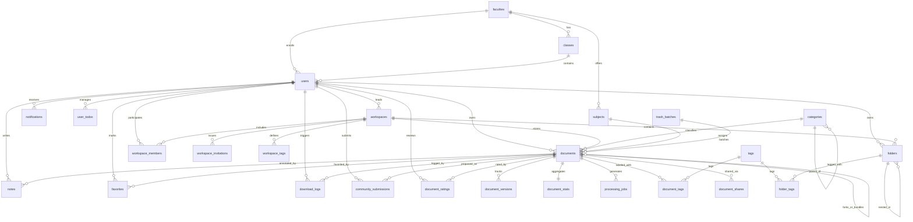
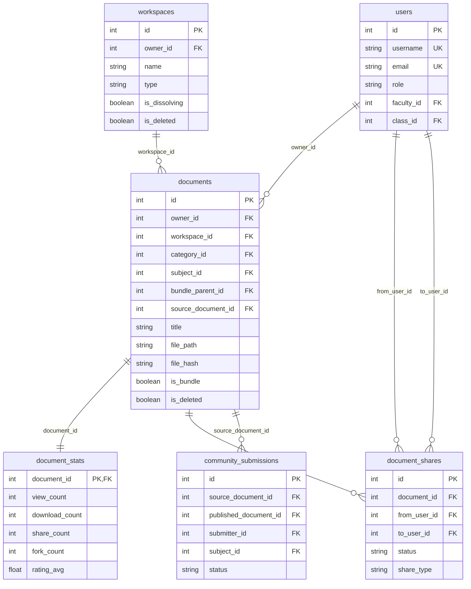

# Sơ Đồ Thực Thể Quan Hệ (Entity Relationship Diagram - ERD)

Tài liệu này cung cấp sơ đồ quan hệ trực quan giữa các bảng dữ liệu trong cơ sở dữ liệu PostgreSQL của **Foundation Project**, được định dạng chuẩn bằng Mermaid `erDiagram`.

---

## 1. Sơ Đồ ERD Tổng Thể

---

## 2. Chi Tiết Thực Thể Cốt Lõi & Ràng Buộc Khóa Ngoại

---

## 3. Quy Tắc Toàn Vẹn Tham Chiếu (Referential Integrity Rules)

| Mối quan hệ Khóa ngoại | Hành vi khi Xóa (`ON DELETE`) | Giải thích nghiệp vụ |
| :--- | :--- | :--- |
| `documents.owner_id -> users.id` | `CASCADE` | Khi tài khoản người dùng bị xóa hoàn toàn, các tài liệu cá nhân thuộc sở hữu của người dùng đó cũng được dọn dẹp. |
| `documents.workspace_id -> workspaces.id` | `SET NULL` hoặc `CASCADE` | Khi một nhóm giải tán, tài liệu có thể chuyển về trạng thái mồ côi (orphaned) hoặc dọn theo chính sách nhóm. |
| `documents.bundle_parent_id -> documents.id` | `CASCADE` | Khi bundle cha bị xóa, các liên kết tài liệu con trong bundle tự động được giải phóng. |
| `document_stats.document_id -> documents.id` | `CASCADE` | Xóa tài liệu thì bản ghi thống kê tương ứng tự động biến mất. |
| `document_tags.document_id -> documents.id` | `CASCADE` | Tự động dọn sạch các liên kết tag của tài liệu khi tài liệu bị xóa vĩnh viễn. |
| `notes.document_id -> documents.id` | `CASCADE` | Ghi chú cá nhân tự động xóa khi tài liệu bị xóa vĩnh viễn. |
| `user_todos.document_id -> documents.id` | `SET NULL` | Khi tài liệu bị xóa, việc cần làm (Todo) vẫn được giữ lại với trường liên kết tài liệu đặt về `NULL`. |
