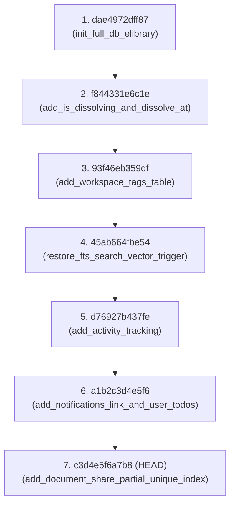

# Quản Lý Di Chuyển Lược Đồ (Database Migrations)

Tài liệu này ghi chép chuỗi lịch sử tiến hóa của cơ sở dữ liệu qua các bản migration của **Alembic**, đồng thời cung cấp cẩm nang vận hành di chuyển schema an toàn cho đội ngũ phát triển và kỹ sư vận hành (DevOps/SRE).

---

## 1. Chuỗi Lịch Sử Di Chuyển Lược Đồ (Migration Chain)

Toàn bộ các thay đổi cấu trúc bảng được kiểm soát phiên bản trong thư mục `alembic/versions/` thành một chuỗi liên tục (Linear Chain):



### Bảng Kê Chi Tiết Các Phiên Bản Migration

| Thứ tự | Revision ID | Bản sửa đổi trước (Down Revision) | Mục đích & Thay đổi chính |
| :---: | :--- | :--- | :--- |
| **1** | `dae4972dff87` | `None` | Khởi tạo toàn bộ cấu trúc CSDL ban đầu (Users, Documents, Workspaces, Folders, Tags, Categories, Submissions, Ratings). |
| **2** | `f844331e6c1e` | `dae4972dff87` | Bổ sung cơ chế giải tán nhóm có trì hoãn: thêm cột `is_dissolving` (Boolean) và `dissolve_at` (Timestamp) vào bảng `workspaces`. |
| **3** | `93f46eb359df` | `f844331e6c1e` | Tạo mới bảng `workspace_tags` phục vụ quản lý thẻ nhãn cục bộ trong từng không gian nhóm. |
| **4** | `45ab664fbe54` | `93f46eb359df` | Khôi phục trigger tự động cập nhật `search_vector` trên PostgreSQL phục vụ tìm kiếm toàn văn FTS cho bảng `documents`. |
| **5** | `d76927b437fe` | `45ab664fbe54` | Bổ sung phân hệ theo dõi hoạt động và kiểm toán: cập nhật bảng `download_logs` và thống kê tương tác. |
| **6** | `a1b2c3d4e5f6` | `d76927b437fe` | Mở rộng hệ thống thông báo với cột `link` (VARCHAR) và tạo mới bảng `user_todos` quản lý công việc cá nhân. |
| **7** | `c3d4e5f6a7b8` *(HEAD)* | `a1b2c3d4e5f6` | Thiết lập Partial Unique Index `uq_document_shares_pending` trên `document_shares` ngăn chặn trùng lặp yêu cầu chia sẻ đang chờ duyệt. |

---

## 2. Cẩm Nang Lệnh Vận Hành Alembic

Mọi lệnh migration cần được chạy từ thư mục gốc của repository với môi trường ảo Python đã được kích hoạt:

### 2.1. Kiểm tra trạng thái hiện tại
```bash
# Xem revision hiện tại của database đang kết nối
alembic current

# Xem toàn bộ lịch sử các bản migration theo thứ tự thời gian
alembic history --verbose
```

### 2.2. Nâng cấp Schema lên phiên bản mới nhất
```bash
# Cập nhật database lên bản mới nhất (HEAD)
alembic upgrade head

# Nâng cấp từng bước một (Single step)
alembic upgrade +1
```

### 2.3. Hạ cấp Schema khi cần Rollback
```bash
# Rollback lại 1 revision gần nhất
alembic downgrade -1

# Rollback về một revision chỉ định
alembic downgrade a1b2c3d4e5f6
```

### 2.4. Tạo bản Migration mới
Khi có sự thay đổi trong các model tại `backend/app/models/`:
```bash
# Tự động so sánh Base.metadata với DB hiện tại để sinh mã migration
alembic revision --autogenerate -m "ten_mo_ta_ngan_gon_ve_thay_doi"
```

> [!CAUTION]
> Sau khi lệnh `--autogenerate` hoàn tất, bạn **bắt buộc** phải mở file migration vừa sinh trong `alembic/versions/` để kiểm tra lại:
> 1. Đảm bảo không xóa nhầm bảng hoặc cột dữ liệu production.
> 2. Đảm bảo các chỉ mục (Indexes) và ràng buộc (Constraints) được sinh đúng theo yêu cầu.

---

## 3. Quy Trình Vận Hành An Toàn Khi Triển Khai (Zero-Downtime Practices)

1. **Sao lưu trước khi di chuyển (Backup first)**:
   ```bash
   pg_dump -h $DB_HOST -U $DB_USER -d $DB_NAME -F c -b -v -f pre_migration_backup.dump
   ```
2. **Quy tắc thêm cột**: Luôn thêm cột mới với thuộc tính `nullable=True` hoặc có giá trị `server_default` hợp lệ. Tuyệt đối không thêm cột `nullable=False` mà không có default value lên bảng đã có hàng triệu bản ghi.
3. **Quy tắc xóa cột/bảng**: Áp dụng chiến lược 2 giai đoạn:
   - Giai đoạn 1: Bỏ tham chiếu trong mã nguồn FastAPI và triển khai mã mới.
   - Giai đoạn 2: Tạo migration xóa cột/bảng sau khi mã mới chạy ổn định tối thiểu 1 tuần.
