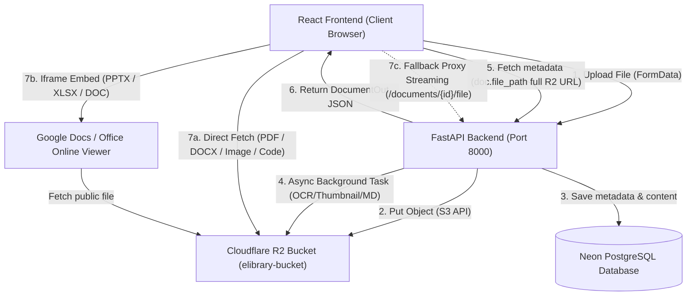
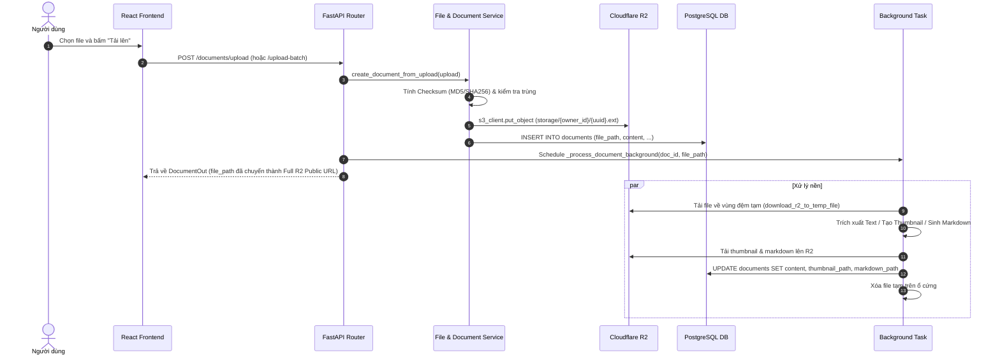
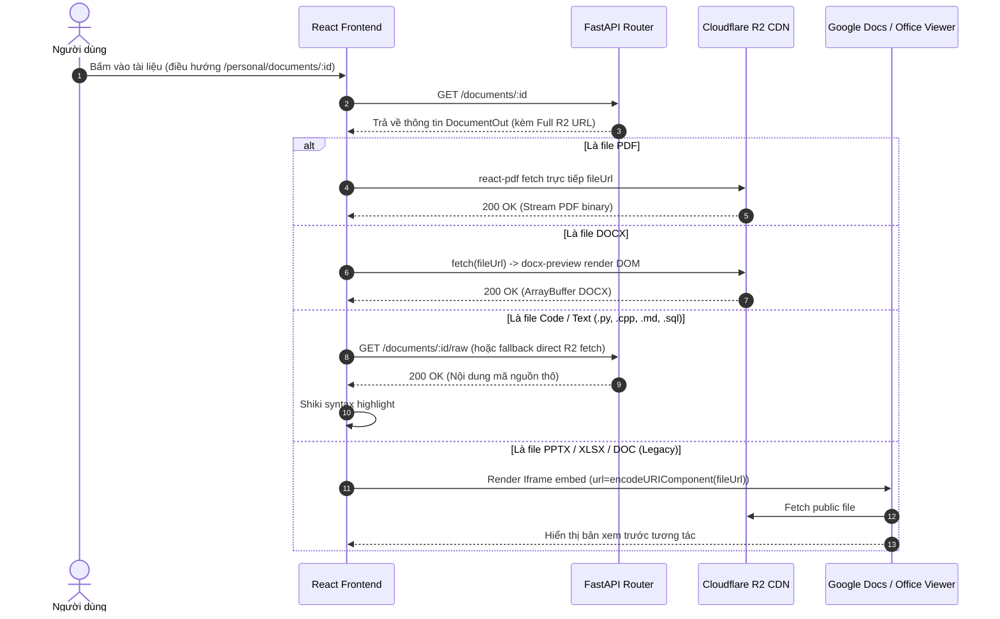

# Hướng Dẫn Kiến Trúc & Triển Khai Hệ Thống Lưu Trữ (Storage Deployment Architecture)

Tài liệu này cung cấp hướng dẫn tổng thể về kiến trúc, cấu hình triển khai và cách thức vận hành hệ thống lưu trữ tài liệu số tích hợp giữa **Cloudflare R2 Object Storage (S3-compatible)**, **FastAPI Backend** và **React (Vite) Frontend**.

---

## 1. Tổng Quan Kiến Trúc Lưu Trữ (Architecture Overview)

Hệ thống quản lý tài liệu số sử dụng mô hình **Hybrid Cloud Storage Architecture**, kết hợp giữa:
1. **Cloudflare R2 Object Storage**: Lưu trữ tập trung toàn bộ file tài liệu gốc (PDF, Word, Excel, PowerPoint, Text/Code), hình ảnh bìa (Thumbnails), và nội dung trích xuất Markdown. Tận dụng ưu thế **0đ phí truyền dữ liệu ra ngoài (Zero Egress Fees)** và tốc độ CDN toàn cầu của Cloudflare.
2. **FastAPI Backend (Stateless Application)**: Đảm nhận xác thực, phân quyền truy cập, điều phối upload, trích xuất text/OCR và tạo markdown/thumbnail chạy nền thông qua cơ chế đệm bộ nhớ tạm (Temporary Buffer).
3. **React Client (Direct Edge Fetching)**: Trực tiếp tải và render nội dung tài liệu từ Cloudflare R2 Public CDN thông qua các Viewer chuyên dụng (`PdfViewer`, `DocxViewer`, `OfficeViewer`, `CodeViewer`, `MarkdownViewer`), giảm tải băng thông và CPU cho Backend đến hơn 90%.

---

## 2. Luồng Xử Lý Dữ Liệu (Data Flows)

### 2.1. Luồng Tải Lên (Upload Pipeline)

### 2.2. Luồng Xem Chi Tiết Tài Liệu (Document Preview Pipeline)

---

## 3. Cấu Trúc Tài Liệu Chi Tiết

Hệ thống tài liệu triển khai được phân tách theo từng chuyên đề kỹ thuật:

| Tài liệu | Nội dung trọng tâm |
| :--- | :--- |
| [**STORAGE_R2.md**](file:///Users/caotiendattx/Developer/Do_An_Co_So/Foundation-Project/docs/deployment/STORAGE_R2.md) | Hướng dẫn cấu hình Cloudflare R2 từ A-Z: Bucket, CORS, Public URL, R2 API Tokens, kiến trúc On-Demand Temp Buffer. |
| [**TROUBLESHOOTING.md**](file:///Users/caotiendattx/Developer/Do_An_Co_So/Foundation-Project/docs/deployment/TROUBLESHOOTING.md) | Phân tích chuyên sâu các sự cố 404, xung đột chuỗi ngầm `.r` trong `.r2.dev`, lỗi ghi đè rỗng database, và các phương án xử lý triệt để. |
| [**ENV_VARIABLES.md**](file:///Users/caotiendattx/Developer/Do_An_Co_So/Foundation-Project/docs/deployment/ENV_VARIABLES.md) | Bảng tra cứu toàn diện các biến môi trường Backend và Frontend cho môi trường Local, Staging và Production. |
| [**BUG_FIX_REPORT.md**](file:///Users/caotiendattx/Developer/Do_An_Co_So/Foundation-Project/docs/deployment/BUG_FIX_REPORT.md) | Báo cáo kỹ thuật chi tiết gửi Engineering Manager/Lead: Đánh giá nguyên nhân, giải pháp, tác động kỹ thuật và giá trị kinh doanh. |

---

## 4. Các Nguyên Tắc Thiết Kế Trọng Yếu (Design Principles)

1. **Stateless Backend Application**:
   Backend không lưu trữ bất kỳ file tài liệu vĩnh viễn nào trên ổ đĩa local. Toàn bộ file đều được upload trực tiếp lên Cloudflare R2 ngay khi nhận request. Điều này cho phép Backend dễ dàng scale horizontal (nhiều instance Docker / Pod Kubernetes) mà không sợ bị lệch storage.

2. **Zero-Overhead Edge Delivery**:
   Client trình duyệt tương tác trực tiếp với Cloudflare R2 Public CDN. Backend chỉ đóng vai trò phân quyền và điều phối, không phải chịu tải IO streaming file lớn (đặc biệt là video, file tài liệu hàng chục MB).

3. **Multi-layer Fallback Resilience**:
   Hệ thống thiết kế cơ chế phòng vệ 2 lớp (Double Protection):
   - Nếu Client fetch trực tiếp từ R2 gặp lỗi mạng/CORS $\rightarrow$ Fallback qua endpoint Streaming Proxy của Backend (`/documents/{id}/file`).
   - Nếu Backend endpoint `/documents/{id}/raw` gặp lỗi $\rightarrow$ Client tự động fallback fetch trực tiếp từ R2 Public URL.
