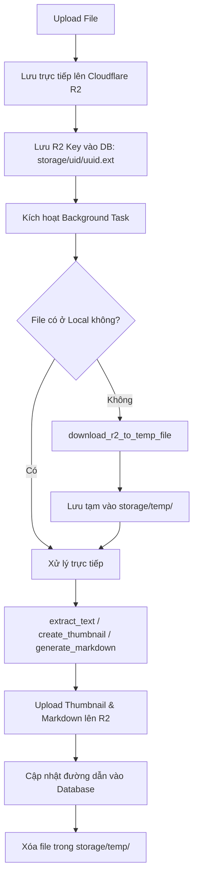

# Hướng Dẫn Triển Khai & Cấu Hình Cloudflare R2 Storage (S3-Compatible)

Tài liệu này cung cấp hướng dẫn kỹ thuật chi tiết về việc triển khai, cấu hình và tích hợp **Cloudflare R2 Object Storage** vào hệ thống số hóa tài liệu thư viện.

---

## 1. Tại Sao Lựa Chọn Cloudflare R2?

Trong các kiến trúc ứng dụng web hiện đại, việc lưu trữ file trên ổ đĩa cục bộ của máy chủ (Local Disk Storage) bộc lộ nhiều hạn chế nghiêm trọng:
- **Khó mở rộng (Scalability)**: Không thể chạy ứng dụng trên nhiều container/server (Docker, Kubernetes) do hệ thống file bị phân mảnh.
- **Rủi ro mất mát dữ liệu (Data Loss)**: Khi container bị khởi động lại hoặc redeploy, dữ liệu trên ổ cứng ephemeral sẽ biến mất.
- **Tải I/O và nghẽn băng thông**: Máy chủ web vừa phải xử lý business logic, vừa phải stream dữ liệu tệp tin dung lượng lớn (video, slide hàng chục MB).

Khi chuyển sang Object Storage đám mây, các dịch vụ truyền thống như AWS S3 thường tính phí **Data Egress** (băng thông tải ra ngoài internet) rất cao ($0.09/GB). **Cloudflare R2** giải quyết triệt để bài toán này với:
1. **0đ Phí Egress (Zero Egress Fees)**: Người dùng xem và tải hàng ngàn tài liệu mỗi ngày mà không phát sinh chi phí băng thông mạng.
2. **Chuẩn giao thức S3 (S3-Compatible API)**: Tương thích hoàn toàn với thư viện `boto3` của Python mà không cần viết lại toàn bộ mã nguồn.
3. **Mạng lưới CDN toàn cầu (Global Edge Caching)**: Phân phối tài liệu từ vị trí gần người dùng nhất với độ trễ tối thiểu.

---

## 2. Hướng Dẫn Cấu Hình Cloudflare R2 Từng Bước (Step-by-Step Setup)

### Bước 1: Tạo Bucket trên Cloudflare Dashboard
1. Đăng nhập vào trang quản trị Cloudflare Dashboard $\rightarrow$ Chọn mục **R2** ở thanh menu bên trái.
2. Nhấn nút **Create bucket**.
3. Đặt tên Bucket (Ví dụ: `elibrary-bucket`).
4. Chọn vùng lưu trữ (Location): Chọn **Automatic** để Cloudflare tự động tối ưu vị trí lưu trữ gần người dùng.
5. Nhấn **Create Bucket**.

### Bước 2: Kích Hoạt Public Access (R2.dev Subdomain hoặc Custom Domain)
Để người dùng và trình duyệt Frontend có thể tải trực tiếp file từ CDN của Cloudflare mà không cần ký presigned URL phức tạp:
1. Trong màn hình chi tiết của Bucket `elibrary-bucket`, chuyển sang tab **Settings**.
2. Cuộn xuống phần **Public Access**.
3. Tại mục **R2.dev subdomain**, nhấn **Allow Access**.
4. Cloudflare sẽ cấp một tên miền công khai dạng:
   `https://pub-54fbde7f3e0e4376aeebd41d1c0f3d1a.r2.dev`
5. *(Tùy chọn cho Production)*: Bạn có thể nhấn **Connect Domain** để gán một tên miền riêng (ví dụ: `cdn.thuvienso.edu.vn`).

### Bước 3: Tạo R2 API Tokens (Access Key & Secret Key)
Backend FastAPI cần thông tin định danh để gọi các hàm S3 API (`put_object`, `get_object`, `head_object`):
1. Tại trang chủ R2, nhấp vào **Manage R2 API Tokens** ở cột bên phải.
2. Nhấn **Create API token**.
3. Đặt tên token: `fastapi-backend-token`.
4. Cấp quyền (**Permissions**): Chọn **Object Read & Write**.
5. Phạm vi (**Specify bucket**): Chọn bucket `elibrary-bucket`.
6. Nhấn **Create API Token**.
7. Lưu lại cẩn thận 3 thông số sau (chỉ hiển thị một lần duy nhất):
   - **Access Key ID**: Ví dụ `1d3e319abd2b39db6d391d704733b397`
   - **Secret Access Key**: Ví dụ `df43912a30372dbe4eaf452143d1475f40f4d84d9299027bc278faec033b0662`
   - **Endpoint**: URL dạng `https://<account_id>.r2.cloudflarestorage.com`

---

## 3. Cấu Hình CORS Cho R2 Bucket (Tối Quan Trọng)

> [!CRITICAL]
> Nếu không cấu hình CORS trên R2 Bucket, trình duyệt sẽ chặn đứng toàn bộ các request tải nội dung qua Javascript của các thư viện như `react-pdf`, `docx-preview`, `html2canvas` với lỗi:
> `Access to fetch at 'https://pub-xxx.r2.dev/...' from origin 'http://localhost:5173' has been blocked by CORS policy: No 'Access-Control-Allow-Origin' header is present on the requested resource.`

### Cấu hình CORS bằng Python Boto3 Script
Hệ thống cung cấp script cấu hình CORS tự động mà không cần can thiệp thủ công:

```python
# configure_cors.py
from app.core.config import s3_client, settings

cors_configuration = {
    'CORSRules': [
        {
            'AllowedHeaders': ['*'],
            'AllowedMethods': ['GET', 'HEAD', 'PUT', 'POST', 'DELETE'],
            'AllowedOrigins': [
                'http://localhost:5173',
                'http://localhost:5174',
                'http://localhost:3000',
                'https://*.r2.dev',
                '*'  # Hoặc cấu hình domain production cụ thể
            ],
            'ExposeHeaders': [
                'ETag',
                'Content-Length',
                'Content-Range',
                'Content-Type',
                'Content-Disposition'
            ],
            'MaxAgeSeconds': 3600
        }
    ]
}

s3_client.put_bucket_cors(
    Bucket=settings.BUCKET_NAME,
    CORSConfiguration=cors_configuration
)
print("Bucket CORS đã được thiết lập thành công trên Cloudflare R2!")
```

Chạy lệnh để áp dụng:
```bash
.venv/bin/python -c "
from app.core.config import s3_client, settings
cors = {
    'CORSRules': [{
        'AllowedHeaders': ['*'],
        'AllowedMethods': ['GET', 'HEAD', 'PUT', 'POST', 'DELETE'],
        'AllowedOrigins': ['*'],
        'ExposeHeaders': ['ETag', 'Content-Length', 'Content-Type', 'Content-Disposition'],
        'MaxAgeSeconds': 3600
    }]
}
s3_client.put_bucket_cors(Bucket=settings.BUCKET_NAME, CORSConfiguration=cors)
print('CORS Configured Successfully!')
"
```

---

## 4. Chiến Lược Lưu Trữ Lai & Vùng Đệm Tạm Thời (Hybrid & On-Demand Temp Buffer)

### Vấn đề kỹ thuật (Technical Challenge)
Nhiều thư viện xử lý tài liệu phổ biến của Python (như `pdfplumber`, `python-docx`, `python-pptx`, `pdf2image`, `pytesseract`, `anydoc`) yêu cầu đường dẫn file thực tế trên ổ cứng (`Path(file_path).exists()`) hoặc con trỏ tệp tin nhị phân cục bộ. Khi file đã nằm trên đám mây R2, các hàm này sẽ thất bại nếu truyền chuỗi URL hoặc key tương đối.

### Giải pháp kiến trúc: On-Demand Temp Buffer
Hệ thống hiện thực giải pháp trong [`app.services.file_service`](file:///Users/caotiendattx/Developer/Do_An_Co_So/Foundation-Project/backend/app/services/file_service.py):
1. **Upload Phase**: File được upload thẳng lên Cloudflare R2. Database lưu `file_path = "storage/{owner_id}/{uuid}.ext"`.
2. **Background Processing Phase**: 
   - Tác vụ nền kiểm tra: nếu file không tồn tại ở ổ cứng cục bộ, gọi `download_r2_to_temp_file(file_path)` để tải file về thư mục tạm `storage/temp/{uuid}.ext`.
   - Các hàm trích xuất text (`extract_text`), tạo ảnh bìa (`create_thumbnail`) và sinh Markdown (`generate_markdown`) hoạt động trên file tạm này.
   - Các artifact được sinh ra (ảnh JPEG bìa tại `storage/thumbnails/{doc_id}.jpg` và Markdown tại `storage/markdowns/{doc_id}.md`) được tự động upload ngược lên Cloudflare R2 bằng hàm `upload_bytes_to_r2`.
   - Khối `finally:` đảm bảo file tạm luôn được xóa ngay lập tức (`temp_file.unlink()`), giữ cho máy chủ Backend hoàn toàn **Stateless** và không bị phình dung lượng đĩa.



---

## 5. Quy Chuẩn Đặt Tên & Cấu Trúc Khóa R2 (R2 Key Structure)

Để đảm bảo an toàn dữ liệu, phân tách tài nguyên và chống trùng lặp tên file:

| Loại tài nguyên | Cấu trúc R2 Key | Ví dụ thực tế |
| :--- | :--- | :--- |
| File người dùng cá nhân | `storage/{owner_id}/{uuid}.{ext}` | `storage/6/27174ac1940a4fe6bb25b31c421722ee.py` |
| File nhóm / Workspace | `storage/groups/{group_id}/{uuid}.{ext}` | `storage/groups/2/a6283a8b7a62489580a3b013a7cc150d.pptx` |
| Ảnh bìa (Thumbnail) | `storage/thumbnails/{doc_id}.jpg` | `storage/thumbnails/15.jpg` |
| Tài liệu trích xuất Markdown | `storage/markdowns/{doc_id}.md` | `storage/markdowns/8.md` |

Khi gửi về phía Client, Schema Pydantic [`DocumentOut`](file:///Users/caotiendattx/Developer/Do_An_Co_So/Foundation-Project/backend/app/schemas/document.py) tự động chuyển đổi các key trên thành Full CDN URL thông qua hàm `get_file_url()`:
`https://pub-54fbde7f3e0e4376aeebd41d1c0f3d1a.r2.dev/storage/6/27174ac1940a4fe6bb25b31c421722ee.py`
