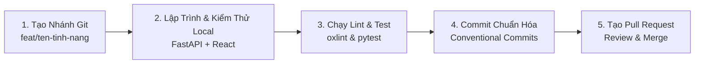

# 🚀 Quy Trình Phát Triển & Chuẩn Mực Mã Nguồn (Development Workflow)

Tài liệu này quy định quy trình làm việc hàng ngày, quy chuẩn kiểm tra chất lượng mã nguồn (Linting, Testing), và quy ước ghi chú commit Git dành cho các thành viên trong nhóm phát triển **Digital Library**.

---

## 1. Vòng Đời Phát Triển Một Tính Năng Mới (Feature Lifecycle)



### Bước 1: Tạo nhánh Git riêng biệt
Luôn phân nhánh từ nhánh `main` mới nhất:
```bash
git checkout main
git pull origin main
git checkout -b feat/ten-tinh-nang
```

### Bước 2: Phát triển và Kiểm thử Cục bộ
* **Backend:** Khởi chạy với cờ `--reload` để tự động nạp lại khi sửa code:
  ```bash
  uvicorn backend.app.main:app --reload --port 8000
  ```
* **Frontend:** Chạy máy chủ phát triển Vite với Hot Module Replacement:
  ```bash
  cd frontend/digital-library
  npm run dev
  ```

---

## 2. Kiểm Tra Chất Lượng Mã Nguồn (Linting & Testing)

Trước khi commit bất kỳ thay đổi nào lên repository, lập trình viên bắt buộc phải chạy các công cụ kiểm tra tự động:

### 2.1. Kiểm tra Linter Giao Diện (Frontend Linting với Oxlint)
Dự án sử dụng **Oxlint** — bộ linter siêu tốc viết bằng Rust giúp phát hiện lỗi cú pháp và anti-pattern trong React/TypeScript:
```bash
cd frontend/digital-library
npm run lint
```

### 2.2. Kiểm tra Kiểu Dữ Liệu TypeScript (Type Checking)
```bash
cd frontend/digital-library
npx tsc -b
```

### 2.3. Chạy Bộ Kiểm Thử Máy Chủ (Backend Testing với Pytest)
Bộ kiểm thử tự động của Backend nằm trong thư mục `backend/tests/`:
```bash
# Kích hoạt môi trường ảo
source .venv/bin/activate

# Chạy toàn bộ test suite
pytest backend/tests/ -v

# Chạy riêng một nhóm test (Ví dụ: Test thuật toán Deduplication)
pytest backend/tests/test_storage_dedup.py -v
```

---

## 3. Quy Ước Đặt Tên Commit Git (Conventional Commits)

Nhóm phát triển áp dụng chặt chẽ quy chuẩn **Conventional Commits v1.0.0**:

```text
<loại_thay_đổi>(<phạm_vi>): <mô tả ngắn gọn bằng thể mệnh lệnh>

[nội dung giải thích chi tiết nếu cần]
```

### Các Tiền Tố Bắt Buộc (Commit Types)
* `feat`: Bổ sung một chức năng mới cho người dùng (Ví dụ: `feat(library): add star rating component`).
* `fix`: Sửa một lỗi kỹ thuật hoặc hành vi sai (Ví dụ: `fix(storage): resolve sha256 memory leak on 50mb files`).
* `docs`: Thêm mới hoặc cập nhật tài liệu kỹ thuật (Ví dụ: `docs(api): document bulk download endpoints`).
* `refactor`: Tái cấu trúc mã nguồn mà không làm thay đổi hành vi nghiệp vụ (Ví dụ: `refactor(auth): simplify jwt dependency injection`).
* `test`: Thêm mới hoặc cập nhật các kịch bản kiểm thử tự động (Ví dụ: `test(trash): add soft delete restore test cases`).
* `chore`: Các công việc bảo trì, cập nhật thư viện, cấu hình build (Ví dụ: `chore(deps): bump vite to 8.2.2`).

---

## 4. Quy Trình Tạo Pull Request (PR) & Hợp Nhất Nhánh (Merge)

1. Đẩy nhánh làm việc lên GitHub:
   ```bash
   git push origin feat/ten-tinh-nang
   ```
2. Mở Pull Request vào nhánh `main`.
3. Bắt buộc tối thiểu **1 thành viên khác (Peer Review)** đọc, phản biện và bấm **Approve**.
4. Toàn bộ các bước kiểm tra tự động (GitHub Actions CI/CD) phải có trạng thái tích xanh (Passed).
5. Sử dụng hình thức **Squash and Merge** để giữ cho lịch sử commit trên nhánh `main` luôn sạch sẽ và dễ tra cứu.
