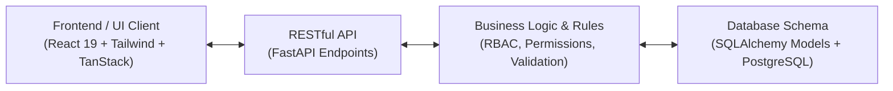

# Danh Mục Đặc Tả Tính Năng (Feature Specifications Index)

Chào mừng bạn đến với khu vực tài liệu **Đặc tả Tính năng (Feature Specifications)** của **Foundation Project**. 

Hệ thống thư viện số được tổ chức thành **10 phân hệ tính năng chuyên sâu**, mỗi phân hệ được lưu trữ trong một thư mục riêng biệt kèm theo đầy đủ đặc tả về giao diện (Frontend), giao diện lập trình ứng dụng (API), mô hình dữ liệu (Database) và quy tắc nghiệp vụ (Business Rules).

---

## 1. Ma Trận Chỉ Mục 10 Phân Hệ Tính Năng

| STT | Phân hệ Tính năng | Thư mục Lưu trữ | Đặc tả Nghiệp vụ & Kỹ thuật | Trạng thái |
| :---: | :--- | :--- | :--- | :--- |
| **01** | **Activity Tracking** | [`feat/activity-tracking/`](./activity-tracking/README.md) | [README](./activity-tracking/README.md) · [API](./activity-tracking/API.md) · [Database](./activity-tracking/DATABASE.md) · [Rules](./activity-tracking/BUSINESS_RULES.md) · [Implementation](./activity-tracking/IMPLEMENTATION.md) | Implemented |
| **02** | **Document Bundle** | [`feat/bundle/`](./bundle/README.md) | [README](./bundle/README.md) · [API](./bundle/API.md) · [Database](./bundle/DATABASE.md) · [Rules](./bundle/BUSINESS_RULES.md) · [Frontend](./bundle/FRONTEND.md) | Implemented |
| **03** | **Community Library** | [`feat/community-library/`](./community-library/spec.md) | [Spec](./community-library/spec.md) · [Implementation](./community-library/implementation.md) · [Management](./community-library/management-extension.md) · [Bug Fix](./community-library/bug-fix-document-counting.md) | Implemented |
| **04** | **Document Preview & Thumbnails** | [`feat/document-preview-and-thumbnails/`](./document-preview-and-thumbnails/README.md) | [README](./document-preview-and-thumbnails/README.md) · [API](./document-preview-and-thumbnails/API.md) · [Database](./document-preview-and-thumbnails/DATABASE.md) · [Rules](./document-preview-and-thumbnails/BUSINESS_RULES.md) · [Implementation](./document-preview-and-thumbnails/IMPLEMENTATION.md) | Implemented |
| **05** | **Document Sharing** | [`feat/document-sharing/`](./document-sharing/README.md) | [README](./document-sharing/README.md) · [API](./document-sharing/API.md) · [Database](./document-sharing/DATABASE.md) · [Rules](./document-sharing/BUSINESS_RULES.md) · [Frontend](./document-sharing/FRONTEND.md) · [Troubleshooting](./document-sharing/TROUBLESHOOTING.md) | Implemented |
| **06** | **Query & Performance** | [`feat/document-query-and-performance/`](./document-query-and-performance/README.md) | [README](./document-query-and-performance/README.md) · [API](./document-query-and-performance/API.md) · [Database](./document-query-and-performance/DATABASE.md) · [Rules](./document-query-and-performance/BUSINESS_RULES.md) · [Frontend](./document-query-and-performance/FRONTEND.md) · [Troubleshooting](./document-query-and-performance/TROUBLESHOOTING.md) | Implemented |
| **07** | **Document View Modes** | [`feat/document-view-modes/`](./document-view-modes/README.md) | [README](./document-view-modes/README.md) · [Rules](./document-view-modes/BUSINESS_RULES.md) · [Frontend](./document-view-modes/FRONTEND.md) · [Integration](./document-view-modes/REUSE_AND_INTEGRATION.md) | Implemented |
| **08** | **Markdown View** | [`feat/markdown-view/`](./markdown-view/README.md) | [README](./markdown-view/README.md) · [Rules](./markdown-view/BUSINESS_RULES.md) · [Database](./markdown-view/DATABASE.md) · [Implementation](./markdown-view/IMPLEMENTATION.md) | Implemented |
| **09** | **Personal Dashboard** | [`feat/personal-dashboard/`](./personal-dashboard/PERSONAL_DASHBOARD.md) | [Personal Dashboard](./personal-dashboard/PERSONAL_DASHBOARD.md) · [Migration SQL](./personal-dashboard/migration.sql) | Implemented |
| **10** | **System Enhancements 2026** | [`feat/system-enhancements-2026/`](./system-enhancements-2026/README.md) | [README](./system-enhancements-2026/README.md) · [API](./system-enhancements-2026/API.md) · [Database](./system-enhancements-2026/DATABASE.md) · [Rules](./system-enhancements-2026/BUSINESS_RULES.md) · [Frontend](./system-enhancements-2026/FRONTEND.md) · [Enhancements](./system-enhancements-2026/SYSTEM_ENHANCEMENTS.md) | Implemented |

---

## 2. Kiến Trúc Phân Tầng Của Mỗi Phân Hệ

Mỗi tính năng trong hệ thống được cấu trúc đồng bộ theo 4 khía cạnh kỹ thuật:

1. **Frontend Specs (`FRONTEND.md` / `implementation.md`)**:
   - Đặc tả giao diện người dùng, component tree, state management (Zustand, React Query).
   - Tương tác người dùng (User Interactions) và xử lý sự kiện.
2. **API Specs (`API.md`)**:
   - Đặc tả chi tiết các endpoint HTTP, Request Body, Query Params và Response JSON.
   - Mã trạng thái phản hồi và xử lý lỗi đặc thù của tính năng.
3. **Database Specs (`DATABASE.md`)**:
   - Mô hình dữ liệu quan hệ, cấu trúc bảng, khóa chính, khóa ngoại, chỉ mục hiệu năng.
4. **Quy Tắc Nghiệp Vụ (`BUSINESS_RULES.md`)**:
   - Điều kiện tiên quyết (Preconditions), quy tắc kiểm tra quyền hạn, các ngoại lệ và ràng buộc nghiệp vụ không thể vi phạm.

---

## 3. Quy Định Duy Trì Tài Liệu Tính Năng

- **Tính nguyên vẹn (Immutability)**: Toàn bộ các file tài liệu tính năng đã nghiệm thu trong các thư mục con của `docs/feat/` được giữ nguyên cấu trúc để bảo tồn lịch sử quyết định kỹ thuật của nhóm tác giả.
- **Bổ sung tính năng mới**: Khi phát triển một tính năng mới (Feature mới), lập trình viên sẽ tạo một thư mục con mới theo định dạng kebab-case (ví dụ: `docs/feat/ten-tinh-nang-moi/`) và tuân thủ các quy chuẩn cấu trúc (Frontend, API, Database, Business Rules). Template mẫu sẽ được cung cấp chi tiết tại mục Hướng dẫn & Quy chuẩn Tài liệu.
