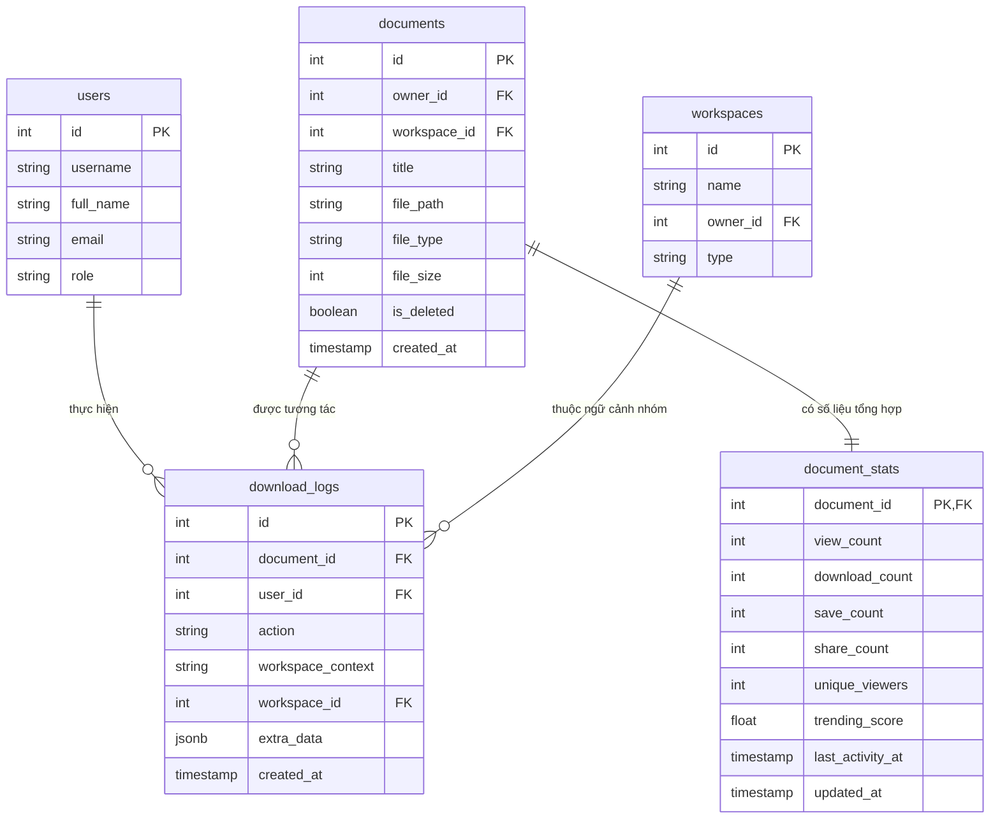

# Thiết Kế Cơ Sở Dữ Liệu: Activity Tracking & Document Stats

Tài liệu chi tiết về thiết kế cấu trúc dữ liệu, các thay đổi trong lược đồ cơ sở dữ liệu (Database Schema), quan hệ thực thể (ERD), chỉ mục tối ưu hóa (Indexes) và Alembic Migration được thực hiện cho tính năng Activity Tracking.

---

## 1. Mở Rộng Bảng `download_logs`

### 1.1. Bối Cảnh & Vấn Đề Trước Khi Nâng Cấp
- Bảng `download_logs` ban đầu được định nghĩa chỉ để ghi nhận việc tải file với 5 cột tối thiểu: `id`, `document_id`, `user_id`, `action`, `created_at`.
- Cột `action` chỉ có kích thước `VARCHAR(20)`, không đủ độ dài cho các hằng số hành động chuẩn hóa mới (ví dụ: `DOCUMENT_CONTRIBUTED` dài 20 ký tự).
- Thiếu thông tin ngữ cảnh: Không biết hành động xảy ra trong kho cá nhân, trong nhóm học tập hay trên kho học liệu công khai; không lưu được ID của nhóm làm việc; không có chỗ lưu siêu dữ liệu mở rộng như nhãn dán, thời lượng đọc, trạng thái cũ/mới...

### 1.2. Các Cột Bổ Sung Trong Lược Đồ Mới
Bảng `download_logs` được mở rộng thêm 3 cột và nâng độ dài cột `action`:

| Cột | Kiểu Dữ Liệu | Nullable | Giá Trị Mặc Định | Mô Tả Nghiệp Vụ |
| :--- | :--- | :---: | :--- | :--- |
| `id` | `INTEGER` | NO | `nextval(...)` | Khóa chính tự tăng |
| `document_id` | `INTEGER` | NO | - | Khóa ngoại tham chiếu đến `documents.id` |
| `user_id` | `INTEGER` | NO | - | Khóa ngoại tham chiếu đến `users.id` |
| `action` | `VARCHAR(30)` | NO | - | Mã hành động (đã nâng từ `VARCHAR(20)` lên `VARCHAR(30)`) |
| `workspace_context` | `VARCHAR(20)` | NO | `'personal'` | Ngữ cảnh không gian: `'personal'`, `'group'`, hoặc `'library'` |
| `workspace_id` | `INTEGER` | YES | `NULL` | Khóa ngoại tham chiếu đến `workspaces.id` (ON DELETE SET NULL) |
| `extra_data` | `JSONB` | NO | `'{}'` | Siêu dữ liệu linh hoạt dạng JSONB (tag_id, old_title, duration...) |
| `created_at` | `TIMESTAMP WITH TIME ZONE` | NO | `now()` | Thời điểm phát sinh sự kiện |

### 1.3. Chỉ Mục Tối Ưu Hóa (Compound Indexes)
Nhật ký là bảng có tốc độ tăng trưởng bản ghi nhanh nhất hệ thống. Để đảm bảo các câu lệnh truy vấn phân trang, lọc theo thời gian và đếm theo loại hành động luôn phản hồi tức thì, 3 chỉ mục kết hợp (B-Tree Compound Indexes) được thiết lập:

```sql
-- 1. Tối ưu API xem lịch sử tài liệu: GET /documents/{id}/activities
CREATE INDEX ix_download_logs_document_id_created_at
  ON download_logs (document_id, created_at DESC);

-- 2. Tối ưu API thống kê hoạt động người dùng: GET /stats/me
CREATE INDEX ix_download_logs_user_id_created_at
  ON download_logs (user_id, created_at DESC);

-- 3. Tối ưu job scheduler tổng hợp số liệu theo loại hành động
CREATE INDEX ix_download_logs_action_created_at
  ON download_logs (action, created_at DESC);
```

---

## 2. Tạo Mới Bảng Tổng Hợp `document_stats`

### 2.1. Mục Tiêu Thiết Kế
Thay vì mỗi lần người dùng xem thông tin tài liệu hoặc hiển thị danh sách tài liệu thịnh hành đều phải thực hiện `COUNT()` và quét toàn bộ bảng `download_logs`, bảng `document_stats` đóng vai trò là một **Materialized Aggregation Cache**.

Dữ liệu bảng này được cập nhật định kỳ mỗi 1 giờ bởi tiến trình nền `APScheduler`, đảm bảo các thao tác truy vấn trang chủ, kho học liệu, bảng xếp hạng trending đều có độ phức tạp thời gian $O(1)$.

### 2.2. Chi Tiết Lược Đồ Bảng `document_stats`

| Cột | Kiểu Dữ Liệu | Ràng Buộc | Ý Nghĩa Kỹ Thuật |
| :--- | :--- | :--- | :--- |
| `document_id` | `INTEGER` | PRIMARY KEY, FK (`documents.id` ON DELETE CASCADE) | Khóa chính đồng thời là khóa ngoại liên kết 1-1 với tài liệu |
| `view_count` | `INTEGER` | NOT NULL, DEFAULT `0` | Tổng số lượt xem được ghi nhận (sau deduplication) |
| `download_count` | `INTEGER` | NOT NULL, DEFAULT `0` | Tổng số lượt tải file về máy |
| `save_count` | `INTEGER` | NOT NULL, DEFAULT `0` | Tổng số lượt lưu tài liệu về kho cá nhân |
| `share_count` | `INTEGER` | NOT NULL, DEFAULT `0` | Tổng số lượt chia sẻ vào nhóm hoặc đóng góp thư viện |
| `unique_viewers` | `INTEGER` | NOT NULL, DEFAULT `0` | Số lượng người dùng duy nhất (`COUNT(DISTINCT user_id)`) đã xem |
| `trending_score` | `FLOAT` | NOT NULL, DEFAULT `0.0` | Điểm số xu hướng tính theo thuật toán suy giảm thời gian |
| `last_activity_at` | `TIMESTAMP WITH TIME ZONE` | NULLABLE | Thời điểm có tương tác gần đây nhất |
| `updated_at` | `TIMESTAMP WITH TIME ZONE` | NOT NULL, DEFAULT `now()` | Thời điểm job scheduler cập nhật bản ghi này |

---

## 3. Sơ Đồ Thực Thể Quan Hệ (Entity-Relationship Diagram)



---

## 4. Ánh Xạ SQLAlchemy 2.0 ORM Models

### 4.1. Model `DownloadLog` (`backend/app/models/download_log.py`)
```python
from typing import TYPE_CHECKING, Optional
from sqlalchemy.orm import Mapped, mapped_column, relationship
from sqlalchemy import Integer, ForeignKey, String, Index
from sqlalchemy.dialects.postgresql import JSONB
from .base import Base, TimestampMixin

if TYPE_CHECKING:
    from .user import User
    from .document import Document
    from .workspace import Workspace


class DownloadLog(Base, TimestampMixin):
    __tablename__ = "download_logs"
    __table_args__ = (
        Index("ix_download_logs_document_id_created_at", "document_id", "created_at"),
        Index("ix_download_logs_user_id_created_at", "user_id", "created_at"),
        Index("ix_download_logs_action_created_at", "action", "created_at"),
    )

    id: Mapped[int] = mapped_column(Integer, primary_key=True, autoincrement=True)
    document_id: Mapped[int] = mapped_column(Integer, ForeignKey("documents.id"), nullable=False)
    user_id: Mapped[int] = mapped_column(Integer, ForeignKey("users.id"), nullable=False)
    action: Mapped[str] = mapped_column(String(30), nullable=False)
    workspace_context: Mapped[str] = mapped_column(String(20), nullable=False, default="personal")
    workspace_id: Mapped[Optional[int]] = mapped_column(
        Integer, ForeignKey("workspaces.id", ondelete="SET NULL"), nullable=True
    )
    extra_data: Mapped[dict] = mapped_column(JSONB, nullable=False, default=dict)

    user: Mapped["User"] = relationship("User", back_populates="download_logs")
    document: Mapped["Document"] = relationship("Document", back_populates="activity_logs")
```

### 4.2. Model `DocumentStats` (`backend/app/models/document_stats.py`)
```python
from datetime import datetime
from typing import TYPE_CHECKING, Optional
from sqlalchemy.orm import Mapped, mapped_column, relationship
from sqlalchemy import Integer, ForeignKey, Float, DateTime, func
from .base import Base

if TYPE_CHECKING:
    from .document import Document


class DocumentStats(Base):
    __tablename__ = "document_stats"

    document_id: Mapped[int] = mapped_column(
        Integer, ForeignKey("documents.id", ondelete="CASCADE"), primary_key=True
    )
    view_count: Mapped[int] = mapped_column(Integer, default=0, nullable=False)
    download_count: Mapped[int] = mapped_column(Integer, default=0, nullable=False)
    save_count: Mapped[int] = mapped_column(Integer, default=0, nullable=False)
    share_count: Mapped[int] = mapped_column(Integer, default=0, nullable=False)
    unique_viewers: Mapped[int] = mapped_column(Integer, default=0, nullable=False)
    trending_score: Mapped[float] = mapped_column(Float, default=0.0, nullable=False)
    last_activity_at: Mapped[Optional[datetime]] = mapped_column(DateTime(timezone=True), nullable=True)
    updated_at: Mapped[datetime] = mapped_column(
        DateTime(timezone=True), server_default=func.now(), onupdate=func.now(), nullable=False
    )

    document: Mapped["Document"] = relationship("Document", back_populates="stats")
```

---

## 5. Chi Tiết Alembic Migration (`d76927b437fe_add_activity_tracking.py`)

File migration được sinh và áp dụng thành công trên cơ sở dữ liệu Neon PostgreSQL:

```python
"""add_activity_tracking

Revision ID: d76927b437fe
Revises: 45ab664fbe54
Create Date: 2026-10-24 20:30:00.000000
"""
from typing import Sequence, Union
from alembic import op
import sqlalchemy as sa
from sqlalchemy.dialects import postgresql

revision: str = 'd76927b437fe'
down_revision: Union[str, None] = '45ab664fbe54'
branch_labels: Union[str, Sequence[str], None] = None
depends_on: Union[str, Sequence[str], None] = None


def upgrade() -> None:
    # 1. Mở rộng độ dài cột action trên download_logs
    op.alter_column('download_logs', 'action',
               existing_type=sa.VARCHAR(length=20),
               type_=sa.String(length=30),
               existing_nullable=False)

    # 2. Bổ sung các cột mới kèm default an toàn
    op.add_column('download_logs', sa.Column('workspace_context', sa.String(length=20), server_default='personal', nullable=False))
    op.add_column('download_logs', sa.Column('workspace_id', sa.Integer(), nullable=True))
    op.add_column('download_logs', sa.Column('extra_data', postgresql.JSONB(astext_type=sa.Text()), server_default='{}', nullable=False))

    # 3. Tạo foreign key và indexes
    op.create_foreign_key('fk_download_logs_workspace_id', 'download_logs', 'workspaces', ['workspace_id'], ['id'], ondelete='SET NULL')
    op.create_index('ix_download_logs_document_id_created_at', 'download_logs', ['document_id', sa.text('created_at DESC')])
    op.create_index('ix_download_logs_user_id_created_at', 'download_logs', ['user_id', sa.text('created_at DESC')])
    op.create_index('ix_download_logs_action_created_at', 'download_logs', ['action', sa.text('created_at DESC')])

    # 4. Tạo bảng document_stats
    op.create_table('document_stats',
        sa.Column('document_id', sa.Integer(), nullable=False),
        sa.Column('view_count', sa.Integer(), server_default='0', nullable=False),
        sa.Column('download_count', sa.Integer(), server_default='0', nullable=False),
        sa.Column('save_count', sa.Integer(), server_default='0', nullable=False),
        sa.Column('share_count', sa.Integer(), server_default='0', nullable=False),
        sa.Column('unique_viewers', sa.Integer(), server_default='0', nullable=False),
        sa.Column('trending_score', sa.Float(), server_default='0.0', nullable=False),
        sa.Column('last_activity_at', sa.DateTime(timezone=True), nullable=True),
        sa.Column('updated_at', sa.DateTime(timezone=True), server_default=sa.text('now()'), nullable=False),
        sa.ForeignKeyConstraint(['document_id'], ['documents.id'], ondelete='CASCADE'),
        sa.PrimaryKeyConstraint('document_id')
    )


def downgrade() -> None:
    op.drop_table('document_stats')
    op.drop_index('ix_download_logs_action_created_at', table_name='download_logs')
    op.drop_index('ix_download_logs_user_id_created_at', table_name='download_logs')
    op.drop_index('ix_download_logs_document_id_created_at', table_name='download_logs')
    op.drop_constraint('fk_download_logs_workspace_id', 'download_logs', type_='foreignkey')
    op.drop_column('download_logs', 'extra_data')
    op.drop_column('download_logs', 'workspace_id')
    op.drop_column('download_logs', 'workspace_context')
    op.alter_column('download_logs', 'action',
               existing_type=sa.String(length=30),
               type_=sa.VARCHAR(length=20),
               existing_nullable=False)
```
