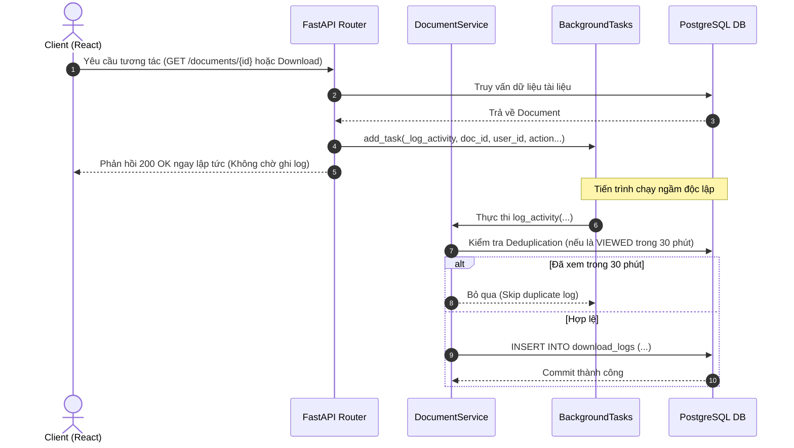
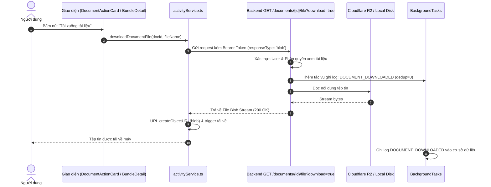
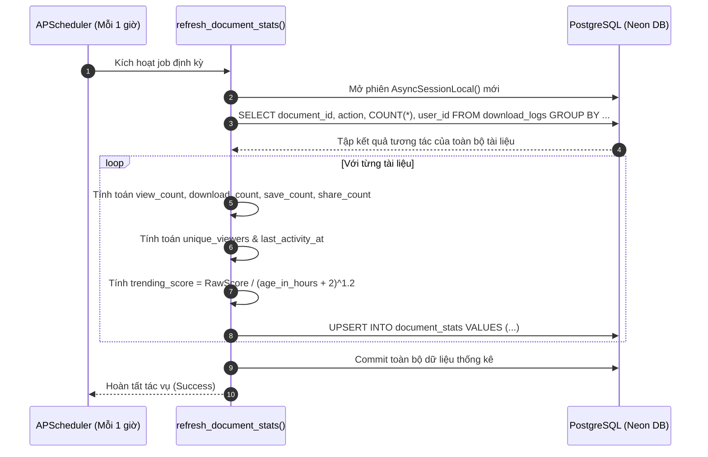

# Đặc Tả Tính Năng: Theo Dõi Hoạt Động & Thống Kê Tương Tác (Activity Tracking & Analytics)

Tài liệu kỹ thuật chi tiết về hệ thống **Theo dõi hoạt động người dùng (Activity Tracking)**, **Hệ thống tổng hợp & tính điểm xu hướng (Trending Score & Document Stats)** và **Bảng điều khiển thống kê (Personal Analytics & Document Activity Timeline)** trong nền tảng Digital Library.

---

## 📑 Mục Lục Điều Hướng

1. [Bối Cảnh & Ý Tưởng Phát Triển (Context & Ideas)](#1-bối-cảnh--ý-tưởng-phát-triển)
2. [Phân Tích Nghiệp Vụ & Yêu Cầu Kỹ Thuật (Analysis)](#2-phân-tích-nghiệp-vụ--yêu-cầu-kỹ-thuật)
3. [Công Nghệ & Thư Viện Sử Dụng (Technology Stack)](#3-công-nghệ--thư-viện-sử-dụng)
4. [Kiến Trúc & Thiết Kế Luồng Hoạt Động (Architecture & Workflows)](#4-kiến-trúc--thiết-kế-luồng-hoạt-động)
5. [Chi Tiết Triển Khai & Các Giai Đoạn (Implementation Steps)](#5-chi-tiết-triển-khai--các-giai-đoạn)
6. [Các Thách Thức Kỹ Thuật Gặp Phải & Giải Pháp (Challenges & Solutions)](#6-các-thách-thức-kỹ-thuật-gặp-phải--giải-pháp)
7. [Danh Mục File Chỉnh Sửa & Vị Trí Code Trọng Tâm (Code Locations)](#7-danh-mục-file-chỉnh-sửa--vị-trí-code-trọng-tâm)
8. [Tài Liệu Chi Tiết Liên Quan](#8-tài-liệu-chi-tiết-liên-quan)

---

## 1. Bối Cảnh & Ý Tưởng Phát Triển

### 1.1. Hiện trạng trước khi triển khai
- **Hạn chế về dữ liệu nhật ký (Logging schema):** Bảng `download_logs` chỉ có 5 cột sơ sài (`id`, `document_id`, `user_id`, `action`, `created_at`). Cột `action` chỉ lưu hai chuỗi tĩnh `view` và `download`. Thiếu hoàn toàn các trường phản ánh ngữ cảnh như loại không gian lưu trữ (`workspace_context`), mã nhóm (`workspace_id`), hoặc siêu dữ liệu mở rộng (`extra_data`).
- **Ghi log bị bỏ quên hoặc sai lệch:** Hàm ghi log `log_download` trong `document_service.py` không được gọi ở bất kỳ router nào. Tại `library.py:388`, mã nguồn tồn tại bug nghiêm trọng: gọi hàm ghi log với các tham số không tồn tại trong model (`ip_address`, `user_agent`), đồng thời thiếu tham số `action`.
- **Lỗ hổng Bypass Backend khi tải tệp tin:** Tại `DocumentDetail.tsx:121`, `BundleDetailPage.tsx:260` và `usePersonalDocuments.ts:106`, nút tải xuống mở trực tiếp URL tĩnh `/storage/...` của máy chủ. Thao tác này bỏ qua hoàn toàn backend API, khiến hệ thống không thể kiểm soát quyền truy cập hay ghi nhận lượt tải tệp.
- **Thiếu cơ chế tổng hợp & xếp hạng (Aggregation & Trending):** Không có bảng counter lưu trữ số liệu tổng hợp. Bất kỳ thống kê nào cũng phải tính toán lại từ đầu (full table scan) trên `download_logs`, gây áp lực lớn lên cơ sở dữ liệu khi lượng truy cập tăng. Không có thuật toán xác định độ "nóng" (trending) của tài liệu.
- **Trải nghiệm giao diện bị gián đoạn (Incomplete UI):** Tab *Hoạt động* trong `DocumentDetail` sử dụng mảng dữ liệu giả lập (hardcoded mock); trang *Thống kê* (`StatsPage.tsx`) chỉ hiển thị một dòng thông báo tạm: `"Trang đang xây dựng"`.

### 1.2. Ý tưởng giải pháp
1. **Mở Rộng Schema & Chuẩn Hóa Event Logging:**
   - Mở rộng bảng `download_logs` (thêm `workspace_context`, `workspace_id`, `extra_data` dạng JSONB, và 3 compound indexes).
   - Thiết lập bảng lưu trữ tổng hợp `document_stats` làm materialized cache lưu trữ `view_count`, `download_count`, `save_count`, `share_count`, `unique_viewers` và `trending_score`.
2. **Ghi Nhận Sự Kiện Bất Đồng Bộ (Non-blocking Logging):**
   - Sử dụng **`FastAPI BackgroundTasks`** kết hợp với session quản lý độc lập `AsyncSessionLocal()`. Khi người dùng thực hiện bất kỳ hành động nào (xem, tải, đổi tên, gắn nhãn...), API phản hồi ngay lập tức cho client mà không bị trễ bởi tiến trình ghi log vào database.
   - Cơ chế Deduplication thông minh: Ngăn chặn hiện tượng spam lượt xem (F5 liên tục hoặc lướt qua lại) bằng cách chặn ghi nhận lại hành vi `DOCUMENT_VIEWED` từ cùng một người dùng trên cùng một tài liệu trong vòng **30 phút**.
3. **Thuật Toán Điểm Xu Hướng & Cron Job Tự Động:**
   - Xây dựng thuật toán tính `trending_score` kết hợp trọng số tương tác (Saves > Shares > Downloads > Views) và hệ số suy giảm theo độ tuổi tài liệu (Recency Decay).
   - Tích hợp Background Job `refresh_document_stats` chạy định kỳ mỗi 1 giờ thông qua **`APScheduler`**.
4. **Chuẩn Hóa Luồng Tải File An Toàn Phía Client:**
   - Thay thế việc mở URL tĩnh bằng API `GET /documents/{id}/file?download=true` stream dưới dạng Blob. Mọi thao tác tải file từ màn hình Chi tiết, Gói tài liệu (Bundle), hay Danh sách tài liệu cá nhân đều bắt buộc phải đi qua backend và được ghi nhận vào nhật ký.
5. **Giao Diện Trực Quan Hóa (Frontend Dashboards):**
   - Tích hợp tab *Hoạt động* thật trong `DocumentDetail` với timeline trực quan, dot màu phân loại, nhãn tiếng Việt rõ ràng, và thời gian tương đối.
   - Xây dựng trang *Thống kê* (`StatsPage`) với 3 Card tổng hợp, biểu đồ cột Recharts 30 ngày liên tục (tự động điền 0 cho ngày trống), và dòng thời gian hoạt động gom nhóm theo ngày. Cung cấp nút chuyển đổi linh hoạt giữa *Hoạt động của tôi* (`scope="me"`) và *Tài liệu của tôi* (`scope="my_documents"`).

---

## 2. Phân Tích Nghiệp Vụ & Yêu Cầu Kỹ Thuật

### 2.1. Phân loại mã hành động (Activity Actions)
Hệ thống chuẩn hóa 12 loại hành động người dùng tương tác với tài liệu:

| Mã Hành Động (Constant) | Chuỗi Định Danh | Trọng Số Điểm | Ý Nghĩa Nghiệp Vụ | Điểm Kích Hoạt (Trigger) |
| :--- | :--- | :---: | :--- | :--- |
| `VIEWED` | `DOCUMENT_VIEWED` | `1.0` | Đọc trực tuyến hoặc xem chi tiết | `GET /documents/{id}`, `GET /documents/{id}/file` |
| `DOWNLOADED` | `DOCUMENT_DOWNLOADED` | `3.0` | Tải tệp tin về máy tính cá nhân | `GET /documents/{id}/file?download=true`, ZIP |
| `UPLOADED` | `DOCUMENT_UPLOADED` | `0.0` | Tải tài liệu mới lên hệ thống | `POST /documents/upload`, `POST /groups/.../upload` |
| `SAVED` | `DOCUMENT_SAVED` | `5.0` | Lưu tài liệu vào kho cá nhân | `POST /groups/.../save-to-personal`, `POST /library/.../save` |
| `SHARED` | `DOCUMENT_SHARED` | `4.0` | Chia sẻ tài liệu vào nhóm học tập | `POST /groups/{group_id}/share/documents` |
| `CONTRIBUTED` | `DOCUMENT_CONTRIBUTED` | `4.0` | Đóng góp tài liệu vào kho học liệu | `POST /library/contribute/{id}` |
| `RENAMED` | `DOCUMENT_RENAMED` | `0.0` | Thay đổi tiêu đề của tài liệu | `PATCH /documents/{id}` |
| `DELETED` | `DOCUMENT_DELETED` | `0.0` | Chuyển tài liệu vào thùng rác | `DELETE /documents/{id}`, `DELETE /groups/...` |
| `RESTORED` | `DOCUMENT_RESTORED` | `0.0` | Khôi phục tài liệu từ thùng rác | `POST /trash/{id}/restore`, restore batch |
| `TAG_ADDED` | `TAG_ADDED` | `0.0` | Gán nhãn phân loại tài liệu | `PATCH /documents/{id}/tags`, `POST /groups/.../tags` |
| `TAG_REMOVED` | `TAG_REMOVED` | `0.0` | Gỡ nhãn phân loại tài liệu | `DELETE /documents/{id}/tags/{tag_id}` |
| `BUNDLE_CREATED` | `BUNDLE_CREATED` | `0.0` | Tạo gói tài liệu nhiều tệp | `POST /documents/upload-batch` |

### 2.2. Yêu cầu phi chức năng (Non-Functional Requirements)
- **Hiệu năng & Bất đồng bộ (Async & Non-blocking):**
  - Tuyệt đối không làm tăng thời gian phản hồi (Latency) của API chính. Mọi thao tác ghi DB cho log được ủy thác cho `BackgroundTasks`.
  - Không gặp lỗi `InterfaceError: cannot perform operation: another operation is in progress` hoặc `connection closed` bằng cách cung cấp session DB độc lập trong tiến trình nền.
- **Tối ưu hóa Index & Dung lượng:**
  - Thiết lập Compound Index trên `(document_id, created_at DESC)`, `(user_id, created_at DESC)`, `(action, created_at DESC)` giúp các câu truy vấn phân trang `LIMIT 20` phản hồi dưới **5ms**.
  - Lưu trữ `extra_data` dạng `JSONB` cho phép mở rộng siêu dữ liệu tùy ý trong tương lai mà không phải chạy lại migration cơ sở dữ liệu.
- **Bảo mật & Phân quyền truy cập:**
  - API xem lịch sử hoạt động `GET /documents/{id}/activities` kiểm tra phân quyền nghiêm ngặt: chỉ cho phép chủ sở hữu tài liệu (`doc.owner_id == current_user.id`) hoặc chủ sở hữu Workspace (`workspace.owner_id == current_user.id`). Người dùng trái phép sẽ bị chặn với mã lỗi `403 Forbidden`.

---

## 3. Công Nghệ & Thư Viện Sử Dụng

### 3.1. Backend Stack
- **FastAPI (Python 3.11+):**
  - Dependency Injection (`get_current_user`, `get_db`).
  - `BackgroundTasks` xử lý ghi log nền không đồng bộ.
- **SQLAlchemy 2.0 (Async) & asyncpg:**
  - Quản lý phiên làm việc bất đồng bộ với `AsyncSessionLocal()`.
  - Sử dụng hàm tổng hợp `func.count()`, `func.date()`, `func.coalesce()` và `selectinload()`.
- **PostgreSQL 15+ (Neon Cloud):**
  - Bảng partitioned-ready logs, cột `JSONB` lưu cấu trúc linh hoạt.
  - Hỗ trợ index B-tree đa cột trên ngày tháng và khóa ngoại.
- **Alembic:** Quản lý phiên bản migration cơ sở dữ liệu (`d76927b437fe_add_activity_tracking.py`).
- **APScheduler:** Bộ điều phối tiến trình nền định kỳ chạy in-process với vòng đời của ứng dụng FastAPI.

### 3.2. Frontend Stack
- **React 19 & Vite 8:** Ứng dụng Single Page Application (SPA).
- **@tanstack/react-query (v5):** Quản lý trạng thái server cache, tự động re-fetch và đồng bộ dữ liệu.
- **Recharts (v3.10.1):** Trình diễn biểu đồ cột `BarChart`, `ResponsiveContainer`, `Tooltip`, `CartesianGrid`.
- **Lucide React:** Bộ biểu tượng giao diện trực quan (`Activity`, `BarChart2`, `Calendar`, `Upload`, `Eye`, `Download`, `FileText`...).
- **Tailwind CSS v4:** Định dạng dot màu trạng thái, skeleton loading `animate-pulse`, layout lưới responsive.

---

## 4. Kiến Trúc & Thiết Kế Luồng Hoạt Động

### 4.1. Luồng 1: Ghi Nhận Hoạt Động Bất Đồng Bộ (Background Activity Logging)

### 4.2. Luồng 2: Tải Xuống Tệp Tin An Toàn & Đầy Đủ Nhật Ký

### 4.3. Luồng 3: Làm Mới Định Kỳ Thống Kê & Điểm Xu Hướng (Scheduler Cron Job)

---

## 5. Chi Tiết Triển Khai & Các Giai Đoạn

Dự án được thực hiện tuần tự qua 3 Phase độc lập, đảm bảo kiểm thử kỹ lưỡng từng bước:

### Giai đoạn 1 (Phase 1): Cơ Sở Dữ Liệu & Ghi Nhận Nhật Ký Nền
1. **Alembic Migration:**
   - Tạo migration `d76927b437fe_add_activity_tracking.py`.
   - Thêm các cột `workspace_context`, `workspace_id`, `extra_data` vào bảng `download_logs`.
   - Tạo 3 chỉ mục compound `ix_download_logs_*`.
   - Tạo bảng `document_stats` với đầy đủ các cột counter, `trending_score`, và khóa ngoại liên kết tới `documents.id`.
2. **Cập Nhật ORM Models:**
   - Nâng cấp model `DownloadLog`, bổ sung quan hệ hai chiều `user` và `document`.
   - Tạo mới model `DocumentStats` và liên kết quan hệ `Document.stats`.
3. **Core Logging Service:**
   - Xây dựng hàm trung tâm `log_activity()` trong `app/services/document_service.py` với cơ chế mở session `AsyncSessionLocal()` riêng biệt, xử lý tham số linh hoạt và tự động deduplicate `VIEWED` trong 30 phút.
4. **Hook Ghi Log Toàn Diện (15 Endpoints):**
   - Đặt background task ghi log tại toàn bộ các điểm chạm quan trọng: xem tài liệu cá nhân, xem trong nhóm, xem trong kho học liệu, tải file bản gốc, tải file zip gói tài liệu, tải tài liệu mới lên, lưu tài liệu về kho cá nhân, chia sẻ vào nhóm, đóng góp vào thư viện, đổi tên, xóa mềm, khôi phục từ thùng rác, gắn/gỡ nhãn dán.
5. **Đăng Ký APScheduler Job:**
   - Khởi tạo job `refresh_document_stats` trong `app/jobs/scheduler.py` chạy mỗi 1 giờ, tự động tính toán counters và điểm số xu hướng.

### Giai đoạn 2 (Phase 2): Xây Dựng RESTful API Backend
1. **Định Nghĩa Schemas:**
   - Tạo `app/schemas/activity.py` định nghĩa `ActivityLogResponse`, `ActivityListResponse`, `DocumentStatsResponse`, `MyStatsResponse`.
2. **Endpoint Lịch Sử Tài Liệu (`GET /documents/{document_id}/activities`):**
   - Hỗ trợ phân trang `page`, `page_size`, lọc theo `action`.
   - Join bảng `users` để trích xuất `actor_name` (ưu tiên `full_name`, fallback sang `username`).
   - Phân quyền chặt chẽ (chỉ owner tài liệu hoặc owner workspace mới được xem).
3. **Endpoint Điểm Số & Counter (`GET /documents/{document_id}/stats`):**
   - Trả về nhanh thông tin số liệu tổng hợp từ bảng `document_stats`.
4. **Endpoint Thống Kê Cá Nhân (`GET /stats/me`):**
   - Hỗ trợ 2 phạm vi: `scope="me"` (hoạt động của người dùng) và `scope="my_documents"` (tương tác của người khác trên tài liệu của người dùng).
   - Truy vấn 20 hoạt động gần nhất join tên tài liệu (`document_title`) và tên người thực hiện.
   - Trả về danh sách 30 ngày liên tục của tháng gần nhất (tự động điền `count: 0` cho các ngày không có tương tác).
5. **Ghi Nhận Hoạt Động Upload:**
   - Định nghĩa `ActivityAction.UPLOADED = "DOCUMENT_UPLOADED"` và gắn hook ghi log khi upload tài liệu đơn lẻ hoặc tạo gói tài liệu.

### Giai đoạn 3 (Phase 3): Hoàn Thiện Giao Diện & Khắc Phục Lỗi Download
1. **Frontend Services & Types:**
   - Tạo `frontend/digital-library/src/types/activity.ts` và `frontend/digital-library/src/services/activityService.ts`.
2. **Khắc Phục Lỗi Tải File Bypass Backend:**
   - Thay thế việc mở trực tiếp URL static `${VITE_API_URL}/${file_path}` bằng phương thức `activityService.downloadDocumentFile()`. Áp dụng đồng bộ tại `DocumentActionCard.tsx`, `BundleDetailPage.tsx` và `usePersonalDocuments.ts`.
3. **Tab Hoạt Động Trong `DocumentDetail`:**
   - Cập nhật `TabPanels.tsx:TabActivity` nhận prop `documentId`.
   - Gọi API thật qua TanStack Query (`useQuery`), hiển thị timeline có dot màu Tailwind theo loại hành động, relative time, loading skeleton và `EmptyState`.
4. **Trang Thống Kê Hoàn Chỉnh (`StatsPage.tsx`):**
   - Thay thế trang đang xây dựng bằng giao diện hoàn chỉnh: 3 `StatCard`, biểu đồ cột Recharts 30 ngày, danh sách 20 sự kiện phân nhóm theo ngày (*Hôm nay*, *Hôm qua*, *Trước đó*), có link nhấp xem tài liệu và nút chuyển đổi phạm vi (`scope`).

---

## 6. Các Thách Thức Kỹ Thuật Gặp Phải & Giải Pháp

| Vấn đề gặp phải | Nguyên nhân gốc rễ | Giải pháp kỹ thuật đã áp dụng |
| :--- | :--- | :--- |
| **Lỗi Connection Closed trong BackgroundTasks** | `BackgroundTasks` thực thi sau khi FastAPI router đã gửi response về client. Session `db` được inject qua `Depends(get_db)` đã bị framework tự động đóng trước khi tác vụ nền kịp ghi log vào database. | Trong hàm `_log_activity`, không tái sử dụng session của request mà khởi tạo một phiên kết nối độc lập: `async with AsyncSessionLocal() as session:`. |
| **Lỗi Download Bypass Backend** | Frontend dùng thẻ `<a href="...static...">` hoặc `window.open(static_url)` mở trực tiếp thư mục `storage/personal/...` của Web server, không gọi qua router. | Chuyển toàn bộ hành vi tải xuống sang gọi API `GET /documents/{id}/file?download=true` với `responseType: 'blob'`, sau đó dùng `URL.createObjectURL` để kích hoạt download trên trình duyệt. |
| **Spam Lượt Xem Khi F5 (View Duplication)** | Mỗi lần người dùng reload trang hoặc chuyển tab, API chi tiết tài liệu được gọi lại, khiến bảng log bị tràn ngập các event `VIEWED` vô nghĩa. | Triển khai cơ chế Deduplication: Trước khi ghi log `VIEWED`, kiểm tra xem trong vòng 30 phút qua user này đã có log xem tài liệu này chưa. Nếu có -> bỏ qua. Riêng `DOWNLOADED` và `UPLOADED` không áp dụng dedup. |
| **Xung Đột Lược Đồ Migration (Stale Revision)** | Cơ sở dữ liệu Neon chứa mã revision cũ không tồn tại trong thư mục mã nguồn repo cục bộ, khiến `alembic upgrade` báo lỗi. | Đồng bộ hóa lại bảng `alembic_version` về head hợp lệ gần nhất (`45ab664fbe54`), sau đó sinh và chạy migration `d76927b437fe_add_activity_tracking.py`. |
| **Biểu Đồ Bị Lỗ Chỗ Ngày Không Có Dữ Liệu** | Phép tính `GROUP BY DATE(created_at)` chỉ trả về các ngày có phát sinh sự kiện. Những ngày không ai tương tác sẽ bị khuyết, làm trục thời gian biểu đồ bị co cụm hoặc sai lệch. | Backend tạo một mảng ánh xạ 30 ngày liên tục tính từ ngày hiện tại lùi về quá khứ, tự động điền giá trị mặc định `{ "date": "...", "count": 0 }` cho các ngày không có log. |

---

## 7. Danh Mục File Chỉnh Sửa & Vị Trí Code Trọng Tâm

### 7.1. Phía Backend
- [`alembic/versions/d76927b437fe_add_activity_tracking.py`](file:///Users/caotiendattx/Developer/Do_An_Co_So/Foundation-Project/alembic/versions/d76927b437fe_add_activity_tracking.py): Migration mở rộng `download_logs` và tạo bảng `document_stats`.
- [`backend/app/models/download_log.py`](file:///Users/caotiendattx/Developer/Do_An_Co_So/Foundation-Project/backend/app/models/download_log.py): Model SQLAlchemy ánh xạ các cột mới và thiết lập 3 compound indexes.
- [`backend/app/models/document_stats.py`](file:///Users/caotiendattx/Developer/Do_An_Co_So/Foundation-Project/backend/app/models/document_stats.py): Model SQLAlchemy lưu trữ counter tổng hợp và điểm xu hướng.
- [`backend/app/models/document.py`](file:///Users/caotiendattx/Developer/Do_An_Co_So/Foundation-Project/backend/app/models/document.py): Bổ sung quan hệ `stats` và `activity_logs`.
- [`backend/app/constants/activity_actions.py`](file:///Users/caotiendattx/Developer/Do_An_Co_So/Foundation-Project/backend/app/constants/activity_actions.py): Định nghĩa hằng số 12 mã hành động chuẩn hóa.
- [`backend/app/services/document_service.py`](file:///Users/caotiendattx/Developer/Do_An_Co_So/Foundation-Project/backend/app/services/document_service.py): Hàm lõi `log_activity()` hỗ trợ phiên DB độc lập và deduplication.
- [`backend/app/jobs/scheduler.py`](file:///Users/caotiendattx/Developer/Do_An_Co_So/Foundation-Project/backend/app/jobs/scheduler.py): Job định kỳ `refresh_document_stats` tính toán điểm số xu hướng.
- [`backend/app/schemas/activity.py`](file:///Users/caotiendattx/Developer/Do_An_Co_So/Foundation-Project/backend/app/schemas/activity.py): Pydantic response models cho activities và stats.
- [`backend/app/routers/documents.py`](file:///Users/caotiendattx/Developer/Do_An_Co_So/Foundation-Project/backend/app/routers/documents.py): Các endpoint `GET /{id}/activities`, `GET /{id}/stats` và gắn log `VIEWED`, `DOWNLOADED`, `UPLOADED`, `RENAMED`, `DELETED`, `TAG_*`.
- [`backend/app/routers/stats.py`](file:///Users/caotiendattx/Developer/Do_An_Co_So/Foundation-Project/backend/app/routers/stats.py): Router cung cấp API `GET /stats/me`.
- [`backend/app/routers/groups.py`](file:///Users/caotiendattx/Developer/Do_An_Co_So/Foundation-Project/backend/app/routers/groups.py): Gắn log `VIEWED`, `DOWNLOADED`, `UPLOADED`, `SHARED`, `SAVED`, `DELETED`, `TAG_*`.
- [`backend/app/routers/library.py`](file:///Users/caotiendattx/Developer/Do_An_Co_So/Foundation-Project/backend/app/routers/library.py): Khắc phục bug ghi log cũ, gắn log `VIEWED`, `DOWNLOADED`, `SAVED`, `CONTRIBUTED`.
- [`backend/app/routers/trash.py`](file:///Users/caotiendattx/Developer/Do_An_Co_So/Foundation-Project/backend/app/routers/trash.py): Gắn log `RESTORED`.
- [`backend/app/main.py`](file:///Users/caotiendattx/Developer/Do_An_Co_So/Foundation-Project/backend/app/main.py): Đăng ký `stats_router` và khởi động scheduler.

### 7.2. Phía Frontend
- [`frontend/digital-library/src/types/activity.ts`](file:///Users/caotiendattx/Developer/Do_An_Co_So/Foundation-Project/frontend/digital-library/src/types/activity.ts): Khai báo kiểu dữ liệu TypeScript cho activity logs và stats.
- [`frontend/digital-library/src/services/activityService.ts`](file:///Users/caotiendattx/Developer/Do_An_Co_So/Foundation-Project/frontend/digital-library/src/services/activityService.ts): API client cho activities, stats và download blob.
- [`frontend/digital-library/src/components/shared/documents/DocumentDetail/tabs/TabPanels.tsx`](file:///Users/caotiendattx/Developer/Do_An_Co_So/Foundation-Project/frontend/digital-library/src/components/shared/documents/DocumentDetail/tabs/TabPanels.tsx): Component `TabActivity` hiển thị dữ liệu lịch sử tương tác thật.
- [`frontend/digital-library/src/components/shared/documents/DocumentDetail/DocumentDetail.tsx`](file:///Users/caotiendattx/Developer/Do_An_Co_So/Foundation-Project/frontend/digital-library/src/components/shared/documents/DocumentDetail/DocumentDetail.tsx): Truyền `documentId` vào `TabActivity` và `DocumentActionCard`.
- [`frontend/digital-library/src/components/shared/documents/DocumentDetail/components/DocumentActionCard.tsx`](file:///Users/caotiendattx/Developer/Do_An_Co_So/Foundation-Project/frontend/digital-library/src/components/shared/documents/DocumentDetail/components/DocumentActionCard.tsx): Thay đổi cơ chế tải file sang gọi `activityService.downloadDocumentFile()`.
- [`frontend/digital-library/src/pages/personal/BundleDetailPage.tsx`](file:///Users/caotiendattx/Developer/Do_An_Co_So/Foundation-Project/frontend/digital-library/src/pages/personal/BundleDetailPage.tsx): Sửa lỗi download file con trong bundle qua API có log.
- [`frontend/digital-library/src/pages/personal/hooks/usePersonalDocuments.ts`](file:///Users/caotiendattx/Developer/Do_An_Co_So/Foundation-Project/frontend/digital-library/src/pages/personal/hooks/usePersonalDocuments.ts): Sửa lỗi download từ context menu danh sách tài liệu cá nhân.
- [`frontend/digital-library/src/pages/stats/StatsPage.tsx`](file:///Users/caotiendattx/Developer/Do_An_Co_So/Foundation-Project/frontend/digital-library/src/pages/stats/StatsPage.tsx): Trang thống kê cá nhân hoàn chỉnh với Summary Cards, Recharts 30 ngày và Timeline phân nhóm.

---

## 8. Tài Liệu Chi Tiết Liên Quan

Để tìm hiểu sâu hơn về từng khía cạnh kỹ thuật, vui lòng tham khảo các tài liệu chuyên đề:
- [Thiết kế Cơ sở Dữ liệu & Schema Migration (DATABASE.md)](DATABASE.md)
- [Quy tắc Nghiệp vụ, Deduplication & Trending Score (BUSINESS_RULES.md)](BUSINESS_RULES.md)
- [Đặc tả RESTful API & Mô hình Dữ liệu (API.md)](API.md)
- [Hướng dẫn Triển khai, Vận hành Job & Kiểm thử (IMPLEMENTATION.md)](IMPLEMENTATION.md)
