# Phân Hệ Tìm Kiếm Tài Liệu & Thư Mục (Document & OCR Full-Text Search)

Tài liệu đặc tả kỹ thuật và kiến trúc của phân hệ **Tìm kiếm tài liệu & thư mục** (bao gồm Quick Search, Folder Search & Filter, Card Highlighting và OCR Full-Text Search) trong hệ sinh thái Thư viện số **Foundation Project**.

---

## 📑 Mục Lục Điều Hướng

1. [Tổng Quan & Phạm Vi Nghiệp Vụ (Overview & Scope)](#1-tổng-quan--phạm-vi-nghiệp-vụ)
2. [Kiến Trúc Kỹ Thuật & Dòng Dữ Liệu (Architecture & Data Flow)](#2-kiến-trúc-kỹ-thuật--dòng-dữ-liệu)
3. [Đặc Tả Chi Tiết 4 Thành Phần Cốt Lõi](#3-đặc-tả-chi-tiết-4-thành-phần-cốt-lõi)
   - [3.1. Tìm kiếm nhanh (Quick Search) & Phân biệt trùng tên](#31-tìm-kiếm-nhanh-quick-search--phân-biệt-trùng-tên)
   - [3.2. Điều hướng & Lọc theo Thư mục (Folder Selection & Filtering)](#32-điều-hướng--lọc-theo-thư-mục-folder-selection--filtering)
   - [3.3. Cơ chế Đánh dấu Thẻ (Card Highlighting: Grid / List / Detail)](#33-cơ-chế-đánh-dấu-thẻ-card-highlighting-grid--list--detail)
   - [3.4. Tìm kiếm toàn văn OCR (OCR Full-Text Search & Safe Highlighting)](#34-tìm-kiếm-toàn-văn-ocr-ocr-full-text-search--safe-highlighting)
4. [Phân Vùng Kiểm Soát Truy Cập (Access-Control Boundaries)](#4-phân-vùng-kiểm-soát-truy-cập-access-control-boundaries)
5. [Danh Sách Tệp Mã Nguồn Liên Quan (Code Map)](#5-danh-sách-tệp-mã-nguồn-liên-quan-code-map)
6. [Bằng Chứng Thực Nghiệm & Báo Cáo Kiểm Thử (Verification Evidence)](#6-bằng-chứng-thực-nghiệm--báo-cáo-kiểm-thử)
7. [Tự Đánh Giá, Đánh Đổi Kỹ Thuật & Giới Hạn (Self-Evaluation & Tradeoffs)](#7-tự-đánh-giá-đánh-đổi-kỹ-thuật--giới-hạn)

---

## 1. Tổng Quan & Phạm Vi Nghiệp Vụ

### 1.1. Bối cảnh
Người dùng cần tra cứu tài liệu nhanh từ thanh tiêu đề hoặc tìm kiếm sâu trong nội dung văn bản trích xuất (OCR). Trước khi nâng cấp, hệ thống có các điểm cần khắc phục:
- Thanh tìm kiếm nhanh chỉ tìm tài liệu và nhóm, chưa hỗ trợ tìm thư mục cá nhân/nhóm.
- Khi nhiều tài liệu hoặc thư mục có cùng tiêu đề, giao diện hiển thị giống nhau khiến người dùng khó phân biệt vị trí lưu trữ.
- Khi chọn folder từ kết quả tìm kiếm, điều hướng sang không gian nhóm có thể làm mất tham số bộ lọc khi người dùng đổi tab.
- Tính năng cuộn và làm nổi bật tài liệu (`useHighlightElement`) dùng timeout cố định 600ms, dẫn đến nguy cơ bỏ lỡ mục tiêu nếu dữ liệu tải trễ qua mạng.
- Tìm kiếm toàn văn bản (FTS) chưa hiển thị đoạn trích xuất OCR chứa từ khóa; nhấp vào kết quả chưa tự động chọn tab "Nội dung OCR" và chưa làm nổi bật từ khóa tìm kiếm.

### 1.2. Phạm vi hỗ trợ (Scope)
- **Kho cá nhân (Personal Library)**: Tìm kiếm tài liệu và thư mục thuộc quyền sở hữu của người dùng đang đăng nhập (`workspace_id IS NULL AND owner_id == user_id`).
- **Không gian nhóm (Group Workspaces)**: Tìm kiếm tài liệu, thư mục và workspace trong phạm vi các nhóm mà người dùng có quyền truy cập (làm chủ hoặc là thành viên hợp lệ).
- **Ranh giới dữ liệu**: Truy vấn có điều kiện lọc để không hiển thị tài liệu cá nhân của người khác, tài liệu thuộc nhóm người dùng không tham gia, hoặc các bản ghi đã xóa mềm (`is_deleted == false`).

---

## 2. Kiến Trúc Kỹ Thuật & Dòng Dữ Liệu

### 2.1. Sơ đồ Dòng Dữ Liệu Toàn Phân Hệ

```mermaid
flowchart TD
    User["Người dùng"] --> Input["SearchBar (Ctrl + K)"]

    %% Luồng 1: Quick Search Dropdown
    Input -->|Nhập từ khóa| QS["GET /search/quick?q=..."]
    QS --> SvcQS["SearchService.quick_search"]
    SvcQS --> DB_QS[("PostgreSQL: Workspaces, Folders, Documents")]
    DB_QS --> Dropdown["Dropdown kết quả:<br/>• Phân loại Icon: Folder/Group/Doc<br/>• Key: type-id<br/>• Subtitle: Kho/Nhóm, Thư mục, Định dạng, Ngày tạo"]
    
    Dropdown -->|Chọn Folder cá nhân| RoutePF["/personal/documents?folder={id}"]
    Dropdown -->|Chọn Folder nhóm| RouteGF["/groups/{ws_id}?tab=documents&folder={id}"]
    Dropdown -->|Chọn Document cá nhân| RoutePD["/personal/documents?highlight_doc={id}"]
    Dropdown -->|Chọn Document nhóm| RouteGD["/groups/{ws_id}?tab=documents&highlight_doc={id}"]

    %% Luồng 2: Highlight Card
    RoutePD --> HookHL["useHighlightElement('highlight_doc')"]
    RouteGD --> HookHL
    HookHL -->|DOM có sẵn| ApplyHL["Áp dụng viền đen ring-4 ring-black<br/>Cuộn mượt giữa màn hình"]
    HookHL -->|DOM chưa có| ObsHL["MutationObserver (tối đa 5000ms)<br/>Chờ render bất đồng bộ"]
    ApplyHL --> TimerHL["Giữ 2500ms -> Gỡ class -> Gỡ highlight_doc khỏi URL (bảo toàn params khác)"]

    %% Luồng 3: Full-Text Search (OCR)
    Input -->|Nhấn Enter / Click xem chi tiết| FTSPage["Điều hướng /search?q={query}"]
    FTSPage --> FTSAPI["GET /search/full?q={query}&page=..."]
    FTSAPI --> SvcFTS["SearchService.full_text_search"]
    SvcFTS --> DB_FTS[("PostgreSQL tsvector / GIN Index<br/>+ Scoped Permissions")]
    SvcFTS --> SnippetPy["extract_snippet (Python stdlib)<br/>Cắt ngữ cảnh ~180 ký tự quanh từ khóa"]
    SnippetPy --> FTSCards["SearchPage Items:<br/>Hiển thị Excerpt OCR bóc tách"]
    FTSCards -->|Nhấp vào kết quả| DocDetailNav["Điều hướng DocumentDetail:<br/>/personal/documents/{id}?tab=content&q={query}<br/>/groups/{ws_id}/documents/{id}?tab=content&q={query}"]
    DocDetailNav --> HookDetail["useDocumentDetail: activeTab = 'content'"]
    HookDetail --> TabOCR["TabContent (Nội dung OCR)"]
    TabOCR --> SafeMark["Phân tách chuỗi an toàn -> Render thẻ mark<br/>Hỗ trợ tiếng Việt có dấu/không dấu"]
    SafeMark --> ScrollMatch["useEffect: Cuộn mượt đến match đầu tiên khi OCR text sẵn sàng"]
```



---

## 3. Đặc Tả Chi Tiết 4 Thành Phần Cốt Lõi

### 3.1. Tìm kiếm nhanh (Quick Search) & Phân biệt trùng tên

- **Mã nguồn Backend**: [`backend/app/services/search_service.py`](../../../backend/app/services/search_service.py) (`quick_search`)
- **Mã nguồn Frontend**: [`frontend/digital-library/src/components/shared/layout/SearchBar.tsx`](../../../frontend/digital-library/src/components/shared/layout/SearchBar.tsx)
- **Đặc tả nghiệp vụ**:
  1. **Thực thể tìm kiếm**: Kết hợp 3 loại thực thể: Nhóm làm việc (`Workspace`), Thư mục (`Folder`), và Tài liệu (`Document`).
  2. **Tránh N+1 query**: Để lấy tên thư mục chứa tài liệu, dịch vụ sử dụng Scalar Subquery tương quan nối qua bảng trung gian: `Document` $\to$ `document_tags` $\to$ `FolderTag` $\to$ `Folder`.
  3. **Phân biệt bản ghi cùng tên**:
     - *Thư mục*: Gắn nhãn `Thư mục • Kho cá nhân` hoặc `Thư mục • Nhóm: {tên_nhóm}`.
     - *Tài liệu*: Subtitle được tạo bởi chuỗi ngữ cảnh kết hợp:
       `[Tài liệu • Kho cá nhân / Nhóm: {tên_nhóm}] • [Thư mục: {tên_thư_mục}] • [ĐỊNH_DẠNG] • [NGÀY_TẠO (DD/MM/YYYY)]`
     - Ví dụ: Hai tài liệu cùng tên *"Báo cáo tuần"* trong kho cá nhân được phân biệt qua subtitle:
       - `Tài liệu • Kho cá nhân • Thư mục: Kỳ 1 • DOCX • 12/03/2026`
       - `Tài liệu • Kho cá nhân • PDF • 18/05/2026`
  4. **React Keys**: Thay thế việc dùng `item.id` bằng khóa tổ hợp `${item.type}-${item.id}` trong dropdown, giúp các phần tử dropdown có định danh React duy nhất, hạn chế trùng lặp key giữa folder và document.

---

### 3.2. Điều hướng & Lọc theo Thư mục (Folder Selection & Filtering)

- **Mã nguồn**:
  - [`frontend/digital-library/src/pages/group/hooks/useGroupSpace.ts`](../../../frontend/digital-library/src/pages/group/hooks/useGroupSpace.ts)
  - [`frontend/digital-library/src/pages/group/hooks/useGroupFilters.ts`](../../../frontend/digital-library/src/pages/group/hooks/useGroupFilters.ts)
- **Đặc tả nghiệp vụ**:
  1. Khi chọn folder từ Quick Search, URL mở đúng không gian:
     - Thư mục cá nhân: `/personal/documents?folder={folder.id}`.
     - Thư mục nhóm: `/groups/{workspace_id}?tab=documents&folder={folder.id}`.
  2. **Đồng bộ hóa tham số URL**:
     - `useGroupSpace.ts` trích xuất `searchParams.get("folder")` và gán vào `groupFilters.setSelectedFolderId(Number(folderParam))`.
     - **Bảo toàn query param khi chuyển tab**: Hàm `setTab` trước đây sử dụng `setSearchParams({})` khiến các query param như `folder` và `highlight_doc` bị xóa mất. Mã mới sao chép `new URLSearchParams(prev)` và chỉ cập nhật riêng thuộc tính `tab`.
  3. **Bảo vệ trạng thái tải ban đầu**: Trong `useGroupFilters.ts`, chỉ thực hiện kiểm tra tự động bỏ chọn folder nếu mảng `folders` đã có dữ liệu thực tế (`folders.length > 0`), tránh việc reset bộ lọc về `null` trong khoảnh khắc mảng folder rỗng đang được fetch từ server.

---

### 3.3. Cơ chế Đánh dấu Thẻ (Card Highlighting: Grid / List / Detail)

- **Mã nguồn**:
  - [`frontend/digital-library/src/hooks/useHighlightElement.ts`](../../../frontend/digital-library/src/hooks/useHighlightElement.ts)
  - Thẻ hiển thị: [`FileDocumentCard.tsx`](../../../frontend/digital-library/src/components/shared/documents/DocumentCard/FileDocumentCard.tsx), [`DocumentListView.tsx`](../../../frontend/digital-library/src/components/shared/documents/DocumentListView.tsx), [`DocumentDetailView.tsx`](../../../frontend/digital-library/src/components/shared/documents/DocumentDetailView.tsx), [`DocumentRow.tsx`](../../../frontend/digital-library/src/components/shared/documents/DocumentRow.tsx).
- **Đặc tả nghiệp vụ**:
  1. **Định danh DOM**: Các thẻ tài liệu trên 3 chế độ xem (Lưới, Danh sách, Chi tiết) và dòng Dashboard sở hữu thuộc tính `id={`doc-${doc.id}`}`.
  2. **Phong cách hiển thị viền**:
     - Tài liệu (`prefix === "doc-"`): Viền đen rõ ràng theo yêu cầu giao diện: `ring-4 ring-black ring-offset-2 transition-all duration-300`.
     - Nhóm, Todo, Submission (`group-`, `todo-`, `submission-`): Giữ nguyên phong cách chủ đạo `ring-4 ring-primary-400 bg-primary-50 transition-all duration-500`.
  3. **Cơ chế chờ phần tử**:
     - *Bước 1*: Kiểm tra trực tiếp `document.getElementById(targetId)`. Nếu tìm thấy, kích hoạt cuộn (`scrollIntoView({ behavior: "smooth", block: "center" })`) và gắn class.
     - *Bước 2*: Nếu chưa tìm thấy (dữ liệu phân trang tải trễ > 600ms), khởi tạo `MutationObserver` theo dõi sự kiện chèn phần tử trên `document.body`.
     - *Bước 3*: Giới hạn thời gian chờ tối đa 5000ms (`maxWaitTimer`). Sau 5000ms nếu không xuất hiện thì ngắt observer và dọn dẹp URL param.
  4. **Dọn dẹp tham số**: Sau 2500ms làm nổi bật, class highlight được gỡ bỏ; tham số `highlight_doc` được xóa bằng cách sao chép `new URLSearchParams(prev)` với `{ replace: true }`, giúp các param khác (`folder`, `tab`, `page`) không bị mất.

---

### 3.4. Tìm kiếm toàn văn OCR (OCR Full-Text Search & Safe Highlighting)

- **Mã nguồn Backend**: [`backend/app/services/search_service.py`](../../../backend/app/services/search_service.py) (`full_text_search`, `extract_snippet`, `remove_accents`)
- **Mã nguồn Frontend**:
  - [`frontend/digital-library/src/pages/search/SearchPage.tsx`](../../../frontend/digital-library/src/pages/search/SearchPage.tsx)
  - [`frontend/digital-library/src/components/shared/documents/DocumentDetail/DocumentDetail.tsx`](../../../frontend/digital-library/src/components/shared/documents/DocumentDetail/DocumentDetail.tsx)
  - [`frontend/digital-library/src/components/shared/documents/DocumentDetail/hooks/useDocumentDetail.ts`](../../../frontend/digital-library/src/components/shared/documents/DocumentDetail/hooks/useDocumentDetail.ts)
  - [`frontend/digital-library/src/components/shared/documents/DocumentDetail/tabs/TabContent.tsx`](../../../frontend/digital-library/src/components/shared/documents/DocumentDetail/tabs/TabContent.tsx)
- **Đặc tả nghiệp vụ**:
  1. **Trích xuất Snippet Ngữ cảnh (Contextual Snippet)**:
     - Hàm `extract_snippet` cắt một cửa sổ ~180 ký tự quanh vị trí từ khóa xuất hiện đầu tiên trong nội dung OCR (`doc.content`).
     - Tự động căn chỉnh theo ranh giới từ (word boundary) để hạn chế cắt ngang từ; bổ sung dấu ba chấm `...` ở đầu hoặc cuối khi chuỗi bị cắt.
     - Nếu tài liệu không có văn bản OCR, fallback lấy từ `doc.description`. Nếu không có từ khóa trong nội dung (khớp tiêu đề), trả về 180 ký tự đầu của văn bản.
     - Hỗ trợ tiếng Việt không dấu: Nhập `bao cao tot nghiep` vẫn trích xuất đoạn chứa `BÁO CÁO TỐT NGHIỆP`.
  2. **Hiển thị tại SearchPage**:
     - Đoạn trích xuất được hiển thị bên dưới thẻ kết quả trong khối nền xám nhạt bo góc (`bg-gray-50/80 px-2 py-1.5 rounded-md border border-gray-100 line-clamp-2`).
  3. **Liên kết điều hướng có trạng thái**:
     - Kết quả tạo đường dẫn:
       - Cá nhân: `/personal/documents/{id}?tab=content&q={encoded_query}`
       - Nhóm: `/groups/{ws_id}/documents/{id}?tab=content&q={encoded_query}`
  4. **Tự động mở Tab OCR & Bôi đậm từ khóa**:
     - `useDocumentDetail`: Đọc `tabParam = searchParams.get("tab")`. Nếu hợp lệ (`validTabs.includes(tabParam)`), khởi tạo `activeTab = "content"`.
     - `DocumentDetail`: Đọc `highlightQuery = searchParams.get("q")` và truyền vào `<TabContent content={doc.content} highlightQuery={highlightQuery} />`.
     - `TabContent`:
       - Xây dựng biểu thức chính quy (Regex) mở rộng nguyên âm tiếng Việt (`VI_MAP`) với capturing group `(${patterns.join("|")})`.
       - Dùng `content.split(regex)`, các phần tử ở vị trí lẻ (odd indices) là đoạn khớp và được bọc trong `<mark className="bg-amber-200 font-bold px-0.5 rounded not-italic">`.
       - Trong phạm vi thành phần `TabContent`, nội dung văn bản OCR và các phân đoạn khớp được React hiển thị dưới dạng text node và thẻ `<mark>`, không sử dụng `dangerouslySetInnerHTML`.
       - Tìm vị trí khớp đầu tiên `firstMatchIndex = parts.findIndex((_, i) => i % 2 === 1)` bằng phép tính thuần túy và gắn ref.
       - Hook `useEffect([content, highlightQuery])` kích hoạt cuộn (`scrollIntoView`) tới từ khóa khi dữ liệu OCR tải xong từ máy chủ.

---

## 4. Phân Vùng Kiểm Soát Truy Cập (Access-Control Boundaries)

Mọi câu truy vấn dữ liệu tìm kiếm đều được đóng khung trong mệnh đề SQL có lọc quyền sở hữu:

```sql
-- Điều kiện phân quyền tài liệu trong Quick Search và Full-Text Search
WHERE documents.is_deleted = false
  AND (
    -- Nhánh 1: Tài liệu cá nhân chính chủ
    (documents.workspace_id IS NULL AND documents.owner_id = :current_user_id)
    -- Nhánh 2: Tài liệu thuộc các Workspace mà người dùng là chủ sở hữu hoặc thành viên
    OR (documents.workspace_id IS NOT NULL AND documents.workspace_id IN (:accessible_workspace_ids))
  )
```

**Các nguyên tắc kiểm soát**:
1. Không dùng điều kiện `documents.owner_id == user_id` độc lập mà không kiểm tra `workspace_id IS NULL`, tránh để lộ tài liệu của nhóm cũ mà người dùng từng tạo nhưng hiện không còn quyền truy cập.
2. Khi `accessible_workspace_ids` rỗng (người dùng chưa tham gia nhóm nào), hệ thống chỉ sinh nhánh cá nhân `(workspace_id IS NULL AND owner_id = :user_id)` và không sinh câu lệnh `IN ()`.
3. Kiểm tra cờ xóa mềm `is_deleted = false` cho Document, Folder và Workspace.

---

## 5. Danh Sách Tệp Mã Nguồn Liên Quan (Code Map)

| Thành phần | Đường dẫn tệp tương đối | Vai trò thực thi |
|---|---|---|
| **Schema API** | [`backend/app/schemas/search.py`](../../../backend/app/schemas/search.py) | Bổ sung trường `snippet: Optional[str] = None` cho `SearchResultItem`. |
| **Search Service** | [`backend/app/services/search_service.py`](../../../backend/app/services/search_service.py) | Cài đặt `quick_search`, `full_text_search`, `extract_snippet`, `remove_accents`. |
| **Search Tests** | [`backend/tests/test_search.py`](../../../backend/tests/test_search.py) | Suite 15 bài kiểm tra tự động bao phủ FTS, Quick Search, Snippet và SQL Predicate. |
| **Search Bar UI** | [`frontend/digital-library/src/components/shared/layout/SearchBar.tsx`](../../../frontend/digital-library/src/components/shared/layout/SearchBar.tsx) | Thanh tìm kiếm Header, dropdown phân loại icon, điều hướng Enter sang `/search`. |
| **Search Page UI** | [`frontend/digital-library/src/pages/search/SearchPage.tsx`](../../../frontend/digital-library/src/pages/search/SearchPage.tsx) | Trang danh sách kết quả FTS, hiển thị đoạn trích xuất OCR (Snippet). |
| **Highlight Hook** | [`frontend/digital-library/src/hooks/useHighlightElement.ts`](../../../frontend/digital-library/src/hooks/useHighlightElement.ts) | Hook quản lý viền đen nổi bật, MutationObserver và dọn dẹp URLSearchParams. |
| **Detail Hook** | [`frontend/digital-library/src/components/shared/documents/DocumentDetail/hooks/useDocumentDetail.ts`](../../../frontend/digital-library/src/components/shared/documents/DocumentDetail/hooks/useDocumentDetail.ts) | Đọc `searchParams`, khởi tạo `activeTab = "content"` khi có tham số `tab=content`. |
| **Detail Page** | [`frontend/digital-library/src/components/shared/documents/DocumentDetail/DocumentDetail.tsx`](../../../frontend/digital-library/src/components/shared/documents/DocumentDetail/DocumentDetail.tsx) | Truyền `highlightQuery` từ URL xuống tab nội dung OCR. |
| **OCR Tab UI** | [`frontend/digital-library/src/components/shared/documents/DocumentDetail/tabs/TabContent.tsx`](../../../frontend/digital-library/src/components/shared/documents/DocumentDetail/tabs/TabContent.tsx) | Bóc tách text, bôi đậm từ khóa bằng `<mark>` và cuộn tới match đầu tiên. |
| **Group Space** | [`frontend/digital-library/src/pages/group/hooks/useGroupSpace.ts`](../../../frontend/digital-library/src/pages/group/hooks/useGroupSpace.ts) | Đồng bộ `folder` param và bảo toàn query params khi gọi `setTab`. |
| **Group Filters** | [`frontend/digital-library/src/pages/group/hooks/useGroupFilters.ts`](../../../frontend/digital-library/src/pages/group/hooks/useGroupFilters.ts) | Tránh reset folder filter khi mảng folders đang tải từ server. |

---

## 6. Bằng Chứng Thực Nghiệm & Báo Cáo Kiểm Thử

### 6.1. Kiểm thử Backend Tự động (Automated Pytest Suite)
- **Lệnh thực thi**:
  ```bash
  cd backend && ../.venv/bin/python -m pytest tests/test_search.py -q
  ```
- **Kết quả đo lường thực tế**:
  - Thời gian wall-clock quan sát được: **0.12s - 0.13s** (môi trường macOS, Python 3.11.17, pytest-8.4.2).
  - Tỷ lệ thực thi: **15 passed, 12 warnings**.
  - *Lưu ý*: Số liệu trên là thời gian chạy thực tế đo bằng đồng hồ hệ thống (wall-clock time); chưa thực hiện profiling bộ nhớ (RAM) hay mức tiêu thụ CPU.
- **Danh mục 15 bài kiểm tra**:
  1. `test_search_endpoint`: Kiểm tra endpoint tra cứu cơ bản.
  2. `test_quick_search_sql_statements_enforce_permissions`: Kiểm tra câu lệnh SQL của quick search sinh đúng mệnh đề lọc phân quyền cho Workspace, Folder và Document.
  3. `test_quick_search_service_distinguishes_same_title_and_ids`: Kiểm tra phân biệt các bản ghi trùng tiêu đề và trùng ID giữa các loại thực thể thông qua subtitle và unique key.
  4. `test_quick_search_no_accessible_workspaces`: Kiểm tra trường hợp user không có nhóm, chỉ truy vấn kho cá nhân mà không gọi query nhóm.
  5. `test_quick_search_api_endpoint`: Kiểm tra endpoint API `/search/quick` trả đúng schema `QuickSearchOut`.
  6. `test_extract_snippet_basic`: Kiểm tra trích xuất snippet cơ bản quanh từ khóa.
  7. `test_extract_snippet_no_accent_query_matches_accented_text`: Kiểm tra từ khóa không dấu khớp văn bản có dấu tiếng Việt.
  8. `test_extract_snippet_multiword`: Kiểm tra từ khóa đa từ trích xuất đúng ngữ cảnh.
  9. `test_extract_snippet_no_match_returns_beginning`: Kiểm tra trường hợp không tìm thấy từ khóa trong nội dung (khớp tiêu đề), trả về đoạn đầu của văn bản.
  10. `test_extract_snippet_empty_content`: Kiểm tra xử lý an toàn khi nội dung văn bản là `None` hoặc chuỗi rỗng.
  11. `test_full_text_search_url_has_tab_and_query`: Kiểm tra URL trả về từ FTS mang đúng `tab=content` và query được mã hóa URL cho cả kho cá nhân và nhóm.
  12. `test_full_text_search_no_ocr_snippet_falls_back_to_description`: Kiểm tra fallback sang `doc.description` khi `doc.content` chưa có OCR.
  13. `test_full_text_search_permission_boundary`: Kiểm tra SQL statement của FTS bắt buộc phải chứa `documents.workspace_id IS NULL AND documents.owner_id = ` và `documents.workspace_id IS NOT NULL AND documents.workspace_id IN`.
  14. `test_full_text_search_empty_accessible_ws_ids_no_broad_query`: Kiểm tra FTS khi user không có nhóm: không sinh câu lệnh `IN ()` và không có nhánh `IS NOT NULL`.
  15. `test_full_text_search_distinguishes_same_title_documents`: Kiểm tra hai tài liệu cùng tiêu đề trong FTS được phân biệt rõ ràng bởi định dạng file, ngày tạo và đoạn snippet OCR khác biệt.

### 6.2. Kiểm tra Chất lượng Mã nguồn Frontend (Linter & Build)
- **Kiểm tra Linter (`oxlint`)**:
  ```bash
  cd frontend/digital-library && npm run lint
  ```
  - Kết quả: **Exit code 0**, **0 errors**, **44 warnings** được ghi nhận trong lần chạy kiểm tra hiện tại.
  - Mã nguồn mới loại bỏ biến đột biến `matchCount`, thay bằng tính toán thuần túy `firstMatchIndex`.
- **Kiểm tra TypeScript & Bundle Production Build**:
  ```bash
  cd frontend/digital-library && npm run build
  ```
  - Kết quả: **Exit code 0**, hoàn thành trong **~0.94s - 1.21s** (wall-clock time quan sát được). Vite đưa ra khuyến nghị phân đoạn tệp (chunk advisory cảnh báo một số chunk vượt quá 500 kB sau minification). Không phát sinh lỗi ép kiểu TypeScript.
- **Kiểm tra Định dạng & Dòng thừa Git**:
  ```bash
  git diff --check
  ```
  - Kết quả: **Exit code 0**, sạch sẽ (không có lỗi khoảng trắng thừa cuối dòng hay lỗi ký tự kết thúc tệp).
- **Kiểm tra Đồ thị Tri thức Graphify**:
  ```bash
  git status -- graphify-out/
  ```
  - Kết quả: **Clean** (toàn bộ đồ thị `graphify-out/graph.json` và cấu trúc wiki liên quan được bảo toàn nguyên trạng, không bị rebuild).

---

## 7. Tự Đánh Giá, Đánh Đổi Kỹ Thuật & Giới Hạn

### 7.1. Phân Tích Đánh Đổi Kỹ Thuật (Technical Tradeoffs)

| Thành phần kỹ thuật | Lựa chọn áp dụng | Phương án thay thế | Lý do & Đánh đổi |
| :--- | :--- | :--- | :--- |
| **Trích xuất Snippet FTS** | Thuần Python (`extract_snippet` dùng stdlib `unicodedata`) | PostgreSQL `ts_headline()` | **Đặc tính**: Chạy độc lập không phụ thuộc cấu hình từ điển máy chủ DB; test suite mock DB chạy trong ~0.12s wall-clock; kiểm soát độ dài ký tự và dấu ba chấm.<br>**Đánh đổi**: Chuỗi văn bản `doc.content` được xử lý trong tiến trình Python để trích xuất snippet thay vì đẩy xuống hàm `ts_headline` của cơ sở dữ liệu. Mức độ sử dụng bộ nhớ/CPU thực tế chưa được đo lường (chưa tiến hành profiling tài nguyên). Phương án này ưu tiên tính độc lập của logic và đơn giản hóa môi trường kiểm thử. |
| **Highlight từ khóa phía Client** | Cắt chuỗi bằng Regex & Render thẻ React `<mark>` | `dangerouslySetInnerHTML` với chuỗi HTML chèn thẻ span | **Đặc tính**: Nội dung OCR và các phân đoạn khớp được hiển thị qua React text node và thẻ `<mark>`, không dùng `dangerouslySetInnerHTML`. Dễ dàng gắn `ref` để auto-scroll.<br>**Đánh đổi**: Biểu thức chính quy mở rộng ký tự tiếng Việt (`VI_MAP`) cần duyệt qua các ký tự của từ khóa. Đã áp dụng giới hạn tối đa 8 từ (`slice(0, 8)`) để hạn chế nguy cơ chậm regex khi query quá dài. |
| **Đồng bộ hóa Tab qua URL** | Đọc `searchParams.get("tab")` để khởi tạo `activeTab` tại mount | Đồng bộ hai chiều liên tục qua `useEffect` | **Đặc tính**: Đơn giản, tránh re-render lặp (không vi phạm lints React Compiler), đảm bảo điều hướng từ trang tìm kiếm sang mở đúng tab OCR.<br>**Đánh đổi**: Nếu người dùng chỉnh sửa thủ công tham số URL mà không load lại trang, tab giao diện không tự cập nhật (trường hợp hiếm gặp trong thao tác thông thường). |
| **Chờ DOM bằng MutationObserver** | Observer trên `document.body` có timeout dọn dẹp 5000ms | `setTimeout` cố định 600ms như trước | **Đặc tính**: Giảm thiểu nguy cơ trượt highlight khi danh sách tải trễ qua mạng; cuộn ngay khi DOM vừa render xong.<br>**Đánh đổi**: Observer quan sát trên `document.body` có thể nhận nhiều mutation event khi trang render nhiều thành phần. Khắc phục bằng cách gọi `disconnect()` ngay lập tức khi tìm thấy phần tử mục tiêu. |

### 7.2. Khoảng Trống Kiểm Thử Cần Xác Minh Thủ Công (Manual Verification Gaps)

1. **Thiếu hạ tầng Frontend Unit Test tự động**:
   - Dự án chưa có harness kiểm thử tự động cho Frontend (như Vitest hoặc Cypress). Hiệu ứng cuộn mượt (`scrollIntoView`) và hiển thị viền đen phụ thuộc vào code review, TypeScript build và kiểm tra giao diện thủ công.
2. **Kiểm thử tích hợp trên cơ sở dữ liệu PostgreSQL thực tế (Live DB Integration)**:
   - Các test backend hiện dùng mock `AsyncMock` và kiểm tra compiled SQL string để đảm bảo tính độc lập.
   - Để kiểm chứng hiệu năng đánh chỉ mục `ix_documents_search_vector` (GIN index) và hàm xếp hạng `ts_rank` trên tập dữ liệu lớn tiếng Việt có dấu, cần thực hiện kiểm thử trên môi trường có PostgreSQL thật và extension `unaccent`.
