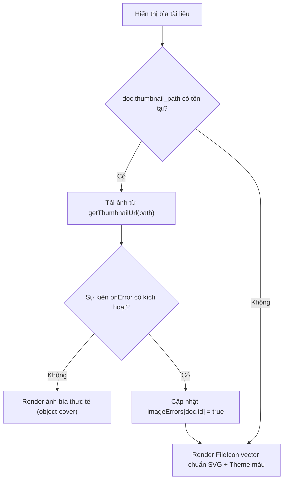

# Quy Tắc Nghiệp Vụ & Hành Vi Giao Diện (Business & UI Rules)

Tài liệu quy định các quy tắc nghiệp vụ, cơ chế dự phòng (fallback), thuật toán tính toán và hành vi giao diện người dùng được áp dụng đồng bộ trong hệ thống hiển thị tài liệu đa phong cách.

---

## 1. Quy Tắc Trích Xuất & Hiển Thị Văn Bản (OCR / Text Snippet)

Chế độ Danh sách chi tiết ([`DocumentDetailView`](file:///Users/caotiendattx/Developer/Do_An_Co_So/Foundation-Project/frontend/digital-library/src/components/shared/documents/DocumentDetailView.tsx)) cung cấp hộp xem trước văn bản trích xuất trực tiếp từ cột `documents.content` của cơ sở dữ liệu.

### 1.1. Chuẩn hóa chuỗi văn bản (`extractSummary`)
- **Độ dài tối đa:** Cắt lấy tối đa $600$ ký tự đầu tiên của văn bản.
- **Làm sạch chuỗi (Sanitization):** Loại bỏ các khoảng trắng thừa, tab thừa và chuẩn hóa các ký tự xuống dòng liên tiếp (`\n\n+`) thành một dấu cách hoặc dòng đơn để tiết kiệm diện tích.
- **Giới hạn hiển thị trên giao diện:** Áp dụng lớp CSS `line-clamp-4 leading-relaxed font-normal text-gray-600`.
- **Quy tắc dự phòng (Fallback):**
  - Nếu `content === null`, rỗng hoặc chỉ toàn khoảng trắng: Hệ thống hiển thị dòng thông báo chữ nghiêng màu xám:
    > *"Tài liệu này chưa có bản trích xuất văn bản (OCR/Text)."*
  - Không bao giờ để khoảng trắng trống trải làm vỡ chiều cao cố định của thẻ.

---

## 2. Quy Tắc Quản Lý Ảnh Bìa & Fallback An Toàn (Thumbnails)

Để đảm bảo trải nghiệm người dùng luôn mượt mà và không bao giờ xuất hiện icon ảnh vỡ (broken image icon), quy trình render ảnh bìa tuân thủ cây ưu tiên 2 tầng:



1. **Tầng 1 - Ảnh bìa thực tế:**
   - Hệ thống gọi hàm `getThumbnailUrl(doc.thumbnail_path)`.
   - Áp dụng `object-cover transition-transform duration-500 group-hover:scale-105`.
2. **Tầng 2 - Xử lý lỗi & Dự phòng Vector:**
   - Khi trình duyệt không thể tải ảnh (lỗi mạng, file bị xóa khỏi storage), sự kiện `onError` sẽ được bắt và lưu vào state `imageErrors[doc.id] = true`.
   - Ngay lập tức, component chuyển sang render [`FileIcon`](file:///Users/caotiendattx/Developer/Do_An_Co_So/Foundation-Project/frontend/digital-library/src/components/shared/documents/FileIcon.tsx) vector dạng SVG rõ nét với màu sắc tương thích hoàn toàn theo định dạng MIME.

---

## 3. Quy Chuẩn Màu Sắc Theo Định Dạng Tệp (`FILE_TYPE_THEMES`)

Hệ thống định nghĩa bảng mã màu nhận diện thương hiệu cho từng loại đuôi tệp học tập:

| Nhóm định dạng | Màu sắc chủ đạo | Ý nghĩa thị giác |
| :--- | :--- | :--- |
| **PDF** (`.pdf`) | **Rose (Đỏ)** | Tài liệu tài liệu tham khảo chính thống, sách giáo trình |
| **Word** (`.doc`, `.docx`) | **Blue (Xanh dương)** | Bài tập lớn, văn bản soạn thảo, báo cáo đồ án |
| **Excel** (`.xls`, `.xlsx`) | **Emerald (Xanh lá)** | Bảng tính số liệu, thống kê khảo sát |
| **PowerPoint** (`.ppt`, `.pptx`) | **Amber (Vàng cam)** | Slide thuyết trình bài giảng, seminar |
| **Images** (`.png`, `.jpg`, `.webp`)| **Purple (Tím nhạt)** | Hình ảnh sơ đồ, mockup thiết kế |
| **Archives** (`.zip`, `.rar`) | **Slate (Xám tro)** | Tệp nén tài nguyên tổng hợp |
| **Code** (`.py`, `.sql`, `.ts`...) | **Slate / Dark** | Mã nguồn lập trình (hiển thị icon mã hóa) |
| **Bundle (Gói tài liệu)** | **Purple (Tím đậm)** | Thư mục gói chứa nhiều tài liệu liên quan |

---

## 4. Quy Tắc Xếp Hạng & Huy Hiệu Tương Tác (Activity Heat)

Hệ thống tính toán độ nhiệt của tài liệu thông qua trường `personal_view_count` (trong kho cá nhân) hoặc `view_count` (trong nhóm/kho học liệu) bằng hàm `getActivityHeat(count)`:

| Số lượt xem | Cấp độ | Tên huy hiệu hiển thị | Hiệu ứng giao diện trên 3 View |
| :---: | :---: | :--- | :--- |
| **$0 - 4$** | Cấp 0 | *Không hiển thị huy hiệu* | Màu nền thẻ trắng tiêu chuẩn (`bg-white`) |
| **$5 - 19$** | Cấp 1 | `5+ xem` | Huy hiệu xanh nhạt, viền `border-blue-200`, nền `bg-blue-50/20` |
| **$20 - 49$** | Cấp 2 | `20+ xem` | Huy hiệu cam ấm, viền `border-amber-200`, nền `bg-amber-50/20` |
| **$\ge 50$** | Cấp 3 | `🔥 Siêu hot` | Huy hiệu đỏ lửa, viền `border-rose-300`, nền `bg-rose-50/30` |

---

## 5. Quy Tắc Thao Tác Chọn Nhiều & Bộ Nhớ Lựa Chọn (Multi-Select Persistence)

1. **Bảo toàn trạng thái khi chuyển View (Zero Loss on View Switching):**
   - Danh sách `selectedIds` được lưu trữ tại Section cha (`PersonalDocumentsSection` hoặc `GroupDocumentsSection`).
   - Khi người dùng click chuyển đổi giữa `Grid`, `List` và `Detail`, mảng `selectedIds` **hoàn toàn được giữ nguyên**, không bị reset hay mất dữ liệu đã tích chọn.
2. **Quy tắc thao tác trên Gói tài liệu (Bundle Operations):**
   - **Tải ZIP hàng loạt:** Tải về toàn bộ các tệp đơn lẻ và cả các file con bên trong bundle đã chọn.
   - **Xóa hàng loạt:** Di chuyển cả bundle và các file đã chọn vào thùng rác sau khi người dùng xác nhận.
   - **Đóng góp vào Kho học liệu cộng đồng (`ContributeModal`):**
     > [!IMPORTANT]
     > Hệ thống tự động **lọc bỏ các gói Bundle** khỏi danh sách đóng góp:
     > ```typescript
     > const docsToContribute = filteredDocCards
     >   .filter((d) => selectedIds.includes(String(d.id)) && !d.is_bundle)
     >   .map((d) => ({ id: Number(d.id), title: d.name }));
     > ```
     > Nếu người dùng chỉ chọn gói Bundle mà không có tệp đơn nào, hệ thống sẽ hiện thông báo nhắc nhở: *"Vui lòng chọn ít nhất 1 tệp tài liệu đơn lẻ (không phải gói bundle) để đóng góp."*

---

## 6. Quy Tắc Mở Rộng & Lọc Dữ Liệu Bundle (Bundle Expansion Rules)

1. **Trong Chế Độ Lưới (Grid View):**
   - Mặc định khởi tạo ở trạng thái mở rộng `isExpandedMode = true` để hiển thị khung [`BundleExpandedFrame`](file:///Users/caotiendattx/Developer/Do_An_Co_So/Foundation-Project/frontend/digital-library/src/pages/personal/components/BundleExpandedFrame.tsx).
   - Khi có bất kỳ bộ lọc nào đang kích hoạt (`searchQuery !== ''` hoặc `selectedTagId !== null`):
     - Hệ thống **tự động ép trạng thái mở rộng** (`setIsExpandedMode(true)`).
     - Áp dụng bộ lọc lồng nhau trên các file con bên trong bundle: Chỉ render khung bundle nếu bundle đó chứa ít nhất một file con thỏa mãn từ khóa hoặc tag đang lọc.
2. **Trong Chế Độ Bảng (List View):**
   - Hiển thị nút mũi tên `ChevronRight`.
   - Click vào mũi tên kích hoạt hàm `handleToggleBundle(bundleId)`.
   - Sử dụng cơ chế Lazy Load: Chỉ gửi request API `documentService.getBundleChildren` ở lần click đầu tiên, sau đó lưu kết quả vào bộ nhớ cache client `bundleChildren[bundleId]` để các lần đóng/mở sau diễn ra tức thì không tốn băng thông.
