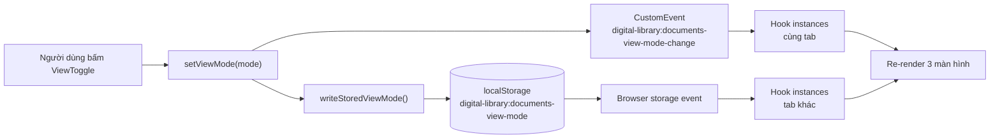
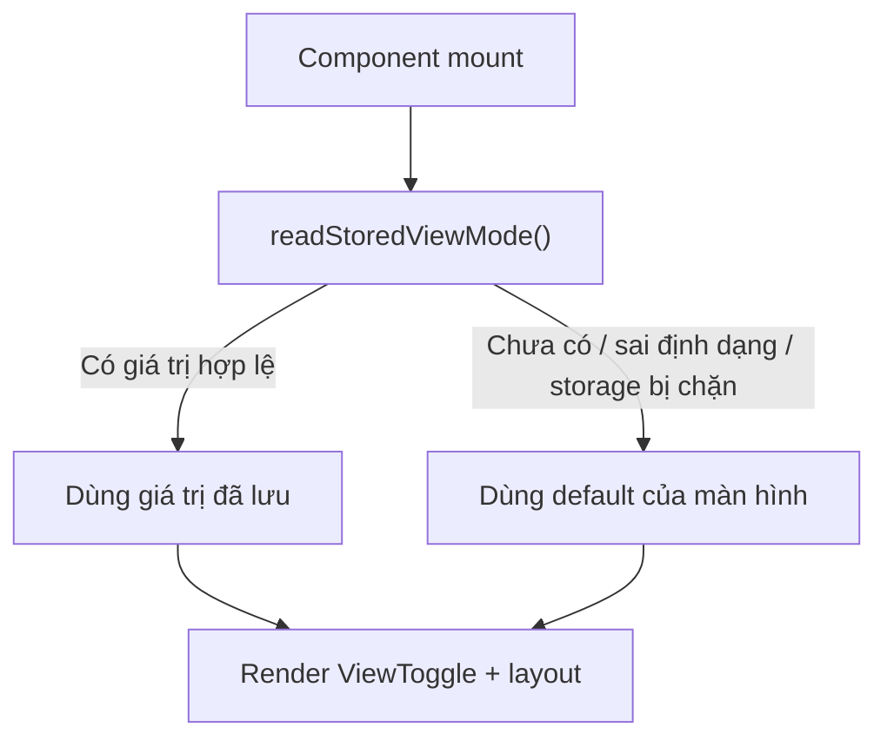

# Lưu Bền & Đồng Bộ Chế Độ Hiển Thị (View Mode Persistence)

Tài liệu này mô tả cơ chế lưu lựa chọn **Grid / List / Detail** vào `localStorage`, cách đồng bộ lựa chọn giữa các màn hình tài liệu, lý do chọn phương án này và bằng chứng kiểm thử trên ứng dụng thực tế.

> [!IMPORTANT] Trạng thái: `Implemented`
> Phạm vi áp dụng: Kho tài liệu cá nhân, Tài liệu đã nhận và Kho học liệu theo môn.

---

## 1. Vấn Đề Trước Khi Sửa

`PersonalDocumentsSection` và `LibrarySubject` từng giữ `viewMode` bằng `useState` cục bộ:

```tsx
const [viewMode, setViewMode] = useState<ViewMode>("detail");
```

Vì state nằm trong component, khi React Router unmount trang để chuyển sang màn hình khác rồi quay lại, component được mount lại và state trở về giá trị khởi tạo:

1. Người dùng chọn **Grid** ở `/personal/documents`.
2. Chuyển sang `/personal/trash`.
3. Quay lại `/personal/documents`.
4. `PersonalDocumentsSection` bị mount lại → `viewMode` về `"detail"`.

Lỗi tương tự xảy ra khi chuyển tab nội bộ của `SharedWithMe` (tab "Đã nhận" unmount `PersonalDocumentsSection`), hoặc khi quay lại `/library/subject/:subjectId` sau khi rời trang.

---

## 2. Phạm Vi Áp Dụng

| Màn hình | Route | Component sử dụng hook | Default khi chưa có lựa chọn |
| :--- | :--- | :--- | :--- |
| Kho tài liệu cá nhân | `/personal/documents` | `PersonalDocumentsSection` | `detail` |
| Tài liệu đã nhận | `/personal/shared` | `PersonalDocumentsSection` (tab Đã nhận) | `detail` |
| Kho học liệu theo môn | `/library/subject/:subjectId` | `LibrarySubject` | `grid` |

Ba màn hình dùng **cùng một key localStorage**, nên lựa chọn được đồng bộ với nhau. Mỗi màn hình vẫn giữ default cũ khi người dùng chưa từng chọn, tránh thay đổi trải nghiệm mặc định hiện tại.

> [!NOTE] Ngoài phạm vi
> `GroupDocumentsSection`, `BundleDetailPage` và các danh sách khác vẫn đang dùng state cục bộ. Có thể tích hợp cùng hook sau nếu muốn đồng bộ toàn hệ thống.

---

## 3. Kiến Trúc Giải Pháp

### 3.1. Sơ đồ luồng ghi & đồng bộ



### 3.2. Sơ đồ đọc khi mount



### 3.3. Key & event dùng chung

| Thành phần | Giá trị |
| :--- | :--- |
| localStorage key | `digital-library:documents-view-mode` |
| Custom event (cùng tab) | `digital-library:documents-view-mode-change` |
| Giá trị hợp lệ | `grid` \| `list` \| `detail` |
| Default toàn cục | `detail` |
| Default riêng từng màn hình | personal/shared: `detail`, library subject: `grid` |

---

## 4. Triển Khai Mã Nguồn

### 4.1. Lớp lưu trữ thuần (`src/utils/viewModeStorage.ts`)

Tách logic đọc/ghi/validate ra khỏi React để có thể unit test bằng Node mà không cần DOM:

```ts
export type ViewMode = "grid" | "list" | "detail";

export const VIEW_MODE_STORAGE_KEY =
  "digital-library:documents-view-mode";

export function isViewMode(value: unknown): value is ViewMode {
  return (
    typeof value === "string" &&
    (["grid", "list", "detail"] as readonly string[]).includes(value)
  );
}

export function readStoredViewMode(storage): ViewMode | null {
  try {
    const value = storage?.getItem(VIEW_MODE_STORAGE_KEY) ?? null;
    return isViewMode(value) ? value : null;
  } catch {
    return null;
  }
}

export function writeStoredViewMode(storage, mode): boolean {
  try {
    storage?.setItem(VIEW_MODE_STORAGE_KEY, mode);
    return true;
  } catch {
    return false;
  }
}
```

Điểm quan trọng:

- Giá trị sai định dạng (`"GRID"`, `"table"`, dữ liệu cũ) trả về `null` để dùng default, không làm crash UI.
- `try/catch` xử lý trường hợp Safari private mode hoặc trình duyệt chặn storage.
- Hàm nhận storage qua tham số nên test được bằng object giả, không phụ thuộc `window`.

### 4.2. Hook React (`src/hooks/usePersistedViewMode.ts`)

```tsx
const [viewMode, setViewMode] = usePersistedViewMode("detail");
```

Cách hoạt động:

1. Khởi tạo state bằng `readStoredViewMode(window.localStorage) ?? defaultMode`.
2. Khi người dùng chọn:
   - Cập nhật state ngay để UI phản hồi tức thì.
   - Ghi vào `localStorage`.
   - Phát `CustomEvent` để các component đang mount trong cùng tab đồng bộ.
3. Lắng nghe:
   - `storage` event của trình duyệt → đồng bộ tab khác.
   - Custom event → đồng bộ component khác trong cùng tab.
4. Nếu storage bị chặn, custom event vẫn giữ đồng bộ tạm thời trong RAM của tab hiện tại.

### 4.3. Tích hợp vào 3 màn hình

**Kho tài liệu / Tài liệu đã nhận:**

```tsx
// PersonalDocumentsSection.tsx
const [viewMode, setViewMode] = usePersistedViewMode("detail");

<ViewToggle viewMode={viewMode} onViewModeChange={setViewMode} />
```

**Kho học liệu theo môn:**

```tsx
// LibrarySubject.tsx
const [viewMode, setViewMode] = usePersistedViewMode("grid");
```

**ViewToggle vẫn giữ API cũ:** `ViewMode` được chuyển sang `src/utils/viewModeStorage.ts` và re-export từ `ViewToggle.tsx`, nên các component đang import `type ViewMode` từ `ViewToggle` không cần sửa.

---

## 5. Vì Sao Chọn `localStorage`?

### 5.1. Yêu cầu thực tế

- Chỉ có **3 giá trị enum**, không phải dữ liệu nghiệp vụ.
- Là **UI preference theo thiết bị/trình duyệt**, không cần đồng bộ giữa các máy.
- Phải sống qua **unmount/remount do chuyển route**, **F5**, **đăng nhập/đăng xuất**.
- Không cần API, không cần database, không cần thêm dependency.
- Không được làm thay đổi default hiện tại của từng màn hình.

### 5.2. So sánh phương án

| Phương án | Sống qua chuyển route | Sống qua F5 | Sống qua login/logout | Chi phí | Kết luận |
| :--- | :---: | :---: | :---: | :--- | :--- |
| `useState` cục bộ | ❌ | ❌ | ❌ | 0 | Không đáp ứng yêu cầu |
| React Query cache | ✅ (trong `gcTime`) | ❌ | ❌ (`queryClient.clear()`) | ~1.1 KB/entry | Sai ngữ nghĩa, dễ mất dữ liệu |
| Zustand không persist | ✅ | ❌ | ❌ | Vài chục byte | Chỉ phù hợp nếu muốn reset khi F5 |
| URL query param | Một phần | ✅ nếu giữ URL | ✅ | 0 | Mất khi điều hướng bằng sidebar |
| React Context ở layout | ✅ | ❌ | ❌ | Thấp | Không sống qua F5, coupling layout |
| **`localStorage`** | ✅ | ✅ | ✅ | **78 B payload** | **Phù hợp nhất** |

### 5.3. Đối chiếu với React Query

Benchmark thực tế (Node 26, `--expose-gc`, 10.000 entry):

| Chỉ số | `localStorage` | React Query cache |
| :--- | ---: | ---: |
| Payload lưu | 78 B (UTF-16) | 674 B JSON |
| RAM thực tế / entry | Không nằm trong JS heap app | ~1.1 KB (gcTime 10 phút) |
| Sống qua F5 | ✅ | ❌ |
| Sống qua `queryClient.clear()` | ✅ | ❌ |
| Tự xóa sau `gcTime` | Không | ✅ (10 phút) |
| Đúng ngữ nghĩa UI state | ✅ | ❌ |

React Query **không yếu về bộ nhớ** — một key chỉ tốn khoảng 1.1 KB. Vấn đề là lifecycle:

- `App.tsx` đặt `gcTime: 10 * 60 * 1000`, nên entry không observer sẽ bị xóa sau 10 phút.
- `LoginPage.tsx` và `Header.tsx` gọi `queryClient.clear()` khi login/logout.
- React Query sinh ra cho server state, không phải preference UI.

Vì vậy `localStorage` tối ưu hơn cho bài toán này: đúng ngữ nghĩa, bền vững, không phụ thuộc vòng đời cache, và gần như không tốn tài nguyên.

> [!TIP] Khi nào không dùng `localStorage`?
> Nếu sau này cần đồng bộ lựa chọn giữa nhiều thiết bị hoặc lưu theo tài khoản, hãy chuyển sang bảng `user_preferences` ở backend. `localStorage` chỉ là lựa chọn tối ưu cho preference theo thiết bị hiện tại.

---

## 6. Kiểm Thử & Bằng Chứng

### 6.1. Unit test lớp lưu trữ

File: `frontend/digital-library/scripts/view-mode-storage.test.mjs`

```bash
cd frontend/digital-library
node --test scripts/view-mode-storage.test.mjs
```

Kết quả thực tế: **9/9 test PASS**, bao gồm:

- Key dùng chung đúng giá trị.
- Chỉ chấp nhận `grid`, `list`, `detail`.
- Đọc/ghi đúng key/value.
- Giá trị hỏng fallback `null`.
- Storage bị chặn khi đọc/ghi không làm crash.
- Không truyền storage vẫn an toàn.

### 6.2. Benchmark tài nguyên

File: `frontend/digital-library/scripts/benchmark-view-mode-storage.mjs`

```bash
cd frontend/digital-library
node --expose-gc scripts/benchmark-view-mode-storage.mjs
```

Kết quả rút gọn:

```text
localStorage key + value: 39 ký tự
UTF-16 (Web Storage thực tế): 78 B
Tỷ lệ dùng quota 5 MiB: 1.49e-3 %

Module-level object:        ~40 B/entry
React Query (Infinity):     ~869 B/entry
React Query (10 phút):      ~1.1 KB/entry

PASS  React Query giữ được giá trị khi đọc lại
PASS  queryClient.clear() xóa mất giá trị
PASS  gcTime hết hạn thì React Query tự xóa entry
PASS  localStorage payload không vượt quá 100 B
```

### 6.3. Kiểm thử E2E trên ứng dụng thực tế

Môi trường: Vite `http://localhost:5173`, backend `http://localhost:8000`, tài khoản seed.

| Bước kiểm thử | Kết quả mong đợi | Kết quả thực tế |
| :--- | :--- | :--- |
| `/personal/documents` → chọn Grid | localStorage = `grid`, nút Grid `aria-pressed="true"` | ✅ |
| Chuyển `/personal/trash` rồi quay lại `/personal/documents` | Vẫn Grid | ✅ |
| Nhấn F5 trên `/personal/documents` | Vẫn Grid | ✅ |
| Mở `/personal/shared` (tab Đã nhận) | Vẫn Grid | ✅ |
| Mở `/library/subject/1` | Vẫn Grid | ✅ |
| Tại library subject chọn List | localStorage = `list` | ✅ |
| Quay lại `/personal/documents` | Chuyển sang List | ✅ |
| Mở 2 tab, đổi Detail ở tab A | Tab B tự cập nhật Detail qua `storage` event | ✅ |
| Xóa key localStorage | Personal về `detail`, library subject về `grid` | ✅ |

Kết quả trên chứng minh:

- Lựa chọn được giữ qua điều hướng và reload dữ liệu route.
- Ba màn hình đồng bộ hai chiều.
- Đồng bộ cả giữa các tab đang mở.
- Default riêng của từng màn hình vẫn đúng khi chưa có lựa chọn.

### 6.4. Kiểm tra build & lint

```bash
cd frontend/digital-library
npm run build   # PASS
npm run lint    # Không phát sinh cảnh báo mới từ các file thay đổi
```

---

## 7. Edge Cases & Giới Hạn

| Tình huống | Hành vi |
| :--- | :--- |
| Chưa có key | Dùng default của từng màn hình (`detail` hoặc `grid`) |
| Giá trị sai định dạng | Fallback default, không crash |
| Safari private mode / storage bị chặn | Vẫn đổi được trong tab hiện tại nhờ state + custom event; reload sẽ mất |
| Xóa site data / incognito | Về default |
| Đổi port dev (`5173` → `5174`) | Origin khác → không dùng chung preference |
| Nhiều tài khoản cùng trình duyệt | Dùng chung preference vì key không chứa user ID |
| Đồng bộ giữa thiết bị | Không hỗ trợ; cần backend user preferences |
| Library subject chọn `detail` | Trang hiện chỉ có layout Grid/List; `detail` render theo nhánh List. Đây là giới hạn UI hiện tại, không phải lỗi lưu trữ |
| Tab khác đang mở | Đồng bộ qua `storage` event; nếu trình duyệt không phát event, lần mount sau vẫn đọc đúng |

> [!CAUTION] Không lưu dữ liệu nhạy cảm
> `localStorage` đọc được bằng JavaScript cùng origin. Chỉ dùng cho preference UI như `viewMode`; không dùng cho token, mật khẩu hoặc dữ liệu cá nhân nhạy cảm.

---

## 8. Hướng Dẫn Mở Rộng

### Thêm màn hình mới

```tsx
import { usePersistedViewMode } from "@/hooks/usePersistedViewMode";

const [viewMode, setViewMode] = usePersistedViewMode("detail");
```

Chỉ cần dùng hook và truyền default phù hợp; màn hình mới sẽ tự đồng bộ với 3 màn hình hiện có.

### Thêm chế độ mới

1. Cập nhật `ViewMode`, `VIEW_MODES` trong `src/utils/viewModeStorage.ts`.
2. Thêm option icon/label trong `ViewToggle.tsx`.
3. Cập nhật logic render ở từng màn hình.
4. Bổ sung test case trong `scripts/view-mode-storage.test.mjs`.
5. Cập nhật tài liệu này.

### Đổi key

Không nên đổi `digital-library:documents-view-mode` tùy tiện: toàn bộ người dùng sẽ mất preference đã lưu. Nếu buộc phải đổi, cần viết migration đọc key cũ và ghi sang key mới.

---

## 9. Tài Liệu & Mã Nguồn Liên Quan

- [`ViewToggle.tsx`](file:///Users/caotiendattx/Developer/Do_An_Co_So/Foundation-Project/frontend/digital-library/src/components/shared/feedback/ViewToggle.tsx) — UI chuyển đổi 3 chế độ.
- [`viewModeStorage.ts`](file:///Users/caotiendattx/Developer/Do_An_Co_So/Foundation-Project/frontend/digital-library/src/utils/viewModeStorage.ts) — validate, đọc, ghi localStorage.
- [`usePersistedViewMode.ts`](file:///Users/caotiendattx/Developer/Do_An_Co_So/Foundation-Project/frontend/digital-library/src/hooks/usePersistedViewMode.ts) — hook React + đồng bộ sự kiện.
- [`PersonalDocumentsSection.tsx`](file:///Users/caotiendattx/Developer/Do_An_Co_So/Foundation-Project/frontend/digital-library/src/pages/personal/components/PersonalDocumentsSection.tsx) — Kho tài liệu & Tài liệu đã nhận.
- [`LibrarySubject.tsx`](file:///Users/caotiendattx/Developer/Do_An_Co_So/Foundation-Project/frontend/digital-library/src/pages/library/LibrarySubject.tsx) — Kho học liệu theo môn.
- [`view-mode-storage.test.mjs`](file:///Users/caotiendattx/Developer/Do_An_Co_So/Foundation-Project/frontend/digital-library/scripts/view-mode-storage.test.mjs) — unit test.
- [`benchmark-view-mode-storage.mjs`](file:///Users/caotiendattx/Developer/Do_An_Co_So/Foundation-Project/frontend/digital-library/scripts/benchmark-view-mode-storage.mjs) — benchmark tài nguyên.
- [`README.md`](./README.md) — đặc tả chung về 3 chế độ hiển thị.
- [`FRONTEND.md`](./FRONTEND.md) — kiến trúc component và state management.
