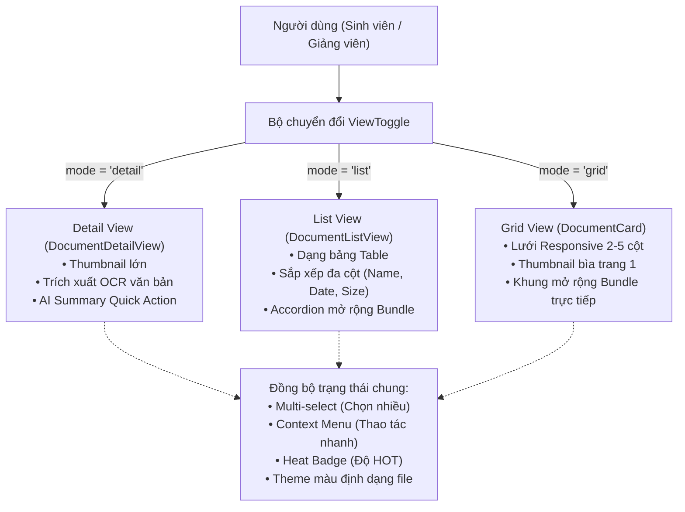
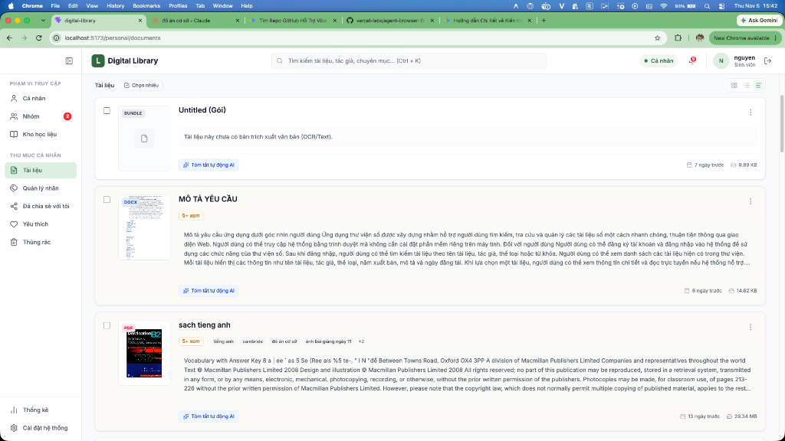
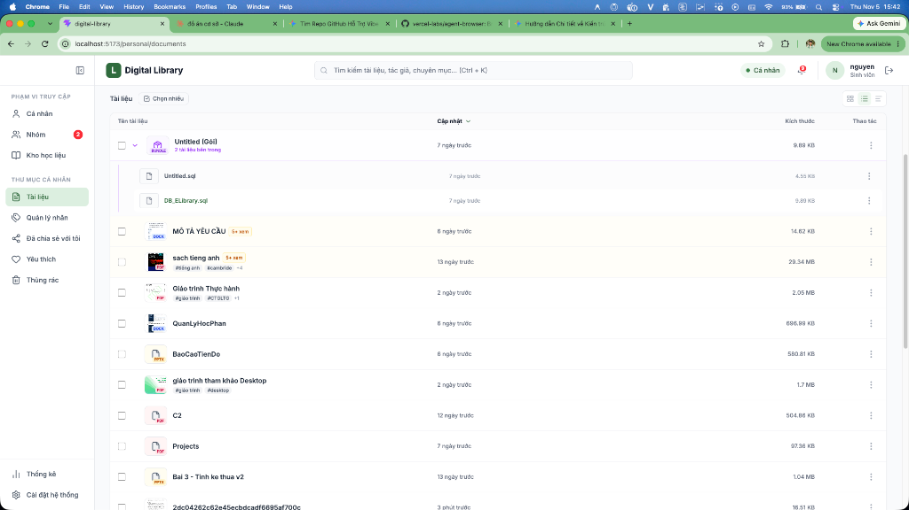
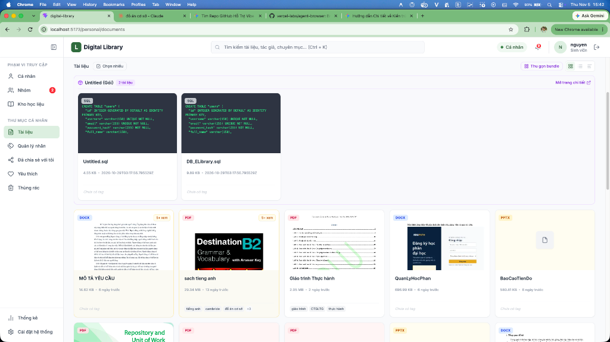
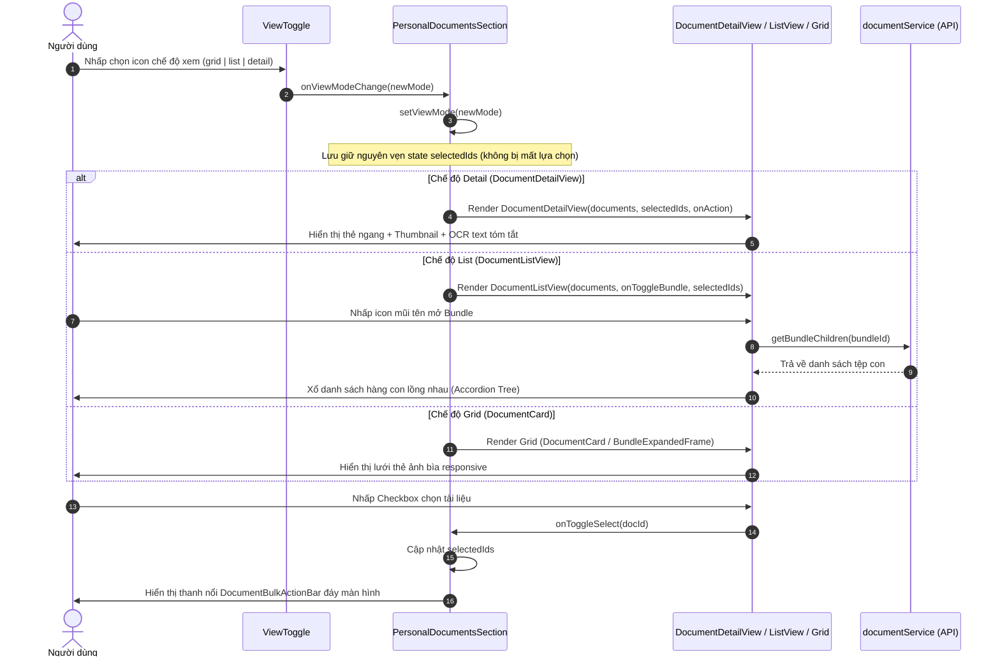

# Đặc Tả Tính Năng: Chế Độ Hiển Thị Tài Liệu Đa Phong Cách (Document Multi-View Modes)

Tài liệu kỹ thuật toàn diện về tính năng **Hiển thị tài liệu dưới nhiều phong cách** (Grid View, List/Table View, Detail/Snippet View) trong hệ sinh thái Thư viện số (Digital Library).

---

## 📑 Mục Lục Điều Hướng

1. [Bối Cảnh & Triết Lý Thiết Kế (Context & Design Philosophy)](#1-bối-cảnh--triết-lý-thiết-kế)
2. [Chi Tiết 3 Chế Độ Hiển Thị (The 3 View Modes)](#2-chi-tiết-3-chế-độ-hiển-thị)
   - [2.1. Chế Độ Danh Sách Chi Tiết (Detail / Snippet View)](#21-chế-độ-danh-sách-chi-tiết-detail--snippet-view)
   - [2.2. Chế Độ Danh Sách / Bảng Tra Cứu (List / Table View)](#22-chế-độ-danh-sách--bảng-tra-cứu-list--table-view)
   - [2.3. Chế Độ Lưới Trực Quan (Grid View)](#23-chế-độ-lưới-trực-quan-grid-view)
3. [Bảng Ma Trận So Sánh & Kịch Bản Sử Dụng (Comparison Matrix)](#3-bảng-ma-trận-so-sánh--kịch-bản-sử-dụng)
4. [Kiến Trúc Thành Phần & Cây Thư Mục (Architecture & Folder Structure)](#4-kiến-trúc-thành-phần--cây-thư-mục)
5. [Sơ Đồ Dòng Dữ Liệu & Tương Tác Trạng Thái (Data & State Flow)](#5-sơ-đồ-dòng-dữ-liệu--tương-tác-trạng-thái)
6. [Mạng Lưới Tái Sử Dụng Trên Toàn Hệ Thống (Reusability Map)](#6-mạng-lưới-tái-sử-dụng-trên-toàn-hệ-thống)
7. [Tài Liệu Chi Tiết Đi Kèm (Related Documentation)](#7-tài-liệu-chi-tiết-đi-kèm)

---

## 1. Bối Cảnh & Triết Lý Thiết Kế

### 1.1. Thách thức trong trải nghiệm duyệt tài liệu số
Trong các thư viện số truyền thống hoặc các hệ thống lưu trữ tệp đám mây (Cloud Storage), người dùng thường gặp phải một trong hai thái cực:
1. **Chỉ có chế độ Lưới (Grid):** Đẹp mắt với ảnh bìa nhưng chiếm nhiều diện tích, khó quét nhanh các thông số kỹ thuật (dung lượng, số trang, ngày giờ chính xác) và không thể xem trước nội dung mà không phải mở file.
2. **Chỉ có chế độ Danh sách (Table/List):** Tiết kiệm diện tích và hiển thị nhiều thông số dạng bảng nhưng khô khan, thiếu tính trực quan về hình ảnh bìa và không hỗ trợ đọc lướt văn bản trích xuất.

### 1.2. Giải pháp đột phá từ Digital Library
Hệ thống Digital Library cung cấp cơ chế **3 chế độ hiển thị linh hoạt (Tri-View Architecture)**, kết hợp tinh hoa từ các nền tảng quản trị tài liệu hàng đầu thế giới:
- **Google Drive / Dropbox:** Chuẩn hóa thao tác chọn chế độ xem tức thời thông qua bộ nút điều hướng [`ViewToggle`](file:///Users/caotiendattx/Developer/Do_An_Co_So/Foundation-Project/frontend/digital-library/src/components/shared/feedback/ViewToggle.tsx).
- **Paperless-ngx:** Cung cấp chế độ **Danh sách chi tiết (Detail View)** hiển thị đoạn trích xuất OCR/Full-text ngay trên thẻ tài liệu, cho phép sinh viên duyệt nhanh bài giảng, đồ án mà không cần mở file.
- **Studocu / Scribd:** Tích hợp trực quan huy hiệu độ tương tác (Activity Heat: Lượt xem, xu hướng) và tóm tắt thông minh bằng AI.



---

## 2. Chi Tiết 3 Chế Độ Hiển Thị

### 2.1. Chế Độ Danh Sách Chi Tiết (Detail / Snippet View)
*Chế độ mặc định được khuyến nghị cho không gian cá nhân và nhóm học tập.*



- **Biểu tượng điều hướng:** `AlignLeft` (`<AlignLeft className="h-4 w-4" />`).
- **Thành phần đảm nhiệm:** [`DocumentDetailView.tsx`](file:///Users/caotiendattx/Developer/Do_An_Co_So/Foundation-Project/frontend/digital-library/src/components/shared/documents/DocumentDetailView.tsx).
- **Đặc trưng thiết kế:**
  - **Khung thẻ nằm ngang (Horizontal Card):** Tận dụng tối đa chiều rộng màn hình, phân bố thông tin cân đối từ trái sang phải.
  - **Khung Thumbnail lớn (32×40):** Hiển thị rõ nét bìa trang 1 của PDF, Word (chụp qua `html2canvas`), hoặc biểu tượng định dạng nhận diện màu sắc (`FILE_TYPE_THEMES`).
  - **Trích xuất nội dung văn bản (OCR / Text Snippet):** Trích xuất tối đa 600 ký tự từ cột `content` của database (được trích xuất tự động qua backend worker hoặc OCR engine). Hiển thị mượt mà với hiệu ứng `line-clamp-4`. Nếu tài liệu chưa có OCR, hệ thống hiển thị thông báo dịu nhẹ *"Tài liệu này chưa có bản trích xuất văn bản (OCR/Text)"*.
  - **Nút hành động nhanh "Tóm tắt tự động AI":** Tích hợp nút AI với biểu tượng `Sparkles` màu xanh công nghệ, sẵn sàng kết nối dịch vụ LLM sinh tóm tắt nội dung tự động.
  - **Huy hiệu tương tác (Activity Heat):** Hiển thị nhãn nổi bật như `5+ xem`, `20+ xem` hoặc `🔥 Siêu hot` theo mức độ truy cập thực tế của người dùng.
  - **Footer giàu Metadata:** Cung cấp thông tin ngày cập nhật (`Calendar`), dung lượng định dạng chuẩn (`HardDrive`), số trang tài liệu (`Files`) và Avatar người tạo (`User` - khi ở chế độ chia sẻ/nhóm).

---

### 2.2. Chế Độ Danh Sách / Bảng Tra Cứu (List / Table View)
*Tối ưu hóa năng suất cho nhu cầu quản lý tệp tin số lượng lớn và thao tác nhanh.*



- **Biểu tượng điều hướng:** `List` (`<List className="h-4 w-4" />`).
- **Thành phần đảm nhiệm:** [`DocumentListView.tsx`](file:///Users/caotiendattx/Developer/Do_An_Co_So/Foundation-Project/frontend/digital-library/src/components/shared/documents/DocumentListView.tsx).
- **Đặc trưng thiết kế:**
  - **Bố cục dạng Bảng 12 cột (12-Column Table Grid):** Phân chia rõ ràng: Checkbox lựa chọn, Tên tài liệu & Thumbnail mini (5 cột), Ngày cập nhật (3 cột), Kích thước tệp (3 cột), Menu thao tác (1 cột).
  - **Sắp xếp linh hoạt (Sortable Columns):** Người dùng có thể click vào tiêu đề các cột *Tên tài liệu*, *Cập nhật*, *Kích thước* để đảo chiều sắp xếp (Tăng dần/Giảm dần) với icon mũi tên xoay 180° mượt mà.
  - **Hỗ trợ Gói tài liệu lồng nhau (Expandable Bundle Accordion):** Khi dòng là một Gói tài liệu (`is_bundle === true`), hệ thống hiển thị nút mũi tên mở rộng (`ChevronRight`). Click vào nút sẽ kích hoạt cơ chế Lazy Fetching tải danh sách tài liệu con bên trong gói mà không cần chuyển trang.
  - **Hiệu ứng Hover & Lựa chọn:** Hàng được làm nổi bật với màu nền dịu nhẹ tương ứng với mức độ nhiệt (`heat.hoverBg`) hoặc viền primary khi checkbox được chọn.

---

### 2.3. Chế Độ Lưới Trực Quan (Grid View)
*Trực quan hóa hình ảnh, thích hợp cho việc duyệt giáo trình, slide bài giảng và hình ảnh.*



- **Biểu tượng điều hướng:** `LayoutGrid` (`<LayoutGrid className="h-4 w-4" />`).
- **Thành phần đảm nhiệm:** [`DocumentCard.tsx`](file:///Users/caotiendattx/Developer/Do_An_Co_So/Foundation-Project/frontend/digital-library/src/components/shared/documents/DocumentCard/DocumentCard.tsx) kết hợp [`BundleExpandedFrame.tsx`](file:///Users/caotiendattx/Developer/Do_An_Co_So/Foundation-Project/frontend/digital-library/src/pages/personal/components/BundleExpandedFrame.tsx).
- **Đặc trưng thiết kế:**
  - **Lưới đa cột co giãn thích ứng (Responsive Grid):** Tự động điều chỉnh số cột theo kích thước màn hình: 2 cột trên điện thoại (`grid-cols-2`), 3 cột trên tablet (`md:grid-cols-3`), 4 cột trên laptop (`lg:grid-cols-4`) và 5 cột trên màn hình lớn (`xl:grid-cols-5`).
  - **Thẻ thẻ bài File trực quan ([`FileDocumentCard.tsx`](file:///Users/caotiendattx/Developer/Do_An_Co_So/Foundation-Project/frontend/digital-library/src/components/shared/documents/DocumentCard/FileDocumentCard.tsx)):** Hình bìa tràn viền tỷ lệ chuẩn, nhãn định dạng màu sắc (PDF đỏ, DOCX xanh dương, XLSX xanh lá, PPTX vàng cam, SQL tím than), hiệu ứng phóng to hover nhẹ nhàng.
  - **Khung xem Bundle độc đáo ([`BundleExpandedFrame.tsx`](file:///Users/caotiendattx/Developer/Do_An_Co_So/Foundation-Project/frontend/digital-library/src/pages/personal/components/BundleExpandedFrame.tsx)):** Khi có gói tài liệu, hệ thống hiển thị nút chuyển đổi *"Xem nội dung bundle / Thu gọn bundle"*. Ở chế độ mở rộng, gói tài liệu trải dài toàn bộ chiều rộng (`col-span-full`) thành một khung nền màu tím nhạt sang trọng, chứa đầy đủ các file con bên trong kèm link deep-link mở trang chi tiết gói.

---

## 3. Bảng Ma Trận So Sánh & Kịch Bản Sử Dụng

| Tiêu Chí Đánh Giá | Detail View (Danh Sách Chi Tiết) | List View (Bảng Tra Cứu) | Grid View (Lưới Trực Quan) |
| :--- | :--- | :--- | :--- |
| **Component cốt lõi** | [`DocumentDetailView.tsx`](file:///Users/caotiendattx/Developer/Do_An_Co_So/Foundation-Project/frontend/digital-library/src/components/shared/documents/DocumentDetailView.tsx) | [`DocumentListView.tsx`](file:///Users/caotiendattx/Developer/Do_An_Co_So/Foundation-Project/frontend/digital-library/src/components/shared/documents/DocumentListView.tsx) | [`DocumentCard.tsx`](file:///Users/caotiendattx/Developer/Do_An_Co_So/Foundation-Project/frontend/digital-library/src/components/shared/documents/DocumentCard/DocumentCard.tsx) |
| **Kích thước Thumbnail** | Lớn ($112 \times 144\text{ px}$ hoặc $128 \times 160\text{ px}$) | Nhỏ ($48 \times 40\text{ px}$) | Trung bình / Lớn (Tỷ lệ khung hình 4:3) |
| **Trích xuất nội dung (OCR)** | **Có** (4 dòng tóm tắt, tối đa 600 ký tự) | Không | Không |
| **Thao tác Sắp xếp (Sorting)** | Qua bộ lọc Filter Bar phía trên | **Trực tiếp trên tiêu đề các cột** | Qua bộ lọc Filter Bar phía trên |
| **Duyệt Bundle con** | Chuyển trang vào `/personal/bundle/:id` | **Accordion xổ xuống tại chỗ** | **Khung lưới mở rộng BundleFrame** |
| **Khả năng chọn nhiều (Bulk)** | Checkbox góc trên trái mỗi thẻ | Checkbox đầu mỗi dòng bảng | Checkbox nút tròn overlay góc trên phải |
| **Mật độ thông tin** | Toàn diện (Ảnh + Text + Metadata) | Rất cao (Nhiều dòng trên 1 màn hình) | Trung bình (Tập trung thị giác) |
| **Kịch bản phù hợp nhất** | • Đọc lướt tài liệu học tập, đồ án<br>• Tìm kiếm nội dung theo từ khóa<br>• Cần xem đoạn văn bản OCR nhanh | • Quản lý số lượng lớn file (hàng trăm tệp)<br>• Cần sắp xếp theo ngày/kích thước<br>• Quản trị viên kiểm tra kho | • Duyệt slide bài giảng, giáo trình PDF<br>• Duyệt ảnh thiết kế, sơ đồ kiến trúc<br>• Trải nghiệm duyệt trực quan |

---

## 4. Kiến Trúc Thành Phần & Cây Thư Mục

Cấu trúc mã nguồn của hệ thống hiển thị tài liệu được bố trí tập trung tại thư mục dùng chung:

```text
frontend/digital-library/src/
├── components/
│   └── shared/
│       ├── feedback/
│       │   └── ViewToggle.tsx              # Component 3 nút chuyển chế độ xem (Grid, List, Detail)
│       └── documents/
│           ├── index.ts                     # Barrel export cho toàn bộ module documents
│           ├── documentView.types.ts        # Định nghĩa kiểu DocumentListItem, BaseDocumentViewProps, Themes
│           ├── FileIcon.tsx                 # Icon chuyên biệt cho từng loại đuôi tệp
│           ├── DocumentDetailView.tsx       # Giao diện Danh sách chi tiết (Detail / Snippet View)
│           ├── DocumentListView.tsx         # Giao diện Danh sách bảng (List / Table View)
│           ├── DocumentContextMenu.tsx      # Menu ngữ cảnh thao tác tài liệu cá nhân
│           ├── DocumentBulkActionBar.tsx    # Thanh công cụ nổi thao tác hàng loạt khi có chọn nhiều
│           └── DocumentCard/                # Nhánh hiển thị dạng Lưới (Grid View)
│               ├── index.ts                 # Export DocumentCard
│               ├── DocumentCard.tsx         # Component định tuyến FileCard / BundleCard + Checkbox
│               ├── FileDocumentCard.tsx     # Card tài liệu đơn lẻ dạng lưới
│               └── BundleDocumentCard.tsx   # Card gói tài liệu dạng lưới
├── pages/
│   ├── personal/
│   │   ├── PersonalDocuments.tsx            # Trang tài liệu cá nhân (/personal/documents)
│   │   ├── BundleDetailPage.tsx            # Trang chi tiết gói tài liệu (/personal/bundle/:id)
│   │   └── components/
│   │       ├── PersonalDocumentsSection.tsx # Điều phối 3 chế độ xem + Multi-select + Bundle expand
│   │       └── BundleExpandedFrame.tsx      # Khung mở rộng nội dung gói tài liệu trên Grid
│   ├── group/
│   │   └── components/
│   │       └── sections/
│   │           └── GroupDocumentsSection.tsx# Điều phối hiển thị 3 chế độ xem trong Nhóm học tập
│   └── library/
│       └── LibrarySubject.tsx               # Hiển thị tài liệu theo môn học trong Kho cộng đồng
```

---

## 5. Sơ Đồ Dòng Dữ Liệu & Tương Tác Trạng Thái



---

## 6. Mạng Lưới Tái Sử Dụng Trên Toàn Hệ Thống

Kiến trúc hiển thị 3 phong cách được thiết kế theo chuẩn module hóa cao (`Atomic & Composite Design`), cho phép tái sử dụng liền mạch tại 4 phân hệ chính:

1. **Kho Tài Liệu Cá Nhân ([`PersonalDocumentsSection.tsx`](file:///Users/caotiendattx/Developer/Do_An_Co_So/Foundation-Project/frontend/digital-library/src/pages/personal/components/PersonalDocumentsSection.tsx)):**
   - Hỗ trợ trọn vẹn 3 phong cách (`grid`, `list`, `detail`).
   - Mặc định khởi tạo ở chế độ `detail` giúp người dùng đọc lướt nhanh nội dung bài học.
   - Tích hợp thanh thao tác hàng loạt [`DocumentBulkActionBar`](file:///Users/caotiendattx/Developer/Do_An_Co_So/Foundation-Project/frontend/digital-library/src/components/shared/documents/DocumentBulkActionBar.tsx) cho phép Tải ZIP, Nộp kho học liệu hoặc Xóa hàng loạt.

2. **Workspace Nhóm Học Tập ([`GroupDocumentsSection.tsx`](file:///Users/caotiendattx/Developer/Do_An_Co_So/Foundation-Project/frontend/digital-library/src/pages/group/components/sections/GroupDocumentsSection.tsx)):**
   - Tái sử dụng [`DocumentDetailView`](file:///Users/caotiendattx/Developer/Do_An_Co_So/Foundation-Project/frontend/digital-library/src/components/shared/documents/DocumentDetailView.tsx) và [`DocumentListView`](file:///Users/caotiendattx/Developer/Do_An_Co_So/Foundation-Project/frontend/digital-library/src/components/shared/documents/DocumentListView.tsx).
   - Tích hợp menu ngữ cảnh đặc thù nhóm [`GroupDocumentContextMenu`](file:///Users/caotiendattx/Developer/Do_An_Co_So/Foundation-Project/frontend/digital-library/src/pages/group/components/shared/GroupDocumentContextMenu.tsx) gắn liền với ma trận phân quyền thành viên (`owner`, `full`, `view`).
   - Hỗ trợ lưu tài liệu nhóm về kho cá nhân (`save_to_personal`).

3. **Trang Quản Lý Chi Tiết Gói Tài Liệu ([`BundleDetailPage.tsx`](file:///Users/caotiendattx/Developer/Do_An_Co_So/Foundation-Project/frontend/digital-library/src/pages/personal/BundleDetailPage.tsx)):**
   - Tái sử dụng [`ViewToggle`](file:///Users/caotiendattx/Developer/Do_An_Co_So/Foundation-Project/frontend/digital-library/src/components/shared/feedback/ViewToggle.tsx) để chuyển đổi giữa Lưới [`DocumentCard`](file:///Users/caotiendattx/Developer/Do_An_Co_So/Foundation-Project/frontend/digital-library/src/components/shared/documents/DocumentCard/DocumentCard.tsx) và Bảng [`DocumentListView`](file:///Users/caotiendattx/Developer/Do_An_Co_So/Foundation-Project/frontend/digital-library/src/components/shared/documents/DocumentListView.tsx).
   - Bổ sung hành động mở rộng: "Tách tài liệu khỏi gói" (`removeFromBundle`).

4. **Kho Học Liệu Cộng Đồng Theo Môn Học ([`LibrarySubject.tsx`](file:///Users/caotiendattx/Developer/Do_An_Co_So/Foundation-Project/frontend/digital-library/src/pages/library/LibrarySubject.tsx)):**
   - Tái sử dụng [`ViewToggle`](file:///Users/caotiendattx/Developer/Do_An_Co_So/Foundation-Project/frontend/digital-library/src/components/shared/feedback/ViewToggle.tsx) trên thanh công cụ thứ cấp để sinh viên tùy chọn phong cách duyệt tài liệu môn học theo sở thích.

---

## 7. Tài Liệu Chi Tiết Đi Kèm

Để tìm hiểu sâu hơn về từng khía cạnh kỹ thuật, bạn có thể tham khảo các tài liệu chuyên đề:
- [`FRONTEND.md`](./FRONTEND.md) — Kiến trúc Component chi tiết, Props Interface, hệ màu định dạng MIME và quản lý State.
- [`REUSE_AND_INTEGRATION.md`](./REUSE_AND_INTEGRATION.md) — Hướng dẫn chi tiết cách các trang tích hợp và tái sử dụng bộ components này.
- [`BUSINESS_RULES.md`](./BUSINESS_RULES.md) — Các quy tắc nghiệp vụ về OCR text, Heat scoring, Fallback thumbnail và Multi-select.
