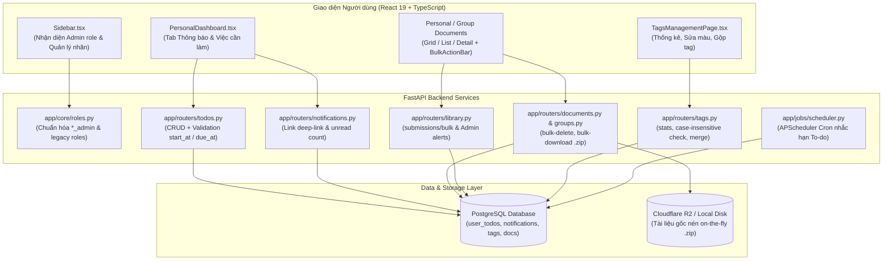

# System Enhancements (Quản trị, Thông báo, Việc cần làm, Thao tác hàng loạt & Quản lý Nhãn)

## 📌 Tổng Quan (Overview)
Bộ tính năng này giải quyết 5 bài toán cốt lõi nhằm nâng cao trải nghiệm quản trị, tương tác học tập và năng suất xử lý tài liệu cho cả sinh viên, giảng viên và quản trị viên trong hệ thống **Digital Library**:

1. **Quản trị Kho học liệu trên Sidebar (`YC1`)**: Tự động nhận diện quyền quản trị (`*_admin`) để hiển thị lối tắt nhanh đến `/library/admin` kèm huy hiệu (badge) đếm số lượng tài liệu đang chờ duyệt theo thời gian thực.
2. **Hệ thống Thông báo đóng góp & Deep-linking (`YC2`)**: Khi người dùng gửi tài liệu lên kho cộng đồng, hệ thống tự động gửi thông báo đến đúng nhóm Admin (Faculty Admin cùng khoa hoặc System/School Admin) kèm đường dẫn liên kết sâu (deep-link). Admin bấm vào sẽ tự động đánh dấu đã đọc, chuyển đến trang duyệt và cuộn/nhấp nháy làm nổi bật đúng thẻ bài nộp.
3. **Quản lý Việc cần làm cá nhân (Personal To-Do) (`YC3`)**: Module việc cần làm tích hợp tại Dashboard cá nhân (`/personal`) hỗ trợ lên lịch học tập/nghiên cứu (đọc tài liệu, gửi bài lên nhóm, xem tài liệu nhóm), thiết lập khung giờ (`start_at` – `due_at`), tự động tính toán đổi màu thẻ theo độ khẩn cấp (Quá hạn, Sắp đến hạn <1h, Trong ngày, Sắp tới, Đã xong) và tiến trình APScheduler chạy ngầm nhắc hạn tự động.
4. **Tích chọn nhiều tài liệu & Thao tác hàng loạt (Bulk Actions) (`YC4`)**: Cung cấp chế độ tích chọn tài liệu đồng bộ trên cả 3 giao diện xem (**Grid**, **List**, **Detail**) ở cả Kho cá nhân và Kho nhóm. Thanh công cụ nổi (`DocumentBulkActionBar`) cho phép tải nén `.zip` trực tiếp, đóng góp hàng loạt vào kho học liệu cộng đồng, hoặc xóa nhiều tài liệu cùng lúc.
5. **Trang Quản lý Nhãn chuyên biệt (`YC5`)**: Module chuyên trách tại `/personal/tags` (nằm trên Sidebar) giúp người dùng quản lý vòng đời nhãn: thống kê số lượng tài liệu/thư mục đang gắn nhãn, thêm nhãn mới với bảng màu preset, chỉnh sửa trực tiếp (inline edit), gộp nhiều nhãn nguồn vào nhãn đích (merge tags) và lọc nhanh tài liệu theo nhãn.

---

## 🗂 Cấu Trúc Tài Liệu Kỹ Thuật (Document Structure)

Để lập trình viên (backend & frontend) nhanh chóng nắm bắt cấu trúc mã nguồn và logic nghiệp vụ, tài liệu kỹ thuật được phân tách thành các phần chuyên biệt:

1. 🗄 **[DATABASE.md](./DATABASE.md)**: Thiết kế lược đồ cơ sở dữ liệu, Alembic migration, bảng mới `user_todos`, mở rộng bảng `notifications`, khóa ngoại, quy tắc cascade và cơ chế tự phục hồi DDL (auto-healing).
2. 🔌 **[API.md](./API.md)**: Đặc tả chi tiết các RESTful API endpoints: method, URL path, headers, request/response schema, HTTP status codes và logic xử lý backend.
3. 💻 **[FRONTEND.md](./FRONTEND.md)**: Kiến trúc UI components, hooks dùng chung (`useHighlightElement`), services, quản lý state TanStack Query, bộ định dạng thời gian thực và trải nghiệm người dùng (UX).
4. 📋 **[BUSINESS_RULES.md](./BUSINESS_RULES.md)**: Quy tắc nghiệp vụ, ma trận phân quyền theo vai trò (`*_admin`), logic chống trùng lặp, thuật toán phân chia trạng thái hạn to-do và quy tắc gộp nhãn an toàn.

---

## 🏗 Kiến Trúc Luồng Tổng Thể (System Architecture Flow)

---

## 📦 Danh Mục Git Commits (Milestones)

Hệ thống được phát triển và chuyển giao theo 5 giai đoạn commit tuần tự, đảm bảo tính độc lập và khả năng kiểm thử tại từng mốc:

| Hash Commit | Mô-đun / Hạng mục | Tóm tắt thay đổi chính |
|:---|:---|:---|
| `82e073df` | **Milestone 1 (`YC1` + `YC2`)** | Tạo `app/core/roles.py` & `utils/roles.ts`, thêm `Notification.link`, tích hợp Sidebar `/library/admin` kèm badge pending count, dropdown thông báo Header, deep-link highlight submission card. |
| `eabe1944` | **Milestone 2 (`YC3`)** | Model `UserTodo`, migration bảng `user_todos`, CRUD API `/todos/`, scheduler nhắc hạn 5 phút, UI Modal tạo việc cần làm kèm bộ chọn tài liệu/nhóm, tự động đổi màu theo hạn mỗi 60s. |
| `d50ff921` | **Milestone 3 (`YC5`)** | API `/tags/stats`, kiểm tra trùng tên hoa thường, API `/tags/merge`, trang `/personal/tags` chuyên biệt trên Sidebar với giao diện thống kê, đổi màu trực tiếp, gộp nhãn và lọc tài liệu qua query `?tag=`. |
| `58141066` | **Milestone 4 (`YC4`)** | Thêm API `bulk-delete`, `bulk-download` (stream `.zip`), `submissions/bulk`. Checkbox tích chọn trên Grid/List/Detail views, thanh công cụ nổi `DocumentBulkActionBar`, mở rộng `ContributeModal` hỗ trợ nộp nhiều file. |
| `06d77d90` | **Milestone 5 (Docs & Tests)** | Bộ tài liệu kỹ thuật chuẩn mực trong `docs/feat/system-enhancements-2026/` và bộ kiểm thử tự động `backend/tests/test_new_features.py` (Pytest 100% passed). |
