# 🌟 Danh Sách Tính Năng Cốt Lõi (Key Features Map)

Hệ thống **Digital Library** được cấu thành từ 10 phân hệ chức năng chuyên sâu. Dưới đây là danh mục tổng quan và các liên kết trực tiếp dẫn tới bộ tài liệu kỹ thuật chi tiết của từng tính năng (Feature Specifications).

---

## 🗺️ Bản Đồ Tổng Quan 10 Phân Hệ Chức Năng

```mermaid
graph LR
    subgraph Core["Lưu Trữ & Hiển Thị"]
        F1["1. Personal Dashboard<br/>Kho Cá Nhân"]
        F5["5. Multi-View Modes<br/>(Grid · List · Detail)"]
        F8["8. Document Preview<br/>& Thumbnails"]
        F6["6. Markdown View<br/>& Export"]
    end

    subgraph Collab["Cộng Tác & Cộng Đồng"]
        F2["2. Community Library<br/>Học Liệu Toàn Trường"]
        F3["3. Document Sharing<br/>Chia Sẻ & Quyền Hạn"]
        F7["7. Document Bundle<br/>Gói Học Liệu"]
    end

    subgraph Intelligence["Tìm Kiếm & Nâng Cấp"]
        F4["4. Query & Performance<br/>Tìm Kiếm Toàn Văn FTS"]
        F9["9. Activity Tracking<br/>& Chấm Điểm Trending"]
        F10["10. System Enhancements<br/>(To-do, Notify, Bulk, Tags)"]
    end

    Core --- Collab
    Collab --- Intelligence
```

---

## 📋 Chi Tiết 10 Phân Hệ & Liên Kết Tài Liệu Kỹ Thuật

### 1. 👤 Personal Dashboard & Quản Lý Tài Liệu Cá Nhân
Trang tổng quan cá nhân hóa giúp sinh viên theo dõi toàn bộ tài nguyên học tập của mình trong nháy mắt.
* **Chức năng chính:** Thống kê nhanh dung lượng đã dùng, số lượng tài liệu, tài liệu truy cập gần nhất, danh mục thư mục và phím tắt thao tác nhanh.
* **Tài liệu chi tiết:**
  * [Tài liệu Đặc tả Cá nhân (PERSONAL_DASHBOARD.md)](../feat/personal-dashboard/PERSONAL_DASHBOARD.md)
  * [Script Migration CSDL (migration.sql)](../feat/personal-dashboard/migration.sql)

---

### 2. 🏛️ Kho Học Liệu Cộng Đồng (Community Library)
Không gian tri thức mở toàn trường, được phân cấp theo từng Khoa đào tạo và Môn học cụ thể.
* **Chức năng chính:** Duyệt học liệu theo Khoa/Môn học, tìm kiếm tài liệu công khai, đánh giá rating 1-5 sao, gửi yêu cầu đóng góp học liệu và quy trình xét duyệt của Quản trị viên Khoa.
* **Tài liệu chi tiết:**
  * [Đặc tả Yêu cầu Cộng đồng (spec.md)](../feat/community-library/spec.md)
  * [Hướng dẫn Triển khai & Giao diện (implementation.md)](../feat/community-library/implementation.md)
  * [Mở rộng Quản lý Khoa & Môn học (management-extension.md)](../feat/community-library/management-extension.md)
  * [Báo cáo Sửa lỗi Đếm tài liệu (bug-fix-document-counting.md)](../feat/community-library/bug-fix-document-counting.md)

---

### 3. 🔗 Chia Sẻ Tài Liệu & Phân Quyền (Document Sharing)
Cơ chế chia sẻ tài liệu linh hoạt giữa các cá nhân, nhóm học tập và chia sẻ liên kết công khai.
* **Chức năng chính:** Tạo link chia sẻ bảo mật, phân quyền chỉ xem (View-only) hoặc tải về, chia sẻ trực tiếp vào nhóm, tự động tạo bản sao độc lập (Forking) khi lưu về kho riêng.
* **Tài liệu chi tiết:**
  * [Tổng quan Chia sẻ (README.md)](../feat/document-sharing/README.md)
  * [Quy tắc Nghiệp vụ Chia sẻ (BUSINESS_RULES.md)](../feat/document-sharing/BUSINESS_RULES.md)
  * [Đặc tả API Chia sẻ (API.md)](../feat/document-sharing/API.md)
  * [Thiết kế Database Chia sẻ (DATABASE.md)](../feat/document-sharing/DATABASE.md)
  * [Kiến trúc Giao diện Frontend (FRONTEND.md)](../feat/document-sharing/FRONTEND.md)
  * [Xử lý Sự cố & Postmortem (TROUBLESHOOTING.md)](../feat/document-sharing/TROUBLESHOOTING.md)

---

### 4. ⚡ Truy Vấn Nâng Cao & Tối Ưu Hiệu Năng (Document Query & Performance)
Cỗ máy tìm kiếm và lọc dữ liệu tốc độ cao phục vụ hàng chục ngàn tài liệu học tập.
* **Chức năng chính:** Tìm kiếm toàn văn (PostgreSQL Full-Text Search), lọc kết hợp (MIME, dung lượng, khoảng thời gian, tag, folder), phân trang con trỏ (Cursor/Offset Pagination) và bộ nhớ đệm TanStack Query.
* **Tài liệu chi tiết:**
  * [Tổng quan Truy vấn & Tối ưu (README.md)](../feat/document-query-and-performance/README.md)
  * [Quy tắc Nghiệp vụ Lọc & Tìm kiếm (BUSINESS_RULES.md)](../feat/document-query-and-performance/BUSINESS_RULES.md)
  * [Đặc tả API Tìm kiếm (API.md)](../feat/document-query-and-performance/API.md)
  * [Thiết kế Database Indexes (DATABASE.md)](../feat/document-query-and-performance/DATABASE.md)
  * [Frontend Hooks & Caching (FRONTEND.md)](../feat/document-query-and-performance/FRONTEND.md)
  * [Xử lý Sự cố Tải chậm (TROUBLESHOOTING.md)](../feat/document-query-and-performance/TROUBLESHOOTING.md)

---

### 5. 🎛️ Chế Độ Hiển Thị Đa Dạng (Document Multi-View Modes)
Trải nghiệm trực quan với 3 chế độ xem tài liệu linh hoạt tùy theo nhu cầu của người học.
* **Chức năng chính:** Chuyển đổi mượt mà giữa Lưới ảnh bìa (Grid View - trực quan), Danh sách gọn (List View - quét thông tin nhanh) và Chi tiết kỹ thuật (Detail View - đầy đủ metadata, mã hash, kích thước).
* **Tài liệu chi tiết:**
  * [Triết lý Thiết kế 3 Chế độ Xem (README.md)](../feat/document-view-modes/README.md)
  * [Quy tắc Nghiệp vụ Hiển thị (BUSINESS_RULES.md)](../feat/document-view-modes/BUSINESS_RULES.md)
  * [Cấu trúc Component & Color Schemes (FRONTEND.md)](../feat/document-view-modes/FRONTEND.md)
  * [Hướng dẫn Tái sử dụng Component (REUSE_AND_INTEGRATION.md)](../feat/document-view-modes/REUSE_AND_INTEGRATION.md)

---

### 6. 📝 Xem & Xuất Văn Bản Markdown (Markdown View & Export)
Môi trường đọc và biên tập tài liệu chuẩn Markdown thân thiện với sinh viên ngành kỹ thuật và lập trình.
* **Chức năng chính:** Trình đọc Markdown có mục lục (TOC), hỗ trợ code block syntax highlighting, xuất bản sang định dạng HTML/PDF và chuyển đổi ghi chú bài học thành Markdown.
* **Tài liệu chi tiết:**
  * [Tổng quan Markdown View (README.md)](../feat/markdown-view/README.md)
  * [Quy tắc Nghiệp vụ Markdown (BUSINESS_RULES.md)](../feat/markdown-view/BUSINESS_RULES.md)
  * [Thiết kế Database Lưu trữ Markdown (DATABASE.md)](../feat/markdown-view/DATABASE.md)
  * [Chi tiết Cài đặt Kỹ thuật (IMPLEMENTATION.md)](../feat/markdown-view/IMPLEMENTATION.md)

---

### 7. 📦 Gói Tài Liệu Học Tập (Document Bundle)
Tính năng đóng gói nhiều tài liệu có cùng chủ đề thành một gói học tập (Study Kit / Course Packet).
* **Chức năng chính:** Gom tài liệu từ nhiều thư mục vào một Bundle, chia sẻ cả gói bằng một liên kết duy nhất, tải về toàn bộ gói dưới dạng file nén ZIP hoặc clone cả gói về kho cá nhân.
* **Tài liệu chi tiết:**
  * [Tổng quan Module Bundle (README.md)](../feat/bundle/README.md)
  * [Quy tắc Nghiệp vụ Đóng gói (BUSINESS_RULES.md)](../feat/bundle/BUSINESS_RULES.md)
  * [Đặc tả API Bundle (API.md)](../feat/bundle/API.md)
  * [Thiết kế Database Bảng Bundle (DATABASE.md)](../feat/bundle/DATABASE.md)
  * [Kiến trúc Giao diện Bundle (FRONTEND.md)](../feat/bundle/FRONTEND.md)

---

### 8. 🖼️ Xem Trước Đa Định Dạng & Quản Lý Ảnh Bìa (Document Preview & Thumbnails)
Giải pháp xem trước tài liệu trực tiếp trên trình duyệt mà không cần tải file về thiết bị.
* **Chức năng chính:** Render PDF qua Canvas, render DOCX phía Client bằng `docx-preview`, xem code với `shiki`, tự động sinh ảnh thu nhỏ trang đầu (Thumbnail) hoặc tùy chọn ảnh bìa đại diện.
* **Tài liệu chi tiết:**
  * [Tổng quan Xem trước & Ảnh bìa (README.md)](../feat/document-preview-and-thumbnails/README.md)
  * [Quy tắc Nghiệp vụ Xem trước (BUSINESS_RULES.md)](../feat/document-preview-and-thumbnails/BUSINESS_RULES.md)
  * [Đặc tả API Upload Ảnh bìa & Trích xuất Text (API.md)](../feat/document-preview-and-thumbnails/API.md)
  * [Thiết kế Database Thumbnails (DATABASE.md)](../feat/document-preview-and-thumbnails/DATABASE.md)
  * [Hướng dẫn Triển khai & Kịch bản Test (IMPLEMENTATION.md)](../feat/document-preview-and-thumbnails/IMPLEMENTATION.md)

---

### 9. 📈 Theo Dõi Hoạt Động & Chấm Điểm Xu Hướng (Activity Tracking & Analytics)
Hệ thống giám sát tương tác và đo lường mức độ quan tâm của cộng đồng đối với từng tài liệu.
* **Chức năng chính:** Bảng log sự kiện append-only `download_logs`, đếm lượt xem/tải/lưu/thích, biểu đồ tương tác 30 ngày qua Recharts, và thuật toán suy hao thời gian tính điểm **`trending_score`**.
* **Tài liệu chi tiết:**
  * [Tổng quan Activity Tracking (README.md)](../feat/activity-tracking/README.md)
  * [Quy tắc Nghiệp vụ & Công thức Trending (BUSINESS_RULES.md)](../feat/activity-tracking/BUSINESS_RULES.md)
  * [Đặc tả API Thống kê (API.md)](../feat/activity-tracking/API.md)
  * [Thiết kế Database Activity Logs (DATABASE.md)](../feat/activity-tracking/DATABASE.md)
  * [Hướng dẫn Triển khai & Job Tính điểm (IMPLEMENTATION.md)](../feat/activity-tracking/IMPLEMENTATION.md)

---

### 10. 🚀 Nâng Cấp Hệ Thống 2026 (System Enhancements 2026)
Gói nâng cấp bổ sung các công cụ hỗ trợ quản trị, năng suất và trải nghiệm người dùng hiện đại.
* **Chức năng chính:** 
  1. **User To-do:** Danh sách việc cần làm gắn với tài liệu và nhắc hạn nộp bài.
  2. **Notification Center:** Trung tâm thông báo đẩy khi có tài liệu mới hoặc kết quả duyệt học liệu.
  3. **Bulk Actions:** Thao tác hàng loạt (tải, xóa, di chuyển nhiều tài liệu cùng lúc).
  4. **Workspace Tags:** Quản lý nhãn độc lập theo từng không gian làm việc.
  5. **Admin Management:** Công cụ quản trị danh mục Khoa, Môn học cho quản trị viên.
* **Tài liệu chi tiết:**
  * [Tổng quan Gói Nâng cấp (README.md)](../feat/system-enhancements-2026/README.md)
  * [Đặc tả Kỹ thuật Chi tiết (SYSTEM_ENHANCEMENTS.md)](../feat/system-enhancements-2026/SYSTEM_ENHANCEMENTS.md)
  * [Quy tắc Nghiệp vụ Nâng cấp (BUSINESS_RULES.md)](../feat/system-enhancements-2026/BUSINESS_RULES.md)
  * [Đặc tả API Nâng cấp (API.md)](../feat/system-enhancements-2026/API.md)
  * [Thiết kế Database Bảng Mới (DATABASE.md)](../feat/system-enhancements-2026/DATABASE.md)
  * [Kiến trúc Giao diện Nâng cấp (FRONTEND.md)](../feat/system-enhancements-2026/FRONTEND.md)
