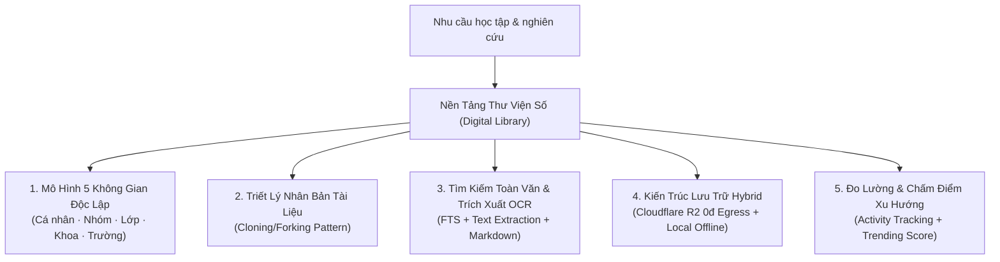

# 📖 Giới Thiệu Dự Án: Thư Viện Số (Digital Library)

> **Tên đầy đủ dự án:** Hệ thống Thư viện số - Quản lý, Cộng tác & Chia sẻ Tài liệu Học tập Đại học  
> **Tên viết tắt:** Digital Library Platform (Foundation Project)

---

## 1. Bối Cảnh & Vấn Đề Thực Tế (Problem Statement)

Trong môi trường giáo dục đại học hiện nay, tài liệu học tập (giáo trình, slide bài giảng, đề thi mẫu, bài tập lớn, ghi chú môn học) đóng vai trò sống còn đối với chất lượng học tập và nghiên cứu của sinh viên. Tuy nhiên, phương thức quản lý tài liệu truyền thống đang bộc lộ những bất cập nghiêm trọng:

1. **Phân mảnh và thất lạc dữ liệu:**
   * Tài liệu được chia sẻ rải rác qua các ứng dụng nhắn tin tức thời (Zalo, Messenger, Telegram) hoặc các thư mục Google Drive cá nhân.
   * Các liên kết tải file thường xuyên hết hạn, bị thu hồi quyền truy cập hoặc biến mất khi các khóa sinh viên trước tốt nghiệp.
2. **Không có công cụ tìm kiếm ngữ nghĩa tập trung:**
   * Sinh viên mất hàng giờ tìm kiếm tài liệu theo tên file mập mờ (ví dụ: `tailieu_final.docx`, `chuong1_sua.pdf`) mà không thể tìm kiếm nội dung bên trong văn bản (Full-text search).
3. **Lãng phí dung lượng & Trùng lặp dữ liệu:**
   * Hàng trăm sinh viên cùng tải lên một tệp tài liệu giống hệt nhau lên hệ thống mà không có cơ chế phát hiện mã băm (Checksum Deduplication), gây tốn kém hạ tầng lưu trữ.
4. **Thiếu sự phân cấp và kiểm duyệt học thuật:**
   * Không có ranh giới rõ ràng giữa tài liệu lưu nháp cá nhân, tài liệu thảo luận nhóm và học liệu chính thống được thẩm định bởi Khoa/Bộ môn.
5. **Rào cản về định dạng và xem trước:**
   * Sinh viên buộc phải tải file về máy mới có thể xem nội dung, gây mất an toàn thông tin và tốn băng thông thiết bị di động.

---

## 2. Mục Tiêu & Giải Pháp Đột Phá Của Hệ Thống

**Digital Library** được xây dựng với mục tiêu trở thành **Trung tâm Tri thức Học tập Toàn diện**, giải quyết triệt để các bài toán trên thông qua những trụ cột giải pháp:

### 2.1. Tổ chức theo 5 Không Gian Học Tập (5 Workspaces)
Hệ thống phân định ranh giới dữ liệu rõ ràng, đáp ứng từng ngữ cảnh sử dụng:
* 👤 **Kho cá nhân (Personal Space):** Kho riêng tư tuyệt đối, nơi người dùng lưu trữ tài liệu cá nhân, gắn thẻ (tags), quản lý danh sách việc cần làm (to-dos) và ghi chú học tập.
* 👥 **Không gian Nhóm (Group Workspace):** Không gian cộng tác linh hoạt cho các nhóm làm bài tập lớn, nghiên cứu khoa học; có phân quyền trưởng nhóm và thành viên.
* 🏫 **Không gian Lớp (Class Space):** Gắn liền với mã lớp học thực tế trong học kỳ, nơi ban cán sự lớp và giảng viên phân phối tài liệu môn học.
* 🏛️ **Kho lưu trữ Khoa (Faculty Space):** Nơi lưu trữ đề cương chi tiết, giáo trình chuẩn của từng Khoa/Viện.
* 🎓 **Kho học liệu Toàn trường (Community Library):** Thư viện mở phục vụ toàn bộ sinh viên và giảng viên, có cơ chế kiểm duyệt nội dung (Submission & Approval Workflow).

### 2.2. Triết lý Nhân Bản Độc Lập (Cloning / Forking Principle)
> **Nguyên tắc cốt lõi:** *Khi một tài liệu từ Kho cộng đồng hoặc Nhóm được lưu về Kho cá nhân, hệ thống thực hiện nhân bản (clone) một bản ghi độc lập.*
* Người nhận sở hữu toàn quyền chỉnh sửa, thêm ghi chú, gắn thẻ riêng trên bản sao của mình mà **hoàn toàn không làm ảnh hưởng đến bản gốc** của giảng viên hay tác giả ban đầu.

### 2.3. Tìm kiếm Toàn văn & Trích xuất Nội dung Tự động
* Tích hợp máy tìm kiếm toàn văn **PostgreSQL Full-Text Search (`tsvector`/`tsquery`)**.
* Backend tự động phân tích và trích xuất nội dung văn bản từ các tệp PDF, DOCX, TXT, Code ngay khi tải lên.
* Hỗ trợ nhận diện chữ tiếng Việt qua **Tesseract OCR** đối với các tài liệu scan hoặc dạng hình ảnh.

### 2.4. Khả năng Vận hành Linh hoạt (Cloud & Offline)
* **Chế độ Cloud Production:** Tích hợp **Cloudflare R2 Object Storage** (chuẩn S3) với ưu điểm **0đ phí truyền dữ liệu ra ngoài (Zero Egress Fees)**, kết hợp Neon PostgreSQL Serverless.
* **Chế độ Local Development:** Chạy offline 100% trên máy tính cá nhân bằng Local Filesystem và PostgreSQL cục bộ mà không cần kết nối Internet, cực kỳ thuận tiện cho quá trình phát triển, kiểm thử và bảo vệ đồ án.

---

## 3. Đối Tượng Sử Dụng & Giá Trị Mang Lại

| Đối tượng | Thách thức trước đây | Giá trị hệ thống mang lại |
|---|---|---|
| **Sinh viên** | Mất tài liệu, link die, khó tìm kiếm đề thi/slide bài giảng. | Kho lưu trữ học tập trọn đời, tìm kiếm siêu nhanh theo từ khóa nội dung, xem trước trực tiếp trên trình duyệt không cần tải về máy. |
| **Giảng viên** | Khó phân phát tài liệu tập trung cho từng lớp, tài liệu bị sửa đổi ngoài ý muốn. | Đăng tải học liệu chuẩn xác tới từng lớp/khoa, tài liệu gốc được bảo toàn; kiểm soát và phê duyệt đóng góp của sinh viên. |
| **Ban Cán sự Lớp** | Liên tục phải gửi lại tài liệu cho bạn cùng lớp qua Zalo. | Tạo không gian lớp học cố định, phân loại theo môn học, tự động hóa lưu trữ cả học kỳ. |
| **Cấp Quản lý Khoa / Trường** | Không đo lường được mức độ sử dụng học liệu, tốn kém chi phí lưu trữ server. | Báo cáo thống kê hoạt động trực quan, bảng xếp hạng tài liệu nổi bật (`trending_score`), chi phí băng thông 0đ nhờ Cloudflare R2. |

---

## 4. Công Nghệ Nền Tảng (Technology Stack Overview)

* **Backend:** Python 3.11, FastAPI (Asynchronous Framework), SQLAlchemy 2.0 (Async ORM), Pydantic V2, PostgreSQL, Alembic (Database Migrations), APScheduler (Background Jobs).
* **Frontend:** React 19, TypeScript, Vite, TanStack Query (React Query v5), Tailwind CSS, Lucide React, Shiki (Code Syntax Highlighter).
* **Storage & Infrastructure:** Cloudflare R2 (S3-compatible Object Storage), Local Filesystem Buffer, Docker, GitHub Actions (CI/CD Deployment).
* **Tài liệu Kỹ thuật:** Docusaurus 3.x, Mermaid Diagrams, GitHub Pages.
