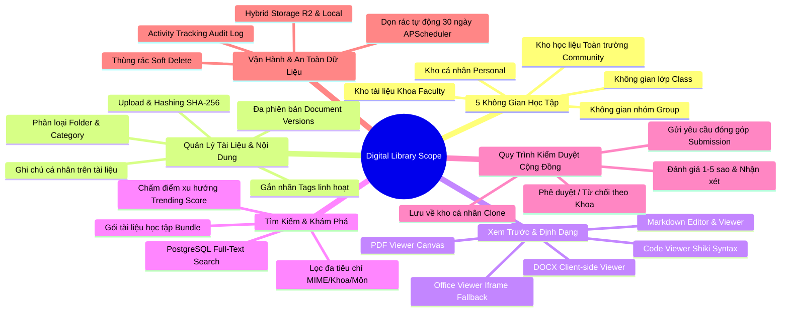

# 🎯 Phạm Vi & Ranh Giới Hệ Thống (Project Scope)

Tài liệu này xác định ranh giới chức năng, các tính năng thuộc phạm vi triển khai (In-Scope), các ràng buộc kỹ thuật, và các hạng mục chủ động nằm ngoài phạm vi (Out-of-Scope) của dự án **Digital Library**.

---

## 1. Phạm Vi Triển Khai Đã Xác Nhận (In-Scope)

Hệ thống được thiết kế và hiện thực hóa xoay quanh 6 phân hệ cốt lõi:

### 1.1. Phân hệ 5 Không Gian Lưu Trữ
* **Kho cá nhân:** Quản lý tài liệu riêng tư, cây thư mục phân cấp, nhãn (tags), to-do list gắn với tài liệu.
* **Không gian nhóm:** Tạo nhóm làm việc, quản lý danh sách thành viên, chia sẻ tài liệu nội bộ, thùng rác nhóm độc lập.
* **Không gian lớp & Khoa:** Liên kết dữ liệu lớp học, môn học và khoa đào tạo theo cấu trúc quản lý của trường đại học.
* **Kho cộng đồng:** Nền tảng học liệu mở toàn trường với danh mục Khoa -> Môn học -> Danh sách tài liệu công khai.

### 1.2. Phân hệ Xử lý & Xem trước Tài liệu (Document Processing & Multi-view)
* Hỗ trợ đa dạng định dạng học tập phổ biến: PDF, Word (`.docx`), Excel (`.xlsx`), PowerPoint (`.pptx`), Plain Text (`.txt`), Markdown (`.md`), Mã nguồn (`.py`, `.js`, `.ts`, `.cpp`, `.java`, `.html`, `.css`,...).
* **3 Chế độ hiển thị danh sách:** Lưới (Grid View), Danh sách (List View), và Chi tiết kỹ thuật (Detail View).
* Xem trước trực tiếp trên trình duyệt bằng các Viewer chuyên dụng không cần tải về máy:
  * `PdfViewer`: Render qua PDF.js canvas.
  * `DocxViewer`: Biên dịch DOCX sang DOM ngay tại trình duyệt qua thư viện `docx-preview`.
  * `CodeViewer`: Tô màu cú pháp chuẩn IDE với thư viện `shiki`.
  * `MarkdownViewer`: Render định dạng Markdown, hỗ trợ chỉnh sửa và xuất file.
  * `OfficeViewer`: Nhúng iframe Google Docs / Office Online cho file PPTX, XLSX.

### 1.3. Phân hệ Kiểm tra Trùng lặp & Lưu trữ Bền vững (Deduplication)
* Tính toán mã băm mật mã học **SHA-256** cho mọi tệp tin được tải lên.
* Tự động phát hiện tệp tin trùng lặp nội dung trong cùng không gian (Personal hoặc Group), ngăn chặn lãng phí tài nguyên máy chủ.
* Lưu trữ Hybrid: Tự động chuyển đổi giữa Cloudflare R2 (S3 API) và Local Filesystem thông qua cấu hình môi trường.

### 1.4. Phân hệ Tìm kiếm & Chấm điểm Xu hướng (FTS & Analytics)
* Tìm kiếm toàn văn trên cả tiêu đề, mô tả và nội dung trích xuất văn bản (`tsvector` trong PostgreSQL).
* Ghi nhận log tương tác append-only (`download_logs`) phục vụ thống kê (lượt xem, lượt tải, lượt lưu, lượt đánh giá).
* Thuật toán suy hao thời gian tính điểm **`trending_score`** để gợi ý tài liệu hot cho sinh viên.

### 1.5. Phân hệ Kiểm duyệt Học liệu Cộng đồng (Moderation Workflow)
* Sinh viên và giảng viên có thể gửi tài liệu từ kho cá nhân/nhóm vào Kho học liệu chung.
* Quản trị viên Khoa (`faculty_admin`) xem xét, đánh giá và quyết định **Phê duyệt (Approve)** hoặc **Từ chối (Reject)** kèm lý do.

---

## 2. Giới Hạn & Ràng Buộc Kỹ Thuật (System Constraints)

| Tiêu chí | Giới hạn hệ thống | Lý do kỹ thuật & Biện pháp xử lý |
|---|---|---|
| **Dung lượng file tối đa** | Mặc định **50 MB** / tệp tin | Đảm bảo an toàn bộ nhớ đệm RAM của Backend khi tính SHA-256 và tối ưu thời gian tải trên mạng di động. |
| **Yêu cầu trình duyệt Client** | Chrome, Edge, Safari, Firefox (Hỗ trợ HTML5 Canvas & WebAssembly) | Để các trình xem trước (PDF, DOCX) hoạt động mượt mà tại phía trình duyệt người dùng. |
| **Độ chính xác OCR Tiếng Việt** | Phụ thuộc vào chất lượng ảnh quét (Scan DPI ≥ 300 khuyến nghị) | Sử dụng Tesseract Engine với gói ngôn ngữ `vie`; với tài liệu mờ hoặc chữ viết tay, kết quả trích xuất có thể không đạt 100%. |
| **Cơ chế dọn thùng rác** | Tự động xóa vĩnh viễn sau **30 ngày** | Job nền APScheduler quét định kỳ hàng đêm để giải phóng dung lượng bộ nhớ. |

---

## 3. Phần Nằm Ngoài Phạm Vi (Out-of-Scope)

Để đảm bảo dự án hoàn thành đúng tiến độ với chất lượng cao nhất, các tính năng sau được chủ động xác định **nằm ngoài phạm vi triển khai** trong phiên bản hiện tại:

1. **Soạn thảo văn bản cộng tác thời gian thực (Real-time Collaborative Editing):**
   * Hệ thống tập trung vào lưu trữ, lập chỉ mục và chia sẻ tài liệu hoàn thiện, không xây dựng công cụ biên tập đồng thời kiểu Google Docs.
2. **Cổng thanh toán & Thương mại hóa tài liệu:**
   * Hệ thống là nền tảng tri thức học tập nội bộ trường đại học phi lợi nhuận, không hỗ trợ mua bán hay thu phí tài liệu.
3. **Ứng dụng di động độc lập (Native Mobile App Android/iOS):**
   * Tập trung phát triển giao diện Web chuẩn Responsive tương thích hoàn hảo trên trình duyệt điện thoại và máy tính bảng, không xây dựng ứng dụng Native trên App Store / Google Play trong giai đoạn này.
4. **Hệ thống Chat / Nhắn tin tức thời thời gian thực (WebRTC / Instant Messaging):**
   * Việc thảo luận nhóm gắn liền với phần bình luận và ghi chú tài liệu; không xây dựng tính năng phòng chat trực tuyến.
5. **Xử lý trích xuất đa phương tiện phức tạp (Video / Audio OCR):**
   * Hệ thống chỉ trích xuất văn bản từ tài liệu text, scan ảnh và mã nguồn; không phiên âm âm thanh từ file ghi âm bài giảng.
