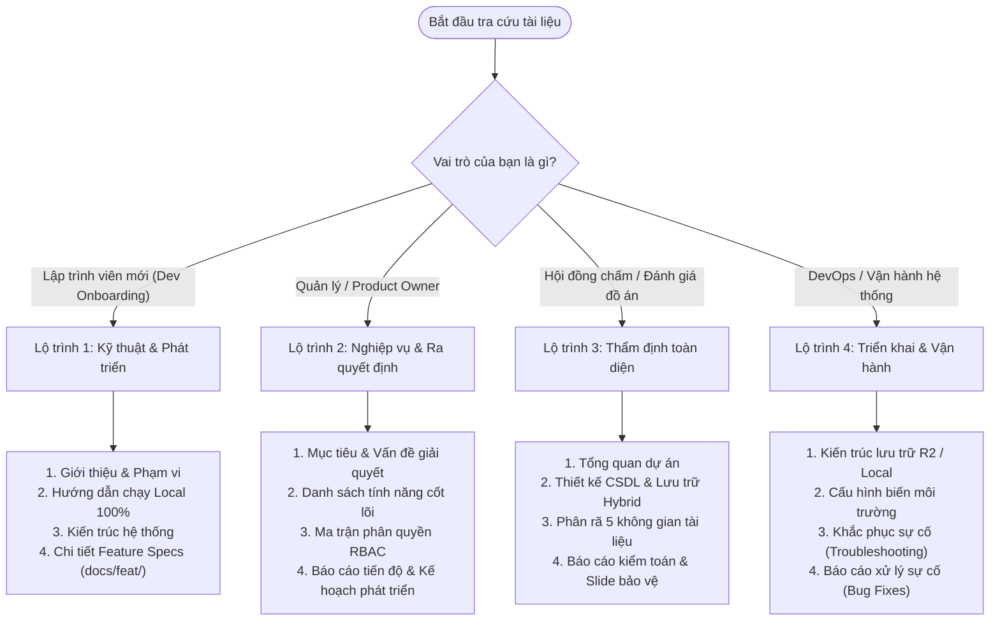

# 🧭 Hướng Dẫn & Lộ Trình Đọc Tài Liệu Dự Án (Reading Roadmap)

Chào mừng bạn đến với cổng tài liệu chính thức của **Hệ Thống Thư Viện Số - Digital Library Platform**. Tài liệu được biên soạn nhằm cung cấp góc nhìn toàn diện cho nhiều đối tượng: từ lập trình viên phát triển tính năng, kỹ sư hạ tầng, đến cấp quản lý và người thẩm định dự án.

---

## 🎯 Chọn Lộ Trình Theo Vai Trò Của Bạn

Để tiết kiệm thời gian và nắm bắt thông tin hiệu quả nhất, vui lòng lựa chọn lộ trình phù hợp với mục tiêu của bạn:

---

## 📚 Chi Tiết Từng Lộ Trình

### 1. 💻 Lộ trình 1: Lập trình viên mới (Developer Onboarding)
*Dành cho lập trình viên cần dựng môi trường và bắt tay vào đóng góp mã nguồn ngay lập tức.*
1. [Giới Thiệu Dự Án](./PROJECT_INTRODUCTION.md) — Hiểu bài toán sản phẩm và cấu trúc người dùng.
2. [Phạm Vi & Ranh Giới](./PROJECT_SCOPE.md) — Nắm rõ những gì hệ thống hỗ trợ và giới hạn kỹ thuật.
3. [Hướng Dẫn Phát Triển Local (Offline)](../LOCAL_DEVELOPMENT_GUIDE.md) — Thiết lập môi trường chạy độc lập không cần Cloud, kết nối Database cục bộ và khởi chạy Backend/Frontend.
4. [Kiến Trúc Hệ Thống](../system-architecture/index.md) — Xem sơ đồ luồng dữ liệu (Dataflow) và kiến trúc tổng quan.
5. [Đặc Tả Tính Năng Cốt Lõi](../feat/document-query-and-performance/README.md) — Đọc chi tiết các module trong mục **Feature Specs** tương ứng với task được giao.

---

### 2. 📊 Lộ trình 2: Cấp Quản Lý & Phê Duyệt Quyết Định (Management & PO)
*Dành cho quản lý dự án, ban chủ nhiệm khoa hoặc Product Owner cần phê duyệt tính năng.*
1. [Giới Thiệu Dự Án](./PROJECT_INTRODUCTION.md) — Xác định vấn đề cốt lõi và giá trị mang lại cho nhà trường/sinh viên.
2. [Danh Sách Tính Năng Cốt Lõi](./KEY_FEATURES.md) — Nắm tổng thể 10 phân hệ chức năng và trạng thái sẵn sàng.
3. [Vai Trò & Ma Trận Phân Quyền](./USER_ROLES_AND_PERMISSIONS.md) — Phê duyệt cơ chế bảo mật và ranh giới truy cập giữa các vai trò.
4. [Mô Tả 5 Không Gian Dự Án](../project-management/MoTaDuAn.md) — Định hướng tổ chức không gian lưu trữ (Cá nhân, Nhóm, Lớp, Khoa, Toàn trường).
5. [Báo Cáo Tiến Độ Dự Án](../project-management/PROJECT_STATUS_REPORT.md) & [Roadmap](../project-management/roadmap.md) — Xem hiện trạng hoàn thành, rủi ro kỹ thuật và kế hoạch dài hạn.

---

### 3. 🎓 Lộ trình 3: Hội Đồng Chấm & Thẩm Định Đồ Án (Reviewer & Board)
*Dành cho giảng viên, ban giám khảo đánh giá chất lượng học thuật và ứng dụng thực tiễn.*
1. [Giới Thiệu Dự Án](./PROJECT_INTRODUCTION.md) & [Thuật Ngữ Dự Án](./GLOSSARY.md) — Thống nhất ngôn ngữ chuyên ngành và mô hình nghiệp vụ.
2. [Kiến Trúc Hệ Thống Lưu Trữ Chuyên Sâu](../architecture/STORAGE_SYSTEM.md) — Bài phân tích chuyên sâu 11 chương về SHA-256 Deduplication, vòng đời tài liệu, APScheduler, và bộ 25 câu hỏi phản biện bảo vệ đồ án.
3. [Báo Cáo Kiểm Toán Ứng Dụng](../AUDIT_REPORT.md) — Kết quả kiểm toán tính khả dụng UI/UX và các phát hiện thực nghiệm.
4. [Mẫu Slide Thuyết Trình Bảo Vệ](../project-management/mau-slide-thuyet-trinh.md) — Dàn ý cấu trúc báo cáo đồ án tốt nghiệp.

---

### 4. ⚙️ Lộ trình 4: Kỹ sư Vận Hành & Hạ Tầng (DevOps & Infrastructure)
*Dành cho kỹ sư phụ trách triển khai, CI/CD, backup dữ liệu và cấu hình lưu trữ đám mây.*
1. [Tổng Quan Triển Khai Lưu Trữ](../deployment/README.md) — Sơ đồ luồng đẩy file lên Cloudflare R2 / Local Server.
2. [Danh Mục Biến Môi Trường](../deployment/ENV_VARIABLES.md) — Toàn bộ cấu hình `.env` cho Backend và Frontend.
3. [Cấu Hình Cloudflare R2 Storage](../deployment/STORAGE_R2.md) — Hướng dẫn tạo Bucket, cấu hình CORS và Public Access.
4. [Cẩm Nang Xử Lý Sự Cố (Troubleshooting)](../deployment/TROUBLESHOOTING.md) — Tổng hợp mã lỗi thực tế, cách cứu dữ liệu và xử lý xung đột kết nối.
5. [Báo Cáo Xử Lý Lỗi Nội Bộ (Bug Fix Report)](../deployment/BUG_FIX_REPORT.md) — Phân tích chi tiết các ca lỗi nghiêm trọng đã được khắc phục triệt để.

---

## 📌 Các Tài Liệu Tổng Quan Trong Phân Hệ Này
* [Giới Thiệu Dự Án (PROJECT_INTRODUCTION)](./PROJECT_INTRODUCTION.md)
* [Phạm Vi & Ranh Giới Hệ Thống (PROJECT_SCOPE)](./PROJECT_SCOPE.md)
* [Danh Sách Tính Năng Cốt Lõi (KEY_FEATURES)](./KEY_FEATURES.md)
* [Vai Trò & Ma Trận Phân Quyền (USER_ROLES_AND_PERMISSIONS)](./USER_ROLES_AND_PERMISSIONS.md)
* [Từ Điển Thuật Ngữ Thống Nhất (GLOSSARY)](./GLOSSARY.md)
