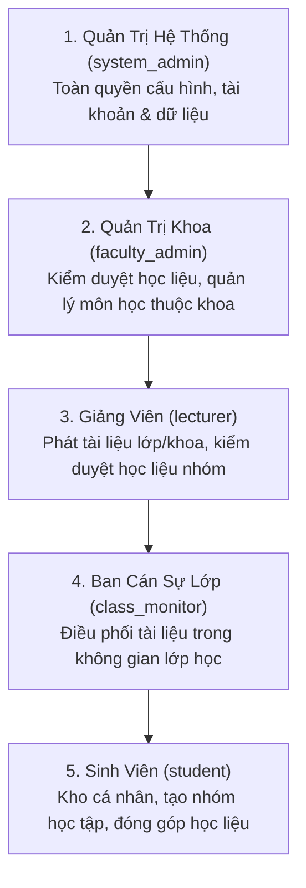
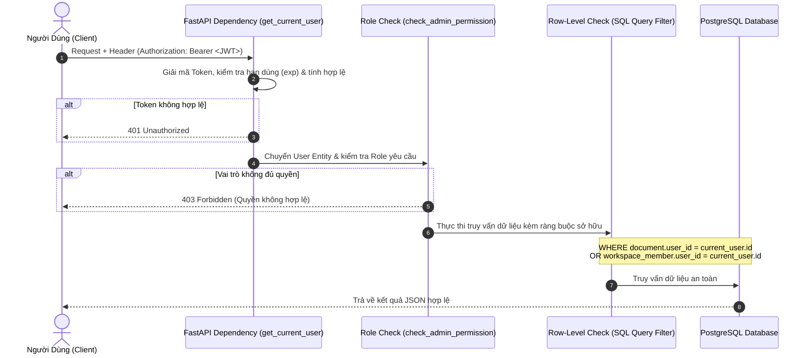

# 🛡️ Vai Trò & Ma Trận Phân Quyền (User Roles & RBAC Matrix)

Hệ thống **Digital Library** áp dụng mô hình phân quyền dựa trên vai trò (**Role-Based Access Control - RBAC**) kết hợp với kiểm soát ủy quyền cấp dữ liệu (**Row-Level Authorization**) để đảm bảo an toàn thông tin và quyền riêng tư tuyệt đối cho người dùng.

---

## 1. Danh Mục Các Vai Trò Trong Hệ Thống

Hệ thống định nghĩa 5 vai trò chính với các mức trách nhiệm và thẩm quyền tăng dần:

1. **Sinh Viên (`student`):**
   * Người học trong trường đại học, sở hữu kho lưu trữ cá nhân riêng biệt.
   * Có quyền tạo các nhóm học tập độc lập, chia sẻ tài liệu với bạn bè và gửi yêu cầu đóng góp học liệu lên Kho cộng đồng.
2. **Ban Cán Sự Lớp (`class_monitor`):**
   * Sinh viên được phân công làm lớp trưởng/cán sự học tập, có thêm thẩm quyền tải lên và sắp xếp tài liệu trong **Không gian Lớp học** của lớp mình.
3. **Giảng Viên (`lecturer`):**
   * Cán bộ giảng dạy, có quyền đăng tải giáo trình chính thức vào các lớp học do mình phụ trách hoặc tài liệu cấp Khoa; đóng góp học liệu mẫu không cần qua bước xét duyệt sơ cấp.
4. **Quản Trị Viên Khoa (`faculty_admin`):**
   * Đại diện khoa/bộ môn chuyên môn, có quyền duyệt hoặc từ chối các yêu cầu đóng góp tài liệu vào các môn học thuộc khoa; quản lý danh mục môn học thuộc khoa mình.
5. **Quản Trị Viên Hệ Thống (`system_admin`):**
   * Đội ngũ kỹ thuật/IT quản trị toàn bộ hệ thống; quản lý danh sách người dùng, phân quyền vai trò, quản lý danh mục toàn bộ các Khoa, giám sát logs và cấu hình hạ tầng.

---

## 2. Ma Trận Phân Quyền Chi Tiết (RBAC Matrix)

| Nhóm chức năng / Hành động | Sinh viên (`student`) | Cán sự lớp (`class_monitor`) | Giảng viên (`lecturer`) | Quản trị Khoa (`faculty_admin`) | Quản trị Hệ thống (`system_admin`) |
|---|:---:|:---:|:---:|:---:|:---:|
| **Kho Cá Nhân (Personal Space)** |
| Upload, tạo thư mục, gán nhãn, sửa ghi chú | ✅ | ✅ | ✅ | ✅ | ✅ |
| Xóa mềm vào thùng rác / Khôi phục | ✅ | ✅ | ✅ | ✅ | ✅ |
| Xóa vĩnh viễn tài liệu cá nhân | ✅ | ✅ | ✅ | ✅ | ✅ |
| Tạo to-do cá nhân & đánh dấu hoàn thành | ✅ | ✅ | ✅ | ✅ | ✅ |
| **Không Gian Nhóm (Group Space)** |
| Tạo nhóm mới (trở thành Trưởng nhóm) | ✅ | ✅ | ✅ | ✅ | ✅ |
| Mời / Xóa thành viên nhóm | 👑 *(Trưởng nhóm)* | 👑 *(Trưởng nhóm)* | 👑 *(Trưởng nhóm)* | 👑 *(Trưởng nhóm)* | ✅ *(Mọi nhóm)* |
| Tải tài liệu lên nhóm | ✅ *(Thành viên)* | ✅ *(Thành viên)* | ✅ *(Thành viên)* | ✅ *(Thành viên)* | ✅ |
| Thùng rác nhóm (Xóa/Khôi phục) | 👑 *(Trưởng nhóm)* | 👑 *(Trưởng nhóm)* | 👑 *(Trưởng nhóm)* | 👑 *(Trưởng nhóm)* | ✅ |
| **Không Gian Lớp Học (Class Space)** |
| Xem & Tải tài liệu lớp | ✅ *(Thuộc lớp)* | ✅ *(Thuộc lớp)* | ✅ *(Phụ trách)* | ✅ *(Thuộc khoa)* | ✅ |
| Tải tài liệu lên không gian lớp | ❌ | ✅ | ✅ | ✅ | ✅ |
| Quản lý thư mục môn học trong lớp | ❌ | ✅ | ✅ | ✅ | ✅ |
| **Kho Học Liệu Cộng Đồng (Community Library)** |
| Tìm kiếm, xem trước, tải tài liệu công khai | ✅ | ✅ | ✅ | ✅ | ✅ |
| Đánh giá (Rating 1-5 sao) & Nhận xét | ✅ | ✅ | ✅ | ✅ | ✅ |
| Lưu tài liệu về kho cá nhân (Fork/Clone) | ✅ | ✅ | ✅ | ✅ | ✅ |
| Gửi yêu cầu đóng góp tài liệu | ✅ | ✅ | ✅ | ✅ | ✅ |
| Duyệt / Từ chối yêu cầu đóng góp | ❌ | ❌ | ❌ | ✅ *(Khoa mình)* | ✅ *(Toàn bộ)* |
| Thêm/Sửa/Xóa Môn học | ❌ | ❌ | ❌ | ✅ *(Khoa mình)* | ✅ *(Toàn bộ)* |
| Thêm/Sửa/Xóa Khoa đào tạo | ❌ | ❌ | ❌ | ❌ | ✅ |
| **Quản Trị Hệ Thống & Bảo Mật** |
| Xem báo cáo Audit Logs & Thống kê toàn trường | ❌ | ❌ | ❌ | 📊 *(Thuộc khoa)* | ✅ *(Toàn trường)* |
| Cấp tài khoản & Đổi vai trò người dùng | ❌ | ❌ | ❌ | ❌ | ✅ |
| Cấu hình tham số hệ thống & Storage | ❌ | ❌ | ❌ | ❌ | ✅ |

*Ghi chú:*
* `✅`: Có toàn quyền thực hiện.
* `❌`: Bị cấm hoàn toàn (trả về HTTP 403 Forbidden).
* `👑`: Quyền chỉ dành cho người sở hữu / Trưởng nhóm được chỉ định.

---

## 3. Cơ Chế Xác Thực & Kiểm Soát Truy Cập Kỹ Thuật

Mô hình an ninh trong mã nguồn Backend (`backend/app/routers/` và `backend/app/auth/`) được hiện thực hóa qua 3 lớp phòng vệ:

1. **Xác thực Token (Authentication):** Sử dụng chuẩn **JWT Bearer Token (HS256)**. Token chứa định danh người dùng (`sub`), vai trò (`role`) và mã khoa (`faculty_id`).
2. **Kiểm tra Vai trò (Role Enforcement):** Được khai báo dạng Dependency trên từng Router FastAPI (ví dụ `check_admin_permission`, `require_roles(["system_admin", "faculty_admin"])`).
3. **Bảo mật Cấp Bản ghi (Row-Level Authorization):** Mọi câu truy vấn Database đều được gán thêm điều kiện lọc theo người dùng sở hữu hoặc quan hệ thành viên trong nhóm, ngăn chặn triệt để lỗ hổng rò rỉ dữ liệu qua ID đối tượng (IDOR - Insecure Direct Object References).
