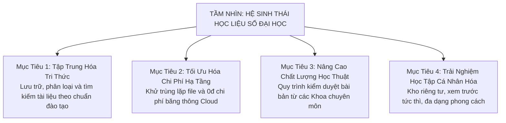

# 🎯 Yêu Cầu Nghiệp Vụ Cấp Cao (Business Requirements Document - BRD)

Tài liệu này xác định các mục tiêu chiến lược, bài toán cốt lõi của nhà trường và người học, cùng các chỉ số đo lường thành công (KPIs) của dự án **Digital Library**.

---

## 1. Tầm Nhìn & Mục Tiêu Nghiệp Vụ (Vision & Strategic Goals)

Hệ thống Thư Viện Số hướng tới xây dựng một **Hệ sinh thái Tri thức Mở** cho môi trường đại học, xóa bỏ tình trạng phân mảnh tài liệu trên các ứng dụng nhắn tin (Zalo, Messenger) hay drive cá nhân, đồng thời tiết kiệm tối đa ngân sách vận hành hạ tầng công nghệ thông tin cho nhà trường.

---

## 2. Danh Sách Yêu Cầu Nghiệp Vụ Chi Tiết (Business Requirements)

### BR-01: Quản lý Tri thức Học tập Tập trung theo Mô hình Đào tạo
* **Mã yêu cầu:** `BR-01`
* **Mức độ ưu tiên:** Khẩn cấp (P0)
* **Trạng thái:** `[Confirmed]` | **Mã nguồn:** `[Implemented]`
* **Mô tả:** Hệ thống phải mô phỏng chính xác cơ cấu tổ chức học thuật của trường đại học bao gồm: Danh sách Khoa/Viện đào tạo -> Danh mục Môn học -> Lớp học phần thực tế. Tài liệu được phân loại theo đúng chương trình đào tạo để sinh viên dễ dàng định vị.
* **Giá trị mang lại:** Giảm thiểu 90% thời gian tìm kiếm tài liệu ôn tập và giáo trình học phần cho sinh viên.

---

### BR-02: Tối ưu Chi phí Hạ tầng & Băng thông Lưu trữ (Zero Egress Strategy)
* **Mã yêu cầu:** `BR-02`
* **Mức độ ưu tiên:** Khẩn cấp (P0)
* **Trạng thái:** `[Confirmed]` | **Mã nguồn:** `[Implemented]`
* **Mô tả:** Hệ thống không được tạo ra gánh nặng chi phí băng thông đột biến khi hàng ngàn sinh viên cùng tải tài liệu trong mùa thi cử:
  1. Tối ưu hóa chi phí với kiến trúc lưu trữ Cục bộ 100% (Local Filesystem), chi phí hạ tầng 0 VNĐ.
  2. Áp dụng thuật toán kiểm tra mã băm SHA-256 (Deduplication) để ngăn chặn việc tải lên nhiều bản sao của cùng một file tài liệu dung lượng lớn.
* **Giá trị mang lại:** Tiết kiệm 100% chi phí egress mạng so với các giải pháp AWS S3 hoặc Google Cloud truyền thống.

---

### BR-03: Thúc đẩy Đóng góp Học liệu Có Kiểm duyệt Chất lượng
* **Mã yêu cầu:** `BR-03`
* **Mức độ ưu tiên:** Cao (P1)
* **Trạng thái:** `[Confirmed]` | **Mã nguồn:** `[Implemented]`
* **Mô tả:** Cho phép sinh viên và giảng viên chủ động đóng góp đề thi mẫu, bài giải hay, slide tóm tắt từ kho cá nhân lên Kho học liệu cộng đồng. Tuy nhiên, tài liệu chỉ được xuất bản công khai sau khi được thẩm định và phê duyệt bởi Quản trị viên Khoa (`faculty_admin`).
* **Giá trị mang lại:** Đảm bảo tính chính xác về mặt học thuật và ngăn ngừa tài liệu rác hoặc vi phạm bản quyền phát tán trong trường.

---

### BR-04: Bảo vệ Quyền Riêng tư Kết hợp Minh bạch Dữ liệu Công cộng
* **Mã yêu cầu:** `BR-04`
* **Mức độ ưu tiên:** Khẩn cấp (P0)
* **Trạng thái:** `[Confirmed]` | **Mã nguồn:** `[Implemented]`
* **Mô tả:** Hệ thống phải duy trì ranh giới bảo mật nghiêm ngặt giữa dữ liệu riêng tư và dữ liệu mở:
  * Kho cá nhân (Personal Space) thuộc quyền sở hữu riêng tư tuyệt đối của từng cá nhân, không ai (kể cả ban quản trị khoa) được phép xem khi chưa được chia sẻ.
  * Kho cộng đồng (Community Library) minh bạch hoàn toàn, sinh viên có thể đánh giá sao, nhận xét phản hồi về chất lượng tài liệu.
* **Giá trị mang lại:** Tạo sự tin cậy tuyệt đối để sinh viên an tâm lưu trữ toàn bộ ghi chú học tập cá nhân.

---

### BR-05: Vận hành Linh hoạt Song song (Đám Mây & Ngoại Tuyến 100%)
* **Mã yêu cầu:** `BR-05`
* **Mức độ ưu tiên:** Cao (P1)
* **Trạng thái:** `[Confirmed]` | **Mã nguồn:** `[Implemented]`
* **Mô tả:** Hệ thống phải vận hành mượt mà ở cả hai môi trường:
  * **Vận hành:** Chạy 100% Cục bộ trên máy tính cá nhân hoặc máy chủ nội bộ với PostgreSQL Local.
  * **Development / Offline:** Chạy hoàn toàn trên máy tính cá nhân bằng Local Filesystem + Local Postgres mà không cần bất kỳ kết nối mạng nào ra ngoài Internet.
* **Giá trị mang lại:** Giảng viên và sinh viên có thể dễ dàng kiểm thử, demo đồ án và bảo vệ tốt nghiệp ở phòng hội đồng không có mạng mà không lo gián đoạn.

---

### BR-06: Độc lập hóa Dữ liệu Tiếp nhận (Document Cloning / Forking)
* **Mã yêu cầu:** `BR-06`
* **Mức độ ưu tiên:** Cao (P1)
* **Trạng thái:** `[Confirmed]` | **Mã nguồn:** `[Implemented]`
* **Mô tả:** Khi một người dùng "Lưu về kho cá nhân" một tài liệu từ Kho cộng đồng hoặc nhóm học tập, hệ thống phải thực hiện nhân bản (clone) một bản ghi độc lập. Người nhận có thể xóa, đổi tên, ghi chú hoặc gắn nhãn riêng mà không ảnh hưởng tới bản gốc của tác giả ban đầu.
* **Giá trị mang lại:** Ngăn chặn hiệu ứng xóa dây chuyền và bảo vệ tính nguyên vẹn của tài liệu gốc.

---

### BR-07: Đo lường & Nhận diện Tài liệu Nổi bật (Trending Analytics)
* **Mã yêu cầu:** `BR-07`
* **Mức độ ưu tiên:** Trung bình (P2)
* **Trạng thái:** `[Confirmed]` | **Mã nguồn:** `[Implemented]`
* **Mô tả:** Hệ thống cần có cơ chế tự động ghi nhận tương tác (lượt xem, lượt tải, lượt lưu, đánh giá sao) và áp dụng thuật toán tính điểm xu hướng có suy hao thời gian (`trending_score`) để xếp hạng tài liệu hữu ích cho cộng đồng.
* **Giá trị mang lại:** Giúp người học nhanh chóng tiếp cận những học liệu giá trị nhất của khóa trước.

---

## 3. Chỉ Số Đo Lường Hiệu Quả (Business KPIs)

| Chỉ số KPI | Mục tiêu nghiệp vụ kỳ vọng | Hiện trạng đo lường thực tế |
|---|:---:|:---:|
| **Thời gian tìm thấy tài liệu** | < 10 giây | Đạt ~ 1-2 giây nhờ PostgreSQL Full-Text Search |
| **Chi phí truyền tải dữ liệu (Egress)** | 0 VNĐ | Đạt 0 VNĐ nhờ hệ thống lưu trữ Cục bộ |
| **Tỷ lệ trùng lặp dữ liệu trên đĩa** | < 5% | Đạt yêu cầu nhờ SHA-256 Checksum Verification |
| **Thời gian xét duyệt học liệu** | < 48 giờ làm việc | Đã có Dashboard xét duyệt riêng cho Quản trị viên Khoa |
| **Độ trễ xem trước tài liệu tại Client** | < 1 giây | Đạt yêu cầu nhờ render DOCX/PDF/Code trực tiếp tại Client |
