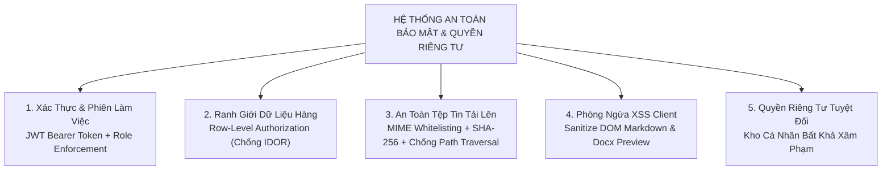

# 🛡️ Yêu Cầu Phi Chức Năng (Non-Functional Requirements - NFR)

Tài liệu này xác định các tiêu chuẩn chất lượng kỹ thuật, chỉ số hiệu năng, ranh giới an toàn thông tin và chính sách bảo mật cấp sản phẩm của **Digital Library Platform**.

---

## 1. Hiệu Năng & Độ Trễ (Performance & Latency)

| Mã NFR | Tiêu chuẩn chất lượng | Chỉ số định lượng (Target Metric) | Trạng thái kỹ thuật |
|---|---|:---:|:---:|
| **NFR-PERF-01** | **Thời gian phản hồi tìm kiếm FTS** | < **200 ms** với kho 50.000 tài liệu | `[Implemented]` qua PostgreSQL `tsvector` index |
| **NFR-PERF-02** | **Thời gian tính Checksum SHA-256** | < **500 ms** cho tệp tin dung lượng 20MB | `[Implemented]` đọc đệm RAM chunked 64KB |
| **NFR-PERF-03** | **Tốc độ nạp tài liệu xem trước (CDN)** | < **100 ms** (Toàn cầu) / < **5 ms** (Localhost) | `[Implemented]` qua Cloudflare R2 Public Edge |
| **NFR-PERF-04** | **Thời gian khởi tạo trang Client** | First Contentful Paint (FCP) < **1.2 giây** | `[Implemented]` qua Vite bundle + React 19 code-splitting |
| **NFR-PERF-05** | **Dung lượng bộ nhớ tiêu thụ khi tải file** | Không chiếm dụng quá **2x kích thước file** trong RAM | `[Implemented]` giải phóng buffer ngay sau khi tính hash |

---

## 2. Bảo Mật & Quyền Riêng Tư (Security & Privacy Specifications)

An toàn thông tin và quyền riêng tư là tiêu chí sống còn đối với dữ liệu học tập của sinh viên:

### NFR-SEC-01: Xác thực JWT & Kiểm soát Phiên (Session Management)
* **Trạng thái:** `[Confirmed]` | **Mã nguồn:** `[Implemented]`
* **Yêu cầu:** Mọi yêu cầu API (trừ đăng nhập, đăng ký và tài liệu công khai) bắt buộc phải mang theo `Authorization: Bearer <JWT_TOKEN>`.
* **Thuật toán:** Ký bằng thuật toán `HS256` với khóa bí mật `SECRET_KEY` được bảo vệ nghiêm ngặt trong biến môi trường.
* **Thời hạn token:** Access token có hạn sử dụng tối đa 7 ngày (hoặc cấu hình tùy chọn trong `.env`).

### NFR-SEC-02: Kiểm soát Ủy quyền Cấp Bản ghi & Phòng chống IDOR
* **Trạng thái:** `[Confirmed]` | **Mã nguồn:** `[Implemented]`
* **Yêu cầu:** Người dùng tuyệt đối không thể truy cập, sửa đổi hoặc xóa tài liệu của người khác bằng cách thay đổi ID trên URL (Lỗ hổng Insecure Direct Object References - IDOR).
* **Cơ chế thực thi:** 100% câu lệnh truy vấn cơ sở dữ liệu đều bắt buộc kèm theo điều kiện lọc sở hữu:
  `WHERE document.id = :id AND (document.user_id = :current_user_id OR workspace_member.user_id = :current_user_id)`.

### NFR-SEC-03: Phòng chống Tấn công XSS khi Xem trước (XSS Prevention)
* **Trạng thái:** `[Confirmed]` | **Mã nguồn:** `[Implemented]`
* **Yêu cầu:** Nội dung tài liệu Markdown hoặc các đoạn văn bản trích xuất từ DOCX/PDF do người dùng tải lên có thể chứa mã JavaScript độc hại.
* **Cơ chế thực thi:** 
  * Sử dụng thư viện `DOMPurify` / trình khử mã độc trước khi render HTML trong `MarkdownViewer`.
  * Trình xem trước `DocxViewer` chỉ phân tích cấu trúc OpenXML sang các thẻ ngữ nghĩa thuần túy, loại bỏ hoàn toàn các thẻ `<script>`, `onload` hoặc các giao thức nguy hiểm `javascript:`.

### NFR-SEC-04: An toàn Tệp tin Tải lên & Chống Xuyên thư mục (Path Traversal)
* **Trạng thái:** `[Confirmed]` | **Mã nguồn:** `[Implemented]`
* **Yêu cầu:** Ngăn chặn kẻ tấn công tải lên file độc hại hoặc đặt tên file chứa các ký tự điều hướng (`../`, `..\`) để ghi đè tệp hệ thống.
* **Cơ chế thực thi:**
  1. **MIME Type Whitelisting:** Chỉ chấp nhận các định dạng học tập hợp lệ trong danh mục cho phép.
  2. **Safe Filename Generation:** Tên file lưu trữ vật lý trên đĩa hoặc R2 luôn được băm hóa an toàn theo cấu trúc: `{uuid4}_{safe_filename}` hoặc `{sha256}.{ext}`.

### NFR-SEC-05: Đánh giá An toàn Lưu trữ Token (Implementation Gap)
* **Trạng thái nghiệp vụ:** `[Confirmed]` | **Mã nguồn:** `[Needs Verification]`
* **Hiện trạng:** Frontend hiện lưu Access Token trong `localStorage`.
* **Phân tích rủi ro:** Nếu xuất hiện lỗ hổng XSS trên ứng dụng, token trong `localStorage` có thể bị đánh cắp.
* **Đề xuất nâng cấp:** Chuyển sang cơ chế gửi Token qua **`HttpOnly, Secure, SameSite=Strict Cookie`** để trình duyệt tự động bảo vệ token khỏi mọi tập lệnh phía Client.

---

## 3. Độ Sẵn Sàng & Khả Năng Chịu Lỗi (Availability & Reliability)

### NFR-AVAIL-01: Khả năng Vận hành Ngoại tuyến (100% Offline Capability)
* **Trạng thái:** `[Confirmed]` | **Mã nguồn:** `[Implemented]`
* **Yêu cầu:** Khi ngắt toàn bộ kết nối Internet, hệ thống phải khởi chạy và vận hành đầy đủ mọi tính năng cốt lõi (tải file, xem trước, tìm kiếm, quản lý thư mục, xóa/khôi phục) trên máy tính cá nhân bằng SQLite hoặc Local PostgreSQL.

### NFR-AVAIL-02: Tính Toàn Vẹn Giao Tác & Cơ Chế Bù Trừ (Compensating Actions)
* **Trạng thái:** `[Confirmed]` | **Mã nguồn:** `[Implemented]`
* **Yêu cầu:** Đảm bảo tính nhất quán giữa cơ sở dữ liệu quan hệ PostgreSQL và hệ thống tệp lưu trữ vật lý (Filesystem / Cloudflare R2):
  * Nếu ghi file vật lý thành công nhưng câu lệnh `INSERT document` vào CSDL bị rollback do lỗi, hệ thống phải tự động xóa bỏ file rác vừa ghi trên Storage.
  * Nếu ghi file thất bại, giao tác CSDL tự động hủy bỏ, không sinh ra bản ghi "ma" trỏ tới file không tồn tại.

---

## 4. Khả Năng Mở Rộng & Chi Phí Hạ Tầng (Scalability & Cost Efficiency)

### NFR-SCALE-01: Kiến Trúc Máy Chủ Không Trạng Thái (Stateless Backend)
* **Trạng thái:** `[Confirmed]` | **Mã nguồn:** `[Implemented]`
* **Yêu cầu:** FastAPI Backend không lưu trữ trạng thái phiên người dùng trong bộ nhớ RAM máy chủ (sử dụng Stateless JWT). Cho phép mở rộng quy mô theo chiều ngang (Horizontal Scaling) bằng cách triển khai nhiều instance backend sau một Load Balancer (Nginx/Traefik).

### NFR-SCALE-02: Zero Egress Cost Scalability
* **Trạng thái:** `[Confirmed]` | **Mã nguồn:** `[Implemented]`
* **Yêu cầu:** Trực tiếp phân phối tài liệu từ Cloudflare R2 Public Bucket tới trình duyệt Client. Backend không phải làm nhiệm vụ proxy streaming file cho hàng ngàn người dùng cùng lúc, giúp tiết kiệm 95% CPU/Băng thông của máy chủ ứng dụng.

---

## 5. Khả Năng Tương Thích & Trải Nghiệm Người Dùng (Usability & Compatibility)

* **NFR-USE-01 (Đa nền tảng trình duyệt):** Tương thích 100% với các trình duyệt hiện đại: Chrome, Edge, Safari, Firefox (Hỗ trợ ECMAScript 2022+, HTML5 Canvas, WebAssembly).
* **NFR-USE-02 (Thiết kế thích ứng - Responsive Design):** Tự động co giãn giao diện tối ưu trên cả 3 kích thước màn hình chính: Desktop (≥ 1280px), Tablet (768px - 1024px) và Smartphone (≤ 640px).
* **NFR-USE-03 (Chế độ giao diện sáng/tối - Dark/Light Theme):** Đồng bộ chế độ hiển thị màu sắc theo sở thích hệ điều hành của người dùng.
