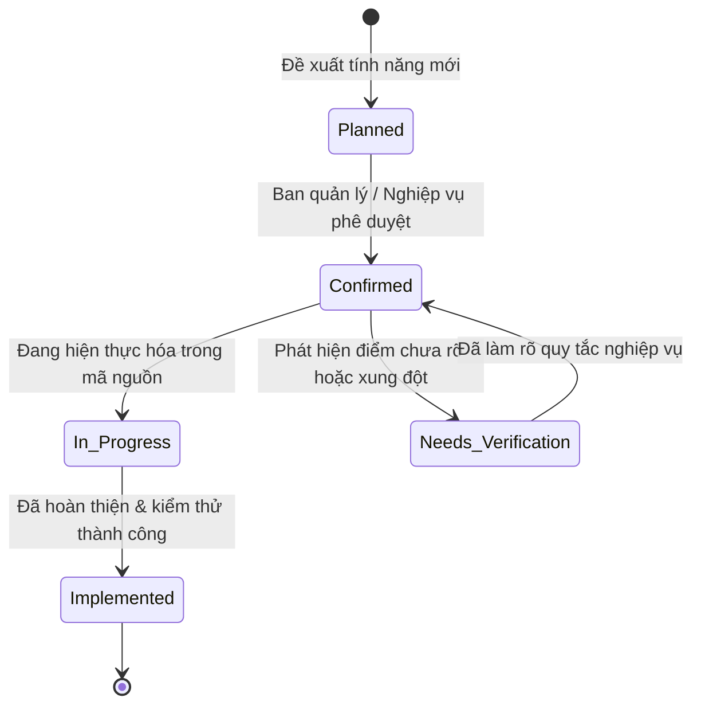

# 📋 Tổng Quan Yêu Cầu & Nghiệp Vụ Hệ Thống (Requirements Overview)

Tài liệu trong phân hệ này mô tả **sản phẩm Thư Viện Số cần làm gì (Product Requirements)** từ góc nhìn người dùng, quản trị viên và nhà trường, được tách biệt hoàn toàn với hiện trạng cài đặt mã nguồn (Source Code Implementation).

---

## 🎯 Triết Lý Quản Lý Yêu Cầu

Để đảm bảo tính minh bạch giữa kế hoạch sản phẩm và hiện trạng mã nguồn, toàn bộ các yêu cầu trong hệ thống được gắn mã định danh chuẩn và nhãn trạng thái chính thức:

### Quy Ước Nhãn Trạng Thái Yêu Cầu
* `[Confirmed]` — Yêu cầu nghiệp vụ cốt lõi đã được phê duyệt chính thức.
* `[Implemented]` — Đã được hiện thực hóa đầy đủ trong mã nguồn và kiểm thử hoạt động.
* `[In Progress]` — Đang được phát triển hoặc chỉ mới hoàn thiện một phần.
* `[Planned]` — Nằm trong lộ trình phát triển tương lai (Roadmap), chưa có trong mã nguồn hiện tại.
* `[Needs Verification]` — Cần làm rõ thêm từ phía ban giám hiệu, quản trị khoa hoặc các bên liên quan.

---

## 📊 Bảng Đối Soát Khoảng Trống Triển Khai (Implementation Gaps)

Một trong những mục tiêu trọng tâm của tài liệu này là chỉ ra các **khoảng trống (Gaps)** giữa yêu cầu nghiệp vụ mong muốn và hiện trạng mã nguồn thực tế:

| Mã Yêu Cầu | Tên Yêu Cầu Nghiệp Vụ | Trạng Thái Nghiệp Vụ | Trạng Thái Code Hiện Tại | Mô Tả Khoảng Trống (Gap) & Hướng Khắc Phục |
|:---:|---|:---:|:---:|---|
| **GAP-01** | Trang "Đã chia sẻ với tôi" (`/personal/shared`) | `Confirmed` | `In Progress` | Giao diện hiện thông báo *"Trang đang xây dựng"*. Backend đã có bảng `document_shares` và endpoint `GET /shares/with-me`. Cần hoàn thiện UI kết nối dữ liệu. |
| **GAP-02** | Trang "Tài liệu yêu thích" (`/personal/favorites`) | `Confirmed` | `In Progress` | Giao diện hiện *"Trang đang xây dựng"*. Backend đã có bảng `favorites` và endpoint `GET /favorites`. Cần hoàn thiện giao diện danh sách yêu thích. |
| **GAP-03** | Lưu trữ Content-Addressed Storage (CAS) hoàn chỉnh | `Planned` | `Needs Verification` | Hệ thống hiện tại dùng SHA-256 để kiểm tra trùng lặp nhưng vẫn lưu bản copy vật lý cho từng tài liệu. Kiến trúc CAS tương lai sẽ chỉ lưu duy nhất 1 file vật lý cho các file cùng mã hash. |
| **GAP-04** | Cơ chế hàng đợi trích xuất nền (Message Queue) | `Planned` | `In Progress` | Hiện dùng FastAPI `BackgroundTasks` và `APScheduler`. Với khối lượng tải lớn, cần chuyển sang hàng đợi phân tán (Redis + Celery) để tránh quá tải RAM server. |
| **GAP-05** | Lưu trữ Token bảo mật (HttpOnly Cookies) | `Confirmed` | `Needs Verification` | Frontend hiện lưu JWT Access Token trong `localStorage`. Cần nâng cấp cơ chế gửi token qua `HttpOnly Cookie` để triệt tiêu hoàn toàn rủi ro XSS. |

---

## 📚 Danh Mục Tài Liệu Thuộc Phân Hệ Yêu Cầu

1. [Yêu Cầu Nghiệp Vụ Cấp Cao (BUSINESS_REQUIREMENTS.md)](./BUSINESS_REQUIREMENTS.md) — Bài toán nghiệp vụ, mục tiêu giáo dục và các chỉ số đo lường hiệu quả (Business KPIs).
2. [Yêu Cầu Chức Năng (FUNCTIONAL_REQUIREMENTS.md)](./FUNCTIONAL_REQUIREMENTS.md) — Đặc tả chi tiết hành vi và chức năng của từng phân hệ (Kho cá nhân, Nhóm, Khoa, Thư viện cộng đồng, Tìm kiếm, Xem trước,...).
3. [Yêu Cầu Phi Chức Năng (NON_FUNCTIONAL_REQUIREMENTS.md)](./NON_FUNCTIONAL_REQUIREMENTS.md) — Tiêu chuẩn về hiệu năng, độ sẵn sàng, bảo mật cấp sản phẩm, tính toán bộ nhớ và khả năng mở rộng.
4. [Quy Tắc Nghiệp Vụ Dùng Chung (BUSINESS_RULES.md)](./BUSINESS_RULES.md) — Các ràng buộc bất biến (Invariants) ở cấp sản phẩm: quyền riêng tư kho cá nhân, cơ chế nhân bản tài liệu, thuật toán trending, vòng đời thùng rác 30 ngày.
5. [Các Luồng Nghiệp Vụ Trọng Yếu (Use Cases)](./use-cases/README.md) — 6 kịch bản tương tác người dùng quan trọng nhất của hệ thống.
# AI requirements

UC-07 và FR/BR/NFR AI được mô tả trong [UC07](./use-cases/UC07_AI_ASSISTED_RETRIEVAL_AND_INSIGHTS.md).
