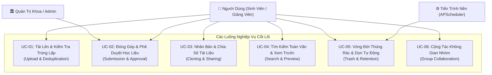

# 🎭 Danh Mục Luồng Nghiệp Vụ Trọng Yếu (Use Cases)

Thư mục này chứa đặc tả chi tiết 6 luồng tương tác nghiệp vụ cốt lõi của hệ thống **Digital Library**. Mỗi Use Case được thiết kế theo tiêu chuẩn công nghiệp với đầy đủ: Tác nhân (Actors), Tiền điều kiện (Preconditions), Luồng cơ bản (Main Flow), Luồng ngoại lệ (Alternative / Exception Flows), và Hậu điều kiện (Postconditions).

---

## 🗺️ Sơ Đồ Use Case Tổng Thể (System Use Case Diagram)

---

## 📋 Danh Sách Các Use Case Chi Tiết

| Mã Use Case | Tên Luồng Nghiệp Vụ | Tác Nhân Chính | Mục Tiêu & Giá Trị Cốt Lõi |
|:---:|---|---|---|
| **[UC-01](./UC01_UPLOAD_AND_DEDUPLICATION.md)** | **Tải lên & Khử trùng lặp tệp tin** | Sinh viên / Giảng viên | Tính toán SHA-256 trong RAM đệm, phát hiện tệp trùng lặp và kích hoạt trích xuất văn bản/OCR ngầm. |
| **[UC-02](./UC02_COMMUNITY_SUBMISSION_AND_APPROVAL.md)** | **Đóng góp & Thẩm định học liệu** | Người học & Quản trị Khoa | Gửi tài liệu học tập từ cá nhân lên thư viện trường; xét duyệt chất lượng học thuật và thông báo kết quả. |
| **[UC-03](./UC03_DOCUMENT_FORKING_AND_SHARING.md)** | **Nhân bản tài liệu & Chia sẻ** | Người học | Tạo bản sao độc lập (Forking) khi lưu tài liệu về kho cá nhân, bảo vệ tính nguyên vẹn của bản gốc. |
| **[UC-04](./UC04_FULLTEXT_SEARCH_AND_PREVIEW.md)** | **Tìm kiếm toàn văn & Xem trước đa dạng** | Mọi người dùng | Tìm kiếm từ khóa ngữ nghĩa qua PostgreSQL FTS và xem trước trực tiếp PDF/DOCX/Code trên trình duyệt. |
| **[UC-05](./UC05_TRASH_LIFECYCLE_AND_PURGE.md)** | **Vòng đời thùng rác & Dọn rác tự động** | Người dùng & APScheduler | Xóa mềm an toàn, khôi phục nguyên trạng và tác vụ quét xóa vĩnh viễn sau 30 ngày. |
| **[UC-06](./UC06_GROUP_WORKSPACE_COLLABORATION.md)** | **Cộng tác không gian nhóm học tập** | Trưởng nhóm & Thành viên | Tạo nhóm, phân quyền trưởng nhóm/thành viên, chia sẻ học liệu và quản lý thùng rác nhóm độc lập. |
