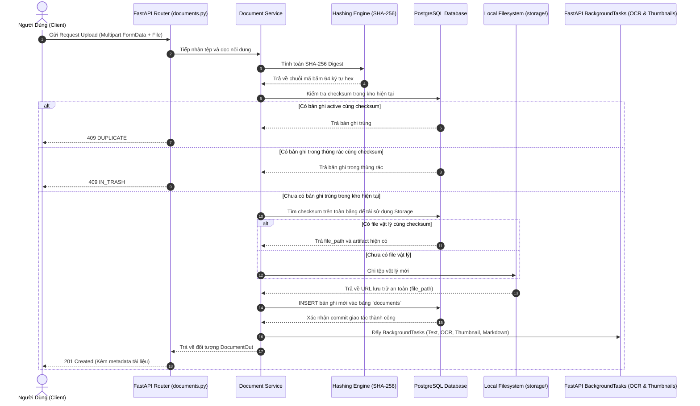

# 📤 UC-01: Tải Lên Tài Liệu & Kiểm Tra Trùng Lặp (Upload & Deduplication)

---

## 1. Thông Tin Tổng Quan
* **Mã nghiệp vụ:** `UC-01`
* **Tác nhân chính:** Sinh viên, Giảng viên (Đã đăng nhập hệ thống).
* **Mục tiêu:** Tải tài liệu học tập lên kho cá nhân hoặc nhóm làm việc, tự động tính toán mã băm SHA-256 để phát hiện file trùng lặp và kích hoạt tác vụ nền trích xuất dữ liệu.
* **Mức độ ưu tiên:** Khẩn cấp (P0).
* **Trạng thái:** `[Confirmed]` | **Mã nguồn:** `[Implemented]`

---

## 2. Tiền Điều Kiện & Ràng Buộc
1. Người dùng đã xác thực thành công và sở hữu JWT Access Token hợp lệ.
2. Định dạng tệp tin được backend tiếp nhận và phân loại theo loại nội dung.

---

## 3. Luồng Sự Kiện Chính (Main Flow)

---

## 4. Các Luồng Ngoại Lệ (Alternative / Exception Flows)

### 4.1. Ngoại lệ: Định dạng tệp không hợp lệ
* **Xử lý:** Backend kiểm tra phần mở rộng và MIME type nhị phân. Nếu là các file thực thi nguy hiểm (`.exe`, `.sh`, `.bat`, `.dll`), hệ thống trả về mã lỗi HTTP `415 Unsupported Media Type`.

### 4.2. Ngoại lệ: Race condition khi upload đồng thời
* **Trạng thái:** Source hiện chưa có khóa giao dịch hoặc unique constraint đủ rõ để bảo vệ hoàn toàn trường hợp hai upload cùng checksum xảy ra đồng thời.

---

## 5. Hậu Điều Kiện (Postconditions)
1. Bản ghi tài liệu mới được tạo trong bảng `documents`; xử lý text, thumbnail và Markdown tiếp tục ở BackgroundTasks.
2. Metadata (kích thước, MIME, SHA-256 hash) được lưu trữ đầy đủ.
3. Trigger PostgreSQL cập nhật `search_vector` từ `title`, `description` và `content`.
