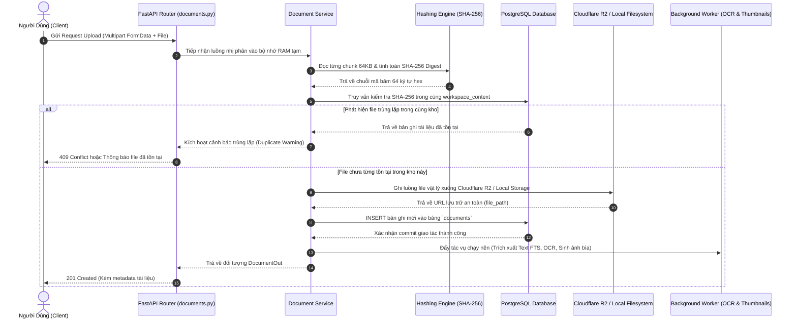

# 📤 UC-01: Tải Lên Tài Liệu & Kiểm Tra Trùng Lặp (Upload & Deduplication)

---

## 1. Thông Tin Tổng Quan
* **Mã nghiệp vụ:** `UC-01`
* **Tác nhân chính:** Sinh viên, Giảng viên (Đã đăng nhập hệ thống).
* **Mục tiêu:** Tải tài liệu học tập lên kho cá nhân hoặc nhóm làm việc, tự động tính toán mã băm SHA-256 để phát hiện file trùng lặp và kích hoạt tác vụ nền trích xuất dữ liệu.
* **Mức độ ưu tiên:** Khẩn cấp (P0).
* **Trạng thái:** `[Confirmed]` | **Mã nguồn:** `[Implemented]`

---

## 2. Tiền Điều Kiện & Ràng Buộc
1. Người dùng đã xác thực thành công và sở hữu JWT Access Token hợp lệ.
2. Tệp tin tải lên có dung lượng không vượt quá **50 MB**.
3. Định dạng tệp tin nằm trong danh mục MIME Whitelist hợp lệ (PDF, DOCX, XLSX, PPTX, TXT, Code, Markdown).

---

## 3. Luồng Sự Kiện Chính (Main Flow)

---

## 4. Các Luồng Ngoại Lệ (Alternative / Exception Flows)

### 4.1. Ngoại lệ 1: File vượt quá kích thước cho phép (> 50MB)
* **Thời điểm phát hiện:** Ngay tại tầng Client hoặc khi đọc content-length ở Header Backend.
* **Xử lý:** Hủy bỏ kết nối ngay lập tức mà không nạp toàn bộ file vào RAM đệm, trả về mã lỗi HTTP `413 Payload Too Large` kèm thông báo: *"Dung lượng file vượt quá giới hạn tối đa 50MB"*.

### 4.2. Ngoại lệ 2: Định dạng tệp không hợp lệ
* **Xử lý:** Backend kiểm tra phần mở rộng và MIME type nhị phân. Nếu là các file thực thi nguy hiểm (`.exe`, `.sh`, `.bat`, `.dll`), hệ thống trả về mã lỗi HTTP `415 Unsupported Media Type`.

### 4.3. Ngoại lệ 3: Ghi file Storage thành công nhưng lỗi cơ sở dữ liệu (Rollback)
* **Xử lý:** Nếu lệnh `INSERT INTO documents` thất bại do mất kết nối Database, khối `try...except` của Service lập tức kích hoạt hành động bù trừ (Compensating Action) xóa ngay file vật lý vừa ghi trên Storage để tránh tạo file rác mồ côi.

---

## 5. Hậu Điều Kiện (Postconditions)
1. Bản ghi tài liệu mới được tạo trong bảng `documents` với trạng thái sẵn sàng.
2. Metadata (kích thước, MIME, SHA-256 hash) được lưu trữ đầy đủ.
3. Tác vụ trích xuất text chạy nền hoàn tất cập nhật trường `search_vector` để người dùng có thể tìm kiếm toàn văn ngay sau đó.
