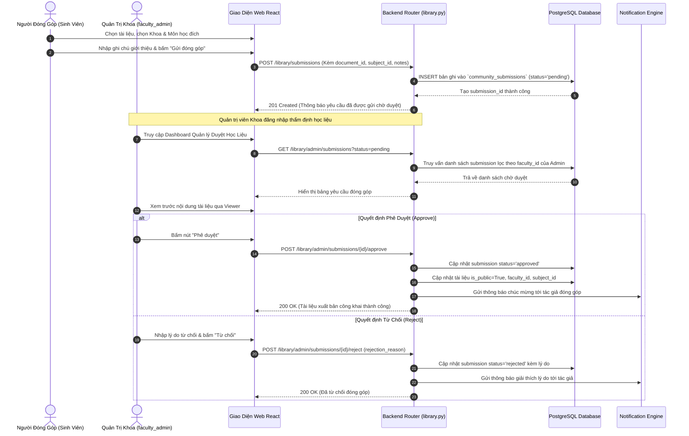

# 🏛️ UC-02: Đóng Góp & Thẩm Định Học Liệu Cộng Đồng (Submission & Moderation)

---

## 1. Thông Tin Tổng Quan
* **Mã nghiệp vụ:** `UC-02`
* **Tác nhân chính:** 
  * **Người đóng góp:** Sinh viên, Giảng viên.
  * **Người thẩm định:** Quản trị viên Khoa (`faculty_admin`), Quản trị Hệ thống (`system_admin`).
* **Mục tiêu:** Cho phép người học chia sẻ tài liệu ôn thi, bài giảng giá trị lên Kho học liệu chung của trường thông qua quy trình xét duyệt chất lượng học thuật nghiêm ngặt.
* **Mức độ ưu tiên:** Cao (P1).
* **Trạng thái:** `[Confirmed]` | **Mã nguồn:** `[Implemented]`

---

## 2. Tiền Điều Kiện
1. Người đóng góp đang sở hữu tài liệu hợp lệ trong Kho cá nhân hoặc Nhóm học tập.
2. Môn học và Khoa đào tạo nhận đóng góp đang ở trạng thái hoạt động trong hệ thống.
3. Quản trị viên Khoa đăng nhập bằng tài khoản có thẩm quyền quản lý đúng Khoa nhận đóng góp.

---

## 3. Luồng Sự Kiện Chính (Main Flow)

---

## 4. Các Quy Tắc Nghiệp Vụ Cần Tuân Thủ
* **BR-MOD-01 (Giới hạn thẩm quyền Khoa):** Quản trị viên Khoa A tuyệt đối không được duyệt hoặc xem các yêu cầu đóng góp thuộc môn học của Khoa B (được kiểm tra chặt chẽ tại `backend/app/routers/library.py` qua `check_admin_permission`).
* **BR-MOD-02 (Bắt buộc lý do từ chối):** Khi từ chối yêu cầu đóng góp, trường `rejection_reason` không được để trống (tối thiểu 10 ký tự) để đảm bảo tính minh bạch đối với sinh viên.
* **BR-MOD-03 (Bảo toàn tác quyền):** Khi tài liệu được duyệt xuất bản công khai, thông tin tác giả ban đầu (`uploader_name`, MSSV) vẫn được hiển thị trang trọng trên trang chi tiết tài liệu cộng đồng.
