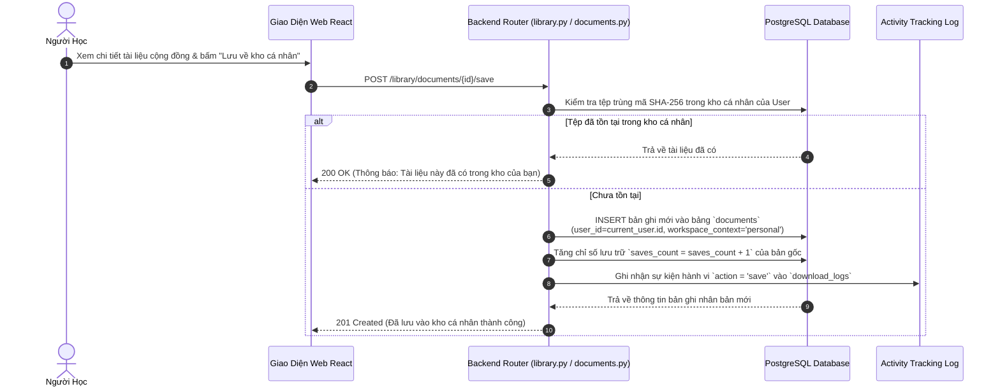

# 🔗 UC-03: Nhân Bản Tài Liệu & Cơ Chế Chia Sẻ (Forking & Sharing)

---

## 1. Thông Tin Tổng Quan
* **Mã nghiệp vụ:** `UC-03`
* **Tác nhân chính:** Người học (Sinh viên, Giảng viên).
* **Mục tiêu:** 
  1. Tiếp nhận tài liệu học tập từ Thư viện trường về Kho cá nhân bằng cơ chế nhân bản độc lập (Document Forking).
  2. Tạo liên kết chia sẻ bảo mật có cấu hình thời hạn và phân quyền cho bạn bè.
* **Mức độ ưu tiên:** Khẩn cấp (P0).
* **Trạng thái:** `[Confirmed]` | **Mã nguồn:** `[Implemented]`

---

## 2. Luồng Nghiệp Vụ 1: Lưu Về Kho Cá Nhân (Document Forking / Cloning)

### Nguyên tắc bảo toàn độc lập:
* Bản sao mới được sinh ra hoàn toàn độc lập với bản gốc. Người dùng có thể gắn nhãn cá nhân, viết ghi chú, chuyển vào thư mục riêng hoặc xóa bỏ mà **không ảnh hưởng gì đến bản gốc** trong Thư viện cộng đồng.

---

## 3. Luồng Nghiệp Vụ 2: Tạo Liên Kết Chia Sẻ Bảo Mật (Secure Sharing Link)

1. **Khởi tạo liên kết:** Người dùng chọn một tài liệu trong kho cá nhân và bấm nút *"Chia sẻ"*.
2. **Cấu hình tham số chia sẻ:**
   * Quyền hạn: Chỉ xem trực tuyến (`can_view=True`) hoặc Cho phép tải file về máy (`can_download=True`).
   * Thời hạn hiệu lực: Tùy chọn 1 ngày, 7 ngày, 30 ngày hoặc Vĩnh viễn (`expires_at`).
   * Mật khẩu bảo vệ (Tùy chọn): Thiết lập mật mã truy cập cho tài liệu quan trọng.
3. **Sinh mã chia sẻ an toàn:** Hệ thống sinh mã ngẫu nhiên dạng UUID4 không thể đoán mò và lưu vào bảng `document_shares`.
4. **Người nhận truy cập liên kết:**
   * Người nhận mở đường dẫn `https://.../share/{share_token}`.
   * Hệ thống kiểm tra: Token có tồn tại không? Đã hết hạn chưa? Có yêu cầu mật khẩu không?
   * Nếu hợp lệ: Hiển thị giao diện xem trước tài liệu trực tiếp. Người nhận không có quyền truy cập vào bất kỳ tài liệu nào khác trong kho của người chia sẻ.
