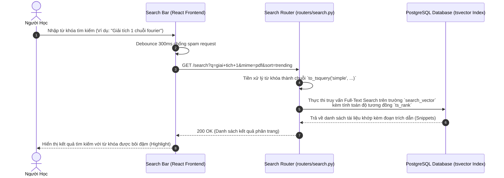
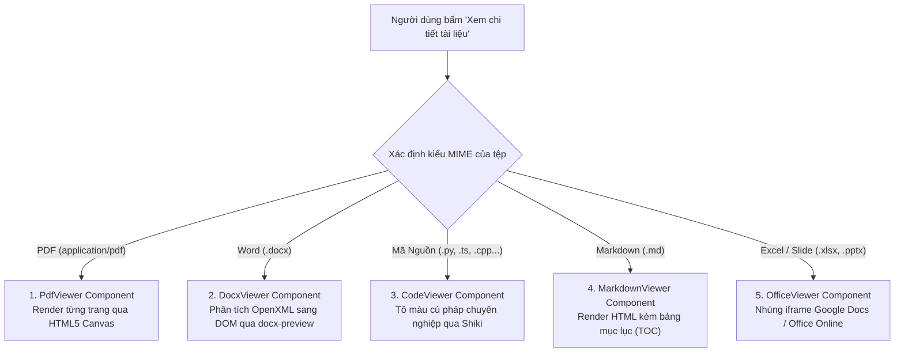

# 🔍 UC-04: Tìm Kiếm Toàn Văn & Xem Trước Đa Định Dạng (Search & Preview)

---

## 1. Thông Tin Tổng Quan
* **Mã nghiệp vụ:** `UC-04`
* **Tác nhân chính:** Toàn bộ người dùng (Sinh viên, Giảng viên, Khách vãng lai).
* **Mục tiêu:** 
  1. Định vị nhanh chóng tài liệu học tập dựa trên từ khóa ngữ nghĩa trong tiêu đề và nội dung văn bản trích xuất.
  2. Xem trước trực tiếp tệp tin với độ trễ thấp ngay trên trình duyệt mà không cần tải file về máy tính cá nhân.
* **Mức độ ưu tiên:** Khẩn cấp (P0).
* **Trạng thái:** `[Confirmed]` | **Mã nguồn:** `[Implemented]`

---

## 2. Luồng Nghiệp Vụ Tìm Kiếm Toàn Văn (Full-Text Search Flow)

### Các tiêu chí lọc kết hợp (Multi-filter):
* **Theo Định dạng (MIME Type):** Lọc riêng PDF, Word, Excel, Slide trình chiếu hoặc Mã nguồn.
* **Theo Đơn vị Đào tạo:** Lọc theo Khoa quản lý và Môn học cụ thể.
* **Theo Tiêu chí Sắp xếp:** Sắp xếp theo Độ phù hợp nhất (`relevance`), Mới cập nhật nhất (`created_at`), hoặc Đang được quan tâm nhất (`trending_score`).

---

## 3. Luồng Nghiệp Vụ Xem Trước Đa Định Dạng (Multi-Format Preview Flow)

Khi người dùng bấm vào một tài liệu trong danh sách, hệ thống tự động xác định định dạng tệp tin và kích hoạt bộ dựng hình (Viewer) phù hợp:

### Ưu điểm vượt trội của giải pháp xem trước:
1. **Tiết kiệm 90% dung lượng:** Người dùng không cần tải các tệp tin 20-30MB về điện thoại/máy tính để chỉ đọc lướt một vài trang thông tin.
2. **An toàn thiết bị:** Tránh hoàn toàn nguy cơ máy tính người dùng bị lây nhiễm virus hay mã độc ẩn trong các tệp tin tải về.
3. **Tương thích hoàn hảo:** Mọi định dạng văn phòng phổ biến đều hiển thị đẹp mắt, đồng nhất trên mọi trình duyệt web.
