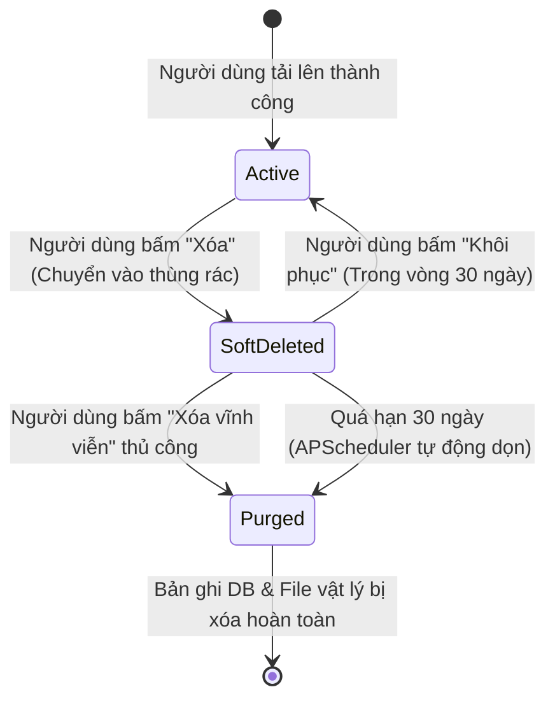
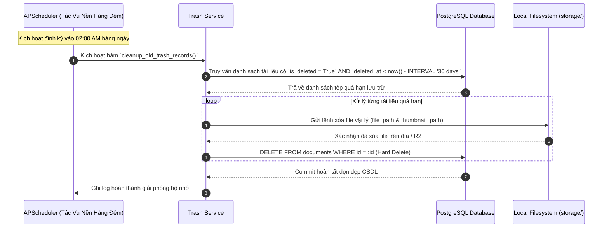

# 🗑️ UC-05: Vòng Đời Thùng Rác & Tự Động Dọn Dẹp (Trash Lifecycle & Purge)

---

## 1. Thông Tin Tổng Quan
* **Mã nghiệp vụ:** `UC-05`
* **Tác nhân chính:** Người dùng sở hữu tài liệu, Tiến trình chạy nền hệ thống (`APScheduler`).
* **Mục tiêu:** Cung cấp cơ chế xóa dữ liệu an toàn tránh mất mát do thao tác nhầm lẫn, đồng thời tự động giải phóng dung lượng lưu trữ cho hệ thống sau 30 ngày.
* **Mức độ ưu tiên:** Cao (P1).
* **Trạng thái:** `[Confirmed]` | **Mã nguồn:** `[Implemented]`

---

## 2. Vòng Đời Tài Liệu Qua Các Trạng Thái

---

## 3. Luồng Chi Tiết Các Tình Huống Nghiệp Vụ

### 3.1. Luồng 1: Xóa Mềm Tài Liệu (Soft Delete)
1. **Hành động:** Người dùng chọn 1 hoặc nhiều tài liệu trong kho cá nhân/nhóm và chọn *"Xóa"*.
2. **Xử lý Backend:**
   * Cập nhật trường `is_deleted = True` và ghi nhận thời điểm xóa `deleted_at = now()`.
   * Ghi log hành vi `action = 'delete'` vào bảng `download_logs`.
3. **Kết quả:** Tài liệu lập tức ẩn khỏi danh sách tài liệu đang hoạt động và không thể tìm kiếm, nhưng file vật lý trên Storage vẫn được bảo toàn nguyên vẹn.

---

### 3.2. Luồng 2: Khôi Phục Tài Liệu (Restore)
1. **Hành động:** Người dùng truy cập Thùng rác (`/personal/trash`), chọn tài liệu cần lấy lại và bấm *"Khôi phục"*.
2. **Xử lý Backend:**
   * Kiểm tra thư mục gốc trước đây của tài liệu còn tồn tại hay không. Nếu thư mục cũ đã bị xóa, tài liệu được đưa về thư mục gốc (Root).
   * Đặt lại cờ `is_deleted = False`, `deleted_at = NULL`.
3. **Kết quả:** Tài liệu xuất hiện trở lại tại vị trí ban đầu với đầy đủ metadata, nhãn và ghi chú.

---

### 3.3. Luồng 3: Tác Vụ Quét Dọn Tự Động Sau 30 Ngày (Scheduled Purge)

---

## 4. Các Biện Pháp An Toàn Khi Xóa Vĩnh Viễn
1. **Cảnh báo nguy hiểm cấp 2:** Khi người dùng chủ động bấm "Xóa vĩnh viễn" thủ công trong thùng rác, giao diện bật hộp thoại xác nhận màu đỏ cảnh báo hành động này không thể hoàn tác.
2. **Bảo toàn dữ liệu dùng chung:** Nếu file vật lý đang được một người dùng khác tái sử dụng trong hệ thống (nhờ cơ chế Deduplication), hệ thống chỉ xóa bản ghi tham chiếu của người dùng đó chứ không xóa file vật lý gốc trên Storage.
