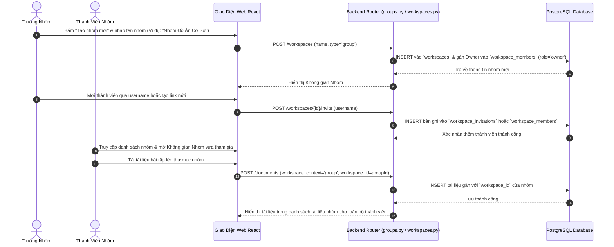

# 👥 UC-06: Cộng Tác Không Gian Nhóm Học Tập (Group Collaboration)

---

## 1. Thông Tin Tổng Quan
* **Mã nghiệp vụ:** `UC-06`
* **Tác nhân chính:** 
  * **Trưởng nhóm (`owner`):** Người khởi tạo nhóm hoặc được ủy quyền.
  * **Thành viên (`member`):** Sinh viên, Giảng viên tham gia nhóm học tập.
* **Mục tiêu:** Cung cấp môi trường chia sẻ và quản lý học liệu chung cho các nhóm làm bài tập lớn, đồ án môn học hoặc đề tài nghiên cứu khoa học.
* **Mức độ ưu tiên:** Cao (P1).
* **Trạng thái:** `[Confirmed]` | **Mã nguồn:** `[Implemented]`

---

## 2. Luồng Nghiệp Vụ Chính (Main Flow)

---

## 3. Ranh Giới Quyền Hạn Trong Không Gian Nhóm

| Thao tác nghiệp vụ trong Nhóm | Trưởng Nhóm (`owner`) | Thành viên (`member`) | Người ngoài nhóm |
|---|:---:|:---:|:---:|
| **Xem & Tải về tài liệu trong nhóm** | ✅ | ✅ | ❌ |
| **Tải lên tài liệu & Tạo thư mục nhóm** | ✅ | ✅ | ❌ |
| **Chỉnh sửa / Gắn nhãn tài liệu nhóm** | ✅ | ✅ | ❌ |
| **Xóa tài liệu nhóm (Chuyển vào thùng rác)** | ✅ | ✅ *(Tài liệu do mình tải lên)* | ❌ |
| **Khôi phục / Xóa vĩnh viễn trong thùng rác nhóm** | 👑 | ❌ | ❌ |
| **Mời / Xóa thành viên khỏi nhóm** | 👑 | ❌ | ❌ |
| **Giải tán / Xóa toàn bộ nhóm** | 👑 | ❌ | ❌ |

---

## 4. Các Quy Tắc Nghiệp Vụ Cần Lưu Ý
* **BR-GRP-01 (Toàn vẹn tài liệu khi thành viên rời nhóm):** Khi một thành viên rời khỏi nhóm hoặc bị xóa khỏi nhóm, **toàn bộ tài liệu mà người đó đã tải lên nhóm vẫn được bảo toàn nguyên vẹn** trong không gian nhóm để không làm gián đoạn tiến độ học tập của các thành viên còn lại.
* **BR-GRP-02 (Thùng rác nhóm độc lập):** Thao tác xóa tài liệu trong nhóm chỉ đưa tài liệu vào Thùng rác của riêng nhóm đó, hoàn toàn không lẫn sang Thùng rác cá nhân của người thực hiện xóa.
